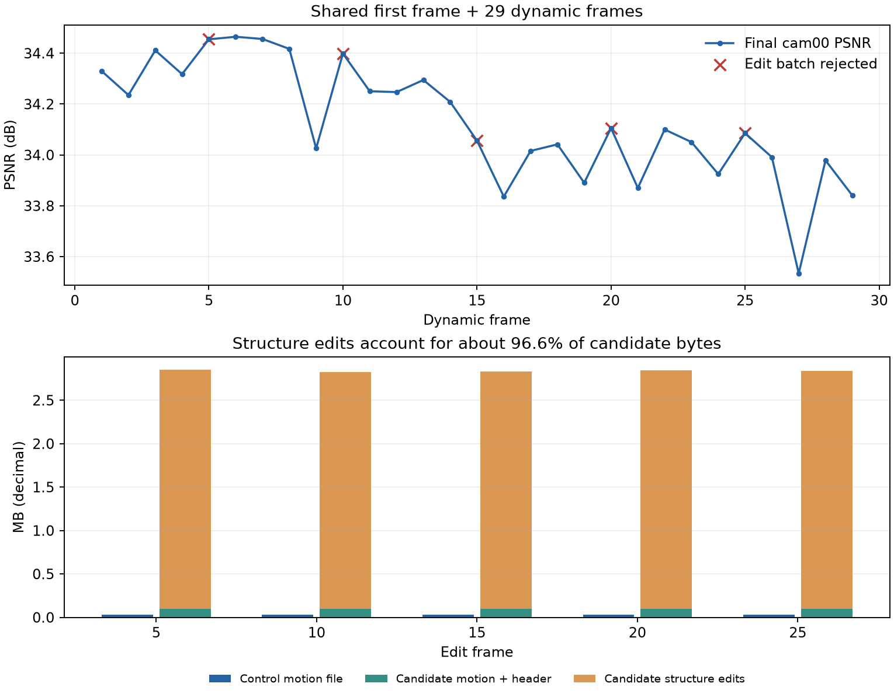

# 30帧动态树实验：候选数量扩大了，结构修改仍全部回退

本次要验证：用多视角位置梯度找到值得拆分的区域，再用位置和平均梯度聚类，按画质与真实存储判断结构调整是否值得保留。

结果是29个动态帧正常完成，5次结构调整全部回退。正式模型始终保留初始3层树。30帧不足以评价长期稳定性，但已经暴露了结构编码、候选训练和拆分约束的问题。下一步应先修这些问题，再扩大序列长度。

## 运行与配置

- 输出：`output/fs_gradient_cluster_tree_30f/20261008T234807_94b746`。
- 运行时间：2026-10-08 23:48至2026-10-09 00:00，约12.4分钟。
- 30帧包含加载的首帧，以及动态帧1–29。最终checkpoint为`ckpt-29-300.pth`，日志正常结束。
- [实验配置](../../config/fs_gradient_cluster_tree_30f.yaml)：seed 0；`resolution: -1`；测试图像1600×1199；训练cam01–cam20，测试cam00。
- 每帧100步运动拟合、80步gate压缩、20步固定gate精修、100步新增GS拟合。
- 每5帧提出编辑；5个训练视角计算位置梯度；每个GS至少2个可见视角；按分数选择前30%合法有信号的拆分区域。
- 初始树3层，上限4层；每侧至少12个有效观测GS；位置与梯度分别归一化后等权二类聚类，上限20次迭代。
- fixed16；平移与旋转独立省略量化后全零的三维块；storage权重0.01。
- 合并/重组与拆分均没有固定数量上限；总节点上限1,000,000。

数据依赖软链接，未复制数据：`data/colmap4d/flame_steak`指向`/home/gamer-02/Documents/DeepLearning/ReCon-GS/data/colmap4d/flame_steak`，其图像和COLMAP依赖`/home/gamer-02/Documents/DeepLearning/S2GS/data/standard_flame_steak_300`。共享首帧来自ReCon-GS的`flame_steak_fullres/20260926T225223_dc5baf/ckpt-0-15000.pth`。

## 本次涉及的实现

- `split_region_scores.py`：同一模型状态下，按可见视角平均每个GS的图像位置梯度；先取每个GS的梯度范数，再按区域平均；按比例筛选和二类聚类。
- `direct_tree.py`：提出相邻区域重组、共同父节点合并、独立筛选的叶区域拆分；修改成员与父子关系。
- `common_contrast.py`：缓存和恢复动态树；v2按平移/旋转块编码，v3增加实际结构编辑码流。
- `direct_transaction.py`和`module.py`：第180步提出候选，原树与候选各精修20步；实际编码、解码后，用全部20个训练视角比较图像损失和字节。选中的分支再拟合新增GS。

已核对保存的源码快照，12个来源文件均与本次分析时的工作区一致。历史输出仅被读取，本次没有训练、修改训练代码或重写实验产物。

## 正式模型结果

以下均值覆盖动态帧1–29。必要字节是运动bin与保留新增GS的PLY实际文件大小，逐帧与汇总一致。

| 指标 | 结果 |
|---|---:|
| 平均测试PSNR | 34.1321 dB |
| 平均SSIM | 0.97194 |
| 平均LPIPS | 0.11893 |
| 平均必要文件 | 33,579 B/帧，33.58 KB/帧 |
| 平均运动文件 | 31,812 B/帧 |
| 平均新增GS文件 | 1,768 B/帧 |
| 29帧动态文件总量 | 973,805 B |
| 日志中的平均渲染FPS | 131.59 |
| 平均每帧总时间 | 25.65秒 |
| 普通帧/编辑检查帧总时间 | 19.12秒 / 56.99秒 |
| 被接受的编辑批次 | 0 / 5 |

FPS只对应渲染forward，未包含码流解码与完整播放流程。必要字节不包含共享首帧与部署配置。

| 动态帧范围 | 平均PSNR | 必要文件/帧 |
|---|---:|---:|
| 1–10 | 34.3510 dB | 34.61 KB |
| 11–20 | 34.0945 dB | 31.96 KB |
| 21–29 | 33.9305 dB | 34.23 KB |

后段画质有所下降，但没有同协议独立固定树对照，无法区分场景内容变化和累计误差。

## 结构调整结果

下表的“进入候选树”仍然属于试改；这些批次最终均被拒绝。

| 编辑帧 | 选中拆分区 | 聚类通过 | 拆分进入候选树 | 合并数 | 候选运动文件 | 其中结构费用 |
|---|---:|---:|---:|---:|---:|---:|
| 5 | 1601 | 157 | 24 | 1000 | 2.855 MB | 2.758 MB |
| 10 | 1600 | 143 | 21 | 986 | 2.827 MB | 2.732 MB |
| 15 | 1599 | 158 | 23 | 989 | 2.834 MB | 2.738 MB |
| 20 | 1599 | 146 | 18 | 993 | 2.845 MB | 2.750 MB |
| 25 | 1599 | 131 | 21 | 991 | 2.841 MB | 2.744 MB |

原树运动文件约30–31 KB。候选的训练图像目标改善只有约0.09%–0.13%。该目标是L1/DSSIM组合，不是测试PSNR。

以第5帧为例，图像目标从0.01253533降至0.01251944，收益约0.000015895。按当前storage权重，这只足以支付约8.20 KB新增费用；实际新增费用约2.823 MB，所以回退是符合目标的选择。

即使在账面上把结构费用设为零，候选仍比原树多约65.5 KB运动及头部费用，超过8.20 KB。其余四次也相同。这只是字节成本的算术检查，没有重新训练免费结构方案。

## 为什么会这样

**1. 结构编码按GS逐项记录，费用过大。**

第5帧修改了194,701个GS的归属，产生600,972条`[层, GS行号, 新归属]`记录。JSON约9.21 MB，压缩后连同结构长度字段仍有2.758 MB，占候选文件约96.6%。父连接变化还会保存对应层的完整父节点列表。

建议改为可重放的节点操作：合并保存节点ID，重组保存交换的子树ID，拆分只保存该区域的紧凑归属位图。解码端利用已有树恢复成员关系，所有实际费用继续计入目标。

**2. 合并触发过宽，并优先覆盖拆分区域。**

当前代码在三个子树配对里选择原配对时，就可能提出“共同父节点合并”。它没有独立检查两个原root是否值得共享共同因子。原配对最好，并不足以说明合并值得付费。

所以每次试改出现近1000次合并，修改约90%的GS归属。五次共选出7998个拆分区域，735个聚类通过，其中628个又因合并冲突被跳过，只有107个实际进入候选树。

建议让合并和拆分按局部收益竞争，再对最终组合验证整体目标。候选可以很多，评估可以分批；不应回到固定只允许两个区域变化。

**3. 新树没有重新学习gate。**

新树在第180步出现。代码把涉及root的候选gate强制打开，随后181–200步进入`gate_refine`，gate参数被冻结。新树只有运动精修机会，无法通过gate关闭多余分支。候选除去结构费用，文件仍有约95–97 KB，原树约30–31 KB。

这是上一轮实现需要修正的流程问题。候选需要运动拟合与gate压缩的机会，原树应获得相同预算，然后再比较真实字节。可以优先讨论将提出候选的时点移到gate压缩之前，继续沿用统一目标。

**4. 拆分最小规模限制太紧。**

选中的区域绝大多数只有26–27个GS，每侧至少12个有效观测，允许的比例接近对半。把少数需要不同运动的GS单独分出，会被这个限制挡住。聚类通过率只有9.19%。

报告没有保存聚类失败的具体原因，不能把每一次失败都归因于最小规模；上述判断来自实际区域大小和代码约束。建议记录失败原因，并把拆分最小规模与初始建树最小规模分开配置，允许不均匀划分。具体候选值另行讨论。

另外，候选初始化的最大位置差为0.00264–0.00427世界坐标单位。提出候选时用的是未量化运动参数，实际forward用量化参数；重参数化和再量化会引入差异。需要以已经解码的状态作初始化依据，并单独检查初始化的渲染变化。现有数值不足以判断这项差异造成的画质损失。

## 下一步

先修紧凑结构编码、合并/拆分的局部取舍，以及候选gate的训练机会；补充不均匀拆分的诊断。继续保持平移/旋转分块编码和当前30%候选筛选思路。

先用30帧确认存在被接受且持久保留的有效结构编辑，再做同协议固定树与动态树的100帧或300帧对照。若全部编辑仍回退，直接加长序列无法提供已经使用动态树的长期效果证据。

本次没有完整顺序解码审计，也没有单独关闭平移/旋转分块编码的对照，不能据此量化分块编码的独立收益。

详细数据：[汇总JSON](assets/20261009_gradient_cluster_tree_30f/summary.json)、[逐帧CSV](assets/20261009_gradient_cluster_tree_30f/frames.csv)。
