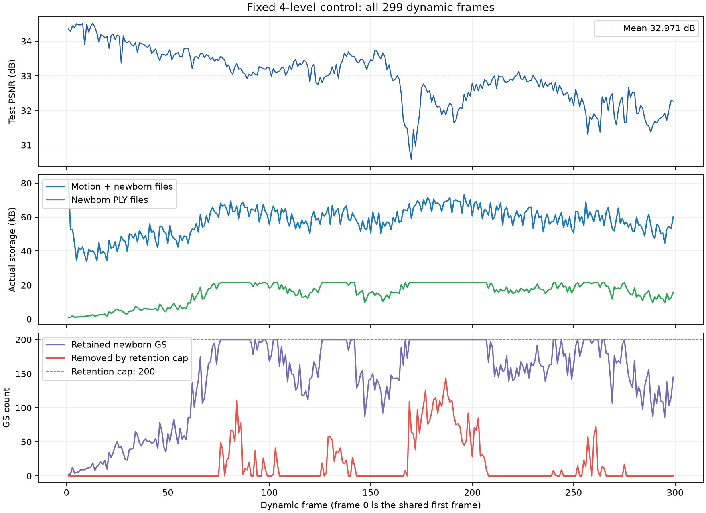

# 固定4层对照：300帧训练完成

本轮先建立完整300帧对照，用来判断动态调整树结构是否改善长期画质。固定树这组正常结束。本记录描述固定组；后续动态对照与两组完整解码已完成，结论见[完整动态对照记录](20261009_nodeops_quality_pair300_completed.md)。

全段平均PSNR为 **32.9711 dB**，必要文件平均 **57.58 KB/帧**。后段存在明显低谷，前30帧不足以代表全段效果。

## 怎么做

共享已训练首帧，接着训练第1–299帧。cam01–20用于训练，cam00用于测试，图像为1600×1199。种子为0。

树从4层起步，关闭拆分、交换和合并候选。保留与动态组对应的优化器重置时点，便于后续同协议比较。平移和旋转独立编码，使用fixed16和v4码流。

本次沿用已验证的代码改动：NED1结构编辑编码、提前提出候选、移除无效拆分、量化后位姿初始化，以及可配置的4层初始树。它们的动态效果仍需另一组结果验证。

每帧运动训练200步，新增GS训练200步，共400步。storage权重0.002；平移量化步长为场景extent的5e-6，旋转步长5e-5；新增GS的feature LR为0.075，最多保留200个。运行前完整数值检查通过227项。

## 完整结果

统计范围为299个动态帧；共享首帧不参与均值。

| 指标 | 结果 |
|---|---:|
| PSNR | 32.9711 dB |
| SSIM | 0.964188 |
| LPIPS | 0.132691 |
| 必要文件/帧 | 57.58 KB |
| 其中运动文件/帧 | 42.09 KB |
| 其中新增GS PLY/帧 | 15.49 KB |
| 全段动态文件总量 | 17,216,603 B |
| 日志渲染FPS | 147.43 |
| 纯训练/帧 | 18.89 s |
| 日志总耗时/帧 | 24.63 s |

KB按1000 B计算。必要文件包括运动码流和新增GS PLY，不包括共享首帧、配置、checkpoint、图片及诊断文件。FPS只计同步渲染与clamp，不计解码和数据加载。

| 动态帧范围 | 平均PSNR | 必要文件/帧 | 达到新增GS上限的比例 |
|---|---:|---:|---:|
| 1–50 | 34.0313 | 45.52 KB | 0% |
| 51–100 | 33.3876 | 58.89 KB | 36% |
| 101–150 | 33.2506 | 59.30 KB | 36% |
| 151–200 | 32.3837 | 64.25 KB | 66% |
| 201–250 | 32.7657 | 60.65 KB | 20% |
| 251–299 | 31.9878 | 56.86 KB | 22.45% |

## 结果怎么看

最差的是第170帧，PSNR为30.5864 dB。第151–200帧出现明显低谷，随后有所恢复；最后49帧又降到约31.99 dB。因此既有局部波动，也有后段画质下降，不能只看全段平均值。

查看第170和257帧的GT与渲染，明显误差主要出现在手、喷火枪、火焰和狗的轮廓。背景较稳定。旧GS的颜色等属性仍冻结，火焰和光照变化可能让运动拟合承担了部分外观误差；这只是待验证解释。

补充检查了全部299帧的保存PNG。手和火焰矩形区域的误差增长明显，上方百叶窗区域较稳定：

| PNG诊断区域 | 第1–50帧平均PSNR | 第251–299帧平均PSNR |
|---|---:|---:|
| 手和喷火枪附近 | 33.50 | 26.75 |
| 锅和火焰附近 | 32.07 | 23.91 |
| 上方百叶窗 | 33.94 | 33.99 |

这些是明确坐标的矩形裁剪，可能含多个物体且相互重叠，并非分割标签。PNG有8位量化，主结果仍使用前面的浮点渲染指标。区域比较用于定位问题，不能单独证明树结构或外观冻结导致了误差。

90帧达到新增GS的200个上限，但有些低分帧并未达到上限。数量限制可能影响修补效果，不能把全部下降归因于它。下一轮应先看动态树是否改善相同低分帧，再决定是否单独测试更高的保留预算。

日志中旧GS实际位姿改变比例为100%，没有形成大量精确不动的GS。当前结果证明了共享运动参数可以压缩存储，尚不能声称已经实现“只让需要改变的GS改变”。

## 已验证与待验证

299个帧汇总与运动文件完整，最终`ckpt-299-400.pth`存在。每帧实际文件大小与汇总一致，保存的源码快照哈希通过检查。

CPU补充检查覆盖全部299个码流头和点数链；第1、49、99、149、199、249、299帧的checkpoint与码流中的前状态、运动后状态、树拓扑哈希一致，新增GS PLY的六个原始属性也与checkpoint完全一致。

这项CPU检查没有执行完整顺序运动解码。随后另行完成全299个动态帧的CUDA顺序解码，最终六个原始GS属性与checkpoint完全一致。完整审计见上述动态对照记录，未以检查点抽查或短实验替代。

固定树结束后，原队列句柄已不可用，动态组当时没有生成日志或输出目录。当时工具环境中`torch.cuda.is_available()`为False，创建CUDA张量报“No CUDA GPUs are available”。

2026-10-09 09:37恢复GPU执行条件：激活ReConGS后能识别3090 Ti，CUDA张量测试通过。已补启动动态300帧，输出为`output/fs_nodeops_quality_dynamic4_300f_20261009/20261009T093800_b2466a`；实际保存的配置和源码快照也通过同协议比较。随后两组完整比较与全299帧CUDA顺序解码均通过，详见[完整动态对照记录](20261009_nodeops_quality_pair300_completed.md)。

后续复查确认：当前12个训练源码文件与本轮快照相同；待运行动态配置通过校验，除experiment_name、梯度拆分开关和候选窗口开关外，所有显式参数均与固定组一致。恢复GPU执行条件后，可以继续缺失的同协议对照。

## 配置、产物与依赖

[配置](../../config/fs_nodeops_quality_fixed4_300f_20261009.yaml)，[完整统计](assets/20261009_nodeops_quality_fixed4_300f/summary.json)，[逐帧CSV](assets/20261009_nodeops_quality_fixed4_300f/frames_0.csv)，[检查点一致性检查](assets/20261009_nodeops_quality_fixed4_300f/checkpoint_consistency.json)。

[PNG区域明细](assets/20261009_nodeops_quality_fixed4_300f/image_regions/summary.json)，[待运行动态配置校验](assets/20261009_nodeops_quality_fixed4_300f/pending_dynamic_protocol.json)。

输出目录：`output/fs_nodeops_quality_fixed4_300f_20261009/20261009T031755_fce68f`。历史产物仅用于读取，本次统计和图另存于上述assets目录。

数据通过`data/colmap4d/flame_steak`访问外部ReCon-GS链接，其图像和COLMAP文件来自S2GS的`data/standard_flame_steak_300`。共享首帧为ReCon-GS的`output/flame_steak_fullres/20260926T225223_dc5baf/ckpt-0-15000.pth`。

执行命令：激活`ReConGS`后运行`python -u scripts/train_common_contrast.py --config=config/fs_nodeops_quality_fixed4_300f_20261009.yaml`。重跑应使用新的experiment_name。
