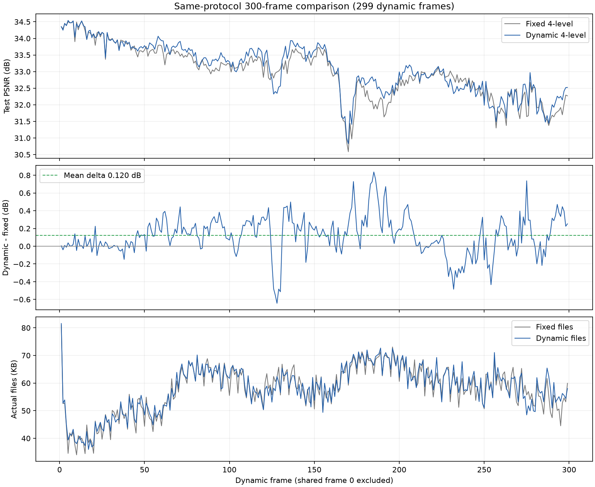

# 动态运动树：300帧同协议对照

动态树全段PSNR为 **33.0915 dB**，比固定4层提高 **0.1204 dB**；必要文件增加 **0.93%**，日志渲染FPS基本持平。说明动态调整有作用，但改善幅度有限，也存在退步帧。

两组300帧训练与完整CUDA顺序解码均已完成。各自299个动态帧顺序恢复后，最终六个原始GS属性与checkpoint完全一致。

## 要解决什么、怎么做

原先树的空间分组固定，运动发生后，相邻GS可能需要不同的运动；相似运动也可能落在不同父节点下。本轮允许交换相邻root的子树，并对合法终端区域提出拆分。

拆分分数来自5个训练视角：先对每个GS的可见位置梯度向量求平均，再取长度，最后在区域内求平均。选择有非零分数的合法区域前30%，不限制为前2个。用分别标准化的空间位置和平均梯度做二类聚类，每侧至少6个受支持GS。

分数只提出候选。第100步提出编辑后，候选和原树都继续80步gate压缩、20步精修，使用相同训练视角与预算。以解码后20个训练视角的图像目标和实际运动文件字节决定保留；新增GS随后只在选中的分支上拟合一次。cam00不参与选择。

结构使用NED1记录交换、合并或拆分操作，拆分成员用位集合传输。平移和旋转各自选择是否传输。本轮从4层起步，暂时关闭合并。新拆分关闭或不可达时移除，移除前后要求位姿完全一致。

## 代码与协议

核心改动在`split_region_scores.py`、`direct_tree.py`、`tree_edit_codec.py`、`direct_transaction.py`、`common_contrast.py`和`module.py`。主要修正是紧凑结构编码、提前学习新gate、从量化后位姿初始化，以及清除无效拆分。训练源码在两组之间保持一致，保存快照哈希已核对。

两组共享首帧和种子0，训练cam01–20、测试cam00，图像1600×1199。共享首帧加299个动态帧构成300帧序列。每动态帧运动200步、新增GS200步；storage权重0.002，保留新增GS上限200，feature LR 0.075。运动fixed16，平移步长5e-6×extent，旋转步长5e-5。运行前完整数值检查通过227项。

固定组关闭候选；动态组开启邻域重组和梯度拆分。其余显式配置相同。两组均使用相应时点的优化器重置，确保延续预算一致。

## 完整结果

以下均值覆盖第1–299帧，共享首帧不计入均值。

| 指标 | 固定4层 | 动态4层 |
|---|---:|---:|
| PSNR | 32.9711 | 33.0915 |
| SSIM | 0.964188 | 0.965052 |
| LPIPS | 0.132691 | 0.130785 |
| 必要文件/帧 | 57.58 KB | 58.11 KB |
| 运动文件/帧 | 42.09 KB | 42.99 KB |
| 新增GS文件/帧 | 15.49 KB | 15.12 KB |
| 日志渲染FPS | 147.43 | 147.75 |
| 纯训练/帧 | 18.89 s | 25.09 s |
| 日志总耗时/帧 | 24.63 s | 30.70 s |

动态文件总量为17,376,207 B，固定为17,216,603 B。KB按1000 B计算。必要文件只包括运动码流与新增GS PLY；共享首帧、配置、checkpoint、图片和诊断文件另计。

| 帧区间 | PSNR增量 | 文件增量 |
|---|---:|---:|
| 1–50 | +0.0223 dB | +1.20% |
| 51–100 | +0.1902 dB | +0.89% |
| 101–150 | +0.1309 dB | −0.53% |
| 151–200 | +0.2685 dB | +1.00% |
| 201–250 | −0.0165 dB | +1.57% |
| 251–299 | +0.1275 dB | +1.50% |

59次候选中保留44次。实际码流包含18,887次子树交换和377次拆分，最终最细层节点从14,848增加至15,602。结构信息共97,839 B，只占动态文件约0.56%。详见[编码操作统计](assets/20261009_nodeops_quality_pair300/encoded_operations.json)。这次正式树确实发生调整，不是仅生成候选后全部拒绝。

## 结果怎么解释

增益在运动更明显的区间较大，尤其固定树低谷所在的151–200帧。第170帧提高0.244 dB，第185帧提高0.837 dB。动态树有助于改善部分运动分组，且结构信息的代价较小。

也有退步：第128帧下降0.644 dB，201–250帧平均略降。候选在训练图像目标上改善，并不保证每个测试帧的PSNR提高；运动压缩目标使用L1与DSSIM，也不完全等同于MSE。两点都是可能原因，不能仅凭这次对照确定因果。

保存PNG的全段区域检查中，狗附近提高0.545 dB、脸部0.207 dB、手和喷火枪附近0.169 dB、锅和火焰附近0.110 dB、上方百叶窗0.081 dB。这些是固定坐标矩形，不是物体分割，区域可能重叠。PNG有8位量化，主结果仍使用浮点渲染指标。

查看低谷附近图像，部分火焰错色减少，手与枪的拖影仍明显。旧GS属性冻结、场景外观变化和新增GS预算可能限制进一步改善；本轮未增加attribute gate。旧GS几乎全部发生位姿变化，也不能据此声称静止GS已经大量保持不动。

## 验证与速度边界

299个汇总、运动文件及最终400步checkpoint齐全，实际文件大小与汇总一致，训练协议和源码快照匹配。固定组全299帧CUDA顺序解码通过，最终六个原始GS属性与checkpoint完全一致。

动态组全299帧CUDA顺序解码也通过。审计从独立首帧PLY和配置出发，逐帧验证前状态、删除、树结构与运动后状态，再追加新增GS；最终xyz、rotation、logscale、opacity、sh_dc和sh_rest均与最终checkpoint完全一致。

表中约148 FPS只计同步渲染与clamp，不计解码、数据加载和模型安装。候选比较使训练总耗时增加约25%。

| 独立顺序解码审计 | 固定4层 | 动态4层 |
|---|---:|---:|
| 解码平均耗时/帧 | 3.266 s | 3.388 s |
| 5次预热后渲染的平均耗时/帧 | 5.081 ms | 5.105 ms |
| 首帧、配置和动态文件总量 | 39.58 MB | 39.74 MB |

解码包括读取、状态哈希、删除、布局、运动应用及新增GS追加，当前Python实现很慢。预热渲染与训练日志的计时方式不同，不能混成一个FPS。本轮验证了小存储增量下的画质改善；实时整段播放仍受解码速度限制。

## 产物与依赖

[固定配置](../../config/fs_nodeops_quality_fixed4_300f_20261009.yaml)，[动态配置](../../config/fs_nodeops_quality_dynamic4_300f_20261009.yaml)，[完整统计](assets/20261009_nodeops_quality_pair300/summary.json)，[固定逐帧CSV](assets/20261009_nodeops_quality_pair300/frames_0.csv)，[动态逐帧CSV](assets/20261009_nodeops_quality_pair300/frames_1.csv)，[PNG区域明细](assets/20261009_nodeops_quality_pair300/image_regions/summary.json)。

[固定完整解码](assets/20261009_nodeops_quality_pair300/decode_audit_0.json)，[动态完整解码](assets/20261009_nodeops_quality_pair300/decode_audit_1.json)，[解码耗时汇总](assets/20261009_nodeops_quality_pair300/decode_summary.json)。

输出分别为`output/fs_nodeops_quality_fixed4_300f_20261009/20261009T031755_fce68f`和`output/fs_nodeops_quality_dynamic4_300f_20261009/20261009T093800_b2466a`。训练产物未加入Git，历史输出未改写。

数据仍通过`data/colmap4d/flame_steak`链接访问ReCon-GS及S2GS的`data/standard_flame_steak_300`。共享首帧为ReCon-GS的`output/flame_steak_fullres/20260926T225223_dc5baf/ckpt-0-15000.pth`。

执行命令为激活ReConGS后运行`python -u scripts/train_common_contrast.py --config=config/fs_nodeops_quality_dynamic4_300f_20261009.yaml`。重跑需使用新的experiment_name。
