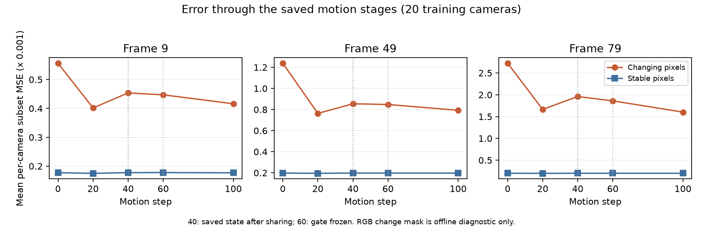

# 后程退化诊断：阶段误差、局部拥挤和自由运动恢复能力

## 本轮结论

后段有局部空间分割失衡，但单次重划分没有改善测试画质。相同第79帧延续自由GS拟合至100步，则能追回约0.148 dB，代价是约40倍纯运动码量。证据支持继续处理共享/点残差约束如何保留有效运动，不能据此断言只改树深度或分割面就能解决长期退化。

生产代码只补诊断字段，没有采用本轮两项训练候选，没有改变learnable gate、运动合成、训练目标或100+100步职责。全300帧目标仍未达到。

## 1. 读取已有检查点，分开看阶段误差

使用原worldroute第9、49、79帧保存的20、40、60、100步检查点，以及各自同一组20个训练相机。代码从第79帧原source_snapshot加载，禁止写pycache；没有优化步骤。100步重建图像与各帧原已记录测试PSNR完全一致，误差均为0。实际计算梯度时使用贡献收集渲染器，并核验首个训练视角的图像与原生渲染器最大差小于1e-6。

变化像素沿用此前固定RGB变化掩码，来自训练帧0、9、29、49、59、69、79，低分辨率400×300，阈值8/255。它会使用未来训练帧，只做离线诊断，未用于任何训练或参数选择；不是运动物体真值分割。

以下是每个训练相机变化像素MSE再取相机平均，单位为0.001。不同于此前按所有掩码像素统一加权的统计，不能直接混用。

|当前帧|20步自由运动|40步共享切换后|60步gate固定|100步点残差拟合后|
|---|---:|---:|---:|---:|
|9|0.40165|0.45363|0.44717|0.41620|
|49|0.76335|0.85481|0.84793|0.79292|
|79|1.66475|1.96041|1.86003|1.60280|

各子图纵轴范围不同，须读取数值，不能直接按曲线高度跨帧比较。

相同帧内可见共享后的误差升高、后续部分恢复；20→40间仍有自由拟合，表格本身不是切换瞬间的因果测量。此前原策略第79帧连续回放测得，40步共享切换瞬间测试PSNR降低约0.08894 dB，见worldroute_stopped80记录。不同帧图像难度不同，跨行差异也不能全归因于累积漂移。

脚本：`/tmp/my4dgs_audit_gate_gradient_conflicts_20261015.py`，结果：`/tmp/my4dgs_worldroute_gradient_conflicts_20261015.json`，session16998正常退出0。共15项状态测量，6项状态另计算两种图像目标的独立逐点XYZ梯度。

## 2. 共享梯度冲突与最深叶子的局部拥挤

保持位姿不变，把每个GS的位置临时视为独立可求导变量，分别计算原全分辨率L1+SSIM、变化像素MSE对位置的梯度。只保留实际参与合成的GS；先跨同一组20训练相机平均，再统计区域内部方向抵消及共享常量方向的投影能量。没有更新参数，也没有训练新损失。

该能量比例只是可见点欧氏坐标下的局部梯度投影，受点尺度、相机、局部渲染敏感度影响，不是可达到的PSNR比例，也不是图像误差的归属比例。细分投影能量非递减、共享投影不超过自由点能量的数学不变量均通过。

第79帧60步，区域15762已经位于最深第5层，包含779个可见GS；约54.4%的变化像素XYZ梯度能量在该区域。进一步检查：

- 首帧该候选叶子只有2点，第9帧100点，第49帧2点，第79帧779点。
- 第79帧成员中，300点来自原始206237点，479点后来新增。
- 100步后，该区域实际非零整数残差为249/779，约31.96%；全局为5692/218265，约2.61%。
- 整体GS加权层深早期1–9平均1.522、后段70–79平均1.588；区域数189.2→288.9。因此没有发现全局细分数量塌缩。

**计数更正：** 早先临时检查把浮点GS参数不等于0当作有残差，得到777点；其中包含量化后归零的bin余量。实际码流整数计数为249。新日志统一按量化整数支持集计算，不能把777当作实际传输行数。

点级敏感度检查还发现：第79帧60步约97.13%、100步约96.54%的变化像素XYZ梯度能量来自后来新增GS；前10个点分别占约69.48%、71.46%。该叶子内部前10个点占其能量约81.03%、79.17%。因此局部大梯度也会被少数点放大，不能宣称97%的图像误差由新增GS造成，更不能据此删除这些点或添加透明度修正。

点级检查：`/tmp/my4dgs_audit_gate_point_concentration_20261015.py`，结果：`/tmp/my4dgs_worldroute79_gradient_concentration_20261015.json`，session55308退出0。原始叶子和原/新增数量另由CPU检查点与首帧参考核对。

## 3. 有界局部空间重划分：未采用

从原第79帧step20状态继续21–100步。只将深度3节点246的子树内9个空间分割中心，按同一前帧已解码位置重新取中位数；3082个点受此子树覆盖。总节点数37449、最大深度5、父子连接均不变；保留原gate标量弱先验、仅重算人口资格，不强制开gate。分割变更时完整整数运动、渲染位置和朝向逐项相同，原GS Adam继续使用。

|运动100步指标|原保存结果|局部重划分|
|---|---:|---:|
|测试PSNR / dB|33.613762|33.612602|
|20训练相机平均PSNR / dB|34.233693|34.286326|
|变化像素MSE|0.001602799|0.001566096|
|纯运动包 / B|27779|27915|
|活跃区域数|351|365|

最大叶子人口779→311，训练变化像素MSE降低约2.29%，测试画质基本不变，因此不采用、不延长。只是把叶子分得均衡，尚未转化为有效测试收益。

包大小为修改后的条件参考上的实际压缩大小，不含出生点、manifest、共享首帧。9个中心原始坐标108 B以及其索引/更新标记尚未实现传输，也未计入上述运动包；不是完整因果序列的存储结果。

脚本：`/tmp/my4dgs_local_spatial_refit_20261015.py`、`/tmp/my4dgs_audit_local_spatial_refit_frame79_20261015.py`；结果：`/tmp/my4dgs_worldroute79_local_spatial_refit_20261015.json`。session93126退出0，原保存基线独立重渲染误差0，没有修改历史输出或生产树规则。

## 4. 自由运动的单帧恢复能力：能追回部分画质，码量不可接受

从同一个原第79帧step20提议及Adam继续21–100步，延续原自由GS拟合：40步不初始化共享字典、不清零GS，候选保持未初始化，原rate ramp因此保持0，没有共享/稀疏裁决。原图像尺度、每步视角、学习率、量化、L1+SSIM保持相同；仍共100步运动，没有执行出生阶段。不是可采用的新方法，也不是严格全局质量上界。

|运动100步指标|原保存结果|延续自由GS|
|---|---:|---:|
|测试PSNR / dB|33.613762|33.761799|
|20训练相机平均PSNR / dB|34.233693|34.847034|
|训练MSE|0.000399574|0.000350892|
|变化像素MSE|0.001602799|0.001301472|
|非零点残差行|5692|217779|
|实际纯运动包 / B|27779|1109844|

测试增加约0.14804 dB，训练变化像素MSE降低约18.80%，实际包增大约39.95倍。因此同一当前状态确实还存在可恢复画质；直接放开所有点并不满足低码率目标。还未消除此前帧继承误差，且两种分配下点参数实际更新次数/优化历史不同，不能把全部收益精确归因于某一次gate决策。

脚本：`/tmp/my4dgs_audit_dense_motion_capacity_frame79_20261015.py`；结果：`/tmp/my4dgs_worldroute79_dense_motion_capacity_20261015.json`，session84205退出0。基线独立渲染误差0；测试相机仅报告，未参与梯度或参数选择。没有将高码量结果当作生产改进。

## 留在生产中的代码改动与验证

`pipeline/ReCon-GS/model/spatial_gated_motion.py::record_final_diagnostics`只增加统计：GS加权深度、最深frontier人口/整数残差数、最大候选叶子人口/整数残差数，以及每个实际区域的观测人数、非零整数残差数和比例。范围均为当前帧新增前的存活GS。它们便于把图像误差与具体区域对应，不单独作为分裂/删点触发器。

原有spatial_gated_motion的53项unittest通过。对真实第79帧检查点另外核验区域人数和观测人数总和、5692个码流残差支持行、局部249行，并确认统计前后完整整数运动、gate参数及全部Adam状态逐项不变。结果：`/tmp/my4dgs_worldroute79_tree_health_diagnostic_check_20261015.json`。没有宣称重新运行生产完整115项套件。

下一步优先处理共享场与少量有效GS修正的配合，结合上述区域分布核查高误差点；当前证据不足以采用统一加深、全树重建或仅按拥挤度分裂的规则。
