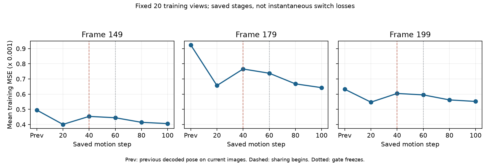

# Worldroute计划300帧、实际200帧：后程共享切换损失扩大

## 核心idea与运行范围

保留已有worldroute方法：GS按上一帧解码位置进入固定五层空间候选树，learnable gate决定实际分区；区域存绝对帧运动、GS存区域残差，旋转只改变朝向。每帧1–40自由GS，40步初始化区域并清零冻结GS，41–60拟合区域/gate，60固定gate，61–100恢复点残差，101–200新增GS。80/100步执行原代表量刷新及残差稀疏裁决。

运行：`output/fs_spatial_gate_worldroute_200_full300_20261015/20261015T180221_5e8236`。从此前已核验0–79的同方法前缀继续，原源实验计划100但实际80帧，通过显式`resume_completed_prefix_frames: 80`验证复制，不重写历史配置。新配置计划300帧，实际完成0–199共200帧；frame199-step200检查点保存后，在frame200进行中主动SIGINT。训练session89078退出130，检查点118479842 B，可恢复。不是完成300帧。

运行中没有改变运动规则。相对原worldroute，只保留更完整的树状态诊断及部分完整前缀续跑支持；基础源码方法一致性此前已有AST与调度核验。运行后79份冻结输入与原快照、当前输入哈希一致。数据通过原软链接读取，没有改写历史输出。

## 独立码流核验结果

以原config.yaml不变、只在基准进程中显式选择200帧前缀，实际200/200核验通过。结果保留planned300、actual200及原配置SHA。每帧10次预热、50次计时；5次GPU检查均无其他上下文。核验工作流session8197退出0。

|实际0–199范围指标|数值|
|---|---:|
|含首帧平均PSNR / dB|33.465422|
|动态1–199平均PSNR / dB|33.462679|
|动态同帧原生方法PSNR差 / dB|−0.556147|
|动态payload / B每帧|37598.985|
|动态完整增量含manifest / B每帧|38036.417|
|完整增量p95 / B|52486.4|
|纯渲染FPS，含首帧/动态|200.164 / 200.151|
|单帧纯渲染FPS最低值|195.744|
|末帧GS数 / 相对首帧增加|253563 / 47326|

共享首帧18361949 B单列。FPS不含解码、上传、核验；平均值超过200不代表每帧都超过200，更不是全300帧速度结论。原生同帧历史值部分经过小数位截断，差值作趋势定位。

|帧段|当前平均PSNR / dB|同帧原生差 / dB|
|---|---:|---:|
|70–79|33.773403|−0.364467|
|100–109|33.299145|−0.878015|
|140–149|33.890324|−0.549006|
|160–169|32.121976|−0.966294|
|170–179|31.672934|−1.501506|
|180–189|31.855498|−1.973322|
|190–199|31.920018|−1.758202|

差距不是逐帧单调增加，但后段明显扩大。因该轨迹已失败而保留完整200帧前缀，优先检验核心规则；最终全300帧>34.2 dB的目标未达到。

## 固定训练视角的阶段定位

只读加载第149、179、199帧的20/40/60/80/100步检查点，使用各自同一组20个训练相机，不更新参数；另把上一帧解码位姿放到当前帧图像上测量，作为step0。100步的测试PSNR与原保存记录在三帧上均精确一致。贡献收集渲染器与原生渲染图像最大差小于1e-6。

|帧|20步训练平均PSNR|40步|60步|100步|
|---|---:|---:|---:|---:|
|149|34.27520|33.73039|33.81543|34.22177|
|179|31.97975|31.29777|31.46005|32.06813|
|199|32.76248|32.31727|32.38921|32.73366|

图中三面板共享纵轴；Prev为前帧位姿在当前图像上的误差。20→40之间还包含自由拟合，不能把两检查点差直接称作共享切换的瞬间损失。粗尺度阶段统一在全分辨率评价，不等于其当时的下采样训练目标。

第160–179帧运动100步平均31.81700 dB，新增阶段到200步为31.89746；180–187分别31.85347和31.89737。因此主要差距在运动阶段已存在，新增阶段仅作有限恢复。

全图L1+SSIM的逐点XYZ欧氏梯度能量，在这些后段帧被少数原始点、粗区域1明显主导；这与此前第79帧变化像素MSE梯度由新增点主导的统计不是同一指标。不能将任何一个梯度能量比例当作像素SSE归属、未来收益上界，或删点/透明度调整的依据。

## 第179帧原规则回放：精确测量共享切换

从同一个原179-step20恢复，继续21–100，规则、视角、学习率及量化不变；在现有切换函数前后用20训练相机测量，并保存恢复RNG。测试视角仅报告。回放session45075退出0，最终与原保存100步PSNR差+0.003235 dB；整数运动逐点完全相同约75.19%，最大差52格，不是逐位重放。

|事件|全分辨率训练图像损失|测试PSNR / dB|
|---|---:|---:|
|40步共享切换前|0.016523194|32.294067|
|40步共享切换后|0.017562847|31.496120|
|60步gate固定、点残差启用|0.017415694|31.605316|
|80步残差裁决前/后|0.016942959 / 0.017029384|31.951910 / 31.942289|
|100步残差裁决前/后|0.016866273 / 0.016907648|32.062660 / 32.060478|

共享切换瞬间下降0.797947 dB，后续追回约0.56436 dB，最终仍比切换前低0.233589 dB；末次裁决只影响0.002182 dB。此前第79帧相同规则回放的共享瞬降约0.08894 dB，表明后段一次共享投影的损伤也已扩大。该观察不是把每帧损失直接相加的累积误差证明。

自由提议没有受到码率约束，不能将其画质当作相同存储下的基线或质量上界。实际压缩后的无出生纯运动包，原保存37539 B、回放37455 B；阶段诊断里的`motion_bytes`为硬稀疏未压缩成本，不能混称完整增量。

这使下一步聚焦共享表示/切换及残差恢复。此前“已有frontier再展开一层收益有限”的检查只在原最大五层内展开，未给已到第5层的叶子新增候选，因此尚不能排除局部候选深度耗尽。但也没有证明盲目加深全树会有效。

## 运行时间、边界与文件

两次GPU资源调度分别暂停原任务166.264秒、989.578秒，合计1155.841秒，计入frame180、188的原始wall time。动态帧原平均44.5118秒，单列扣除调度暂停后约38.7036秒；不把暂停误报为训练性能退化。所有暂停进程已恢复并最终正常响应主动SIGINT，无遗留停止中的训练任务。

启动本实验前已有完整117项unittest通过，本轮未改变生产训练方法，不宣称再次运行整套测试。新增诊断只读；`git diff --check`通过。

2026-10-16 清理后，主要证据集中保存在本 run 的 `verification_evidence/`：

- `my4dgs_worldroute200_stopped200_benchmark_20261015.json`：原始 200 帧码流核验、画质、码量和渲染计时。
- `my4dgs_worldroute_late_stage_audit_20261015.json`：后段阶段损失分析。
- `my4dgs_worldroute179_exact_transition_v2_20261015.json`：第 179 帧共享切换检查。

以上文件由持久化的 `output/recovery_bundles/` 移入，内容未改写。原 `/tmp/` 下的 source-scope、motion-birth report 和临时诊断脚本在本次清理前已不存在，不再将这些临时路径作为可用入口。原始实验记录全文收入 `docs/archive/history_before_20261016_cleanup.tar.gz`。

历史 `run/config.yaml` 保持原样，记录当时从前 80 帧继续的来源；这些旧源 run 已清理。本 run 自带完整 0–199 帧码流、首帧参考与 `rigid-ckpt-199-200.pth`。根目录的 `config/fs_spatial_gate_worldroute_200_full300_20261015.yaml` 已改成从本 run 的第 199 帧继续、显式 `resume_completed_prefix_frames: 200`，并使用新的 experiment_name，避免依赖已删除的旧前缀。

原阶段回放在单帧恢复时同时清除已不适用的 `resume_prefix_dir` 及 `resume_completed_prefix_frames`，没有修改历史配置或运动规则。最初旧入口被前缀配置校验拒绝，未执行训练更新；修正后的回放才计入以上结果。
