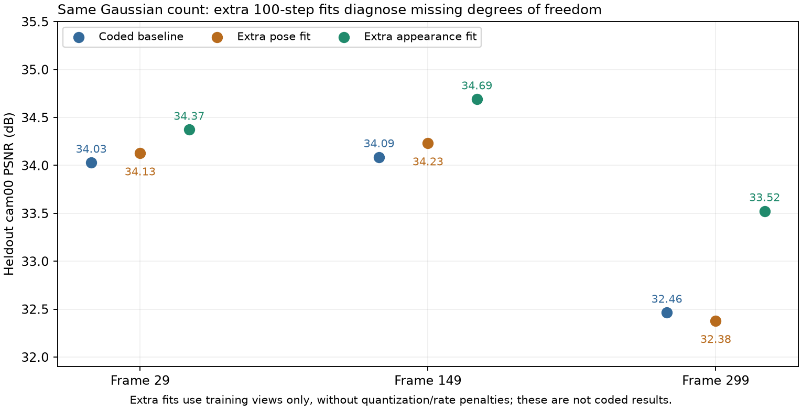
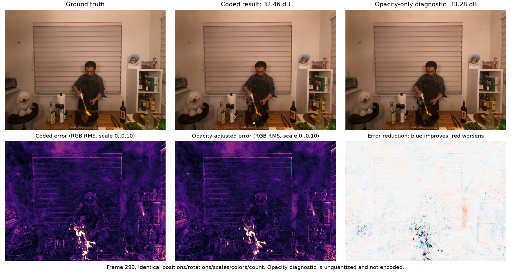

# 后段退化与存储瓶颈：定向诊断

已完成全序列统计、三个检查点的固定点数拟合诊断、第 299 帧补点量对照、相同运动的门结构重编码，以及原生 ReCon-GS 的代码/历史日志对照。**当前证据不支持把问题简单归为“新 GS 数量不够”。更明确的缺口是旧点缺少修正与替换、当前增密只能补有限类型的缺口，以及最占码量的 GS 残差没有直接可导的字节惩罚。**

这些诊断定位机制问题，没有修改正式训练方法，也没有重写两次完整 300 帧结果。解除量化/码率约束的拟合结果仅表示参数自由度的诊断空间，不是新的压缩成绩。

## 1. 退化主要在新增前已经存在

以 0.003 组为例，动态 271–299 帧的运动 100 步 PSNR 平均 **32.5744 dB**，新增完成后 **32.5983 dB**，只补回约 **0.024 dB**。同期每帧平均生成约 1132 个初始克隆，最终保留约 358 个新点；比前 30 帧约 104 个保留点更多。全序列 GS 数从 206237 增至 278364，已增加约 35%。

因此，后段不是因为配置把新增点数硬限制住了。`max_new_gaussians=null`，没有人为数量上限。但新点的选择和优化方式仍有限制，不能用总数证明增密充分。

## 2. 直接检验“多加点”

从同一个第 299 帧 step70 检查点恢复，以相同运动/新增调度重放到 step200；一组保留原阈值 0.00015，另一组只把增密阈值改为四分之一。

| 条件 | 初始克隆候选 | 最终保留新 GS | 测试 PSNR / dB | 动态负载 / KB |
|---|---:|---:|---:|---:|
| 原阈值重放 | 1111 | 327 | 32.465229 | 125.286 |
| 阈值降为 1/4 | 15050 | 4705 | 32.473297 | 317.449 |

新点从 **327 增至 4705**，约 14.4 倍；PSNR 仅提高 **0.0081 dB**，负载却增加约 **192 KB/帧**。这里的负载不含各约 0.44 KB 的 manifest。原完整运行该帧为 32.463444 dB、321 个新点；同配置重放为 32.465229 dB、327 个，存在小幅 CUDA/优化轨迹差异，不声称逐位重现。两组 step100 旧点 PSNR 差仅约 0.00012 dB。

两组新增重放随后均用独立进程从 frame298 参考和 frame299 包解码；解码模型与最终 checkpoint 的原始字段完全一致，渲染与保存 PSNR/SSIM/L1 差异均为 0。

这说明：**在当前增密方式与 100 步新增预算下，简单降低阈值堆新点没有解决该后段帧。**不能由此排除不同位置、不同初始化或更充分优化的新点会有效。

初始选择中还有一个限制：原阈值下 6812 个旧点超过梯度阈值，其中只有 1111 个小点允许克隆，5701 个大点被排除。当前只对新点候选进行后续 split，没有对这些大旧点做标准 split/替换。这个选择路径也继承自原生 ReCon-GS，不能单独归因于本轮改动。此前概括为“普通新增”过于笼统，准确说是“小旧点克隆＋新点候选分裂/剪枝”。

约 70% 的新候选会被剪掉。原阈值重放第 140 步剪掉的 703 个点全部因低透明度；末步还存在 29 个屏幕半径超限的候选。因此“最终新增少”不能直接解释成上限太低。

## 3. 旧点的自由度与生命周期存在缺口

代码中 `_freeze_base()` 冻结所有旧点原始属性，运动分支只提供位置/旋转；新增阶段旧点运动也提交并冻结。点的颜色、尺度和透明度从出生后就不再优化，旧点也不删除。对第 29、149、299 帧的检查点逐字段核验：首帧 206237 个点的 SH、尺度和 opacity 与首帧参考完全相同。

在同一批点、相同 20 个训练视角、相同固定视角顺序下，再优化 100 步，每步 2 个视角，测试视角 cam00 只用于报告：

| 第 299 帧诊断 | 测试 PSNR / dB | 训练视角平均 PSNR / dB |
|---|---:|---:|
| 已有码流结果 | 32.463444 | 33.013381 |
| 只优化位置/旋转 | 32.379654 | 33.362754 |
| 只优化透明度、尺度和 SH | 33.523163 | 34.622894 |
| 只优化 SH 颜色 | 32.574535 | 33.346740 |
| 只优化透明度 | 33.279961 | 34.003577 |
| 优化已有点全部属性 | 33.690773 | 34.943278 |
| 只继续优化当帧 321 个新点 | 32.458275 | 33.048398 |

点数始终为 **278364**，没有增加点。透明度单独调整能恢复约 **0.82 dB**，外观/尺度共同调整能恢复约 **1.06 dB**；继续位姿优化的训练视角变好，但测试视角稍差。后段问题涉及旧点的表示、遮挡和拟合泛化，不能全部交给更多位姿 step 或叠加新点解决。

额外拟合组均取消量化与码率惩罚，采用记录在 JSON 中的固定 Adam 学习率；不构成相同字节数下的公平算法优劣比较。透明度诊断在 0.01 logit 网格上会改变约 **220017 个点**，不能直接把这组自由更新接入后就声称存储也达标。

图中误差图由导出的 8-bit 图像计算，用于观察位置；上述 PSNR 来自原始浮点渲染。透明度修正可减轻部分火焰附近的异常，但没有完全恢复形状与细节。

**对照原生实现时发现更明确的差异：**原生 ReCon-GS 在每帧合并新增点后，会按 opacity 排序并删除等量的低透明度点，使已有点预算保持稳定；当前实现始终 `no_old_deletions=True`，只有出生当帧的新候选会剪枝。我们保留了新增而没有旧点替换。原生源码 Git 提交与历史日志中的提交均为 `36e87f16fddd5b7e984dba613a3ebb9a3f347f82`。

原生同样不是每帧自由调整全部旧点外观，所以不能把“解除外观冻结能改善”直接等同于唯一根因。点的替换、更平滑的共享运动、运动量化与累计跟踪状态等仍相互影响。旧点替换缺失是已确认的方法差异，修复它后的完整序列效果尚待验证。

删除也不能一刀切：第 299 帧直接去掉前 269 帧积累的 61391 个旧新增点、仅保留首帧点和最近 30 帧新增点，PSNR 从 32.4634 降至 **32.0544 dB**。需要按贡献/误差选择退出的点，而不是按年龄整批删除。

## 4. 与原生历史结果的差距在后段扩大

读取同数据入口、resolution=-1、SH=1、20 训练视角与 1 测试视角的原生历史日志，未重新训练或渲染原生模型；原生数值仅保留四位小数，且初始剪枝和算法配置不同。这是定位退化趋势的参照，不是同码率严格对照，也未复用历史 FPS。

| 帧段 | 原生日志 PSNR | 当前 0.003 PSNR | 当前差值 |
|---|---:|---:|---:|
| 1–30 | 34.2204 | 34.2174 | -0.0030 |
| 121–150 | 34.2573 | 34.2409 | -0.0164 |
| 151–299 | 33.7327 | 32.7680 | -0.9648 |
| 271–299 | 33.9002 | 32.5983 | -1.3019 |

第 299 帧原生日志为 **34.2709 dB**，当前为 **32.4634 dB**。因此后段退化不只是该帧本身更难；但仅凭历史参照不能把差异全部分配给旧点替换或某一项量化。

## 5. 存储的主要瓶颈是 GS 残差

已实际解压并解析两组全部 598 个运动包，逐段相加校验长度。以 0.003 组的动态平均为例：

| 运动包中的部分 | 解压后的字节数 / 帧 |
|---|---:|
| gate 位图 | 586.0 |
| 区域运动段 | 1766.5 |
| GS 残差段 | 372924.9 |
| 其中：GS 平移向量 | 124072.7 |
| 其中：GS 旋转向量 | 160644.5 |
| 其中：GS 行号间隔与标志 | 88204.7 |
| 新增点位姿 | 6754.4 |
| 新增点源行号 | 723.5 |

GS 残差占解压运动包约 **97.41%**，平均每帧 **44102.4 个 GS** 有非零残差。整个运动包平均从约 **382.9 KB** 压至 **114.8 KB**，再加约 4.51 KB 新增属性和 0.44 KB manifest，得到完整更新 **119.70 KB**。

表内是熵压缩前、解压后的各段原始成本，不能把它们按比例当作压缩文件中的独立贡献，熵压缩存在段间相关性。另外，之前“运动包约占 96%”不等于全是旧点运动：运动包还存新点的位姿和源行号，新点属性另有单独文件。

树深度和 gate 位图不是当前主要空间来源。在第 299 帧固定完整整数运动、不进行任何图像训练，只改编码分区并重算代表量：

| 分区端点诊断 | 活动区域 | 非零 GS 残差 | 纯旧点运动包 / B | PSNR |
|---|---:|---:|---:|---:|
| 已学习分区 | 43 | 39953 | 110251 | 32.456017 |
| 固定 8 粗区域 | 8 | 95256 | 182843 | 32.456020 |
| 全部可细分 gate 打开 | 4045 | 39777 | 110515 | 32.456017 |

三个结果的完整整数运动完全相同，位置浮点重组最大差 1.91e-6；未含当帧新增点。全开从 43 个区域变为 4045 个，却几乎没有减少非零残差或文件大小；粗到 8 个区域反而更大。这个端点检查不能排除更好的混合切分，也不能说明当前训练运动已最优，但不支持仅靠全开 gate 或加树容量解决现有码量。诊断没有写回训练 gate，没有把规则 gate 加入正式方法。

还有一个不能只靠“非零点越来越多”解释的现象：0.003 组前 30 帧的非零残差点平均 48854 个，后 29 帧反而降至 44473 个；原始运动流也从 418.3 KB 降至 386.2 KB，但压缩后的运动包从 104.5 KB 增至 125.0 KB。压缩后/压缩前比值由 0.250 变为 0.324，符号分布、相关性及新点位姿成本的变化会影响真实码量。它说明仅数非零块无法预测最终文件大小；不能仅凭此断定是哪种符号的熵变化占主因。

## 6. storage loss 对最占空间的部分如何起作用

在训练期软路径形式下检查字节项的 autograd 连接，区域平移/旋转与 GS 平移/旋转的梯度均为 `None`，gate logits 有梯度。原因是非零块用 `round(...).ne(0).any(...)` 计数，其对向量不连续；整条路径 STE 保留的是分区概率梯度，并没有为 GS 非零计数补上梯度。

因此 storage 权重仍通过 gate 选择、代表量刷新和每 20 步的 Adam 度量稀疏裁决起作用；GS 也受独立的相对运动 L1 约束。但这不是对实际压缩字节数的全程可导优化。当前字节代理主要数固定 int16 非零块与索引，没有直接建模最终压缩器对符号分布的编码长度。代理中 `_gs_id_lengths` 按绝对 GS 编号估计 varint 长度，而实际 `_sparse_write()` 编码相邻活动行号之差；本次 GS 差分行号平均几乎全为 1 字节，两者也存在开销估计偏差。0.002→0.003 确实减少约 6% 更新量，不能说完全无效；它也不足以把约 4.4 万个独立 GS 残差压到 50 KB 目标。

另外，`Module.training_step()` 只在运动尚未提交时加入运动 regularization；新增阶段只有图像损失和属性量化，没有对新增点数或新属性包直接收取 rate loss。末次报告虽然把出生位姿等算进字节诊断，但并不代表出生阶段已经按这些字节优化。增大出生候选数量因此很容易把更新量推高。

## 7. 建议的改进顺序

1. 先恢复有选择的旧点更新/替换：允许不再合适的点淡出或退出，让新点承担新结构，而不是永久叠加。透明度可作为候选入口，但必须把其更新/退出成本纳入码流，不能直接全量放开。
2. 检查运动残差是否在代偿外观/遮挡错误，以及相邻点和跨帧运动的一致性。附加位姿拟合训练分数提高却测试下降，提示仅增加自由 GS 运动拟合步数不足。
3. 给 GS 非零残差本身设计可导的码率代理，并用真实落盘文件校准，分别记录平移、旋转、索引和新点成本；保持 learnable gate。
4. 把大旧点的结构细化/替换纳入新增设计，而不是只调候选数量。是否有效应看同一后段帧的质量与实际字节一起改善，再继续长序列验证。

上述是基于本次诊断的优先级，不是已经验证的新 300 帧方案；各因素的全序列因果贡献仍需下一版实现检验。

## 文件与验证

正式方法源码的 19 个文件已核对与两次 full300 固定快照一致。本次只新增诊断脚本和独立输出目录。所有拟合使用训练视角，cam00 只用于报告，未按测试分数选择步骤或超参数；每个额外拟合固定 100 步，两个出生重放固定 70→200。

证据目录：`output/fs_late_degradation_audit_20261017/`。

- [固定点数拟合与删组诊断](../../output/fs_late_degradation_audit_20261017/parameter_audit.json)
- [出生阈值重放与梯度检查](../../output/fs_late_degradation_audit_20261017/birth_audit.json)
- [透明度与年龄组诊断](../../output/fs_late_degradation_audit_20261017/opacity_detail.json)
- [全包存储分解](../../output/fs_late_degradation_audit_20261017/storage_audit.json)
- [同运动分区端点诊断](../../output/fs_late_degradation_audit_20261017/frontier_audit.json)
- [原生日志参照](../../output/fs_late_degradation_audit_20261017/native_log_comparison.json)
- [轻量证据归档](../archive/late_degradation_audit_20261017.tar.gz)
