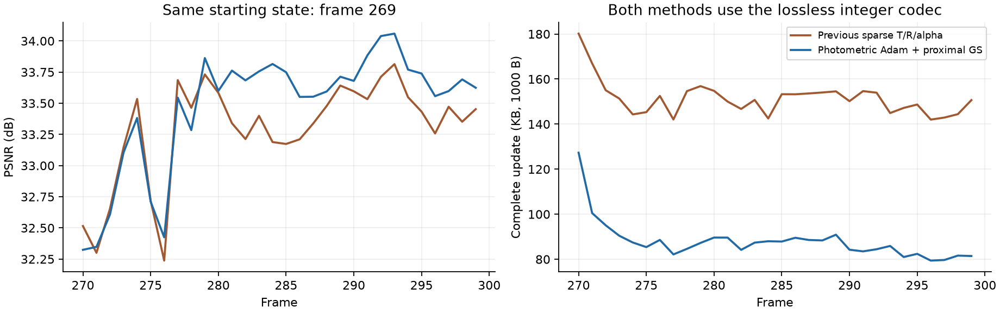

# 图像 Adam 与 GS 近端稀疏优化：后 30 帧续跑

## 结果与范围

**非零 GS 残差明显减少，PSNR 提高，实际存储下降。** 从相同旧第 269 帧继续训练 270–299，平均 PSNR **33.2909 → 33.4669 dB**；完整动态更新 **151.406 → 87.874 KB，减少 41.96%**。这里比较的两组均使用已接入的无损整数编码，未将编码格式本身的收益重复计入。

这是 30 帧续跑实验，**未重新训练完整 300 帧**。另以当前基础 storage=0.002 从共享原生首帧训练两个动态帧，检查首帧 gate 全关、后续继承、量化 opacity 与删点及导出闭环。数据集配置始终为 300 帧、resolution=-1，实际 1600×1199，20 训练视角、cam00 测试；数据通过原软链接读取。

## 发现的问题

旧方案对量化残差的稀疏代理和相对运动 L1 反传，GS 的 Adam 动量/二阶矩同时混合了图像梯度与收缩梯度。随后周期性 L0 块选择又将这份混合二阶矩用作局部度量，估算把残差归零的代价。这会将正则化自身的驱动力混入“保留运动的依据”。

同时，旧相对运动 L1 的输入是量化值。零 bin 内没有该 L1 梯度，微小图像梯度仍能累积到半步长边界；非零一侧又受到收缩。因此之前观测到很多连续旋转参数停在 0.50–0.51 bin，却仍发送 ±1 符号。不是 rounding 或角度单位错误。

本次同时调整 GS 梯度分工与连续残差 L1 的优化方式；没有单独拆分这两个因素的贡献，不能据此认定其中一个是唯一原因。

## 实现与更新过程

新增配置开关 `module.rigid_tree.proximal_gs_regularization`：

1. GS 的 Adam 只接收图像梯度。区域和 gate 仍通过候选残差、码率与相对运动目标学习；没有基于阈值的开关替代 learnable gate。
2. 区域更新后继续重编码，保留刚拟合的完整运动。随后对连续 GS 相对残差做 Adam 度量下的 L1 近端软阈值，每步执行。
3. 原来的每 20 步及运动结束时的 T/R 联合 L0 块选择继续执行，使用的是 GS 图像梯度二阶矩。

对图像 Adam 更新后的 GS 参数 `z`，软阈值为：

`x = sign(z) * max(abs(z) - lr*a/(sqrt(v_image)+eps), 0)`

其中平移 `a=relative_weight*ramp/(N*extent)`，旋转 `a=relative_weight*ramp/N`。该操作只向零移动，不会由收缩项跨过零制造反向更新；子 bin 提议也受到约束。原来的 storage 权重、relative-motion 权重均保留，没有额外增加一套损失权重。

图像渲染继续使用相同步长和 STE；本次没有扩大旋转量化步长、删除所有小旋转或禁止 GS 旋转残差。区域仍存完整帧增量，GS 存相对区域的残差；区域更新仍主要学习编码表示，没有新增区域直接图像梯度或重新聚类。

简要代码位置：

- [rigid_residual_tree.py](../../pipeline/model/rigid_residual_tree.py)：开关、验证和旧配置兼容。默认 False，历史配置保留原行为。
- [spatial_gated_motion.py](../../pipeline/model/spatial_gated_motion.py)：GS 正则目标停止进入 Adam；连续 L1 对区域/gate 保留梯度，GS 用更新后的近端步骤实现收缩。
- [回归检查](../../tests/test_proximal_gs_regularization.py)：区域/gate 仍有梯度、GS 二阶矩只含图像梯度、软阈值不会反向越零、checkpoint 后更新一致。
- 两份当前 YAML 启用开关并使用新的 `proxgs_lossless` experiment_name，没有新增 YAML 文件。

每帧仍为 70 步联合优化＋30 步固定 gate，每步 2 视角；随后新增 GS 100 步、每步 1 视角。robust_median、四层树、前帧热启动、α＜0.01 删除、opacity 参数、无损码流均保留。

## 同一后段窗口的结果

| 帧 270–299 | 此前三通道稀疏方案＋新无损编码 | 本次近端方案 |
|---|---:|---:|
| 平均 PSNR | 33.290858 dB | **33.466945 dB** |
| 平均 SSIM | 0.967325773 | 0.967188658 |
| 平均 LPIPS | 0.125464018 | 0.125497432 |
| 第 299 帧 PSNR | 33.452621 dB | 33.624321 dB |
| 平均运动包，含新生 pose/来源 | 115.111 KB | **51.002 KB** |
| 平均 opacity 包 | 29.742 KB | 30.023 KB |
| 平均新生属性包 | 5.977 KB | 6.273 KB |
| 完整更新，含 manifest | 151.406 KB | **87.874 KB** |
| 平均非零 GS 残差点数 | 58,051.7 | **15,035.7** |
| 非零 GS 残差占旧点比例 | 21.865% | **5.657%** |
| 平移残差块 | 25,760.9 | 14,678.3 |
| 旋转残差块 | 36,681.1 | **687.0** |
| 平均选中区域数 | 137.0 | 98.5 |
| 移动点中纯共享、无 GS 残差比例 | 76.532% | **94.290%** |
| 最终 GS 数 | 267,258 | 267,778 |
| 窗口纯渲染 FPS | 200.386 | 200.013 |
| 日志平均训练耗时 | 27.250 s | 26.820 s |

KB=1000 B，一次性第 269 帧参考不计入动态均值。“移动点”指完整量化运动非零，并非真实物体运动分割；GS 残差为零仍可继承区域运动。不能将 94.29% 理解为真实场景静止点比例。

PSNR 平均提高 0.1761 dB，但 SSIM、LPIPS 略有下降，并非所有指标一起改善；前几帧有质量损失，后半段更明显改善。未做多次独立重复训练。训练耗时仅列原日志，不能据此声称稳定提速。FPS 是预解码、上传后的完整 materialized render＋clamp，30 帧共 1500 次计时，排除解码、上传和验证；平均约 200，部分单帧低于 200。

本段新增 10,421 点、删除 10,271 点；此前为新增 9,902、删除 10,272。删除数量几乎相同，最终点数还略多，说明节省主要来自运动残差变稀疏，不是删除更多 GS。当前存储仍高于 50 KB 目标：运动约占 58.0%，opacity 34.2%，新生属性 7.1%。

## 旋转边界是否改善

第 299 帧 step100：

| 项目 | 此前 | 本次 |
|---|---:|---:|
| 非零旋转残差点 | 45,890 | 321 |
| 只有一个 ±1 分量的点 | 42,135 | 215 |
| 上述点中位于 0.50–0.51 bin 的点 | 39,939 | **7** |
| 上述点活跃分量连续绝对值中位数 | 0.5020 bin | 0.7884 bin |
| 连续旋转残差严格全零的点 | 0 | 266,341 |

其余两个检查点也出现同样趋势：第 270/279 帧靠近半 bin 的单 bin 点分别从 22,434/41,663 降到 4/8。说明收益不是只把量化值藏到一个更大的步长中，很多连续残差已经实际归零；同时保留了仍有图像依据的非零旋转。

## gate 的边界仍需诚实区分

本次打开的 eligible gate 为 26–58 个，选中区域数为 98–99。有效 frontier 基本稳定，不能用开关位变化等同于区域频繁变化，也不能把整个收益归为 gate 本身的独立优势。

第 299 帧 step100 固定完整整数运动、只改变编码层级并重估代表：

| 层级诊断 | 区域数 | GS 残差点 | 旧点运动包 |
|---|---:|---:|---:|
| learned gate | 98 | 14,056 | **37.810 KB** |
| 仅八个大区域 | 8 | 163,065 | 227.551 KB |
| 全部 eligible gate 打开 | 4,029 | 14,050 | 38.326 KB |

相对全细分只省 **516 B，约 1.35%**，依然不宜声称 learnable gate 已有很大的独立压缩优势。本次最明确的进展是 GS 稀疏优化与共享/例外分工改善。上述表不含新生 pose、opacity 或新增属性，与完整 87.874 KB 不同口径；它是单帧固定整数运动的只读诊断，浮点重分组最大位置差约 3.81e-6，不作为逐字节训练对照或生产开关规则。

## 启动、恢复与独立解码

- **179 项回归全部通过**。定向检查验证了只含图像梯度的 GS Adam 二阶矩和 checkpoint 恢复后更新一致。
- 从同一旧第 269 帧检查点恢复后显式启用新机制，保存源/有效配置；bootstrap raw 逐张量匹配源检查点。
- 全部 30 帧独立解码，raw-state/decoded-state 摘要、保存的 PSNR/SSIM/L1 均通过；质量差和 cache 开关像素差为 0。最终 raw 逐张量匹配第 299 帧检查点。
- storage=0.002、同一共享首帧的两个动态帧分别为 **34.378090 / 34.247475 dB**、完整更新 **146.107 / 90.347 KB**，旋转残差 250 / 202 点。独立解码、图像与最终检查点通过；初始参考逐张量匹配历史共享首帧。这仅是默认配置启动检查，不与 0.003 后段或不同权重旧启动段混作对照。
- 启动训练完成后的汇总脚本曾因 OmegaConf ListConfig 序列化失败而退出；已修正脚本，并从已保存的完整报告重建汇总，未重跑训练，原失败日志保留。

当前基础 0.002 和实验 0.003 YAML 均启用 `proximal_gs_regularization: true`，新实验名分别为 `fs_ste_proxgs_lossless_rate002_full300_20261017`、`fs_ste_proxgs_lossless_rate003_full300_20261017`。0.002 只完成上述启动检查，0.003 完成后 30 帧；都不是新配方完整 300 帧成绩。

结果位于 `output/fs_proximal_gs_validation_20261017/`，包含固定源码、源码摘要、训练和验证脚本、逐帧 CSV、旋转/层级诊断和实际码流。[轻量证据归档](../archive/proximal_gs_late270_299_20261017.tar.gz)不含原始训练产物。原有历史目录、数据链接与链接目标未修改。
