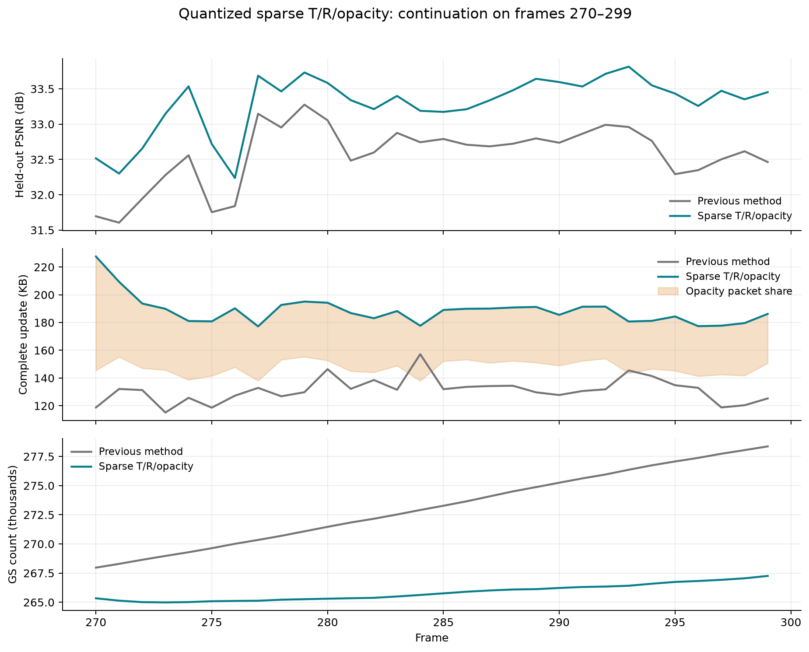

# 2026-10-17：平移、旋转、透明度联合量化与稀疏更新，后 30 帧续跑

## 结论与实验范围

**后段画质明显改善，实际存储回归。** 从旧 0.003 实验已经完成的第 269 帧继续训练 270–299，平均 PSNR 从 **32.5682 提升至 33.2909 dB**，第 299 帧提升 **0.9892 dB**；每帧完整更新量从 **131.257 增至 188.492 KB，增加 43.605%**。本次验证了透明度更新与删点闭环，但还不是满足存储目标的配方。

这是**共享旧第 269 帧状态的后段续跑**，不是从首帧重新训练的完整 300 帧成绩。另完成共享首帧加两个动态帧的启动检查。数据通过原软链接访问，resolution=-1，实际图像 1600×1199，20 训练视角、cam00 测试，随机种子 0，RTX 3090 Ti、350 W。

## 核心想法与机制

旧 GS 除平移、旋转外，新增可学习的 **logit 不透明度残差**。三个通道都按量化值参与渲染，再用稀疏更新成本约束变化。当前配置为：

| 项目 | 参数 |
|---|---|
| 平移量化步长 | 场景 extent × 3e-5，沿用此前设置 |
| 旋转向量量化步长 | 0.001 rad，沿用此前设置 |
| 旧点 opacity logit 量化步长 | 0.05 |
| 旧点 opacity Adam 学习率 | 0.05 |
| 删除阈值 | 当前量化后 α＜0.01 |
| storage 权重 | 0.003；以共享参考 24N 字节归一化 |
| 稀疏梯度宽度 | 1 个量化 bin |
| 每帧安排 | 70 步联合优化 + 30 步固定 gate；再训练新增点 100 步 |
| 视角数 | 前 100 步每步 2 视角，新增阶段每步 1 视角 |

每个点继承上一帧**解码后的** logit `a_prev`，训练残差 `d`，`q=round(d/step)`，渲染不透明度为 `sigmoid(a_prev+step*q)`。量化通过 STE 回传梯度，零符号保留上一帧原始浮点位。

此前平移/旋转的非零计数只能给 gate 提供梯度。本次增加统一的稀疏替代梯度：前向仍取真实的非零块计数，反向通过 `1-exp(-sum(abs(q))/width)` 的平滑近似传递。**梯度在量化 bin 上计算，零 bin 的稀疏梯度为零**，避免对已免费的小残差施力产生反向过冲。共享区域和 GS 残差的平移、旋转，以及 GS 的透明度，都纳入更新成本。

透明度按典型的“1 字节差分编号 + 2 字节 int16”估算原始更新成本，加上包头后纳入同一 storage 权重；实际编号长度、压缩后字节另行核验。保留原来的运动相对残差 L1 与 Adam 度量下的稀疏近端步骤。该 surrogate 没有直接拟合熵编码后的文件长度。

第 100 步完成后，按当前量化后的 α 删除旧点，随后拟合新增点。**取消按新增数量强制删除等量点**。删除点不发送透明度残差，也不再发送其运动；保留点只发送非零透明度更新。播放端顺序为：删除旧编号 → 解码旧点运动及透明度 → 用更新后的属性预测新增点。

## 简要代码改动

- [sparse_updates.py](../../pipeline/model/sparse_updates.py)：量化 logit 残差、三通道共用的稀疏支持梯度、opacity 优化器及 OPD1 稀疏整数包。
- [spatial_gated_motion.py](../../pipeline/model/spatial_gated_motion.py)：平移/旋转获得直接稀疏梯度；gate 使用候选代价学习，运动参数使用实际选中区域的代价；支持运动提交前删除点并保留对应参数与 optimizer 状态。
- [module.py](../../pipeline/module.py)：联合优化有效 α，按当前 α 删除，记录 opacity 包真实成本。旧点尺度、SH 继续固定。
- [回放](../../scripts/replay_rigid_tree.py)：新增显式 `before_births` 时序，历史 opacity 包默认 `after_births` 保持兼容。
- [trainer.py](../../pipeline/trainer.py)：中途恢复时重建删除前、透明度更新前的完整参考。
- [测试](../../tests/test_sparse_updates.py)：覆盖三个通道的稀疏梯度、零 bin、CPU/GPU 位一致性、缓存失效、高 α 点变透明后删除、新点预测及检查点参考。

开关与参数均为配置项。基础 0.002 YAML 已接入，本次实际使用 [0.003 实验配置](../../config/fs_ste_sparse_tralpha_rate003_full300_20261017.yaml)。两个旧完整实验配置与此前固定预算替换配置保持原义。

启动检查中发现过一次不合理的替代梯度：对未量化的 bin 内残差继续施力，配合 Adam 可以生成反向非零项。修正后，首动态帧的运动包由 254,215 B 回落至 125,427 B，活跃运动 GS 由 97,163 回落至 41,024。旧尝试只用于机制检查，未用于后 30 帧成绩。源码 v1/v2 与日志均留档。

## 后 30 帧结果

| 指标，帧 270–299 | 旧实验同一窗口 | 本次续跑 |
|---|---:|---:|
| 平均 PSNR | 32.5682 dB | 33.2909 dB |
| 平均 SSIM | 0.964781 | 0.967326 |
| 平均 LPIPS | 0.129104 | 0.125464 |
| 第 299 帧 PSNR | 32.4634 dB | 33.4526 dB |
| 平均运动包 | 124.542 KB | 140.884 KB |
| 平均透明度包 | 0 | 41.056 KB |
| 平均新增属性包 | 6.278 KB | 5.977 KB |
| 平均完整更新，含 manifest | 131.257 KB | 188.492 KB |
| 最终 GS 数 | 278,364 | 267,258 |
| 窗口聚合纯渲染 FPS | 196.036 | 200.386 |
| 平均报告训练耗时 | 23.527 s | 27.250 s |

KB=1000 B。参考状态只计一次，不包含在动态更新均值中。FPS 只计完整 materialized render + clamp，每帧 10 次预热、50 次计时；不含解码、上传与验证。上述 FPS 不能代替全 300 帧结果。

### 点是否真的能失活

起始第 269 帧有 267,628 个点。本次新增 9,902 个，删除 10,272 个，最终 267,258 个，数量由当前拟合与低 α 条件决定。

按第 269 帧的原始编号追踪，其原有点中有 9,446 个被删除，包含 **511 个原始 α≥0.5、188 个原始 α≥0.9** 的点。另有 547 个仍保留的点，其 α 从原始至少 0.9 降到不足 0.5。这说明原本不透明的点确实能够逐帧淡出；不能用“删除前一帧是否 α≥0.9”代替这个跨帧统计。

### 存储为何反而增大

新旧均值差主要来自两处：透明度增加 **41.056 KB**，运动包再增加 **16.342 KB**；新增属性略减。每帧平均活跃运动 GS 从 44,301 增至 58,052，旋转非零块从 24,422 增至 36,681，平移块从 22,870 增至 25,761。

透明度更新平均约 27,073 点，已经只更新少部分点，但仍不足以保证总码流减少。当前代理、权重和优化过程没有阻止位姿更新数量增长；非零计数也没有充分反映压缩后的熵。画质增益来自这套联合改动，本次没有单独拆分透明度、删点及新稀疏梯度的贡献。

下一步重点是透明度更新选择与运动实际码率约束。当前配置应视为实验配方，不能因画质提升或梯度接通就认定压缩成功。

## 追加：实际存储占比与无损编码审计

本节只读取上述 270–299 帧的既有码流，**没有重新训练，也没有调整正式导出格式或删除策略**。KB=1000 B，不含一次性第 269 帧续跑参考。

| 正式文件，30 帧平均 | KB/帧 | 占完整更新 |
|---|---:|---:|
| 运动包，含新增点位置、旋转与来源 | 140.884 | 74.74% |
| 旧点透明度更新 | 41.056 | 21.78% |
| 新增点尺度、透明度、SH 属性 | 5.977 | 3.17% |
| 每帧 manifest | 0.576 | 0.31% |
| 合计 | 188.492 | 100% |

运动包解压后平均 503.471 KB，其中 GS 局部更新 490.758 KB，占 **97.47%**；区域运动仅 1.250 KB，gate 位图 0.586 KB，删除映射 0.543 KB，新增点位置/旋转 9.242 KB，新增来源 0.990 KB，其余为包头与校验。**这些是压缩前的精确分项，不能作为压缩后各分项的占比**。整个运动包共同做熵压缩，分项压缩收益不能简单相加。

GS 局部更新压缩前可继续分为平移符号 154.565 KB、旋转符号 220.086 KB、差分编号 58.052 KB、标志 58.052 KB及 3 B 计数。区域树及 gate 的直接传输开销很小；优化树的价值主要在于更好地共享运动、减少逐 GS 更新，而非节省 gate 位图本身。

### 已验证的无损编码空间

现有稀疏记录把每个点的编号、标志和 int16 向量交错存放。离线试验先拆分编号、标志和平移/旋转分量，再将带符号整数映射为非负整数并做变长编码，最后在原样、zlib、LZMA 中选择最短者。透明度使用同样的分离与整数编码。试验包计入版本、布局、压缩方法和原始长度等外壳开销。

| 离线可逆方案 | 完整更新 KB/帧 | 相对正式文件节省 |
|---|---:|---:|
| 当前正式文件 | 188.492 | — |
| 仅优化运动布局与整数编码 | 162.719 | 13.67% |
| 仅优化透明度布局与整数编码 | 177.178 | 6.00% |
| 两者同时优化 | **151.404** | **19.68%** |

最后一项中运动包 115.110 KB、透明度包 29.741 KB，新增属性和 manifest 不变。30 帧、三种布局、两个通道及原布局压缩探针合计 **210 次可逆性检查**，解压并逆变换后均逐字节还原原始码流；此外逐帧检查了 zlib level 9 的还原。只是把透明度 zlib level 6 改为 9，平均仅节省 77.867 B，收益很小。

这是**离线试编码结果，尚未接入正式训练导出和播放器**。原实验实际成绩仍为 188.492 KB，不能直接改写为 151.404 KB。没有测量新布局的正式导出耗时和播放解码耗时；已有纯渲染 FPS 不能代表新格式的端到端速度。

后续已完成[正式编码接入与独立回放核验](20261017_lossless_codec_gate_rotation.md)：相同状态重新导出为 151.406 KB。本段保留接入前的探针记录，原训练文件及原训练结果没有改写。

### 训练侧仍需解决的开销

- 非零旋转块中 **94.97%** 只有一个分量为 ±1、其余为零；全部旋转分量中 99.81% 的绝对值不超过 1。当前按非零三维块存三个 int16，适合进一步使用小整数编码。是否可以减少这些小旋转，仍需训练或图像验证，不能由符号小直接认定其无用。
- 新版运动活跃 GS 比旧版同窗口增加 31.04%，旋转块增加 50.20%；透明度平均更新旧点的 10.20%。因此光减少总点数或优化包头不足以解决码率。
- 当前运动 storage surrogate 平均 615.853 KB，真实原始包为 503.471 KB。主要偏差来自 surrogate 使用绝对编号长度，而码流使用差分编号；平均约 2.94 B 对实际 1 B。此外，块计数没有描述符号分布与压缩熵。代理既不是实际文件字节，也不能仅凭数值大小判定约束是否有效。
- 稀疏梯度因子为 `exp(-L1(q)/width)/width`，当前 width=1。平移非零块中 91.16% 的整数 L1 至少为 5、53.13% 至少为 10，透明度分别为 32.62%、14.76%，这些位置的平滑稀疏梯度明显衰减；近端投影和原有相对运动 L1 仍在工作。因此“已接通梯度”不等于“实际码率优化充分”。后续应校准实际码流成本与分通道约束，而非直接删掉全部小更新。

### 阈值删除与固定预算

这次按上一轮“学习透明度、删除低透明度点”的要求采用当前 α＜0.01，并关闭固定数量替换。其含义是删除已经失活的点，新增数和删除数可以独立变化；固定预算替换则按目标数量回收点，能限制规模，但可能在尚无足够失活点时删除仍有效的点。**阈值策略不能自动保证预算，固定数量策略也不是必然不合理。** 当前 α 已可学习，固定预算排序可使用更新后的 α；当前代码将两模式设为互斥只是实现选择，方法上可以结合。

本窗口起始 267,628 点，新增 9,902、删除 10,272，最终 267,258，已经略微缩减。当前存储偏高的直接证据是更新块变多、透明度新增码流，而非本窗口点数继续增长。α 也不等于实际渲染贡献；若后续引入预算上限，应在低 α 回收基础上结合可见贡献，避免只凭数量或单帧遮挡删除有用点。

审计代码、逐帧 CSV、整数分布和完整结果位于 `output/fs_sparse_tralpha_storage_audit_20261017/`，以 `audit_v2.json`、`per_frame_v2.csv` 为准；v2 将布局模式显式写入试验包头。[轻量审计归档](../archive/sparse_tralpha_storage_audit_20261017.tar.gz)仅保留脚本、结果文本和来源摘要，不包含训练产物。

## 核验、恢复与产物

- **171 项测试通过**。实际训练第 270 帧 step20，区域与 GS 的平移/旋转、opacity 残差均获得非零 storage 梯度。
- 起始参考逐张量匹配旧第 269 帧检查点。独立解码全部 30 帧，逐帧 raw 摘要、保存的 PSNR/SSIM/L1 均通过；质量差值和缓存像素差值全部为 0。最终 raw 属性逐张量匹配第 299 帧检查点。
- 第 279 帧 step100 的检查点能够重建第 278 帧完整参考，逐张量匹配独立回放；259 个删除编号和旧 opacity 均正确。
- 从该 step100 恢复后完成新增阶段 100 步，未重复删点，恢复后的独立解码匹配其检查点；保留旧点的全部属性与原运行逐位一致。新生点由 303 变为 304，最终 PSNR 差 -0.03709 dB，差异集中于恢复后的新增拟合。可能与 CUDA 非确定性及新增剪枝阈值敏感性有关，当前不保证训练逐位复现。

后段运行：`output/fs_sparse_tralpha_validation_20261017/late270_299/20261017T113231_40d3c5`。

对比 CSV、JSON、源码快照、启动检查、benchmark 与恢复核验位于 `output/fs_sparse_tralpha_validation_20261017/`；[轻量证据归档](../archive/sparse_tralpha_late270_299_20261017.tar.gz)不包含原始训练产物。启动段修正后的两个动态帧平均为 34.3033 dB、170.203 KB，仅作链路检查，不与后段均值混用。
