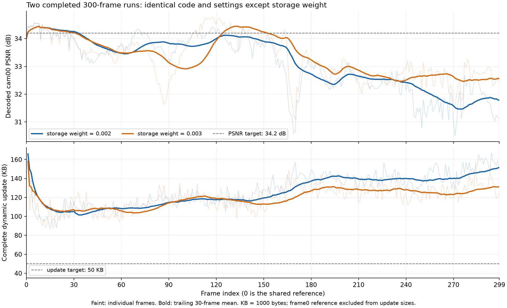

# STE gate：storage 0.002 / 0.003 的完整 300 帧对比

两次均已完成 300 帧训练和独立码流核验。本次 **0.003 在 PSNR 与更新量的取舍上更好：PSNR 增加 0.2178 dB，动态更新减少 6.00%**。两组仍未达到 34.2 dB、50 KB/帧的目标，纯渲染也都略低于 200 FPS。

## 完整结果

| 指标 | storage 0.002 | storage 0.003 |
|---|---:|---:|
| 全 300 帧 PSNR | 33.0724 dB | 33.2902 dB |
| 全 300 帧 SSIM | 0.967811 | 0.967762 |
| 动态 LPIPS（训练后评估） | 0.125227 | 0.125418 |
| 完整动态更新平均 | 127.338 KB | 119.698 KB |
| 完整更新 P95 | 156.317 KB | 138.030 KB |
| 全序列纯渲染 FPS | 199.494 | 199.820 |
| 正常帧报告耗时（去掉首个动态帧） | 21.830 秒 | 21.811 秒 |
| 训练总耗时 | 109.83 分钟 | 108.84 分钟 |
| 动态前 150 帧 PSNR | 33.8932 dB | 33.8041 dB |
| 动态后 149 帧 PSNR | 32.2398 dB | 32.7680 dB |
| 末帧 GS 数 | 278476 | 278364 |

PSNR 是独立解码后 cam00 的逐帧算术平均，分辨率 1600×1199，包含共享首帧。存储是动态帧 1–299 的实测更新，包含运动、新增属性和每帧 manifest，KB=1000 B；首帧参考 **17720236 B** 另计。SSIM 和 LPIPS 有很小的反向差异，因此这里的优势仅指 PSNR 和更新量。

纯渲染每帧预热 10 次、计时 50 次，按总次数/总耗时汇总，不包括解码、验证、上传和指标计算；不能称为端到端播放速度。训练耗时包含该帧加载、优化、评估和图像保存。第一组首个动态帧包含扩展编译，两组去掉该帧后均约 21.8 秒。

## 时间上的变化

细线是逐帧值，粗线是向前取最多 30 帧的滑动平均。下图不含首帧参考；虚线为目标。0.003 在早段部分帧更差，后段整体较好，两组都出现后段退化。

| 动态帧范围 | 0.002 PSNR | 0.003 PSNR | 0.002 更新 / KB | 0.003 更新 / KB |
|---|---:|---:|---:|---:|
| 1–30 | 34.2577 | 34.2174 | 105.353 | 107.062 |
| 31–60 | 33.4751 | 33.4898 | 108.234 | 105.963 |
| 61–90 | 33.8341 | 33.1414 | 114.686 | 114.138 |
| 91–120 | 33.9955 | 33.9309 | 117.559 | 118.918 |
| 121–150 | 33.9034 | 34.2409 | 119.475 | 113.037 |
| 151–180 | 32.7248 | 33.2365 | 137.192 | 127.038 |
| 181–210 | 32.6504 | 32.8624 | 139.359 | 128.290 |
| 211–240 | 32.4206 | 32.5063 | 139.951 | 128.218 |
| 241–270 | 31.5851 | 32.6307 | 140.204 | 123.027 |
| 271–299 | 31.8033 | 32.5983 | 152.197 | 131.688 |

## 这次说明了什么

提高权重后，平均活动区域从 289.9 减至 179.7，非零 GS 残差平均从 46485.1 减至 44102.4，存储代理与实际字节数也均下降。但实际更新只减少约 7.64 KB/帧，离 50 KB 仍远；仅调整这个权重没有解决长序列退化与运动包过大的问题。

两个结果中运动包都占完整动态更新约 96%，新增属性约 4.5 KB/帧，manifest 约 0.44 KB/帧，主要优化空间仍在运动表示与编码。新增 100 步的即时 PSNR 平均收益仅 0.0255 / 0.0228 dB，同时总 GS 数都增加约 7.2 万个。下一步值得检查新增阶段的效率及后段误差来源；这些统计尚不能直接证明退化由某个模块单独造成。

本次没有新增算法改动，只运行作者指定的两个权重。两组共用同一份 STE 固定源码：深度 4、robust_median、远点最近区域、首个动态帧 gate 全关、后续继承前帧；70 步联合＋30 步固定 gate（每步 2 视角）＋100 步新增（每步 1 视角）。随机种子为 0，各运行一次，不能据此声称统计显著或初始化鲁棒。

## 核验与文件

两组各 300/300 帧从码流独立解码，状态哈希核验通过；299 个动态帧的 PSNR、SSIM、L1 与训练保存值差异均为 0，缓存开关像素差异为 0。493 个固定源码文件哈希通过，运行配置仅实验名和权重不同；21 个首帧参考字段逐字段一致，两个参考文件 SHA256 相同。数据通过软链接访问，原始训练产物仅保留在本地 output。

- [0.002 详细记录](20261017_ste_storage002_full300.md) · [0.003 详细记录](20261017_ste_storage003_full300.md)
- [配对逐帧 CSV](../../output/fs_ste_rate_sweep_full300_20261017/per_frame_comparison.csv)
- [0.002 逐帧 CSV](../../output/fs_ste_rate_sweep_full300_20261017/rate002_per_frame.csv) · [0.003 逐帧 CSV](../../output/fs_ste_rate_sweep_full300_20261017/rate003_per_frame.csv)
- [比较与一致性验证 JSON](../../output/fs_ste_rate_sweep_full300_20261017/comparison.json)
- [轻量证据归档](../archive/ste_storage002_003_full300_20261017.tar.gz)：固定源码、配置、逐帧指标、benchmark、运行来源及日志；不含原始数据或模型 checkpoint。
