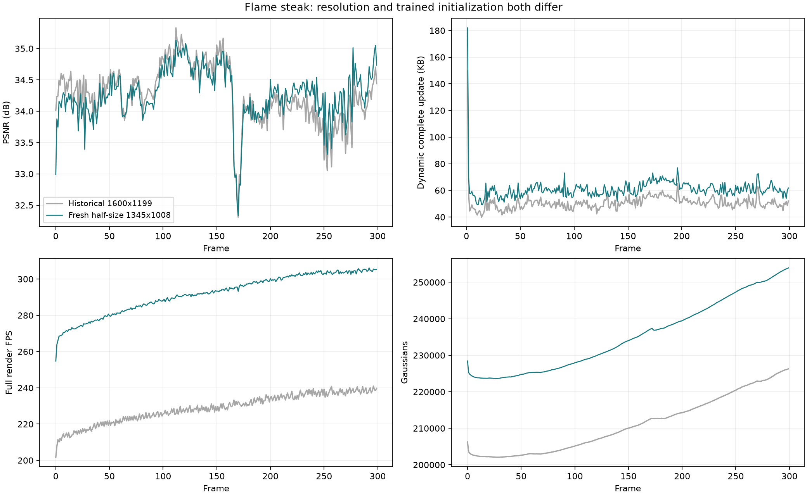

# Flame steak：标准半分辨率、新首帧、连续 300 帧

本实验于 2026-10-18 启动，10-19 完成。使用既有去畸变半分辨率图像，重新训练 native 首帧，再连续运行第 0–299 帧。核心目的是验证与公开方法一致的半分辨率处理链路，同时重新统计质量、动态更新体积和渲染速度。处理依据和全六景检查见[数据审计](20261018_n3dv_preprocessing_audit.md)。

## 核心方法与改动

沿用已验证的 shared discovery 方法。动态帧仍为 300 步：前 200 步运动优化，每步 2 个训练视角；后 100 步普通新增，每步 1 个视角。运动阶段先进行共享区域与 learnable gate 的发现，gate 在第 70 步固定；随后联合拟合区域和逐点稀疏残差，第 101–200 步固定非零支持、精修幅值。前 20 步为区域预热，gate 从第 20 步开始学习。区域使用父子相对平移，最大深度 4，robust_median 初始化、远点路由到最近区域；旋转更新关闭，透明度量化与阈值删除保持开启。

与旧验证配置相比，`module`、`trainer` 参数字典完全相同。改变的是数据适配目录、`resolution: 1`、`expected_image_size: [1345, 1008]`、新首帧 checkpoint 和实验名；没有中途调参。

本轮代码改动：

- `scripts/prepare_n3dv_half_colmap4d.py`：链接已有半分辨率 PNG，并按真实宽高比例缩放原始 PINHOLE 内参，分别保留 fx/fy。共享图像、位姿和 PLY 保持原样。
- `scripts/benchmark_rigid_residual_tree.py`：质量核验与输出尺寸采用配置，去除仅接受 1600×1199 的限制，计时和解码逻辑不变。
- `scripts/freeze_experiment_source.py`：支持指定数据适配路径，并将 CUDA extension 源码纳入快照。第一次快照遗漏 extension，启动在首个动态优化 step 前失败；补全后从新首帧重新启动。本报告只统计后一次完整运行。
- `tests/test_rigid_sequence_benchmark.py`：增加分辨率、RGB 范围与非有限数值检查；对应测试共 9 项通过。

## 数据与首帧核验

原去畸变 COLMAP 模型为 2689×2016，实际半分辨率为 1345×1008。保持 cam00 留出、其余 20 视角训练，21 相机各 300 帧，共 6300 张图像均通过软链接访问，训练时不再缩小。额外抽查全部 21 个首帧及 149/299 帧部分相机，共 27 张，逐像素与 ImageMagick `-resize 50%` 结果一致。

种子 PLY 为 40000 点，与历史实验文件 SHA256 相同；点来自原始分辨率去畸变图像的 COLMAP/MVS，再做 FPS 降采样。点云本身是世界坐标，没有“1345 像素点云”这种尺寸。此次重新训练的是半分辨率首帧 GS 模型：15000 步、237495 GS、未剪枝 cam00 PSNR 32.991226 dB。初始透明度剪枝后保留 228432 GS，实际码流参考 PSNR 32.994446 dB。原始种子相同不意味着训练后的 GS 数相同。

适配目录的 `images.bin` 仅供 loader 读取位姿，其 2D 观测仍为原像素坐标，不能将这个适配目录当作新的 SfM 模型。

## 完整结果

| 指标 | 历史 1600×1199 | 本次 1345×1008、新首帧 |
| --- | ---: | ---: |
| 平均 PSNR / dB | 34.259709 | 34.265514 |
| 平均 SSIM | 0.971042 | 0.967694 |
| 平均 LPIPS（VGG） | 0.120677 | 0.117121 |
| 动态完整更新 / KB | 50.692104 | 60.913512 |
| 纯渲染 FPS | 228.448 | 291.513 |
| 训练及评估秒 / 动态帧 | 33.0743 | 29.7221 |
| 初始保留 GS | 206237 | 228432 |
| 动态平均 GS | 211024.7 | 235222.4 |
| 最后一帧 GS | 226267 | 253930 |

PSNR ≥34.2 dB 与纯渲染 FPS >200 均达到目标。动态完整更新为 60.914 KB，比 50 KB 高 21.83%，存储目标尚未达到。KB=1000B；中位数 59.810 KB，P95 67.917 KB，最大 182.030 KB。

首帧参考单独计算：19661738 B（19.662 MB）；整段完整码流 37874878 B（37.875 MB）。摊入首帧后为 126.250 KB/帧。checkpoint、训练图片和日志不计入传输体积。

两次运行同时改变了分辨率和训练后的首帧模型，因此上述差异不能单独归因于分辨率；跨分辨率的 PSNR、SSIM、LPIPS也不能作为同口径方法改进幅度。

## 为什么像素变少，更新没有随之减少

1. **计算对象包含 GS。** 像素面积减少 29.33%，但初始保留点数增加 10.76%，动态平均点数由 211025 增至 235222。每帧仍执行相同 300 步及视角数量；点参数优化、建树、量化和编码开销继续存在。最终整帧训练耗时缩短 10.14%，纯渲染速度增加 27.61%。
2. **分辨率不会直接缩小世界运动或量化步长。** 两次平移步长都是 0.00038961812970228493 世界单位；图像损失按像素取均值，像素数减少不代表梯度整体乘 0.707。不能期待非零更新点数按像素面积同比缩小。
3. **同一 storage 权重对应的每字节惩罚变弱。** 当前公式为 `L_rate = 0.002 × B_hat / (24 × N0)`，`N0` 是初始剪枝后点数，在序列内固定。N0 从 206237 变为 228432，使每字节系数从 4.04066e-10 降至 3.64806e-10，下降 9.72%。当前目标是相对参考属性体积的更新成本，不直接固定每帧 50 KB。
4. **实际逐点残差更多。** 全程平均非零局部残差点 13450.5 → 16509.4，增加 22.74%；按旧点数加权的残差比例 6.379% → 7.025%。点数、残差率和有效字节惩罚同时变化，构成存储上涨的明确线索，各自因果贡献尚未分离。

首个动态帧含首次 CUDA 编译，耗时 86.09 秒，已如实计入总均值。对应第 2–299 帧，旧版平均 33.0691 秒、新版 29.5329 秒，缩短 10.69%。

后续若要统一六景的绝对 KB 目标，应优先统一每字节惩罚或显式预算口径，并检查首帧点数控制；本次保持原方法参数，用完整结果记录这些问题。

## 存储组成与 gate 状态

| 类别 | 历史平均 KB | 本次平均 KB | 本次完整更新占比 |
| --- | ---: | ---: | ---: |
| 运动包 | 41.230 | 49.775 | 81.71% |
| 旧 GS 透明度 | 5.044 | 5.882 | 9.66% |
| 区域 DC | 0.261 | 0.268 | 0.44% |
| 新增属性 | 3.498 | 4.329 | 7.11% |
| manifest | 0.659 | 0.659 | 1.08% |

运动包增加约 8.545 KB，约占总增量的 83.6%。运动包还包含区域、删除映射与新增位置，不能将其全部归为旧 GS 残差。

- 286/299 动态帧选择了超过 8 个有效区域，13 帧仅保留粗区域；平均有效区域数 122.09，历史为 115.05。
- 原始 gate 开启位平均 49.83 个；关闭祖先之下也可能存在开启位，因此 `frames_with_open_gates=299` 不表示 299 帧都使用了细区域。有效细分帧数按选中区域统计。
- 按旧点数加权，92.975% 不需要逐点平移残差，其中包含静止点。该比例不是 gate 单独贡献的因果证明。GS 旋转残差块总数为 0，与配置一致。
- 每帧平均保留新增 205.03 点、删除 119.75 点；最终点数增长至 253930。
- 最低 PSNR 为第 170 帧 32.3326 dB，最高为第 112 帧 35.1323 dB。第 170 帧附近仍有局部低谷。

## 核验与统计口径

- 质量均值覆盖第 0–299 帧、cam00；动态存储和训练耗时覆盖第 1–299 帧。
- 从新首帧参考连续解码 299 个更新，验证各帧属性摘要，独立重渲染的 PSNR/SSIM/L1 与训练记录最大绝对差均为 0。缓存与未缓存逐像素差为 0。
- 第 0 帧 LPIPS 在剪枝后的参考上重新计算；动态帧 LPIPS 使用训练结束时 decoded-state 评估，此次顺序回放没有重算全部动态 LPIPS。
- RTX 3090 Ti，每帧预热 10 次、计时 50 次完整 `Module.forward+clamp`，总计 15000 次；全部渲染次数除总渲染秒数得到 FPS。GPU 独占检查通过。
- 纯渲染 FPS 排除解码、上传、图像加载和质量计算；CPU 文件解码与摘要校验平均 0.4291 秒/动态帧，上传 0.0028 秒，单独记录。不能把纯渲染指标直接当作含解码的播放 FPS。
- 训练时间来自每帧墙钟记录，包含数据准备、训练和评估，最终 checkpoint 写入在该计时外。新首帧训练另耗时 415.234 秒。
- 实际运行快照 `source_v2` 含 520 个带 SHA256 的源文件，基于提交 `0902bc106107575cb3b0070f185f8a933ecdc733` 加本轮未提交改动；结束后全部文件摘要一致。不能仅用该 Git 提交号代表运行源码。

## 每 30 帧

| 帧范围 | PSNR | SSIM | LPIPS | 动态完整 KB | 纯渲染 FPS | 训练评估秒/帧 |
| --- | ---: | ---: | ---: | ---: | ---: | ---: |
| 0–29 | 34.0370 | 0.97006 | 0.11342 | 60.917 | 271.2 | 31.29 |
| 30–59 | 34.1976 | 0.96847 | 0.11445 | 56.967 | 278.7 | 28.91 |
| 60–89 | 34.1692 | 0.96738 | 0.11669 | 61.107 | 284.4 | 29.06 |
| 90–119 | 34.6644 | 0.96804 | 0.11598 | 59.464 | 288.9 | 29.09 |
| 120–149 | 34.6787 | 0.96783 | 0.11692 | 58.996 | 291.9 | 29.25 |
| 150–179 | 34.0588 | 0.96661 | 0.11865 | 63.441 | 295.0 | 29.52 |
| 180–209 | 34.0892 | 0.96711 | 0.11957 | 66.136 | 298.9 | 29.70 |
| 210–239 | 34.3032 | 0.96739 | 0.11852 | 60.591 | 302.0 | 29.90 |
| 240–269 | 34.0375 | 0.96703 | 0.11897 | 60.439 | 303.6 | 30.17 |
| 270–299 | 34.4195 | 0.96704 | 0.11804 | 61.076 | 304.6 | 30.39 |

第一段质量包含第 0 帧，动态存储与训练耗时仅使用第 1–29 帧，因此与训练中只汇报动态 1–29 帧的 PSNR 有区别。

## 产物与复现证据

- 配置：[flame_steak_half_fresh_full300.yaml](../../config/n3dv/flame_steak_half_fresh_full300.yaml)。
- 原始输出：`output/n3dv_flame_steak_half_fresh_full300_20261018/20261018T231032_84d9ab/`；汇总在其上一级。
- [完整汇总](evidence/flame_steak_half_fresh_full300_20261018/summary.json) · [逐帧 CSV](evidence/flame_steak_half_fresh_full300_20261018/per_frame_metrics.csv) · [每 30 帧 CSV](evidence/flame_steak_half_fresh_full300_20261018/per_30_frames.csv) · [顺序解码与计时](evidence/flame_steak_half_fresh_full300_20261018/decoded_sequence.json)。
- [全程诊断](evidence/flame_steak_half_fresh_full300_20261018/full300_diagnostics.json) · [数据适配元信息](evidence/flame_steak_half_fresh_full300_20261018/data_adapter.json) · [像素缩小核验](evidence/flame_steak_half_fresh_full300_20261018/half_resize_pixel_check.json) · [源文件快照清单](evidence/flame_steak_half_fresh_full300_20261018/source_manifest.json) · [实际启动记录](evidence/flame_steak_half_fresh_full300_20261018/launch_v2.json)。

仓库仅归档轻量指标、图表、配置和摘要；原始模型与数据保留在本地 output/ 和共享目录。本轮只完成 flame_steak，另外五景尚未进入完整动态训练。
