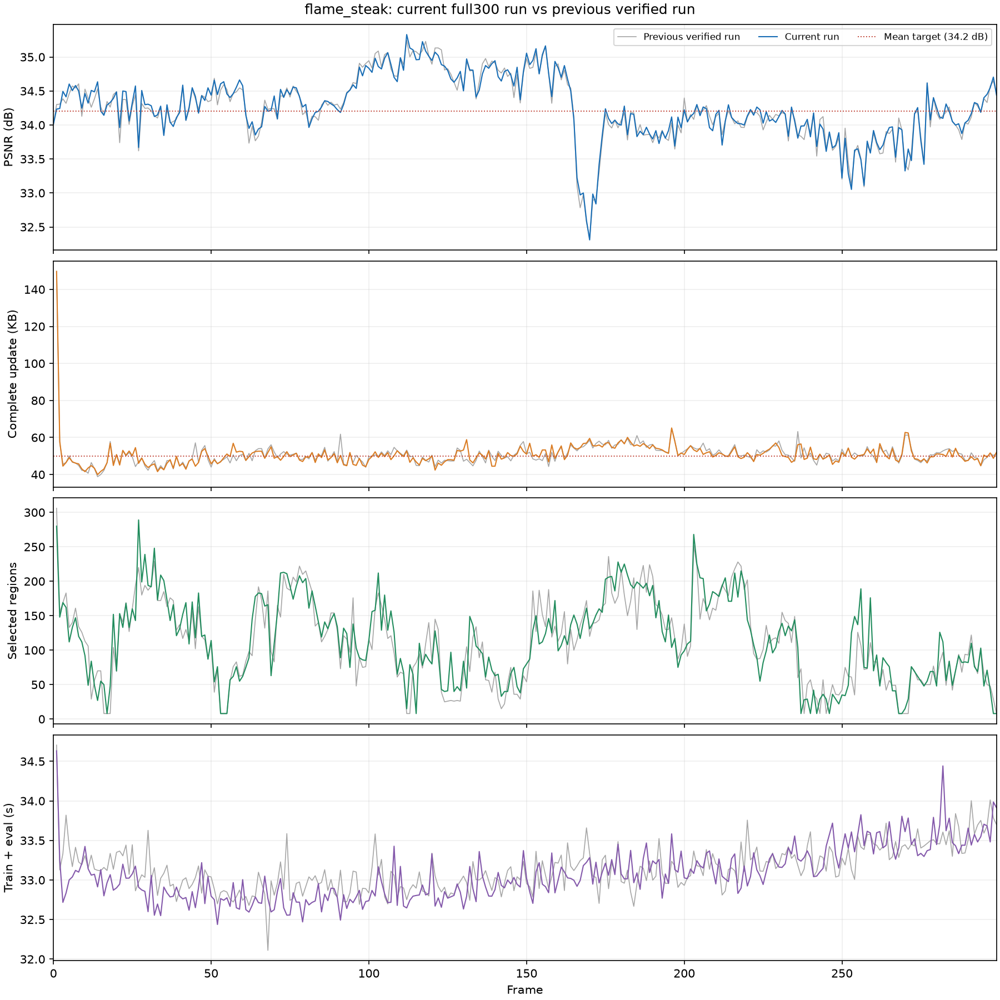

# 作者连续重跑完整300帧：统计与独立解码核验

本次统计作者手动运行的`fs_shared_discovery_depth4_verified_full300/20261018T181655_49843b`，从共享第0帧连续训练动态1–299帧，每个动态帧300步。没有重新训练、修改参数或改写原运行目录。

## 核心想法与代码

沿用此前的共享发现方案：先训练区域和learnable gate，再固定gate并开放GS残差；保留100步运动精修、100步普通新增及阈值删除。方法不变，运行包含上一轮等价性能清理，详见[清理记录](20261018_shared_discovery_speed_cleanup.md)。

此次仅读取训练记录并执行顺序解码、质量复算和渲染计时。两个性能清理源码的SHA与清理记录一致。训练日志中的Git提交为`d282223`，当时还包含未提交的性能清理，不能把训练源码简单标成干净的该提交。

## 完整结果

| 指标 | 前一份已核验300帧 | 本次连续300帧 |
| --- | ---: | ---: |
| 平均PSNR/dB | 34.244412 | **34.259709** |
| 平均SSIM | 0.971067 | 0.971042 |
| 平均LPIPS（VGG） | 未在该汇总中报告 | 0.120677 |
| 动态完整更新/KB | 50.917187 | **50.692104** |
| 纯渲染FPS | 226.931 | **228.448** |
| 训练及评估秒/动态帧 | 33.1422 | 33.0743 |

与前一份运行相比，PSNR变化+0.015297dB，完整更新变化-0.225084KB，训练及评估耗时变化-0.0679秒/动态帧。整体质量和体积接近，未观察到明显的整帧训练提速；这些是独立运行的观察值，不能将质量差异归因于性能清理。

PSNR超过34.2dB；动态平均存储比50KB高1.38%，严格≤50000B仍为`false`。动态更新中位数50.073KB，P95为56.969KB，最大149.702KB。KB=1000B。

首帧参考为17720236B（17.720MB），另外计算；整段完整码流合计32877175B（32.877MB）。若摊入首帧则为109.591KB/帧。训练checkpoint和图片不属于上述传输体积。

## 统计口径与核验

- 数据为`flame_steak`原生300帧，实际1600×1199，留出cam00；质量均值覆盖第0–299帧，动态存储与训练时间覆盖1–299帧。
- 从共享首帧顺序解码299个动态更新，核对各帧manifest中的解码状态与原始属性摘要。逐帧重新渲染的PSNR/SSIM/L1/LPIPS与训练记录的最大绝对差分别为0/0/0/0。
- 缓存与未缓存图像的最大逐像素差为0。
- RTX 3090 Ti，每帧预热10次、计时50次完整`Module.forward+clamp`；FPS按全部15000次渲染数除总计时时间汇总。GPU独占检查通过：True。
- FPS不包含解码、上传、图像加载和质量计算。当前CPU解码及manifest校验平均0.4110秒/动态帧，上传平均0.0025秒，单独记录，不能将纯渲染FPS当作含解码的端到端播放FPS。
- LPIPS沿用仓库`libgs.metric.lpips(..., net_type='vgg')`，质量计算不参与FPS计时。每帧训练耗时来自原记录，包含数据准备、训练和评估；终态checkpoint写入在该计时之外。

## 存储组成

| 类别 | 平均KB/动态帧 | 完整更新占比 |
| --- | ---: | ---: |
| 运动包 | 41.230 | 81.33% |
| 旧GS透明度 | 5.044 | 9.95% |
| 区域DC | 0.261 | 0.51% |
| 新增属性 | 3.498 | 6.90% |
| manifest | 0.659 | 1.30% |

运动包也包括区域信息、删除映射及新增位置，不能全部视为旧GS残差。

## gate、点数与局部表现

- 286/299帧学出细分，13帧仅保留8个粗区域。平均115.05个选中区域，范围8–289；平均开启47.76个gate。
- 按旧GS点数加权，93.62%不需要逐点平移残差，其中包含静止点。单点旋转块总数0，与关闭旋转更新一致。
- GS从206237增长至226267；动态帧模型平均211024.7点，每帧最终保留新增164.71点、删除97.72点。
- 最弱帧为第170帧，32.3098dB；最高为第112帧，35.3298dB。后期仍有波动，240–269为33.7066dB，270–299恢复至34.1235dB，不能说局部退化已全部解决。

## 每30帧汇总

| 帧范围 | 本次PSNR | 前次PSNR | SSIM | LPIPS | 动态完整KB | 纯渲染FPS | 训练评估秒/帧 |
| --- | ---: | ---: | ---: | ---: | ---: | ---: | ---: |
| 0–29 | 34.3495 | 34.3029 | 0.97335 | 0.11684 | 50.779 | 213.7 | 33.08 |
| 30–59 | 34.3437 | 34.3140 | 0.97181 | 0.11871 | 47.475 | 219.7 | 32.77 |
| 60–89 | 34.2558 | 34.2254 | 0.97087 | 0.12065 | 50.276 | 223.5 | 32.74 |
| 90–119 | 34.8144 | 34.8524 | 0.97157 | 0.11952 | 48.532 | 226.3 | 32.81 |
| 120–149 | 34.7657 | 34.7764 | 0.97138 | 0.12051 | 49.568 | 228.3 | 32.92 |
| 150–179 | 34.1461 | 34.1007 | 0.97018 | 0.12227 | 53.891 | 230.3 | 33.07 |
| 180–209 | 34.0074 | 34.0029 | 0.97048 | 0.12256 | 54.523 | 233.5 | 33.15 |
| 210–239 | 34.0845 | 34.0588 | 0.97065 | 0.12139 | 51.191 | 236.0 | 33.17 |
| 240–269 | 33.7066 | 33.7107 | 0.97012 | 0.12240 | 50.250 | 237.4 | 33.44 |
| 270–299 | 34.1235 | 34.0998 | 0.97001 | 0.12192 | 50.438 | 238.5 | 33.58 |

第0帧没有动态更新，因此第一段的动态存储和训练时间使用第1–29帧。

[完整汇总](evidence/manual_full300_20261018/summary.json) · [逐帧CSV](evidence/manual_full300_20261018/per_frame_metrics.csv) · [每30帧CSV](evidence/manual_full300_20261018/per_30_frames.csv) · [独立解码与FPS数值](evidence/manual_full300_20261018/decoded_sequence.json)。输出副本和诊断图在`output/fs_shared_discovery_metrics_20261018/`，训练原始产物保持原样。
