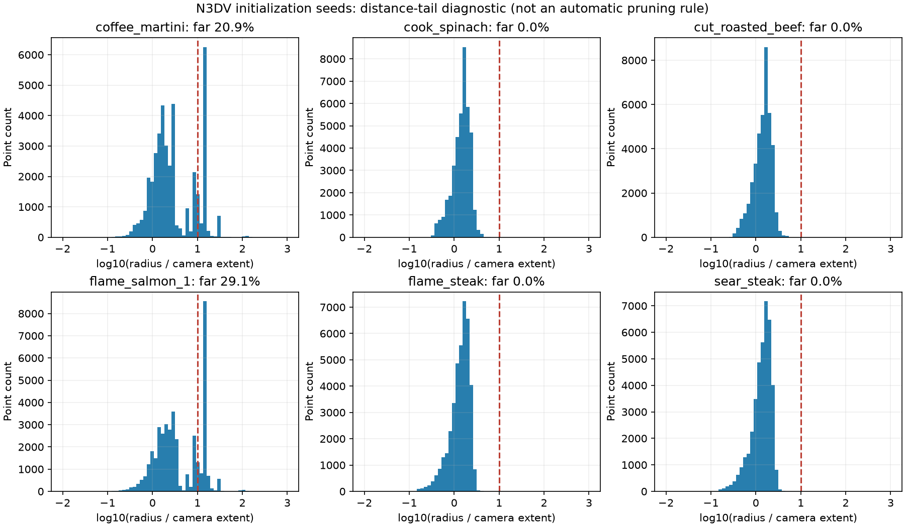

# N3DV 六场景预处理检查（2026-10-18）

本次完成已有数据的只读检查，没有修改共享数据或历史结果。六景半分辨率图像已处理完毕，文件完整性通过；coffee 和 salmon 的点云远距离长尾仍需核实，不能把所有初始化都标为通过。根据作者后续要求，本轮各场景均重新训练首帧，flame 也不复用旧检查点。

## 数据清单

共享根目录：`/home/gamer-02/Documents/DeepLearning/data/n3dv`。原视频在 `<scene>/`，处理结果在 `<scene>_result/`；S2GS 和 queen 通过软链接访问。各相机图像在 `camXX/images/0000.png..0299.png`。

| 场景 | 相机数 | 每相机帧数 | PNG 数 | 实际宽×高 | 种子点数 |
| --- | ---: | ---: | ---: | --- | ---: |
| coffee_martini | 18 | 300 | 5400 | 1341×1006 | 40000 |
| cook_spinach | 21 | 300 | 6300 | 1345×1008 | 40000 |
| cut_roasted_beef | 20 | 300 | 6000 | 1343×1006 | 40000 |
| flame_salmon_1 | 19 | 300 | 5700 | 1345×1009 | 40000 |
| flame_steak | 21 | 300 | 6300 | 1345×1008 | 40000 |
| sear_steak | 21 | 300 | 6300 | 1344×1007 | 40000 |

检查结果：

- 全部 36000 张 PNG 的 CRC 检查通过；帧号完整，RGB 模式和各景尺寸一致。
- 每相机完整解码第 0、149、299 帧，共 360 张，并检查采样帧存在时间变化。
- 相机目录与现存原视频一致。coffee 缺 03/15/17、beef 缺 04、salmon 缺 03/17，在原视频目录也不存在，不应强行补齐连续编号。
- 六个 PLY 实际解析后均有 40000 个有限、互不重复的点；位姿为有限数值，旋转正交且行列式接近 1。
- S2GS 现有 `scripts/pre_dynerf/run_train_eval.sh --check` 通过。上述检查补充了完整 PNG 校验、实际 PLY 解析和几何诊断。
- `cam00` 为测试视角，其余相机训练。salmon 原视频较长，当前标准化序列取前 300 帧。

## 初始化疑点与验证边界

以点云坐标中位数为中心，以训练相机 extent 的 10 倍为诊断阈值。extent 是训练相机中心到其均值的最大距离乘 1.1。coffee 有 8370 个点超过阈值（20.925%），salmon 有 11626 个（29.065%），其余四景为 0。两景最大半径分别约为相机 extent 的 219 倍、184 倍。



远点可能同时含背景和重建散点，需要结合多视角支持及深度判断；距离阈值不是自动删除规则。日志显示稠密点云经过最远点采样，采样可能放大远方散点在种子中的占比，这是待验证解释。

只有 flame 保留完整去畸变 COLMAP 模型及全部原尺寸去畸变帧，其他五景只保留处理图、LLFF 位姿、种子 PLY 和日志。文件完整、位姿正交以及稀疏投影颜色一致，均不能代替 SfM/MVS 的完整几何验证。

flame 的 LLFF 位姿恢复到 COLMAP 后，旋转最大差为 `2.22e-16`，相机中心最大差为 `8.88e-16`，相机行顺序和轴转换一致。保留模型为 PINHOLE，`fx=1460.8873`、`fy=1455.3859`；LLFF 仅保留一个焦距。不能混用旧原始位姿和另一套重建 PLY，也不能从 LLFF 声称完整恢复了原始双焦距内参。

额外的 PLY 颜色投影采用现有 S2GS 单焦距假设、4 像素格最近深度采样，仅作排错线索，不是特征重投影误差或几何精度认证。

## 分辨率核对

- [S²GS 论文 IV-B1 和表 I](https://arxiv.org/html/2608.19639v1) 明确使用半分辨率；[官方预处理](https://github.com/liyw420/S2GS/blob/main/scripts/pre_dynerf/convert.py) 对去畸变图执行 `mogrify -resize 50%`。
- [QUEEN 附录 B.2](https://arxiv.org/html/2412.04469v1) 对 2704×2028 视频下采样 2 倍训练和测试。
- [STG 第 6.1 节和表 1](https://openaccess.thecvf.com/content/CVPR2024/papers/Li_Spacetime_Gaussian_Feature_Splatting_for_Real-Time_Dynamic_View_Synthesis_CVPR_2024_paper.pdf) 使用半分辨率，表中 FPS 对应 1352×1014。
- [ReCon-GS 官方配置](https://github.com/jyfu-vcl/ReCon-GS/blob/main/config/dynerf.yaml) 为 `resolution: -1`。已安装 libgs 的 `data/dataset/base.py` 仅在该设置且输入宽度超过 1600 时自动缩到 1600；该配置值本身不能证明其论文输入尺寸。

本地约 1345 宽是先去畸变，再减半。例如 flame：2704×2028 原视频 → 2689×2016 去畸变图 → 1345×1008 半尺寸图。保留各景实际尺寸与匹配内参，不强行拉伸为同一宽高。

种子点云与训练好的首帧 GS 是两件事。S²GS [处理脚本](https://github.com/liyw420/S2GS/blob/main/scripts/pre_dynerf/run_train_eval.sh) 先在原尺寸第 0 帧做 COLMAP 重建与融合，再[最远点采样到最多 40000 点](https://github.com/liyw420/S2GS/blob/main/scripts/pre_dynerf/downsample_point.py)，之后将训练图缩小 50%。[QUEEN 的数据说明](https://github.com/NVlabs/queen#data-preparation) 也将种子 PLY 交给 4DGaussians 的 COLMAP 预处理生成，首帧训练分辨率另由其半分辨率协议确定。没有理由把 PLY 的三维坐标按 1345/1600 再缩放。

本地 flame 实查原始首帧为 2704×2028、去畸变帧为 2689×2016，保留了 `frame000001/fused.ply`。新 GS 使用已有 40000 点种子及 1345×1008 PNG 重新优化；1600 是旧 GS 训练加载时的尺寸，与点云融合流程不同。

进一步解析保留的融合点云，共 924335 点；用最近邻逐点核对，40000 个种子点到融合点云的最大距离为 0，确认它们确实是该融合结果的子集。证据为 `output/n3dv_preprocessing_audit_20261018/flame_seed_provenance_check.json`。

本轮采用这套已有去畸变半分辨率数据。基线也需使用相同图像、相机划分和分辨率；裁剪后的 1345×1008 不能与未裁剪 1352×1014 的论文数字无条件直接比较。

现有重要 flame 结果是 1600×1199，300 帧 PSNR 34.2597 dB、动态包 50.6921 KB、纯渲染 228.4479 FPS。该结果独立保留，不能混入本轮半分辨率六景平均。新分辨率的指标需重测。QUEEN 的 FPS 还包含残差解码并取中位数，与纯渲染均值的统计口径不同。

## 新首帧与运行准备

my4dgs 原来只有 flame 的 COLMAP4D 输入适配，其他五景仍需补齐。40,000 点 PLY 是训练种子，不是训练好的首帧高斯模型。

作者已要求本轮首帧全部重训，旧首帧检查点只保留为历史记录。新增 `scripts/prepare_n3dv_half_colmap4d.py` 用已有半尺寸 PNG 建立软链接适配；需要保留的去畸变 PINHOLE 模型，分别按实际宽、高缩放 fx/fy，拒绝用 LLFF 单焦距冒充原始双焦距。适配只用于训练加载，原 `images.bin` 中的二维观测仍为原像素坐标，不得把它当作新的 SfM 模型。

flame 的新首帧配置为 `config/n3dv/flame_steak_half_frame0.yaml`：不加载 checkpoint，使用 1345×1008 实际 PNG、20 个训练相机、cam00 测试、SH1、15000 步，只训练第 0 帧。使用旁边 ReCon-GS 的 native 入口生成当前动态方法兼容的首帧，输出进入本仓库的新实验目录。

加载验证已完成：21 路第 0 帧张量均与共享半分辨率 PNG 逐像素一致，20 个训练相机及 1 个 cam00 测试相机正确，种子点数 40000，共享 PLY/位姿哈希未变。相机缩放后 `fx=730.7153`、`fy=727.6929`。证据位于 `output/n3dv_preprocessing_audit_20261018/flame_native_half_loader_check.json`。首帧新实验目录为 `output/n3dv_half_fresh_frame0_20261018/flame_steak/`，训练结果完成后另记，不在本预处理记录中预报指标。

不要误用 `cook_spinach/recongs_first_frame_20260919`：README 声明仅首帧输入，本次实查也确认 `frames/0000` 有 21 张图，`0001`、`0002` 为空。完整序列应来自 `_result`。

原始检查结果在 `output/n3dv_preprocessing_audit_20261018/`。[保存的 JSON](evidence/n3dv_preflight_20261018/audit.json) 含逐相机诊断及位姿/PLY SHA256；[检查脚本](evidence/n3dv_preflight_20261018/audit_script.py) 记录主体检查流程，额外 COLMAP 核对和输入清单已补入 JSON。完整六景动态训练尚未启动；需先核实两景远点、补齐五景内参和数据适配，并获得各景新首帧。

## flame 半分辨率新首帧：已完成

核心目的：统一六景半分辨率口径，并按作者要求放弃历史首帧初始化。使用已检查的原尺寸重建种子，重新训练首帧 GS；本次不重跑 COLMAP，也没有改动动态运动方法。

新增代码为软链接输入适配脚本及首帧配置；图像直接引用已有去畸变半尺寸 PNG，相机 fx/fy 分别按宽高比例缩放。训练从 40000 个点开始，SH1、15000 步，500–5000 步按 native 配方增密，20 视角训练、cam00 留出测试，没有加载旧 checkpoint。

完成目录：`output/n3dv_half_fresh_frame0_20261018/flame_steak/20261018T224824_9ca22a/`。

| 指标 | 训练视角均值 | cam00 测试 |
| --- | ---: | ---: |
| PSNR / dB | 36.372944 | 32.991226 |
| SSIM | 0.971362 | 0.967834 |
| LPIPS / VGG | 0.108265 | 0.117148 |

训练耗时 415.234 秒，最终 237495 个 GS。检查点为 `ckpt-0-15000.pth`，`current_frame=0`、`global_step=15000`，保存的所有 GS 张量均为有限数值。用 my4dgs 的 GaussianModel 和 Renderer 独立加载该 checkpoint，cam00 PSNR 同为 32.991226，确认模型可以读取，且图像与相机设置一致。

这是新首帧的测试结果，不能当作完整 300 帧指标，也不能用它与旧 1600 分辨率的 300 帧均值判断方法升降。首帧增密后点数与原始种子点数不同属于正常训练行为。native 原有 FPS 计时未同步 CUDA，因此未把它计为有效速度结果。

精确指标、模型 SHA256 和独立加载结果保存在运行目录的 `native_frame0_summary.json`；启动命令及 native 源码哈希在上级 `launch.json`，新 checkpoint SHA256 为 `61f38b3ff4ffc40655b1bad75834ce92c1540537962f0a65438b5a2646b4384e`。

复现命令（先激活 ReConGS）：

```bash
cd /home/gamer-02/Documents/DeepLearning/ReCon-GS
conda activate ReConGS
python main.py --config=/home/gamer-02/Documents/DeepLearning/my4dgs/config/n3dv/flame_steak_half_frame0.yaml
```

数据适配已经在本机生成；其他机器先运行 `scripts/prepare_n3dv_half_colmap4d.py --source=<flame_steak_result> --destination=<new_adapter> --frames=300`，并调整配置中的路径。脚本拒绝覆盖现有适配目录。
