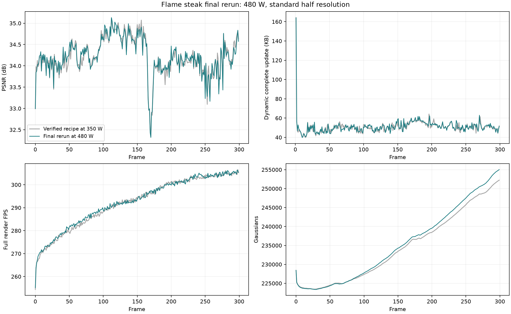

# Flame steak：480 W 标准配置，最终完整 300 帧

作者指定本次为 flame_steak 最终结果。恢复显卡默认 480 W 后，用固定标准半分辨率配方，从新训练的首帧开始完整运行第 0–299 帧，没有使用动态前缀，也没有根据中间结果调整参数。

最终 **34.211170 dB、51.027672 KB/动态帧、292.205 纯渲染 FPS**。具体阈值是否达到，以[完整核验](evidence/flame_steak_final480w_20261019/final_audit.json)的 target_checks 为准，不用此前 350 W 的结果替代本次指标。

PSNR ≥34.2 dB：达到；纯渲染 FPS >200：达到；动态完整更新严格 ≤50 KB：未达到。

## 配方与数据

配置 [flame_steak_half_final480w.yaml](../../config/n3dv/flame_steak_half_final480w.yaml)。与[上一轮](20261019_half_byte_budget_full300.md) module/trainer/data 字典完全一致，仅改实验名。每字节代价 `3e-5/50000=6e-10`，50000 是损失单位，不是硬码流上限。learnable gate 仍使用随机离散前向与 STE，最大深度 4、robust_median、远点连最近区域，父子运动相对表示，旋转更新全部关闭；透明度量化、近端稀疏与低透明度删除保持开启。本轮未改方法代码。

1345×1008，21 相机，每相机 300 帧，cam00 留出，其余 20 相机训练。6300 张图像保持软链接，全部 PNG 头尺寸及链接检查通过，处理来源和像素检查见[预处理审计](20261018_n3dv_preprocessing_audit.md)。原始种子仍为相同 40000 点世界坐标 PLY；本次不重新进行 SfM/MVS。

首帧直接加载此前这轮重新训练的半分辨率 15000 步 checkpoint；本次未重复 native 首帧训练，也未使用历史 1600 模型或 17000 步精修模型；SHA256 `61f38b3ff4ffc40655b1bad75834ce92c1540537962f0a65438b5a2646b4384e`。初始保留 228432 GS，参考包与上一轮逐字节一致。480 W 的变化不能单独解释两次所有质量差异：GPU 优化有非确定性，上一轮还存在经验证的动态前缀续跑。

每动态帧 300 步：1–20 共享区域/DC 预热，21–70 区域与 gate 学习，71–100 固定 gate 后的区域/逐点稀疏联合拟合，101–200 固定非零支持精修幅值，201–300 普通新增及区域 DC 更新。前 200 步每步 2 视角，后 100 步每步 1 视角。

## 完整结果

| 指标 | 此前 350 W 同配方 | 本次最终 480 W |
| --- | ---: | ---: |
| cam00 PSNR / dB | 34.208911 | 34.211170 |
| SSIM | 0.967604 | 0.967629 |
| LPIPS（VGG） | 0.117031 | 0.117419 |
| 动态完整更新 / KB | 50.796388 | 51.027672 |
| 纯渲染 FPS | 291.792 | 292.205 |
| 训练与评估秒/动态帧 | 29.4643 | 29.4586 |

质量均值覆盖 cam00 第 0–299 帧，动态体积与时间覆盖第 1–299 帧。KB=1000B。完整更新包含运动、新增、透明度、区域 DC 和必要 manifest，首帧参考另计。中位数 50.575 KB，P95 57.450 KB，最大 163.961 KB，137/299 帧不超过 50 KB。首帧参考 19.661738 MB，整段完整码流 34.919012 MB，摊入首帧后 116.396707 KB/帧。

| 成分 | 平均 KB/动态帧 | 占比 |
| --- | ---: | ---: |
| 运动包 | 39.797 | 77.99% |
| 旧点透明度 | 5.892 | 11.55% |
| 区域 DC | 0.265 | 0.52% |
| 新增属性 | 4.415 | 8.65% |
| manifest | 0.659 | 1.29% |

291/299 个动态帧存在有效细分，平均 116.68 个选中区域，原始 gate 开启位平均 43.03。按旧点数加权，94.705% 无逐点平移残差，包含静止点，不能把它当作 gate 单独贡献的因果比例。所有 GS 旋转残差块为零。最终 255018 GS，平均新增 208.84、删除 119.92 个/帧。

最低 PSNR：第 170 帧 32.319031 dB；最高：第 112 帧 35.131226 dB。本次是固定配方最终复跑，不是功率消融或新的机制归因实验。

## 独立核验与计时范围

连续解码全部 299 个动态更新并独立重渲染，packet/manifest 摘要通过，PSNR/SSIM/L1 与保存值最大差为 0，缓存逐像素差为 0。第 0 帧 LPIPS 独立复算；动态 LPIPS 使用训练终态 decoded-state 评估，未独立复算全部动态 LPIPS。

每帧预热 10 次、计时 50 次完整 `Module.forward(cam00)+clamp`，15000 次渲染除以总秒数得到 FPS，GPU 独占检查通过，测量前后功率上限均为 480 W。**纯渲染 FPS 排除解码、上传、图像 I/O 与质量计算**。CPU 解码/校验 0.3863 秒/动态帧，上传 0.002791 秒。

训练墙钟包含数据准备、训练与评估，终态 checkpoint 写入在计时外；首动态帧 84.38 秒，排除该帧后平均 29.2743 秒/动态帧。固定首帧原训练耗时另计。训练期间 292 次功率抽查上限均为 480 W，抽样最高功耗 321.75 W、最高温度 59°C，抽样峰值不代表全部瞬间最大值。

冻结源码 525 个文件摘要全部通过，基于提交 `0902bc106107575cb3b0070f185f8a933ecdc733` 加已记录的工作区改动；当前 467 个训练/extension 源文件与快照一致。

## 每 30 帧

| 帧范围 | PSNR / dB | 动态完整 KB | 纯渲染 FPS | 训练评估秒/动态帧 |
| --- | ---: | ---: | ---: | ---: |
| 0–29 | 34.0240 | 51.176 | 271.5 | 30.82 |
| 30–59 | 34.2142 | 46.878 | 280.0 | 28.60 |
| 60–89 | 34.1944 | 50.341 | 285.5 | 28.73 |
| 90–119 | 34.6955 | 48.975 | 289.8 | 28.78 |
| 120–149 | 34.6721 | 50.165 | 292.3 | 29.04 |
| 150–179 | 34.0385 | 54.691 | 295.8 | 29.26 |
| 180–209 | 34.0687 | 55.314 | 299.7 | 29.45 |
| 210–239 | 34.1519 | 51.592 | 302.3 | 29.74 |
| 240–269 | 33.8349 | 50.327 | 304.0 | 29.98 |
| 270–299 | 34.2175 | 50.823 | 305.1 | 30.23 |

第一段质量包含第 0 帧，动态存储与时间仅覆盖第 1–29 帧。



## 输出与复现

统一保留入口：`output/final/README.md`。其中 `run/` 指向完整训练结果，`stream/` 指向完整码流，`measurement/` 包含逐帧统计，`source/` 指向当时实际运行的冻结源码，另保留实际配置、新训首帧和第299帧终态检查点。均使用软链接，不搬动或改写原始产物；`preservation_manifest.json` 记录文件摘要与完整性检查。该入口固定对应本次正式结果。

原始输出：`output/n3dv_flame_steak_half_final480w_20261019/training/20261019T091653_42b563`。统计：`output/n3dv_flame_steak_half_final480w_20261019/measurement`。

```bash
conda activate ReConGS
python main.py --config=config/n3dv/flame_steak_half_final480w.yaml
```

[汇总](evidence/flame_steak_final480w_20261019/summary.json) · [逐帧CSV](evidence/flame_steak_final480w_20261019/per_frame_metrics.csv) · [每30帧CSV](evidence/flame_steak_final480w_20261019/per_30_frames.csv) · [顺序解码](evidence/flame_steak_final480w_20261019/decoded_sequence.json) · [完整核验](evidence/flame_steak_final480w_20261019/final_audit.json) · [文件摘要](evidence/flame_steak_final480w_20261019/evidence_manifest.json)。原始模型和训练图片保留在本地 output，未加入 Git。其他五景的完整动态训练尚未启动，不能将本次指标当作 N3DV 六景平均。
