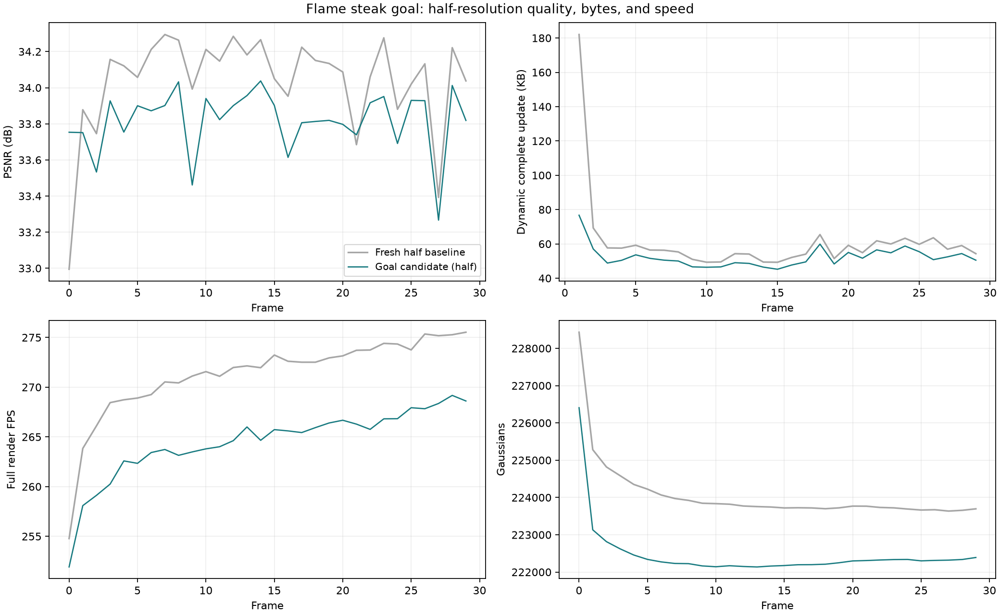
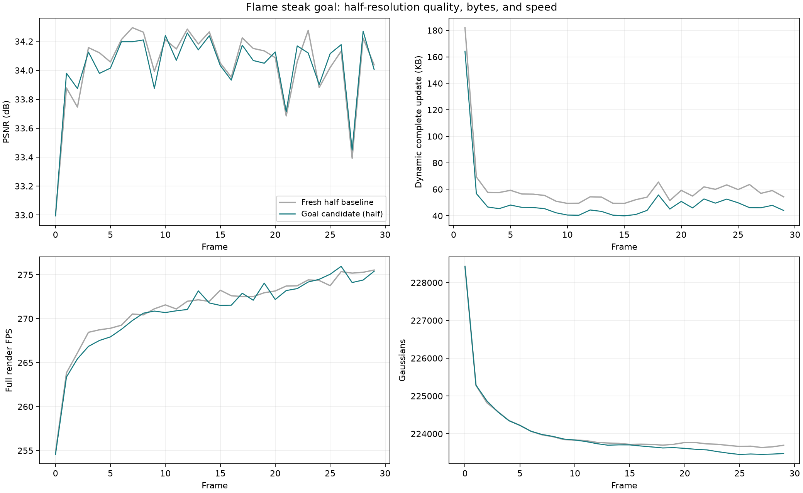

# 半分辨率改进：显式字节基准与首帧质量核查

目标：标准 1345×1008 flame_steak 连续 300 帧平均 PSNR ≥34.2 dB，动态完整更新约 50 KB、尽量 ≤50 KB，纯渲染 ≥200 FPS。本文记录前期短测与诊断，不能用这些短测数值替代全序列指标。后续完整 300 帧已核验为 **34.208911 dB / 50.796388 KB / 291.792 纯渲染 FPS**，详见[完整实验记录](20261019_half_byte_budget_full300.md)；严格 ≤50 KB 尚未达到。

## 已确认的问题

像素数不会直接限定 GS 数。native 首帧从同一 40000 点种子开始，按屏幕梯度克隆/拆分；两次阈值均为 0.0002，增密步数 500–5000，只有 10000000 的宽松点数上限。点数差发生在训练增密中，现有图像、内参、位姿与种子检查没有发现装载错误。

但新首帧训练质量存在差距：将旧 1600 训练模型和此次新 1345 模型均放到同一 1345×1008 真值与 PINHOLE 相机下，只读渲染结果如下。旧模型仅作诊断，没有用于新训练。

| 首帧模型（均剪枝阈值 0.0075） | GS | 20 训练视角平均 PSNR | cam00 PSNR |
| --- | ---: | ---: | ---: |
| 历史 1600 训练模型 | 206237 | 36.801914 | 33.952248 |
| 此次新 1345 训练模型 | 228432 | 36.373479 | 32.994446 |

这不能证明预处理错误，但说明更多 GS 没有换来更好的首帧拟合，不能把差异仅归为分辨率或认定整体方法无问题。native 代码在整个首帧训练期间加固定 0.01 世界单位的位置扰动；接下来将核查末期精修。

存储目标也有明确尺度问题：原 `L_rate=0.002*B_hat/(24*N0)`，N0 从 206237 变为 228432 后，相同一字节的惩罚从 4.04066e-10 降至 3.64806e-10。它没有直接表达统一的绝对 KB 代价。

## 改动：显式字节归一化

`RigidTreeConfig` 增加可选 `rate_normalization: budget` 与正整数 `rate_budget_bytes`。默认 frame/reference 行为和旧 checkpoint 恢复保持兼容；所有区域/gate、GS 近端稀疏、透明度与 DC 成本继续共用统一的每字节系数。诊断新增归一化字节数。

首轮设 `rate_budget_bytes: 50000`、`rate_loss_weight: 0.00003`，即每字节价格 6e-10。50000 只是损失计量基准，不是硬码流大小约束，不能由设置本身宣布 ≤50 KB。

除此之外沿用此次新首帧与 300 步 shared discovery 配方：区域预热 20、gate 学习至 70、固定 gate 稀疏联合拟合至 100、100 步幅值精修、100 步新增。运动 2 视角/步；未改变旋转、量化步长或残差 L1。gate 继续通过随机离散前向与 STE 梯度学习，没有使用枚举选 gate。

## 短测 v1：动态 1–3 帧已完成

全部数据配置始终规划 300 帧，控制脚本只在原始 `frame_training_loop` 完成评估和终态 checkpoint 后停止，因此没有用截短数据范围改变相机归一化或采样顺序。后续可通过验证过的 prefix extension 接续。

| 同一新首帧，动态 1–3 平均 | 原半分辨率配方 | 显式字节 v1 |
| --- | ---: | ---: |
| PSNR / dB | 33.926754 | 33.993266 |
| 完整动态更新 / KB | 102.996 | 89.187 |
| 非零逐点平移残差数 | 31673.0 | 26127.7 |
| 选中区域数 | 229.33 | 185.00 |

首个动态帧的预热成本较高，不能用该三帧均值替代全 300 帧指标。第 3 帧为 34.126080 dB、46.601 KB；顺序解码至第 3 帧并重渲染与训练记录一致，单帧纯渲染计时 266.889 FPS。该单帧 FPS 也不是整段平均值。

短测显示提高稀疏代价减少了例外残差，平均画质暂未下降，但还不能证明全程率失真更好或归一化单独带来了收益：本轮同时提高了每字节价格。目标仍需完整 300 帧验证。

## 检查与产物

全套 346 项检查通过，包含新增字节尺度不随参考点数改变、有效梯度、checkpoint 恢复和参数校验。实际运行源码冻结于 `output/fs_goal_half_budget_20261019/source_v1`，522 文件摘要，基于 `0902bc106107575cb3b0070f185f8a933ecdc733` 加工作区改动。GPU 为 RTX 3090 Ti，短测时上限仍为 350 W；恢复默认 480 W 的操作需要本机管理员权限，当前会话权限不足。

运行：`output/fs_goal_half_budget_20261019/absolute_bytes_v1/20261019T015438_7f571f`。

[短测统计](evidence/half_byte_budget_20261019/prefix_v1_statistics.json) · [第3帧独立解码与计时](evidence/half_byte_budget_20261019/prefix_v1_decoded_frame3.json) · [配置](evidence/half_byte_budget_20261019/prefix_v1_config.yaml) · [同真值首帧诊断](evidence/half_byte_budget_20261019/frame0_same_half_gt_diagnosis.json) · [源码摘要](evidence/half_byte_budget_20261019/source_v1_manifest.json)。原始 checkpoint 和码流仅保留在本地 output。

## 新首帧：2000 步无扰动末期精修已完成

从本轮新训练的 `ckpt-0-15000.pth` 继续至 17000 步，将 `noise_scale` 设为 0。增密在 5000 步已结束，此段没有增加点；没有使用历史 1600 模型。这个结果包含“追加 2000 步”和“关闭扰动”两个变化，不能独立归因于其中一项。

| 指标（native 未剪枝模型） | 原新首帧 15000 步 | 精修后 17000 步 |
| --- | ---: | ---: |
| 原始 GS 数 | 237495 | 237495 |
| 训练视角平均 PSNR | 36.372944 | 38.2504 |
| cam00 PSNR | 32.991226 | 33.7515 |
| cam00 SSIM | 0.967834 | 0.9692 |
| cam00 LPIPS | 0.117148 | 0.1100 |

精修结果采用 native 日志的 4 位小数精度，后续动态码流参考会独立重算。透明度 ≥0.0075 的保留数从 228432 降至 226408；全部 GS 张量有限。native 帧计时约 59.65 秒，独立评估及保存另计。该提升说明首帧末期拟合有优化空间，不构成对所有动态帧或 gate 贡献的证明。

第一次续训在末尾因 native `frame` 计时器未启动而失败，保留了 PLY 但未保存完整 checkpoint，未用于后续。用启动包装器补上 `frame_training_loop` 开始时的计时器启动，从同一 15000 步 checkpoint 重新执行 2000 步，完整保存与评估成功；外部 ReCon-GS 源文件未改。复现续训使用归档的 `run_native_refit.py`，其中只有计时器修正。

成功 checkpoint：`output/fs_goal_half_budget_20261019/frame0_noisefree_refit_v2/20261019T020226_b9e705/ckpt-0-17000.pth`；SHA256 `4959ac5698f22cb5e5dec7659d9f3fe5e0376ee16a2078e79fc8ba7d270f5451`。

[精修评估](evidence/half_byte_budget_20261019/frame0_refit_evaluation.json) · [模型检查](evidence/half_byte_budget_20261019/frame0_refit_checkpoint_check.json) · [配置](evidence/half_byte_budget_20261019/frame0_refit_config.yaml) · [native 计时器恢复包装器](evidence/half_byte_budget_20261019/run_native_refit.py)。

## 短测 v2：精修首帧 + 显式字节代价，0–29 帧已完成

保持 v1 的运动/gate/新增/量化配置，改用上节精修后的本轮新首帧，初始化步数如实设为 17000。数据仍规划 300 帧，训练在完整第 29 帧终态停止。独立顺序解码与重渲染覆盖 0–29 帧，统计范围明确标为 prefix，未宣称完整 300 帧。

| 同范围 0–29 帧 | 原半分辨率配方 | v2 精修首帧 + 字节代价 |
| --- | ---: | ---: |
| 平均 PSNR / dB | 34.037035 | 33.818283 |
| SSIM | 0.970056 | 0.969274 |
| LPIPS | 0.113423 | 0.111034 |
| 动态完整更新 / KB（1–29） | 60.917103 | 52.195414 |
| 纯渲染 FPS | 271.240 | 264.439 |
| 训练及评估秒 / 动态帧 | 31.2854 | 28.9614 |

PSNR 降低 0.218752 dB，动态更新减少 8.722 KB。新首帧静态质量提高没有转化为动态序列收益，因此此时不采用精修首帧作为最终配方，不将该实验延长至 300 帧。首帧与动态优化、稀疏代价及共享区域之间存在相互作用，不能从该结果断言只需要调超参数或整体方法没有问题。v1 未精修参考下的三帧短测仍有改善信号，接下来继续该已完成前缀，避免重复训练首三帧。

v2 平均选中 119.48 个区域，27/29 动态帧存在有效细分；旧 GS 按点数加权 93.747% 无逐点平移残差。首帧剪枝后 226408 点，最后 222391 点，动态平均 222321.6 点。运动包 42.432 KB、透明度 6.004 KB、区域 DC 0.244 KB、新增属性 2.856 KB、manifest 0.659 KB。不能只凭点数减少或稀疏比例升高认定率失真改进。

PSNR/SSIM/L1 与训练保存值最大差为 0，缓存逐像素差为 0，所有 packet/manifest 摘要通过。动态 LPIPS 沿用终态 decoded-state 评估，第 0 帧在解码参考上重算。每帧 10 次预热、50 次计时完整渲染；350 W 上限全程仍在。FPS 排除解码/上传；平均 CPU 解码及校验 0.3980 秒/动态帧。

新增评测 `--sequence --through-frame=29` 只限定测量前缀，不改变 300 帧数据配置；输出显式标记 `planned_frames=300`、`measured_frames=30`、`sequence_complete=false`。对应 10 项 CPU 评测检查通过。默认无该参数仍严格核验完整序列。

[30帧汇总](evidence/half_byte_budget_20261019/prefix_v2/summary.json) · [逐帧 CSV](evidence/half_byte_budget_20261019/prefix_v2/per_frame_metrics.csv) · [顺序解码](evidence/half_byte_budget_20261019/prefix_v2/decoded_sequence.json) · [配置](evidence/half_byte_budget_20261019/prefix_v2/prefix_v2_config.yaml)。

## 保留的 learnable gate 是否产生共享压缩收益

对 v1 第 3 帧 step200 的 checkpoint 做只读重编码：固定该帧的总量化平移/旋转与解码参考，只改变表示方法，不重新训练、不参与训练时的 gate 决策。

| 同一整数运动的新增前运动包 | 包大小 / KB | GS 平移残差块数 |
| --- | ---: | ---: |
| 实际学习到的 140 区域层级 | 35.394 | 11628 |
| 现有 8 个粗区域预测器 | 134.071 | 99372 |
| 按现有码率/L1代理重拟合的 8 个粗区域 | 114.047 | 72657 |
| 全部改为 GS 更新、无共享预测 | 171.347 | 204500 |

当前学习层级相对代理重拟合粗区域省约 68.97% 的运动包，展示了该样本中有效细分的表示收益。各表示的整数总运动逐项一致，生产编码/解码检查通过，浮点重组的位置最大差为 7.63e-6；源 checkpoint 摘要未变。这里比较的是新增前运动包，不是完整帧存储；粗区域代理并非精确熵最优，也没有训练一个替代固定树，因此不能作为论文消融或声称全 300 帧均有同样幅度的收益。

[表示核查数值](evidence/half_byte_budget_20261019/learned_sharing_frame3.json) · [只读核查脚本](evidence/half_byte_budget_20261019/audit_learned_sharing.py)。

## 短测 v3：保留原新首帧、继续 v1 至 0–29 帧，已核验

v2 的精修首帧暂不采用。回到 v1 的原本新训练的 15000 步首帧，从已完成第 3 帧的 checkpoint 依验证后的 prefix extension 继续至第 29 帧；过去的参考与增量包逐字节保留，模块/训练/数据配置不变，数据始终规划 300 帧。

| 同范围 0–29 帧 | 原半分辨率配方 | 固定字节代价 v1 延长 |
| --- | ---: | ---: |
| 平均 PSNR / dB | 34.037035 | 34.023285 |
| SSIM | 0.970056 | 0.970022 |
| LPIPS | 0.113423 | 0.113273 |
| 动态完整更新 / KB（1–29） | 60.917103 | 50.392172 |
| 纯渲染 FPS | 271.240 | 270.853 |
| 训练评估秒 / 动态帧 | 31.2854 | 30.9582 |

与同段基线相比 PSNR 低 0.013750 dB，完整更新减少 17.28%，为更好的后续候选。动态 payload 为 49.733931 KB，另有 0.658241 KB manifest，完整更新仍高于严格 50 KB 约 0.78%，没有只报 payload。30 帧平均 PSNR 不是完整 300 帧目标的验证；同段基线自身为 34.037 dB，而其完整结果为 34.266 dB。

本轮同时改变计量基准与每字节强度：6e-10 相比该半分辨率基线的 3.64806e-10 提高约 64.5%，不能把压缩收益单独归为归一化选项。方法中的 learnable gate、相对区域运动和稀疏量化保持原样。

参考 GS 仍为 228432，最后 223478，动态平均 223838.4；28/29 动态帧使用有效细分，平均选中 124.38 区域。按旧点数加权 93.983% 无逐点平移残差。运动包 41.116 KB、透明度 6.115 KB、区域 DC 0.253 KB、新增属性 2.249 KB、manifest 0.658 KB；主要节省来自运动包。

全部 0–29 帧顺序解码和完整质量核验通过：PSNR/SSIM/L1 与保存值最大差均为 0，缓存逐像素差为 0，GPU 独占检查通过。FPS 口径仍为每帧 10 次预热 + 50 次完整渲染，排除解码/上传；350 W。CPU 解码与校验平均 0.3856 秒/动态帧，单独报告。动态 LPIPS 使用终态 decoded-state 评估，首帧独立复算。

这个已验证前缀被选中继续完整第 30–299 帧，没有中途改训练参数；完整结果完成后另记。输出 `output/fs_goal_half_budget_20261019/absolute_bytes_full300/20261019T023630_678e85`，状态 `output/fs_goal_half_budget_20261019/full300_progress.json`。

[30帧汇总](evidence/half_byte_budget_20261019/prefix_v3/summary.json) · [逐帧 CSV](evidence/half_byte_budget_20261019/prefix_v3/per_frame_metrics.csv) · [顺序解码](evidence/half_byte_budget_20261019/prefix_v3/decoded_sequence.json) · [前缀来源验证](evidence/half_byte_budget_20261019/prefix_v3/prefix_provenance.json)。

