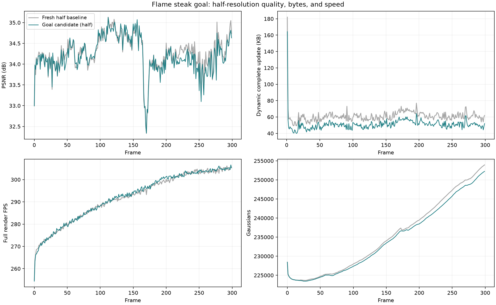

# Flame steak：显式字节代价，完整 300 帧

标准半分辨率 1345×1008，新训练的首帧，连续解码第 0–299 帧。最终平均 **34.208911 dB、50.796388 KB/动态帧、291.792 纯渲染 FPS**。满足 PSNR ≥34.2 dB、动态更新约 50 KB 和纯渲染 ≥200 FPS；严格 ≤50 KB 尚未达到，超出 1.59%。实验及测量使用 350 W 上限，结束后已于 2026-10-19 恢复设备默认 480 W，并禁用开机 350 W 限功率服务。

本轮的短测、首帧精修尝试和初始化检查见[前期记录](20261019_half_byte_budget.md)，数据处理依据见[预处理审计](20261018_n3dv_preprocessing_audit.md)。

## 核心 idea 与代码改动

目标是减少零散逐点更新，同时保留通过图像梯度学习的层级共享运动。原配方的码率项为 `0.002 * B_hat / (24 * N0)`；初始点数变化会改变同一字节受到的惩罚。新增可选 `rate_normalization: budget`、正整数 `rate_budget_bytes`，允许跨初始化密度使用明确的每字节系数，原 frame/reference 行为保持兼容。

本次设为 `3e-5 * B_hat / 50000`，每字节系数 6e-10，比同分辨率基线的 3.64806e-10 提高 64.47%。**50000 是损失的计量基准，不是硬码流上限。** 本场景同时改了归一化方式和惩罚强度；压缩收益不能单独归因于新增归一化模式。当前 B_hat 仍是可导 raw-block 代理，不是实际压缩包大小的精确可导模型。

训练代码改动限于 `pipeline/model/rigid_residual_tree.py` 的参数校验和归一化字节数，以及 `spatial_gated_motion.py` 的诊断输出。前期已通过 346 项检查，包含新增 3 项字节尺度、梯度和恢复检查；前缀测量扩展另通过 10 项 CPU 检查。完整运行结束后，522 个冻结文件摘要全部一致，当前工作区 467 个训练/extension 源文件与运行快照一致。

保持 shared discovery、随机硬 gate 前向与 STE 梯度，不用规则或枚举决定训练 gate。树深度 4，robust_median 初始化，远处点连接最近区域，父子区域存相对运动。所有旋转更新继续关闭。平移、透明度和区域 DC 的量化/近端稀疏、透明度阈值删除、新增策略均保持原参数。除额外保存第 3 帧 checkpoint 外，数据和训练调度与同分辨率基线一致。

## 首帧与训练流程

21 个相机，cam00 留出，20 个相机训练。图像通过软链接读取，每相机 300 帧，`resolution: 1`，预期尺寸 1345×1008。原始去畸变相机为 2689×2016，fx/fy 分别按实际尺寸缩放；27 张图像逐像素缩小核验和全图完整性检查已通过。种子仍是同一 40000 点世界坐标 PLY，未复制大型数据。

使用此次新训练的 15000 步首帧，237495 GS；透明度 0.0075 初筛后保留 228432 GS。参考包与同分辨率基线逐字节相同，实际解码首帧 PSNR 32.994446 dB。没有采用历史 1600 模型，也没有采用此前追加 2000 步的精修模型：后者首帧指标更高，但 30 帧动态质量更差。

原始新首帧 checkpoint：`output/n3dv_half_fresh_frame0_20261018/flame_steak/20261018T224824_9ca22a/ckpt-0-15000.pth`；SHA256 `61f38b3ff4ffc40655b1bad75834ce92c1540537962f0a65438b5a2646b4384e`。

每动态帧仍为 300 步：

| 步数 | 作用 | 每步视角 |
| --- | --- | ---: |
| 1–20 | 共享区域/DC 预热；gate 固定，逐点位移为零 | 2 |
| 21–70 | 区域和随机离散 gate 联合学习共享运动 | 2 |
| 71–100 | 固定 gate，区域和逐点稀疏残差联合拟合 | 2 |
| 101–200 | 固定非零残差支持，精修幅值 | 2 |
| 201–300 | 普通新增、量化、低透明度删除和区域 DC 更新 | 1 |

先完成 1–3 帧、再接续至 29 帧，核验后延伸至 299 帧。各段参数与规划的 300 帧数据范围相同，保存并恢复随机状态和优化状态；参考和前缀码流原样继承，最终 204 个前缀文件摘要均未变。这是同一配方的顺序续跑，并非单个不间断 OS 进程。完整输出中包含第 0 帧和所有 299 个更新。

## 完整结果：同分辨率比较

| 指标 | 原半分辨率配方 | 本次字节代价配方 |
| --- | ---: | ---: |
| cam00 平均 PSNR / dB | 34.265514 | 34.208911 |
| SSIM | 0.967694 | 0.967604 |
| LPIPS（VGG） | 0.117121 | 0.117031 |
| 动态完整更新 / KB | 60.913512 | 50.796388 |
| 纯渲染 FPS | 291.513 | 291.792 |
| 训练及评估秒 / 动态帧 | 29.7221 | 29.4643 |
| 初始保留 GS | 228432 | 228432 |
| 最后一帧 GS | 253930 | 252239 |

完整动态更新减少 **16.61%**，平均 PSNR 降低 **0.056603 dB**。这是为存储换取少量画质的结果，不能写成所有指标都提高；仅本次序列实测超过 34.2，余量约 0.009 dB，尚无多种子稳定性或其他五景的证明。

KB=1000B。动态包中位数 50.253 KB，P95 57.0354 KB，最大 164.201 KB，137/299 帧 ≤50 KB。单独 payload 平均 50.137324 KB，必要 manifest 另占 0.659064 KB，本文报告完整值。首帧参考为 19.661738 MB，整段参考加完整动态码流 34.849858 MB；摊入参考后为 116.166193 KB/帧。checkpoint、训练图片和日志不计入传输体积。

## 存储与 learnable gate 的实际作用

| 成分 | 平均 KB/动态帧 | 完整更新占比 |
| --- | ---: | ---: |
| 运动包 | 39.694 | 78.14% |
| 旧 GS 透明度 | 5.891 | 11.60% |
| 区域 DC | 0.262 | 0.52% |
| 新增属性 | 4.291 | 8.45% |
| manifest | 0.659 | 1.30% |

运动包从基线约 49.775 KB 降至 39.694 KB，是主要节省来源。它还包含区域、删除映射和新增位置，不能全部称为旧 GS 残差。

284/299 个动态帧使用超过 8 个有效区域，平均选中 115.16 个区域；原始 gate 开启位平均 43.37。关闭祖先下面的开启位不代表有效细分，因此没有用原始开启位计数代替有效区域统计。按旧点数加权，**94.688% 没有逐点平移残差**，基线为 92.975%；包含静止点，不能全部归为 gate 的因果贡献。GS 旋转残差块全为零，与配置一致。每帧平均新增 203.51、删除 123.89 个 GS。

对第 239 帧 step200 做只读重编码，固定整数总运动与参考，仅改变表示方式：

| 相同整数运动的新增前运动包 | KB | GS 平移残差块数 |
| --- | ---: | ---: |
| 实际学习的 22 区域层级 | 34.930 | 12092 |
| 现有 8 个粗区域预测器 | 86.743 | 50777 |
| 按当前 rate/L1 代理重新拟合的 8 个粗区域 | 78.091 | 40699 |
| 全部使用 GS 更新，无共享预测 | 155.415 | 197374 |

该样本的学习层级比代理重拟合粗区域节省约 55.27% 的运动包；第 3 帧的对应节省为 68.97%。整数运动一致、生产编码解码核验通过，源 checkpoint 未变，浮点重组最大位置差 7.63e-6。**这是表示能力诊断，不是重新训练的消融，也不是完整帧存储或全序列的因果贡献比例。** 结果支持细分共享正在发挥作用，尚不能证明 gate 已最优。

## 后期画质差距在哪里

210–239 帧相对基线，运动阶段结束时已低 0.192635 dB；最终低 0.197443 dB，新增/DC 阶段造成的差距变化只有约 0.004808 dB。对应平均新增数 212.40 →209.07，差别较小；逐点残差数 16536.47 →12658.77，有效区域数 142.27 →128.27。当前证据把主要差距定位到新增前，不能只归因于本帧新增 GS 不够，也不能据此断言只有超参数问题、整体方法完全没有问题。

较强稀疏、共享区域选择及累计几何/外观状态的耦合，都可能参与该差距。下一步若继续提高质量，优先改善共享预测与必要例外残差的分配，而不是直接全面加点。本轮不继续追加训练或消融。最低质量仍在第 170 帧 32.338432 dB，最高第 112 帧 35.125462 dB；阶段性低谷尚未解决。

## 核验口径

质量覆盖 cam00 第 0–299 帧，动态体积和训练时间覆盖 1–299。独立顺序解码 299 个更新并重渲染，所有 packet/manifest 摘要通过，PSNR/SSIM/L1 与保存结果最大差均为 0，缓存逐像素差为 0。首帧 LPIPS 独立复算，动态 LPIPS 使用训练终态 decoded-state 评估，未独立复算全部 299 帧 LPIPS。

RTX 3090 Ti、350 W 上限，每帧 10 次预热、50 次完整 `Module.forward(cam00)+clamp`，15000 次计时渲染除以总秒数得到 FPS，11 次 GPU 独占检查通过。**纯渲染 FPS 排除解码、上传、图像 I/O 和质量计算**；CPU 解码与校验平均 0.3887 秒/动态帧，上传平均 0.002814 秒，不能将 291.8 FPS 当作当前含解码播放速度。

训练墙钟包含数据准备、训练和评估，终态 checkpoint 写入在其外；首动态帧含首次 CUDA 编译 83.91 秒，保留在均值中，排除它后为 29.2816 秒/动态帧。新首帧 15000 步原训练约 415.234 秒，另计。

## 每 30 帧

| 帧范围 | PSNR / dB | 动态完整 KB | 纯渲染 FPS | 训练评估秒/动态帧 |
| --- | ---: | ---: | ---: | ---: |
| 0–29 | 34.0233 | 50.392 | 270.8 | 30.96 |
| 30–59 | 34.1492 | 47.230 | 278.9 | 28.73 |
| 60–89 | 34.1765 | 51.044 | 284.2 | 28.81 |
| 90–119 | 34.6740 | 48.385 | 289.0 | 28.87 |
| 120–149 | 34.7169 | 49.972 | 292.7 | 29.09 |
| 150–179 | 34.0767 | 53.732 | 295.8 | 29.23 |
| 180–209 | 34.0247 | 55.029 | 300.2 | 29.43 |
| 210–239 | 34.1057 | 51.261 | 302.1 | 29.63 |
| 240–269 | 33.8525 | 50.066 | 303.6 | 29.86 |
| 270–299 | 34.2896 | 50.838 | 304.8 | 30.08 |

第一段质量包含第 0 帧，体积和训练时间仅用动态 1–29 帧。



## 产物、复现与功率恢复

原始输出：`output/fs_goal_half_budget_20261019/absolute_bytes_full300/20261019T023630_678e85/`。核验和统计：`output/fs_goal_half_budget_20261019/measurement_full300/`。原始模型、码流和图像仅保存在本地 output，未加入 Git。

从新首帧开始的[复现配置](../../config/n3dv/flame_steak_half_byte_budget_20261019.yaml)，module/data/trainer 与完整运行实际配置一致；运行实际配置中的 checkpoint 指向第 29 帧续跑，不能误认作首帧初始化来源。重新运行：

```bash
conda activate ReConGS
python main.py --config=config/n3dv/flame_steak_half_byte_budget_20261019.yaml experiment_name=flame_steak_half_byte_budget_rerun
```

[汇总](evidence/half_byte_budget_full300_20261019/summary.json) · [逐帧 CSV](evidence/half_byte_budget_full300_20261019/per_frame_metrics.csv) · [每30帧 CSV](evidence/half_byte_budget_full300_20261019/per_30_frames.csv) · [顺序解码与计时](evidence/half_byte_budget_full300_20261019/decoded_sequence.json) · [完成审计](evidence/half_byte_budget_full300_20261019/full300_audit.json) · [第239帧共享诊断](evidence/half_byte_budget_full300_20261019/learned_sharing_frame239.json) · [后期差距](evidence/half_byte_budget_full300_20261019/late210_239_diagnosis.json) · [文件摘要](evidence/half_byte_budget_full300_20261019/evidence_manifest.json)。

设备默认功率 480 W，支持上限 516 W；原 350 W 限制来自 `my4dgs-gpu-power-limit.service`。先前三次尝试因管理员认证失败而受阻；作者随后提供认证，已于 2026-10-19 执行下列操作。服务停止动作成功恢复默认 480 W，NVML 的配置与实际生效上限均为 480 W；服务已 inactive/disabled，遥测服务仍 active/enabled。认证信息未写入文件。

```bash
sudo systemctl disable --now my4dgs-gpu-power-limit.service
nvidia-smi --query-gpu=power.limit,power.default_limit --format=csv
```

核验见[功率恢复记录](evidence/half_byte_budget_full300_20261019/power_restore_success.json)。350 W 上限下已达到本次纯渲染目标，不能把既有 FPS 结果写成 480 W 测得。其余五景完整动态实验尚未开始，不能将 flame 单景结果写成 N3DV 六景平均。
