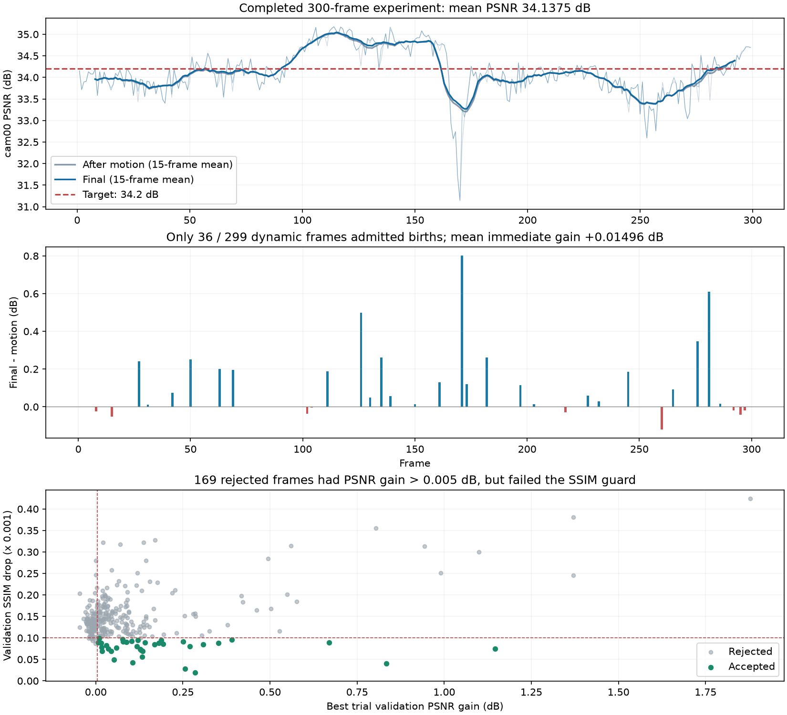

# Flame Steak：300帧结果与新增GS子集筛选

2026-10-24完成本轮分析和短验证。用户完整运行 `flame_steak_1024_multiview.yaml`，300帧平均PSNR为 **34.137506 dB**，距34.2 dB目标还差0.062494 dB。本文后的新版只做了固定运动输入和两帧连续验证，尚未运行新版完整300帧。

## 已完成的300帧结果

来源：`output/n3dv/flame_steak_1020/130k_multiview_mse_180_80_40/20261024T002601_88a2fc`。画质包含原生首帧，共300帧；动态增量、耗时和增删统计299个后续帧。KB=1000 bytes。

| 指标 | 结果 |
| --- | ---: |
| 平均PSNR | 34.137506 dB |
| 平均SSIM | 0.966777 |
| 平均LPIPS | 0.122869 |
| 平均动态负载＋索引，不含共享参考 | 33.508612 KB/帧 |
| 参考帧摊销后的总存储 | 70.333727 KB/帧 |
| GS初始→最终 | 128,963→127,999 |
| 累计新增/删除 | 35,095 / 36,059 |
| 平均模型训练时间 | 24.0225 s/后续帧 |
| 平均帧墙钟时间 | 28.0354 s/后续帧 |
| 纯渲染计时参考 | 313.27 FPS，FPS仅供参考 |

GS净减少964个，数量增长问题已受到控制。动态增量口径下仍有一定空间；包含共享参考摊销的70.33KB不能误写成33.51KB。FPS只覆盖验证时forward＋clamp，不包含解码、上传等，也未审核GPU独占状态。

### 新增阶段的主要瓶颈

直接对每帧保存的180/260/300步诊断及验收记录统计：

- 299帧只有 **36帧** 接受了新增，263帧撤回，提交率12.04%。
- 290,591个候选中，低alpha、屏幕尺寸、世界尺度剪枝累计均为0。本轮候选主要在最后验收时被整批撤回。
- 263个撤回帧中，**169帧已有验收PSNR增益超过0.005 dB，却未通过SSIM约束**。最佳试删方案SSIM下降的全序列中位数约0.000137，高于允许的0.0001。
- 接受的36帧中，26帧cam00改善、10帧cam00下降。验收视角改善并不保证测试视角改善。
- 299帧运动结束平均PSNR为34.125619，最终34.140582；新增及精修当帧平均只贡献 **+0.014963 dB**。最后40步平均贡献仅+0.000269 dB。

包含首帧后才是全序列34.137506。若各帧运动终态保持不变，要使整体达到34.2，后续帧最终平均需34.203285；出生阶段需平均约 **+0.077666 dB**。这只是固定运动输入下的目标差额，实际更换新生点会改变后续帧输入。

不能将169帧全当作“应该放行”：部分候选在另一些视角可能有害，已接受的10帧测试退化也说明了风险。已确认的瓶颈是整批准入率低；有用与无益候选混合、以及纯MSE拟合与SSIM验收不一致，是本次针对的原因。



原始汇总见 [baseline_run_summary.json](assets/flame_steak_birth_selection_20261024/baseline_run_summary.json)，逐帧分析见 [baseline_stage_analysis.json](assets/flame_steak_birth_selection_20261024/baseline_stage_analysis.json)。

## 本版idea与实际代码改动

核心是**让有用的新点单独留下**，并在拟合时同时关注结构质量。仍使用原13万GS首帧和180＋80＋40调度。

1. **出生损失改为MSE＋0.01×(1−SSIM)。** 在新点位置、颜色、尺度、透明度优化时加入结构项；运动阶段的原损失、storage loss 3e-5、旧点颜色和尺度固定策略保持原配置。
2. **增加基于图像收益的新点子集。** 第260步，在临时模型中将新点alpha设为其当前值的一半，用验收图像损失对每个新点的导数估计移除收益。实际训练的新点属性不因估计而修改。保留整批作为候选，同时尝试正收益新点的全部、前50%、前25%。它是局部近似，最终仍渲染真实属性的组合进行验收。
3. **子集与旧点删除一起验收。** 每个子集大小为K，对应试删 `ceil(0.9K)`、K、`floor(1.1K)` 个旧点。删除仍按当前及上一帧实际合成贡献排序，保护所选新点的编码来源和上一帧新生点。提交满足PSNR与SSIM条件的最佳方案，而不是让整批失败就失去所有有用新点。
4. **最后40步使用全部20台训练相机精修新点。** 第181–260步仍保留cam04/08/12/16作候选选择、验收，不用于新点位置/颜色等属性拟合；第261–300步点集固定，这4台相机也参与新点精修。此时它们不再是独立验证数据。cam00始终只测试，不参与排序、选择或优化。

SSIM准入容差仍为0.0001，PSNR最低增益仍为0.005 dB。新点旋转继承来源并固定；出生后旧点全部属性与运动幅值固定。共享颜色没有恢复，首帧没有重新训练。

主要实现见 [birth_selection.py](../../pipeline/model/birth_selection.py)、[module.py](../../pipeline/module.py) 和 [trainer.py](../../pipeline/trainer.py)。新参数默认关闭，旧配置和checkpoint按原策略恢复。新配置显式启用 `fit_loss: mse_ssim`、`fit_ssim_weight: 0.01`、`admission_useful_fractions: [1.0, 0.5, 0.25]`、`refit_all_training_views: true`。

## 固定运动终态的正式出生流程验证

直接加载这次完整实验保存的第001、009、029帧step180 checkpoint，保留旧点、初始新生候选、优化器及随机状态，在该边界显式切换新版出生配置；然后执行真实80步筛选、40步精修和码流编码。普通恢复没有放宽策略检查。三帧原流程均拒绝整批候选，原最终PSNR等于各自运动终态。

| 帧 | 同一运动终态/原最终PSNR | 新版260步 | 新版最终PSNR | 净收益/dB | 提交新增/删除 |
| --- | ---: | ---: | ---: | ---: | ---: |
| 001 | 34.151192 | 34.167633 | 34.168625 | +0.017433 | 299 / 270 |
| 009 | 33.580093 | 33.655289 | 33.664009 | +0.083916 | 120 / 108 |
| 029 | 33.935638 | 33.940365 | 33.940628 | +0.004990 | 271 / 298 |

第009帧从953个候选中估计出240个正收益新点，尝试953/240/120/60四种大小，最终提交120个。第001帧保留299/942个，第029帧保留271/943个。它们都是按图像收益选择，不是设置固定的新生数量上限。

| 帧 | 提交时内部验收PSNR增益 | 内部验收SSIM变化 |
| --- | ---: | ---: |
| 001 | +0.021386 dB | +0.00001596 |
| 009 | +0.058553 dB | +0.00001451 |
| 029 | +0.013098 dB | +0.00002858 |

三帧提交时SSIM均改善，支持“筛出部分候选能同时改善PSNR和SSIM”的判断。由于同时改变了损失、子集选择与精修视角，不能将增益单独归因于某一项。三帧由可用checkpoint决定，不能代表全部299个后续帧，也不能直接外推新版完整序列平均值。

## 连续性、恢复与实际存储

从新版frame029终态继续训练frame030、031，验证下一帧输入、上一帧新点保护及来源行编码：

| 帧 | 运动结束PSNR | 最终PSNR | 当帧净收益/dB | 新增/删除 |
| --- | ---: | ---: | ---: | ---: |
| 030 | 33.575653 | 33.583111 | +0.007458 | 232 / 209 |
| 031 | 33.905800 | 33.917046 | +0.011246 | 257 / 282 |

这两帧承接的是修改后的frame029，因此不能用它们与原完整序列同编号帧的绝对差值归因于出生阶段。表中收益使用各自同一次运行的运动终态。

| 帧 | 实际二进制负载/KB | 含JSON索引的动态增量/KB | 计时范围 |
| --- | ---: | ---: | --- |
| 001 | 97.644 | 98.216 | 复用运动，仅计出生/精修120步 |
| 009 | 31.409 | 31.981 | 同上 |
| 029 | 38.112 | 38.686 | 同上 |
| 030 | 37.770 | 38.344 | 完整300步 |
| 031 | 38.840 | 39.414 | 完整300步 |

第001帧仍有较高的首个动态帧运动/结构负载，新增后的97.64KB不是平均存储。第030、031帧完整训练分别28.82、27.59秒，帧墙钟32.80、31.50秒；第001/009/029复用了运动，不能将其15秒左右的训练时间写成完整每帧耗时。新版完整序列平均画质、存储和训练时间尚未测量。

可靠性检查：

- 上述5帧均经独立码流回放，位置、旋转、尺度、透明度、DC和高阶SH六组属性与各自最终checkpoint逐张量相同。
- 新版frame009从260步严格恢复，最终4份码流/索引与未中断执行逐字节一致；旧点六组属性在最后40步保持相同。
- frame030保护了上一帧271个新生点，frame031保护了上一帧232个新生点，两次均未删除这些宽限期内的点；实际新增/删除均满足10%差额约束。
- 127项相关测试通过，覆盖半alpha收益估计、原始行序子集、部分接纳与全部拒绝、来源映射、固定旧点、结构损失、精修相机切换及恢复、历史checkpoint兼容与码流回放。

附加数值、配置和脚本见 [附件目录](assets/flame_steak_birth_selection_20261024/)。模型位于 `/tmp/my4dgs_birth_selection_1024_v2/` 及 `/tmp/my4dgs_birth_selection_1024_verify/`；未复制大型数据或改写原完整实验。临时模型目录清理后，需要重新生成短验证，附件不包含checkpoint。

## 新配置和命令

原 `flame_steak_1024_multiview.yaml` 保留对应已完成实验。新版为 [flame_steak_1024_multiview_select.yaml](../../config/n3dv/flame_steak_1024_multiview_select.yaml)，规划300帧，从原生首帧启动。已完成以上短验证，尚未证明300帧平均超过34.2 dB。

```bash
conda activate ReConGS
cd /home/gamer-02/Documents/DeepLearning/my4dgs
OMP_NUM_THREADS=4 MKL_NUM_THREADS=4 OPENBLAS_NUM_THREADS=4 \
python main.py --config=config/n3dv/flame_steak_1024_multiview_select.yaml
```

输出位于 `output/n3dv/flame_steak_1020/130k_multiview_select_ssim_180_80_40/<时间戳>/`。新增保存59/119/179/239/299帧的阶段checkpoint，便于下一轮直接分析中后期。

复现固定运动短验证：

```bash
conda activate ReConGS
OMP_NUM_THREADS=4 MKL_NUM_THREADS=4 OPENBLAS_NUM_THREADS=4 \
python scripts/probe_birth_selection.py \
  --run-dir output/n3dv/flame_steak_1020/130k_multiview_mse_180_80_40/20261024T002601_88a2fc \
  --config config/n3dv/flame_steak_1024_multiview_select.yaml --frames 1 9 29
```
