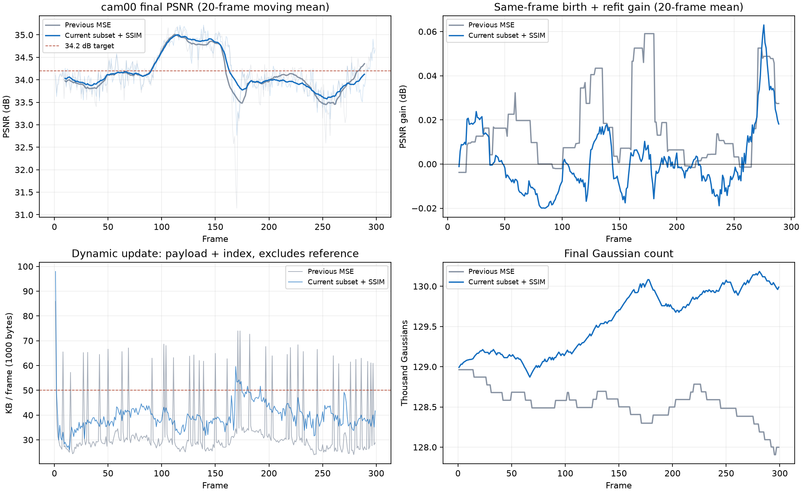

# Flame Steak：多视角新生GS子集筛选，完整300帧报告

2026-10-24。完整序列平均 **PSNR 34.160024 dB**，比上一版34.137506 dB提高 **0.022517 dB**，距34.2 dB目标仍差0.039976 dB。动态增量含索引、不含共享首帧，平均 **39.626836 KB/帧**；GS从128,963变为129,989。

这次解决了“候选整批被拒绝”的问题，但**新增阶段的当帧测试收益仍然很弱**：295帧提交增删，其中178帧的cam00 PSNR比各自运动结束时下降。不能把准入率提高直接当作新增方法已经有效。

## 实验来源与统计口径

- 本轮：`output/n3dv/flame_steak_1020/130k_multiview_select_ssim_180_80_40/20261024T095641_3b0b28`，对应 [flame_steak_1024_multiview_select.yaml](../../config/n3dv/flame_steak_1024_multiview_select.yaml)。
- 上轮：`output/n3dv/flame_steak_1020/130k_multiview_mse_180_80_40/20261024T002601_88a2fc`，对应 [上一轮分析](20261024_flame_steak_multiview_full300_and_selection.md)。
- 两轮均完整覆盖frame000–299；质量含原生首帧，共300帧；动态增量、增删和耗时统计299个后续帧。KB=1000 bytes，MB=1,000,000 bytes。
- 两轮参考状态SHA256相同，均使用132,586 GS原生首帧，并在载入时剪至128,963 GS。图像1345×1008，半分辨率去畸变数据；本轮未重新生成首帧或预处理原始数据。
- cam00始终只做测试、阶段诊断，不参与新点生成、子集排序、验收或梯度优化。第181–260步用cam04/08/12/16做内部选择，其余16台训练相机拟合新点；第261–300步点集固定，20台训练相机共同精修。此时那4台相机不再是独立验证集。

本报告从两轮 `run_summary.json`、参考评价、各299份逐帧汇总与实际码流文件重新计算。两轮300帧画质均值、动态字节数、逐帧点数恒等式、增删10%限制、上一帧新生点保护和260→300点数固定均核对通过。没有在本次报告工作中重新训练，也没有重新回放全部300帧码流。

上传前运行全仓库 `python -m unittest discover -s tests`，251项测试通过，涵盖训练调度、运动、增删、恢复、渲染与码流等；[完整测试日志](assets/flame_steak_multiview_select_full300_20261024/repository_tests.txt)随报告保存。

## Idea与实际改动

希望在有用与无益候选混合时，留下能改善图像的那部分新点，并缩小拟合目标与验收指标的差异。相比上一轮实际配置，方法变化只有以下三项，另增加了阶段checkpoint的保存帧：

1. 新生损失由MSE改为 **MSE＋0.01×(1−SSIM)**，同时优化新点的位置、颜色、尺度与透明度；新点旋转继承编码来源并固定。
2. 在260步尝试多个新点子集：整批候选，以及按半alpha图像导数估计出的正收益新点全集、前50%、前25%。每个大小K都配套试删约0.9K、K、1.1K个旧点，实际渲染各组合；内部平均PSNR至少提高0.005 dB、SSIM下降不超过0.0001才允许提交，再从通过方案中选PSNR最高者。
3. 最后40步保持点集固定，改用全部20台训练相机精修新点，补充此前只用于选择的4台相机。

仍使用180步运动＋80步新生拟合/筛选＋40步固定点集精修。旧点在运动结束后固定全部属性与运动幅值；共享颜色没有恢复。storage loss仍为3e-5。删除按当前与前一帧的实际合成贡献最大值排序，保护所选新点的编码来源及上一帧新生点，数量差仍为新增量的±10%。

主要实现见 [multiview_birth.py](../../pipeline/model/multiview_birth.py)、[birth_selection.py](../../pipeline/model/birth_selection.py)、[birth_retirement.py](../../pipeline/model/birth_retirement.py)、[module.py](../../pipeline/module.py) 和 [trainer.py](../../pipeline/trainer.py)。本报告只整理实验产物，没有新增训练代码修改。

## 全序列结果

| 指标 | 上轮MSE整批准入 | 本轮结构损失＋子集筛选 |
| --- | ---: | ---: |
| PSNR，300帧 | 34.137506 dB | **34.160024 dB** |
| SSIM | 0.966777 | **0.966913** |
| LPIPS | 0.122869 | **0.122665** |
| 动态二进制负载，不含索引/参考 | 32.948950 KB/帧 | 39.053468 KB/帧 |
| 动态负载＋索引，不含参考 | 33.508612 KB/帧 | **39.626836 KB/帧** |
| 参考摊销后的总存储，300帧 | 70.333727 KB/帧 | **76.431557 KB/帧** |
| GS初始→最终 | 128,963→127,999 | 128,963→129,989 |
| 累计新增/删除 | 35,095 / 36,059 | 67,948 / 66,922 |
| 模型训练均时，后续帧 | 24.0225 s | 27.7063 s |
| 帧墙钟均时，后续帧 | 28.0354 s | 31.7953 s |
| 纯渲染计时参考 | 313.27 FPS | 313.45 FPS |

FPS仅供参考：计时只包括验证时同步的forward＋clamp，排除解码、上传、加载、warmup和质量指标，且未审核GPU是否独占。

本轮共享参考为11.081043 MB，总存储22.929467 MB。动态增量的39.626836 KB以299个后续帧平均；76.431557 KB是“共享参考＋全部动态增量”除以300，口径不能混用。前者满足50 KB目标，包含参考后仍超目标。

动态字节增长6.118224 KB/帧，主要包括运动负载增加3.063732 KB、新生负载增加2.774967 KB、透明度负载增加0.265819 KB。候选提交更频繁也改变后续旧点状态，不能将全部存储增长归为当帧新点编码。只有9帧动态增量超过50 KB，上轮为37帧；本轮存储中位数38.670 KB、90分位46.1024 KB、最大97.947 KB，平均更高但尖峰更少。



图中质量与阶段收益曲线的粗线采用20帧移动平均，只用于观察趋势；表中均值均来自原始逐帧数值。

## 准入率提高，测试收益没有同步提高

| 指标，299个后续帧 | 上轮 | 本轮 |
| --- | ---: | ---: |
| 提交增删帧数 | 36（12.04%） | **295（98.66%）** |
| 撤回帧数 | 263 | 4 |
| 多视角候选总数 | 290,591 | 291,411 |
| 低alpha/屏幕尺寸/世界尺度剪枝 | 均为0 | 均为0 |
| 准入帧内部验收PSNR平均增益 | +0.198225 dB | +0.059231 dB |
| 准入帧内部验收SSIM平均变化 | −0.00007696 | +0.00000833 |
| 准入帧cam00改善/下降 | 26 / 10 | **117 / 178** |

本轮295个提交中，271帧选择“正收益新点全集”，18帧选择其中前50%，6帧选择前25%，没有帧选择原始整批。局部收益估计确实筛掉了大量不利于内部相机图像的候选，整批失败导致所有点撤回的现象大幅减少。

然而内部验收与测试结果脱节：295帧提交时内部PSNR、SSIM满足要求，最终只有117帧在cam00取得正收益。全299帧出生净收益中位数 **−0.006302 dB**，10/90分位为−0.042352/+0.056431 dB，最差−0.156494 dB、最好+0.237087 dB。

本轮仅frame004、012、028、167撤回。其余帧几乎都提交，并不说明对应新点具备跨视角收益。与上一轮相比，低透明度再次删除并非当前主要失败环节：两轮新点低alpha/尺寸剪枝均为0，主要变化发生在内部选择和最终测试效果之间。

## 180/260/300步收益

以下均使用各帧同一次执行的阶段图像，避免把不同运行的运动状态差当成出生收益。“出生净收益”包含新增、配套删除和最后精修，不能分解为单独新增的因果收益。

| 299个后续帧的平均值 | 上轮 | 本轮 |
| --- | ---: | ---: |
| 180步运动终态PSNR | 34.125619 | **34.162296** |
| 260步增删完成PSNR | 34.140313 | 34.162910 |
| 300步最终PSNR | 34.140582 | 34.163175 |
| 180→260增删净收益 | +0.014694 dB | **+0.000614 dB** |
| 260→300固定点集精修收益 | +0.000269 dB | **+0.000265 dB** |
| 180→300出生净收益 | +0.014963 dB | **+0.000879 dB** |

本轮准入帧184帧在260步时cam00已经下降，178帧在300步时仍下降，退化大多在增删边界前后已出现。最后40步平均有微小正收益，但不足以修复这个问题；不能只靠增加精修步数来解释或解决。

跨运行的最终提升可作一个数值分解：后续帧运动终态提高0.036677 dB，而出生净收益降低0.014085 dB，后续帧最终均值净提高0.022593 dB；计入相同首帧后，全序列提高0.022517 dB。**这只是观测分解，不代表本轮修改了运动算法。** 两轮运动配置相同，新点与删除会改变以后各帧的输入状态，CUDA训练也未证明完全确定，因而不能把这0.036677 dB当作某个模块的独立因果贡献。

如果暂时固定本轮各帧运动终态不变，达到全300帧34.2 dB需要出生净收益平均约 **+0.040989 dB**，当前只有+0.000879 dB。这个差额用于说明改进幅度，不是对更换方法后的序列结果预测。

### 时间区间中的差异

| 帧范围 | 上轮最终PSNR | 本轮最终PSNR | 本轮出生净收益 | 本轮准入/后续帧 |
| --- | ---: | ---: | ---: | ---: |
| 000–049 | 33.882352 | 33.945107 | +0.007659 dB | 46 / 49 |
| 050–099 | 34.179974 | 34.178544 | **−0.012005 dB** | 50 / 50 |
| 100–149 | 34.855504 | 34.893867 | +0.002256 dB | 50 / 50 |
| 150–199 | 34.008174 | 34.144067 | −0.001142 dB | 49 / 50 |
| 200–249 | 33.994566 | 33.906528 | **−0.007171 dB** | 50 / 50 |
| 250–299 | 33.904468 | 33.892030 | +0.015812 dB | 50 / 50 |

本轮第050–099、200–249段几乎每帧准入，却平均降低当帧测试PSNR。低收益不是只有最初几帧适应不足，也不只是最后40步造成的。

## GS与时间开销

本轮GS范围128,871–130,184，最终净增1,026个（约0.80%）。准入的295帧中，147帧删除少于新增、58帧相等、90帧删除多于新增，均在10%容差内；上一帧新生点被删除数为0。因此当前问题不是GS总量失控，也没有强制每次新增/删除完全相等。

训练均时中的运动约13.7315 s、出生约9.8851 s、精修约4.0897 s；上一轮分别13.5904/7.5537/2.8784 s。新增候选数相近，提交和试选子集更多，合成模型与精修工作增加；但这里没有隔离每个改动的独立耗时，不能将全部时间增长单独归因于收益排序。

## 固定属性补充诊断：更偏向新点本身

对已保存180/300步checkpoint的frame001、009、029、059、119、179、239、299做只读渲染，不再优化或选择参数。每帧分别渲染完整旧点、仅保留最终幸存旧点、完整旧点＋最终新点、最终幸存旧点＋最终新点四种布局。完整旧点与最终布局均复现原180/300步PSNR，误差小于0.0001 dB。

| 帧 | 完整旧点加入最终新点的PSNR变化 | 新点存在时再删除旧点的PSNR变化 |
| --- | ---: | ---: |
| 001 | +0.016037 dB | 0.000000 dB |
| 009 | +0.057560 dB | 0.000000 dB |
| 029 | +0.002495 dB | 0.000000 dB |
| 059 | −0.014717 dB | −0.000008 dB |
| 119 | −0.008301 dB | +0.000359 dB |
| 179 | −0.067184 dB | −0.000008 dB |
| 239 | −0.032883 dB | −0.000233 dB |
| 299 | −0.024212 dB | −0.000042 dB |
| 8帧平均 | **−0.008901 dB** | **+0.000009 dB** |

这些帧中，即使把被删旧点全部放回，5帧仍因加入最终新点而下降；删除的固定属性直接影响最大绝对值仅0.000359 dB。因此，这个样本更支持优先检查新点在测试视角中的位置、颜色、尺度、透明度及遮挡作用，删除本身不是这些帧退化的主要直接渲染来源。

限制必须保留：这里加入的是**已在删除方案下训练完成的最终新点**，不是重新执行“始终不删除”的训练，也不是260步之前实际出现过的独立新增状态；只有8帧可用checkpoint，不能代表全部299帧，更不能排除删旧对后续优化与后续帧输入的间接影响。上述结论是固定属性诊断，不是全序列因果分解。原始数值见 [fixed_attribute_diagnosis.json](assets/flame_steak_multiview_select_full300_20261024/fixed_attribute_diagnosis.json)，渲染脚本见 [render_fixed_attribute_diagnosis.py](assets/flame_steak_multiview_select_full300_20261024/render_fixed_attribute_diagnosis.py)。

## 解释与下一步方向

已确认的是：子集筛选能通过内部图像验收，但对cam00的当帧净收益不可靠。固定4台内部相机同时用于收益排序与方案选择，平均分数会掩盖视角间冲突；三维深度、SH颜色和遮挡可能对这些相机成立，却不利于测试视角。这些是与结果一致的解释，尚未由单独实验验证。

删除同时发生，旧点的合成权重低也不等于删掉后所有视角都没有图像损失。不过，上述8帧固定属性诊断中，删除直接影响很小，测试退化主要已出现在加入最终新点后。后续仍需在训练的增删边界记录独立状态，区分新点本身、优化交互与长期继承状态，避免将样本结论直接外推整条序列。

下一轮最有价值的诊断是明确区分旧点运动终态、仅加入新点、配套删除后、固定点集精修后这四个状态；cam00继续只用于事后分析。方法改进应提高新点的跨视角几何/图像一致性，检查增删组合对不同训练相机的影响，优先解决“内部增益、外部退化”。进一步放宽准入门槛或单纯追求更多新点，现有数据没有提供支持。

完整数值及可复现统计脚本见 [comparison.json](assets/flame_steak_multiview_select_full300_20261024/comparison.json) 与 [analyze.py](assets/flame_steak_multiview_select_full300_20261024/analyze.py)。脚本只读取已有产物、核对文件大小并生成本报告图表，不加载训练器或修改模型。

```bash
conda activate ReConGS
python docs/experiment/assets/flame_steak_multiview_select_full300_20261024/analyze.py
```
