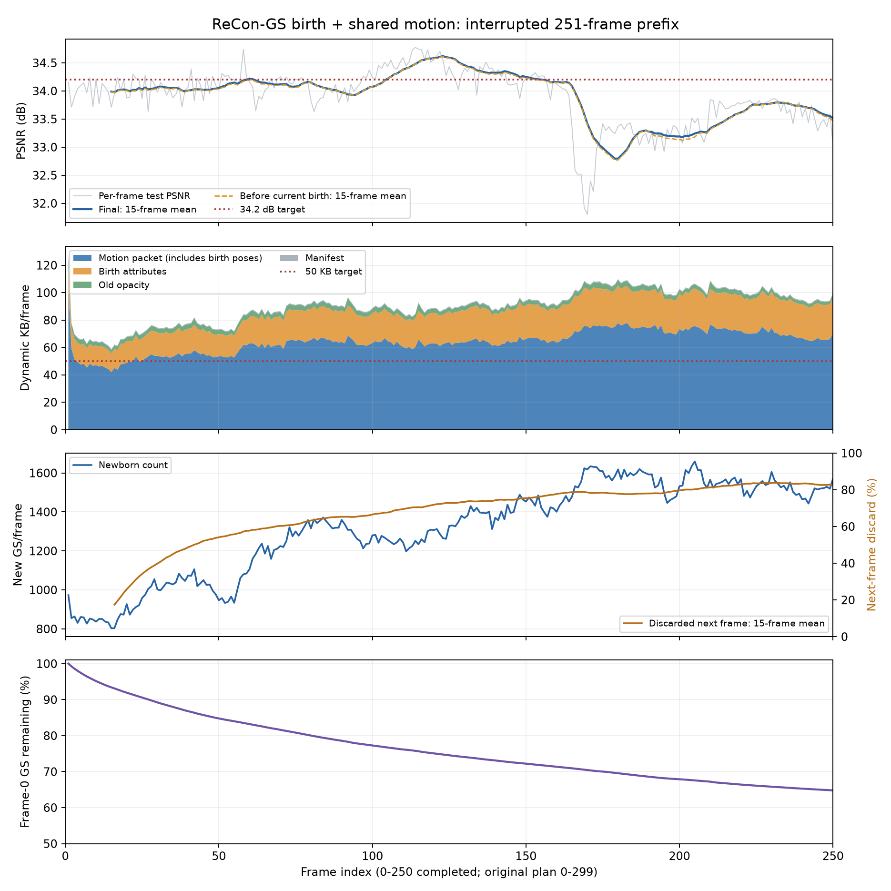

# 共享运动＋官方ReCon-GS出生：第0–250帧分析

## 范围与结论

运行：`output/n3dv/flame_steak_1025/recongs_birth/20261025T180552_c105b3`。

原计划300帧，实际中断在frame250。画质覆盖frame0–250共251帧，动态更新和训练时间覆盖frame1–250共250帧，**不是完整300帧结果**。未把恢复运行或其他实验的帧混入本次统计。

当前PSNR **33.894338 dB**，动态完整更新 **90.039584 KB/帧**，纯渲染 **381.98 FPS**。速度达标，画质和存储均未达到34.2 dB、约50 KB/帧的目标。新增每帧平均1314点，阶段平均净增益只有0.01560 dB；约70.2%的新点在下一帧就被删除，说明需要检查新增点的生命周期与传输收益。

## 核心想法与实现

保留已有空间层级共享运动及旧alpha量化更新，新增阶段采用官方ReCon-GS流程。`pipeline/model/recongs_birth.py`负责按高梯度小GS在世界坐标中采样、继承SH和尺度、单位四元数初始化、opacity logit=0.1，以及新点split。`pipeline/module.py`负责独立新点拟合、下一帧全局最低alpha淘汰和码流对接。

每动态帧180步运动＋100步出生，每步分别2/1个训练视角；出生采用连续参数拟合，最终输出量化码流。下一帧合并上一帧新增K点后，删除合并集合中K个最低alpha点，基础容量维持128963。没有使用旧实验的候选池硬上限、位置步长约束或末端硬数量筛选。

实际第29帧step220 checkpoint的新点优化器为：SH DC学习率0.0025，SH其余系数0.000125，opacity 0.05，scale 0.005，rotation 0.001；xyz学习率由stage2日程和场景尺度决定，当时为0.0153945。这反映官方restore路径继承基础优化器组设置，不能仅凭YAML的stage2非xyz学习率解释训练行为。

## 总体指标

| 指标 | 已完成部分 |
| --- | ---: |
| 测试PSNR，251帧 | 33.894338 dB |
| SSIM | 0.965803 |
| LPIPS，VGG | 0.123908 |
| 动态完整更新，含manifest | 90.039584 KB/帧 |
| 动态更新中位数 / P95 | 91.477 / 106.719 KB |
| 不超过50 KB的动态帧 | 0 / 250 |
| 纯渲染FPS | 381.98 |
| 模型训练时间 | 15.18 秒/动态帧 |
| 完整帧墙钟均值 / 中位数 | 27.76 / 19.20 秒 |
| 首帧参考点数 → frame250总点数 | 128963 → 130534 |
| 平均新增 / 删除 | 1314.18 / 1307.90 |
| 首帧共享参考 | 11.081043 MB |

KB=1000字节。动态存储不含首帧参考、checkpoint及图片；若把首帧参考摊到这251帧，实际前缀为133.828 KB/帧。纯渲染是验证阶段forward+clamp计时，排除解码、上传与加载，训练期间GPU独占未审计。

墙钟长尾主要记录在`diagnostics`阶段：frame96/132/156/187/220分别约384/503/481/333/427秒。该阶段包含指标同步和进度输出；日志不能确认具体外部原因，不能把这些暂停全部算作模型优化计算变慢。模型训练时间在这些帧仍约15秒。

## 分段表现

| 帧范围 | PSNR/dB | 动态完整KB | 平均新增点 | 当帧出生净增益/dB |
| --- | ---: | ---: | ---: | ---: |
| 0–29 | 34.0006 | 69.53 | 887 | +0.01048 |
| 30–59 | 34.1121 | 76.05 | 1021 | +0.01185 |
| 60–89 | 34.0336 | 89.49 | 1271 | +0.01045 |
| 90–119 | 34.3797 | 88.29 | 1262 | +0.00284 |
| 120–149 | 34.3135 | 90.39 | 1373 | +0.01725 |
| 150–179 | 33.4691 | 99.36 | 1510 | +0.01894 |
| 180–209 | 33.2547 | 104.00 | 1568 | +0.03329 |
| 210–239 | 33.7487 | 100.92 | 1537 | +0.00567 |
| 240–250 | 33.4652 | 94.41 | 1505 | +0.05330 |

第一段质量含首帧，动态存储与出生统计不含首帧。frame0–149平均34.1679 dB，frame150–250平均33.4881 dB。后半段包含更困难的火焰等变化，不能把分段下降单独归因于时间累积或基础点淘汰。

最低frame170为31.8038 dB，随后frame169/172分别31.9184/32.2050 dB。若假设当前251帧完全不变，要使300帧均值达到34.2，余下49帧需平均35.7657 dB；这只是算术条件，不是后续质量预测。

## 存储花在哪里

| 包 | 实测平均KB/动态帧 |
| --- | ---: |
| motion，包含新点位置、四元数、预测行及删除映射 | 64.052784 |
| 新生GS其余属性 | 22.224684 |
| 旧GS alpha更新 | 3.186852 |
| manifest | 0.575264 |
| 合计 | 90.039584 |

不能把64.05 KB全部归因于共享运动：当前新点可优化朝向，每个新点在motion原始流中有3个位置float、4个四元数float及来源行。该出生段压缩前平均40.7165 KB，**它是motion包内部的原始字节，不能再与压缩包大小相加**。减少新点属性重复传输和周转，比只压缩旧alpha更值得优先研究。

当前出生优化主要最小化图像误差；现有运动存储loss不能直接替代对当前出生数量、属性传输及跨帧替换的预算决策。因此“运动有存储惩罚”并不保证整帧能落到50 KB。

## 新点贡献与生命周期

本节通过逐帧CPU解码跟踪点身份，所有250个动态包的布局摘要和全部原始属性摘要均与各自manifest一致；没有重新训练或修改码流。

- 动态帧出生前PSNR平均33.881449 dB，最终解码后33.897044 dB，平均净增益 **+0.015595 dB**，中位数 **+0.004255 dB**。
- 166/250帧增益超过0.001 dB，51/250帧退化超过0.001 dB。收益并非全部为零：frame191为+0.4746 dB，frame250为+0.1761 dB，frame21为+0.1557 dB。
- 平均初始候选1421.64点，最终1314.18点，平均剪枝111.66点（split同时改变数量，因此不能直接用两个均值之差代替剪枝数）。
- 累计新增328546点。已有下一帧可观察的326975个新点中，229403个在下一帧被删，淘汰率 **70.1592%**；只有29.8408%至少再活过一次帧边界。
- 原始128963点中，45415点被删除，占35.22%；frame250仍存83548个原始点，另有46986个后续生成的点。
- 所有删除点的平均alpha约0.0523，说明固定容量淘汰不只针对接近完全透明的点。但alpha和年龄都不等于真实贡献，**不能把原始点删除直接叫作误删，也不能把短命新点全当作无用点**：瞬时火焰本来就可能短命。

这里的“出生前”模型仍包含历史帧新增和淘汰的结果，不等于从首帧开始完全关闭出生的独立实验。

出生阶段180→220平均+0.00985 dB，220→260仅+0.00088 dB，260→最终解码+0.00486 dB。最后一段同时包含20步拟合和编码，没有独立的编码前终态评价，不能把这一差值单独解释为量化损失。

## 图像误差与解释边界

检查了保存的frame170渲染/真值：火焰形状与强度、肉表面和锅边反光存在明显差异，同时有较宽范围的细节模糊。仅查看这些图片不能区分缺失几何、错误遮挡与外观表达不足。

在保存的8位PNG上，用固定锅/火焰框`x=575..804,y=805..974`做只读误差诊断，该框占2.884%像素，在frame120/170/250分别贡献约7.93%/37.04%/22.48%的RGB平方误差。它只用于分析，不参与训练或选择；PNG误差与原始浮点PSNR口径不同。

## 下一步优先方向

1. **先重审新点的跨帧继承与基础点替换。** 当前“高梯度生成→当帧拟合→下一帧最低alpha淘汰”运行正常，但高周转、低平均收益说明需要区分短暂补充与长期表示。候选方向是基础层与补充池分工：仍有用的补充点复用，持续有效后再决定是否替换基础点，避免每帧在全局只靠alpha竞争。这是机制假设，尚未验证收益。
2. **让新增/接纳决策直接考虑误差收益与传输成本。** 先弄清哪些训练视角残差需要新几何，哪些主要是外观/遮挡问题，再决定在哪里补点和是否值得写码流。重点是有效点的产生与复用，不继续仅围绕alpha阈值、学习率或数量硬上限循环试探。
3. **先验证困难段。** 150帧以后是主要质量缺口，应检查基础模型在新点进入前的误差、补充点覆盖以及替换前后的训练视角边际贡献。正式改法仍先短帧，画质与字节收益明确后再决定长帧。所有判断使用训练视角，cam00继续仅评价。
4. 速度目前优先级较低。单独排查记录/终端长暂停即可，不应为了FPS改变运动机制；新增点的属性/姿态重复传输才是当前存储重点。

本次只做数据汇总、顺序解码和保存图片诊断，未修改训练参数或启动实验。中断前缀不能提供完整300帧结论。

## 可复核产物

- [逐帧指标与身份追踪CSV](assets/recongs_birth_250_20261025/per_frame.csv)
- [汇总JSON](assets/recongs_birth_250_20261025/analysis.json)
- [本轮实际保存配置](assets/recongs_birth_250_20261025/run_config.yaml)
- 分析脚本：`tmp/analyze_recongs_250.py`

