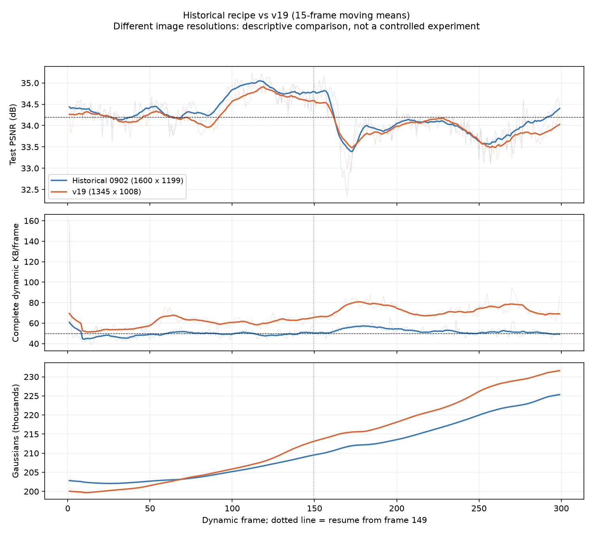

# v19 完整 300 帧：结果与“最重要版本”的差异（2026-10-27）

## 结论

本次已完成 frame 0–299。独立顺序解码、manifest 状态与原始属性哈希、留出 cam00 重渲染校验通过；299 个动态帧的重渲染 PSNR 与训练保存值最大差为 0。

全 300 帧 PSNR **34.133703 dB**；299 个动态帧完整更新 **66.658686 KB/帧**；已解码后的完整渲染 **261.024 FPS**。达到渲染速度要求，但未达到 34.2 dB 与约 50 KB 的质量/存储目标。KB=1000 字节。

当前版本与 `0902bc1`“最重要版本”的差异远不止共享颜色。共享运动核心及 gate 配方基本相同，但新增点的时机、选择、学习率、优化器、图像目标和旧点人口约束均有变化。当前第 71 步起切换整个图像目标到 RMSE，这会影响旧点运动；不能将全部差异当成“移除共享颜色”的效果。

## 本次产物与统计口径

完整运行：`output/flame_steak_1027/fs_v19_r150/20261027T155600_6d47b8`。

初始运行：`output/flame_steak_1027/fs_v19_300/20261027T134052_ab3faa`，第 184 帧完成，第 185 帧中途停止。续跑使用 frame149 step300 checkpoint，原样复制 0–149 的前缀，再训练 150–299。

前缀的 746 个文件逐项与原运行、provenance 中 SHA-256 一致，没有重新编码。原运行与续跑重叠的 frame150–184，续跑测试 PSNR 平均高 0.04048 dB，逐帧平均绝对差 0.11853 dB；训练存在数值/随机差异，续跑不能称为与未中断训练逐位一致。这一范围没有出现由恢复造成的平均质量下降。

| 指标 | 数值 |
|---|---:|
| 全 300 帧重渲染 PSNR | 34.133703 dB |
| 动态帧 1–299 测试 PSNR | 34.134309 dB |
| 动态 SSIM / LPIPS | 0.967553 / 0.118471 |
| 完整动态更新 | 66.658686 KB/帧 |
| 日志动态 payload（不含 manifest） | 65.652087 KB/帧 |
| 已解码后渲染 FPS | 261.024 |
| 完整读包、解码、更新和渲染的播放 FPS | 本次未测 |
| 训练与评估平均时间 | 30.18 秒/动态帧 |
| 首帧参考 | 17.720236 MB，单列 |
| 初始参考 / 末帧 GS | 206237 / 232033 |

299 个动态帧中，107 帧 PSNR 低于 34 dB，174 帧低于 34.2 dB；293 帧的完整更新大于 50 KB。最低为 frame172 的 32.88497 dB，最高为 frame122 的 35.04150 dB。

纯渲染使用 RTX3090Ti、1345×1008、每帧预热 10 次及计时 50 次，共 15000 次完整 `Module.forward(cam00)+clamp`，包含冻结属性缓存；解码与上传不计入该 FPS。缓存逐像素检查通过。不能用这个数替代完整播放速度。

## 存储和 GS 变化

| 文件成分 | KB/动态帧 |
|---|---:|
| 运动包 | 54.185064 |
| 新生属性 | 5.428789 |
| 旧点透明度 | 6.038234 |
| manifest | 1.006599 |
| 总计 | 66.658686 |

共享首帧加完整动态流共 37.651183 MB。完整更新比 50 KB 约高 33.3%，并非小幅超出。

每帧平均新增 298.01 个、删除 211.74 个，净增 86.27 个。全程共新增 89105、删除 63309，净增 25796 个，末帧 232033 GS。平均 17463 个旧点有逐点平移残差，平均约 254 个选中区域。后半段运动包和 GS 数量持续增长。

第 200 步旧点渲染到最终结果的 PSNR 平均变化为 +0.01226 dB，前 29 帧为 −0.0269 dB。因为新点从第 70 步就已参与训练，且之后旧点透明度仍变化，这不是独立的新点贡献测量，不能据此断言删掉新增阶段就会更好。

## 与 Git“最重要版本”的实际差异

定位到的提交为 `0902bc106107575cb3b0070f185f8a933ecdc733`。其提交说明使用了近似指标；随提交保存的已核验记录是 **34.244412 dB / 50.917187 KB / 226.931 FPS**，图像为 **1600×1199**。本次为 **1345×1008**，因此两者不是只改变一个因素的严格比较。

两版共享首帧 checkpoint 路径和 SHA-256 一致：`0715e9f0ce2eaea16633207fb9f1e87170162f9fb2974f8b9f1a20206da35c7d`；保留 206237 个点。后来另有 1345×1008 的最终 480W 实验，但它用了重新训练的 228432 点首帧和不同字节预算配方，不应与这里混用。

| 项目 | `0902bc1` 配方 | 本次 v19 |
|---|---|---|
| 共享运动 / gate | 先共享 70 步、冻结 gate、开放残差，父子相对运动 | 核心相同 |
| 旧点共享颜色 | 启用区域 DC，跟随 gate，量化步长 0.01 | 模块与训练路径已去掉，旧点 DC 跨帧固定 |
| 图像目标 | 全程 L1 + DSSIM | 1–70 步 L1；71–300 步 RMSE + DSSIM |
| 新点出生时机 | 第 200 步运动结束后 | 第 70 步 |
| 新生点依据 | 屏幕空间位置梯度克隆，后续增密 | RGB 高残差责任度，固定两个候选视角及空间预算 |
| 新生点参与 | 后 100 步单独训练，主要每步一个视角 | 71–300 步参与，和旧点/透明度共享优化轨迹，每步两个视角 |
| 新生点初始化 | 源协方差随机偏移 | 确定性局部偏移、缩小尺度、受限 alpha、残差颜色微调 |
| 新生点初始位置学习率 | 0.0024 × 场景尺度 | 0.00008 × 场景尺度 |
| 新生点 DC / alpha 学习率 | 0.075 / 0.75 | 0.01 / 0.03 |
| 新生旋转 | 关闭 | 开启；旧点旋转仍关闭 |
| 存储与退出 | 旧点 alpha 更新/阈值删除；普通新点清理 | 增加新点 storage loss、旧新点统一人口压力、末帧内 alpha 清理 |

`pipeline/module.py` 的图像损失覆盖逻辑是关键：顶层 `photometric_loss:l1` 并不意味着旧点一直使用 L1。一旦 `early_initialized`，`birth.photometric_loss:rmse` 就用于整个训练图像损失。

当前运动模型类相对旧版的主要代码增加是解码一致的旧点位姿和新生位置编码接口；不能因此推断整个运动训练过程只差颜色。外层图像目标、新点遮挡及旧点 alpha 的共同优化也会改变运动拟合。

旧版存档中，运动包 41.40655 KB、区域 DC 0.25927 KB。当前运动包多约 12.78 KB；新增属性多约 1.90 KB；透明度多约 0.97 KB。移除区域 DC 直接减少的存储很小，无法解释或解决总存储增长。运动包也包含新增位置、删除映射和区域信息，不应把其全部增量等同于旧点残差。

## 逐段表现

以下两个版本分辨率不同，仅用于描述变化位置，不作单项方法归因。

| 动态帧 | 旧存档 PSNR | v19 PSNR | 旧存档 KB | v19 KB |
|---|---:|---:|---:|---:|
| 1–29 | 34.3130 | 34.2540 | 50.30 | 57.10 |
| 30–59 | 34.3140 | 34.1958 | 47.39 | 56.98 |
| 60–89 | 34.2254 | 34.0873 | 50.80 | 64.40 |
| 90–119 | 34.8524 | 34.6014 | 49.59 | 59.74 |
| 120–149 | 34.7764 | 34.6785 | 49.46 | 63.16 |
| 150–179 | 34.1007 | 34.0162 | 53.05 | 72.75 |
| 180–209 | 34.0029 | 33.9212 | 55.20 | 76.24 |
| 210–239 | 34.0588 | 34.1077 | 52.00 | 69.17 |
| 240–269 | 33.7107 | 33.6419 | 50.44 | 73.53 |
| 270–299 | 34.0998 | 33.8430 | 50.91 | 73.19 |

## 下一步依据

共享颜色、优化目标和出生/退出机制一起变化，当前结果不能单独证明哪一项导致回退。缺少旧点颜色自由度，可能使运动和新点承担本该由外观解释的误差；第 71 步全图 RMSE 覆盖、较小的新点学习率和早期新点遮挡也可能影响拟合。这些是需要验证的解释，不是已确认因果。

后续应先明确要保留的旧版配方，并处理旧点图像目标被新点选项覆盖这一耦合，再讨论共享颜色及新增机制的改进。恢复共享颜色需要恢复训练模块及对应码流，不能只加一个 YAML 开关；当前 GPU 增量播放器也需要相应颜色包支持。

本次只读取历史结果、独立回放及评估，没有启动新的训练。完整逐帧数据、旧版归档副本、前缀与重叠检查及全序列渲染证据在 `tmp/v19_full300_analysis/`。旧版证据来自 `git show 0902bc1:docs/experiment/evidence/shared_discovery_full300_20261018/`，原训练产物未修改。
