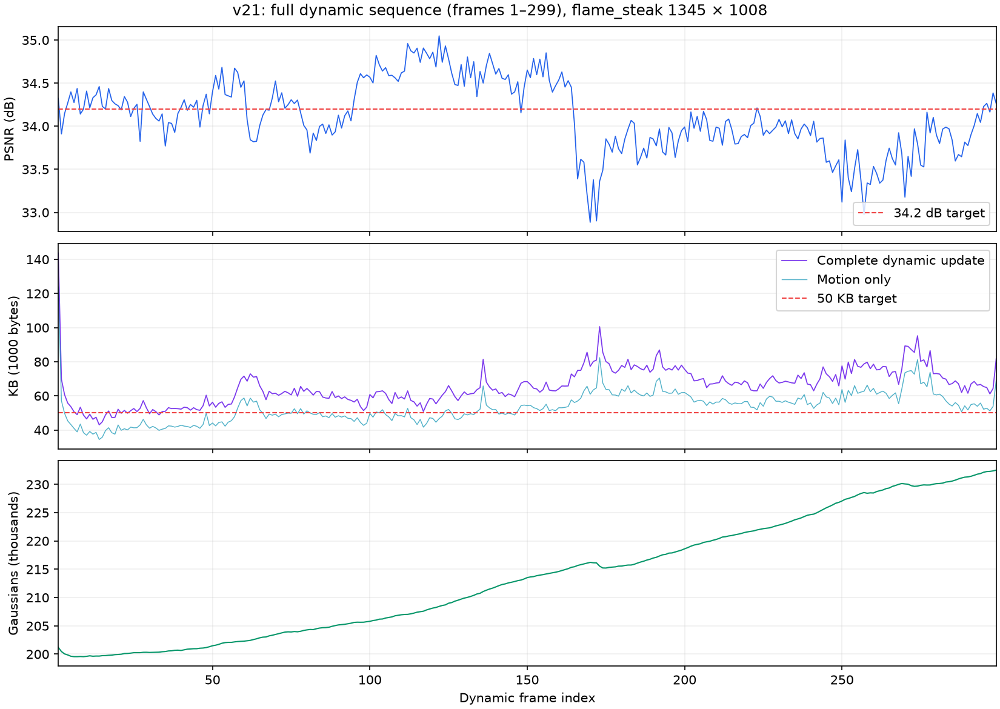

# v21 全 300 帧：延后固定运动支持

## 想法与配置

v19 在第 100 步固定逐点运动支持，随后 100 步只拟合幅度；新点此时才共同拟合约 30 步。假设较早选择可能留下新表达拟合后已不划算的运动更新，本次仅把 `amplitude_refit_steps` 从 100 改为 20，使原有稀疏约束持续到第 180 步。

没有修改量化精度或其他机制。共享首帧、1345×1008 图片、cam01..20 训练、cam00 测试、每步两个训练视角、每帧 300 步，共 300 帧。恢复基线为 v19 提交 `895db0e`；运行期间源码哈希未改变。

## 完整结果

训练 frame1..299，并从共享 frame0 开始独立顺序解码全部动态码流，重新渲染和核对每帧测试结果。以下为真实文件字节，KB=1000B。

| 指标 | 结果 |
|---|---:|
| 全 300 帧平均 PSNR | 34.11464 dB |
| 299 个动态帧平均 PSNR | 34.11518 dB |
| 全 300 帧平均 SSIM | 0.967247 |
| 动态完整存储，含 manifest | 65.506 KB/帧 |
| 动态 payload，不含 manifest | 64.500 KB/帧 |
| 共享首帧参考包 | 17.720236 MB |
| 首帧与全部动态完整包总计 | 37.306597 MB |
| 上述总计摊到全 300 帧 | 124.355 KB/帧 |
| 全序列材质化渲染速度 | 262.15 FPS |
| 最慢帧的材质化渲染速度 | 233.61 FPS |
| 动态帧平均 elapsed 时间 | 31.49 秒 |
| 最后 GS 数量 | 232517 |

**没有达到 34.2 dB / 动态完整存储约 50 KB 的目标。** FPS 是独立 GPU 上的完整 `Module.forward + clamp` 渲染，每帧 10 次预热、50 次计时，涵盖全部 300 帧；不包含读包、解码、哈希核验和上传。CPU 读取/解码/哈希核验累计 146.24 秒，上传累计 0.762 秒，因此不能声称含解码的播放达到 200 FPS。

初始帧已经存在，本次没有重新训练。部分时段有隔离实现的短检查共享 GPU，训练 elapsed 只记录实际用时，不作为公平的加速对比。

动态平均字节构成为 motion 53.308 KB、birth 5.395 KB、opacity 5.797 KB、manifest 1.007 KB。motion 仍是主要成本；单纯降低新点数量不足以解决当前存储问题。

## 后半段的退化

| 动态帧区间 | 平均 PSNR | 完整 KB/帧 | 区间末 GS |
|---|---:|---:|---:|
| 1–50 | 34.214 | 53.676 | 201482 |
| 51–100 | 34.219 | 60.936 | 205799 |
| 101–150 | 34.659 | 61.175 | 213530 |
| 151–200 | 33.946 | 74.614 | 218614 |
| 201–250 | 33.907 | 68.649 | 227067 |
| 251–299 | 33.739 | 74.161 | 232517 |

最低质量为 frame170 的 32.8846 dB；后半段 GS 与 motion 字节持续增加，质量同时降低。这只能说明当前表达和优化未能持续维持画质，不能单凭时间相关性判定是点数、火焰或某一机制导致。必须检查跨帧更新是否有效，而不能将前 30 帧结果外推到全序列。

与已完成 v19 相同的前 29 个动态帧相比，v21 PSNR 从 34.32048 降至 34.25750，完整存储从 57.561 降至 54.425 KB。该局部结果是画质与存储交换，没有显示同等画质下的稳定收益。没有同条件 v19 完整 300 帧结果，所以不声称 v21 的完整序列一定比 v19 更差。

## 验证、指标与下一步

全部 299 个动态帧通过 decoder 状态和六类 raw 属性的 manifest 哈希；重新渲染的 PSNR/SSIM/L1 与训练保存值一致，缓存与非缓存渲染像素完全相同。GPU 独占检查贯穿测量。没有使用测试视角优化参数。

50 KB 可以作为动态增量目标，但需要与“包含首帧”分开：当前参考包单独摊到 300 帧就约 59.07 KB/帧。若目标是包含首帧的总平均 50 KB，还必须压缩首帧，不能只改变动态更新。[ReCon-GS 表 1](https://arxiv.org/html/2509.24325v1#S5.T1)也区分含/不含初始帧的存储。单场景达到阈值仍不等于多场景 SOTA。

本次不继续靠延长稀疏惩罚阶段推进。下一版 [v24](20261027_v24_conditional_support.md) 回到 v19 的 100 步幅度拟合，并利用新旧表示组合后的图像收益选择旧残差，随后检查完整序列。其两帧集成检查只是允许进入完整实验的依据。

配置：`config/fs_v21_300.yaml`。运行：`output/flame_steak_1026/fs_v21_300/20261027T000914_01cb60`。

复现产物在 `tmp/research_motion_20261027/`：`v21_source/source_manifest.json`、`v21_run.json`、`v21_train.log`、`v21_full300_verified.json`、`v21_summary.json`、`v21_per_frame.csv`、`v21_breakdown.json`、`v21_verify.log`。训练原始产物不进入 Git。
