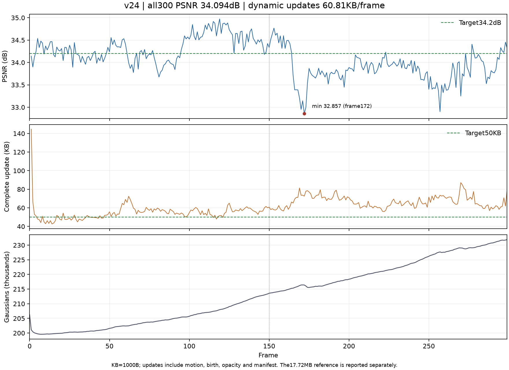

# v24 按组合图像收益选择旧点残差

## 想法与改动

[冻结结果的归因检查](20261027_v19_residual_attribution.md)显示，部分逐点运动在新表达存在时收益很小，而已有近端操作主要依据参数幅度和 Adam 二阶量估计删除代价。因此本次保留 v19 的共享运动、新增点、统一透明度退出、量化精度和 100 步幅度拟合，只增加后期的图像证据：

1. 第 160..179 步复用当前每步的两个训练视角，把旧点残差临时缩放到 0.25、0.75，计算组合图像损失对残差的梯度，近似分配从零到完整残差的收益。新点遵循原有来源坐标；探测后立即恢复正常位置。
2. 第 180 步用生产编码器测量逐点残差的总字节贡献，再以字节上下文模型分配每行成本；沿用 v19 的字节价格，撤回收益不足以覆盖成本的残差。
3. 清除退出行的 Adam 状态及幅度拟合支持，继续最后 20 步运动拟合和原有新点阶段。退出的是当帧逐点运动更新，不是直接删除 GS；下一帧仍可重新学习。

新增 `motion_evidence.py` 保存训练证据；运动模块负责临时缩放、决策与恢复，`Module.training_step` 插入探测。配置通过 `counterfactual_residual_support` 开启，默认关闭，v19 行为保留。码流格式不变，不传输评分或 gate。

每步仍取两个相机，但第 160..179 步每步额外执行 4 次探测渲染和梯度，全帧增加 80 次渲染。这里有明确计算成本，不能称为免费选择，也没有新增每帧集中渲染 20 视角的筛选关卡。

## 已完成的集成检查

完成 frame0..2 的真实训练，包含两个动态帧。不是最终全 300 帧结果。

| 动态帧 | v19 PSNR | v24 PSNR | v19 完整 KB | v24 完整 KB |
|---|---:|---:|---:|---:|
| 1 | 34.15056 | 34.18414 | 159.902 | 145.161 |
| 2 | 34.05688 | 34.14850 | 68.048 | 65.269 |
| 均值 | 34.10372 | 34.16632 | 113.975 | 105.215 |

完整存储含 motion、birth、opacity、manifest，KB=1000B。短检查中 PSNR 增加 0.06260 dB，完整存储减少 7.69%；分别撤回 6541/49991、2999/19559 个候选残差行。终态 200389 GS。该检查只说明实现可运行且没有重复 v22/v23 的明显画质退化，不能据此推断全序列效果、达标或 SOTA。

本次与 v21 共享 GPU，首帧还包含扩展编译，因此不比较训练时间，未测 FPS。

## 验证

607 项全量检查通过。新增 6 项检查覆盖含来源新点的条件图像收益、两次路径采样的近似、探测不污染主优化梯度和全局 RNG、异常后恢复真实来源位置、关闭行不被 Adam 带回、生产码流姿态一致，以及 checkpoint 续训和删除行后的证据映射。之后仅调整配置校验顺序和尊重原有 rate ramp，定向 6 项再次通过；当前实验配置的 ramp 已为 1，两项不改变本次计算结果。

两帧实际码流独立顺序解码，通过 manifest 的状态与 raw 属性哈希检查。终态 decoder SHA256 为 `d16322de00957852548c35cba46231b15314eefe4fa519559a8e6743031cd93c`。

运行：`output/flame_steak_1026/fs_v24_smoke3/20261027T023557_b7a95a`。源码与日志：`tmp/research_motion_20261027/v24_source/`、`v24_full_tests.log`、`v24_unit_final.log`、`v24_smoke_train.log`、`v24_smoke_metrics.json`。基于 v19 提交 `895db0e`，完整实验前冻结源码哈希。

## 局限与下一步

有限路径采样、短时间窗口和渲染非线性都会引入收益估计误差；撤回多行后的真实变化也不等于独立收益之和。跨帧累计误差与后段的新增点数量仍需检查。该方法借用了已有归因与率失真思路，当前研究区别与通用性尚未建立。

下一步进行同一首帧和数据划分的完整 300 帧训练与独立解码，统一报告全序列画质、全部动态包和首帧摊销存储，以及定义清楚的渲染/播放速度。若完整结果不能保持画质并改善存储，不把两帧的正结果当作成功结论。

## v24 全 300 帧独立核验结果

在 v19 的100步幅度拟合中，以新旧组合图像的条件收益选择逐点运动残差；配置与实现见上文。

| 指标 | 结果 |
|---|---:|
| 全300帧平均 PSNR | 34.094340 dB |
| 全299动态帧完整存储 | 60.808809 KB/帧 |
| 动态 payload | 59.802187 KB/帧 |
| 首帧参考包 | 17.720236 MB |
| 首帧与动态完整包摊到300帧 | 119.673567 KB/帧 |
| 全300帧材质化渲染速度 | 261.16 FPS |
| 全299动态帧CPU解码+上传+渲染 | 8.196 FPS |
| 全299动态帧增量GPU解码+渲染 | 82.470 FPS |
| 最后 GS 数量 | 231918 |

KB=1000B。完整动态存储包含所有动态包及必要 manifest，未排除首个动态帧。材质化渲染 FPS 仅计解码、上传后的完整渲染；读包、CPU 解码及逐帧哈希核验单列。

CPU解码路径完整播放另以三轮连续299次更新计时，使用等价加速解码源码 `b43b1762ae9ba3a8fc6b8222d64da62af255441b`；逐帧读包、内部完整性检查、解码、上传和一次完整渲染均在计时内。一次性参考包读取、相机/GT加载、额外manifest核验和质量指标不计入；文件经过预检，因此是本地温缓存I/O。结果：`/home/gamer-02/Documents/DeepLearning/my4dgs/tmp/research_motion_20261027/v24_playback_299_b43b176.json`。

增量GPU路径独立核验完整300帧的状态、raw属性、激活属性与实际像素相同后，计时三轮299次更新。源码 `e2dfa41c54e45c18d009bcdaf0d88e3db3515c5c`，结果 `/home/gamer-02/Documents/DeepLearning/my4dgs/tmp/research_motion_20261027/v24_gpu_playback_e2dfa41.json`。计时含两线程读包/解压/校验、属性预测、传输、GPU更新和一次Module.forward；最多预取两个未来稀疏包，没有缓存未来稠密帧。完整状态下载/SHA与相机/GT加载属于启动核验，不在播放计时内。

CPU读包/解码/哈希核验累计 124.674 秒，上传累计 0.763 秒。每帧重新渲染并校验保存指标、状态和 raw 属性哈希，缓存与非缓存图像一致。

预设目标对照：PSNR≥34.2 为 False，动态完整存储≤50KB 为 False。这不是多场景 SOTA 结论，详细归因需结合逐帧趋势继续检查。

运行：`/home/gamer-02/Documents/DeepLearning/my4dgs/output/flame_steak_1026/fs_v24_300/20261027T025304_49567c`。独立结果：`/home/gamer-02/Documents/DeepLearning/my4dgs/tmp/research_motion_20261027/v24_full300_verified.json`。

## 完整结果的分段分析与下一步依据

这轮未达到目标。PSNR比已完成v21低 0.02030dB，完整动态存储低 7.17%。两轮同时包含幅度拟合时序差异（v21为20步、v24回到100步再加条件收益选择），所以这不是隔离消融，不能把差值单独归因于条件收益。

| 动态帧段 | 平均PSNR(dB) | 完整KB/帧 |
|---|---:|---:|
| 1..50 | 34.20974 | 50.919 |
| 51..100 | 34.16590 | 57.194 |
| 101..150 | 34.61504 | 56.446 |
| 151..200 | 33.85644 | 68.893 |
| 201..250 | 33.90967 | 63.500 |
| 251..299 | 33.80634 | 68.046 |

后半段同时需要更多字节并且画质较差，不能用前30/150帧的结果替代全序列。最低为frame172的32.85725dB。最后231918个GS，比初始206237多25681；人口约束没有令整段点数固定。点数增长与存储上升相关，但本记录没有证明它们之间的单独因果关系。

含解码的速度没有达到200FPS。等价CPU解码路径为8.196FPS；经过全300帧状态/像素一致性核验的增量GPU路径为82.470FPS，约快10.06倍。GPU路径每帧host更新调用约7.4..7.9ms，读包等待约1.1..1.5ms，渲染调用约3.1ms；这些host阶段不是单个GPU kernel时间，仍需profile定位，不能从261FPS纯渲染推断完整播放已经达标。

已找到并单独验证的两项实现问题是数值病态协方差反传、以及新增点局部尺度偏移未旋转到世界坐标，分别见[数值检查](20261027_v25_gradient_checks.md)与[初始化检查](20261027_seed_axes.md)。v25以相同量化精度、候选数、字节价格和300步框架验证这两项修复组合；没有根据测试PSNR调整阈值，也没有额外启动训练消融。v25运行在隔离冻结源码中，完整结果出来后再判断两项修复是否改善实际画质/码率。

当前候选仍需要关注新点有效性、旧更新与新表达的条件收益、以及后段误差来源。已有反传和初始化诊断是具体实现证据，不足以把“新物体出现”或“累计漂移”认定为所有低PSNR帧的原因。
