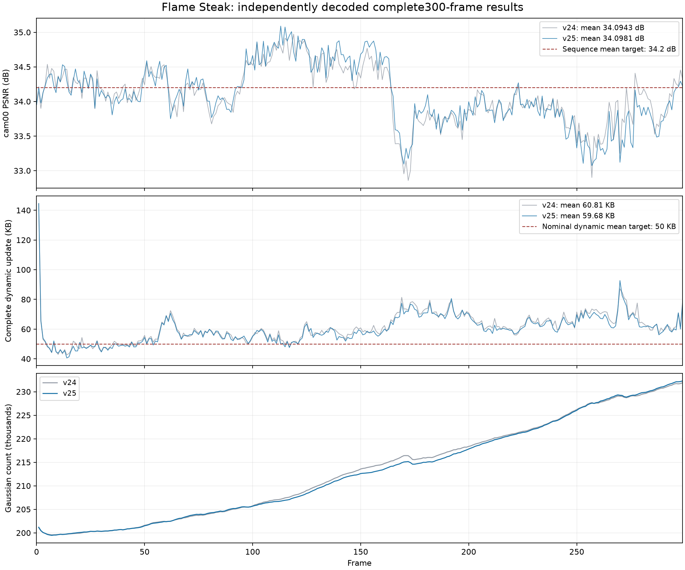

# v25 完整序列记录

完整结果为 **34.098095 dB、59.683759 KB/动态帧、238.753 FPS 实际增量播放**。画质和存储尚未达标，播放已超过200 FPS。播放使用后续逐位等价的优化实现；下文同时保留原播放器结果，便于区分版本。

## v25 全 300 帧独立核验结果

在 v24 上修正两项已验证的不一致：协方差反传的数值不稳定，以及 newborn 局部尺度偏移未旋转到世界坐标。前者保持目标数学导数一致，后者保持候选数、偏移幅度、量化和存储字段不变；相关诊断见20261027_v25_gradient_checks.md和20261027_seed_axes.md。本轮为修复组合后的完整实验，不独立归因各项的画质/存储收益。另合入状态等价的批量CPU解码和符号复用提速，见20261027_decode_fast.md与20261027_decode_direct.md，不能据此单独归因训练时间变化。

| 指标 | 结果 |
|---|---:|
| 全300帧平均 PSNR | 34.098095 dB |
| 全299动态帧完整存储 | 59.683759 KB/帧 |
| 动态 payload | 58.677171 KB/帧 |
| 首帧参考包 | 17.720236 MB |
| 首帧与动态完整包摊到300帧 | 118.552267 KB/帧 |
| 全300帧材质化渲染速度 | 261.08 FPS |
| 全299动态帧CPU解码+上传+渲染 | 8.233 FPS |
| 全299动态帧增量GPU解码+渲染（原实现 e2dfa41） | 85.396 FPS |
| 全299动态帧增量GPU解码+渲染（优化实现 5e41e4d） | 238.753 FPS |
| 最后 GS 数量 | 232296 |

KB=1000B。完整动态存储包含所有动态包及必要 manifest，未排除首个动态帧。材质化渲染 FPS 仅计解码、上传后的完整渲染；读包、CPU 解码及逐帧哈希核验单列。

CPU解码路径完整播放另以三轮连续299次更新计时，使用等价加速解码源码 `b43b1762ae9ba3a8fc6b8222d64da62af255441b`；逐帧读包、内部完整性检查、解码、上传和一次完整渲染均在计时内。一次性参考包读取、相机/GT加载、额外manifest核验和质量指标不计入；文件经过预检，因此是本地温缓存I/O。结果：`/home/gamer-02/Documents/DeepLearning/my4dgs/tmp/research_motion_20261027/v25_playback_299_b43b176.json`。

增量GPU路径独立核验完整300帧的状态、raw属性、激活属性与实际像素相同后，计时三轮299次更新。源码 `e2dfa41c54e45c18d009bcdaf0d88e3db3515c5c`，结果 `/home/gamer-02/Documents/DeepLearning/my4dgs/tmp/research_motion_20261027/v25_gpu_playback_e2dfa41.json`。计时含两线程读包/解压/校验、属性预测、传输、GPU更新和一次Module.forward；最多预取两个未来稀疏包，没有缓存未来稠密帧。完整状态下载/SHA与相机/GT加载属于启动核验，不在播放计时内。

CPU读包/解码/哈希核验累计 43.760 秒，上传累计 0.775 秒。每帧重新渲染并校验保存指标、状态和 raw 属性哈希，缓存与非缓存图像一致。

预设目标对照：PSNR≥34.2 为 False，动态完整存储≤50KB 为 False。这不是多场景 SOTA 结论，详细归因需结合逐帧趋势继续检查。

运行：`/home/gamer-02/Documents/DeepLearning/my4dgs/output/flame_steak_1026/fs_v25_300/20261027T054839_bedd4e`。独立结果：`/home/gamer-02/Documents/DeepLearning/my4dgs/tmp/research_motion_20261027/v25_full300_verified.json`。

## 完整对照与优化播放器的补充分析

两版从相同首帧raw属性开始，原始参考哈希和全序列cam00相机签名均已核对。下表仅比较完整300帧，分段存储均含必要manifest。

| 指标 | v24 | v25 |
|---|---:|---:|
| 全300帧PSNR | 34.094340 | 34.098095 |
| 完整动态KB/帧 | 60.808809 | 59.683759 |
| 优化GPU播放器，连续299次更新 | 225.720 FPS | 238.753 FPS |
| 最后GS数量 | 231918 | 232296 |

本轮整体PSNR变化+0.003755dB，完整动态存储变化-1.125050KB/帧。数值反传与seed坐标修复共同构成本轮，不能把整体差值单独归因于其中一项。修复有独立正确性证据，但不等同于已经证明大幅提高重建质量。

| 动态帧范围 | v24 PSNR | v25 PSNR | v24完整KB | v25完整KB |
|---|---:|---:|---:|---:|
| 1..50 | 34.20974 | 34.18261 | 50.91924 | 50.23040 |
| 51..100 | 34.16590 | 34.20520 | 57.19350 | 56.70294 |
| 101..150 | 34.61504 | 34.69819 | 56.44568 | 55.30656 |
| 151..200 | 33.85644 | 33.97606 | 68.89288 | 67.43190 |
| 201..250 | 33.90967 | 33.87701 | 63.50000 | 62.18794 |
| 251..299 | 33.80634 | 33.64332 | 68.04631 | 66.37667 |

优化播放器版本`5e41e4d4e4471327c582980c3203c4d2209f16fb`；各自完成全300帧CPU/GPU状态、raw、激活属性、实际像素和保存指标核对后独占计时。它仅改变解码调度与空间路由并行，不改变训练结果或文件字节。对应旧版播放器结果仍保留在上文，不能混为同一版本。

v25目标检查：PSNR≥34.2为False，完整动态≤50KB为False，实际播放>200FPS为True。单场景结果不能直接称为多场景SOTA。

存储/人口/残差阶段/旧外观的额外冻结检查见`20261027_storage_motion_audit.md`；未采用缺乏收益的编码和外观原型。下一轮v26以已验证的新点初始化为候选，仍需完整序列验证。

证据：`/home/gamer-02/Documents/DeepLearning/my4dgs/tmp/research_motion_20261027/v25_per_frame.csv`、`/home/gamer-02/Documents/DeepLearning/my4dgs/tmp/research_motion_20261027/gpu_fast_v25_verified.json`、`/home/gamer-02/Documents/DeepLearning/my4dgs/tmp/research_motion_20261027/gpu_fast_v25_playback.json`。
