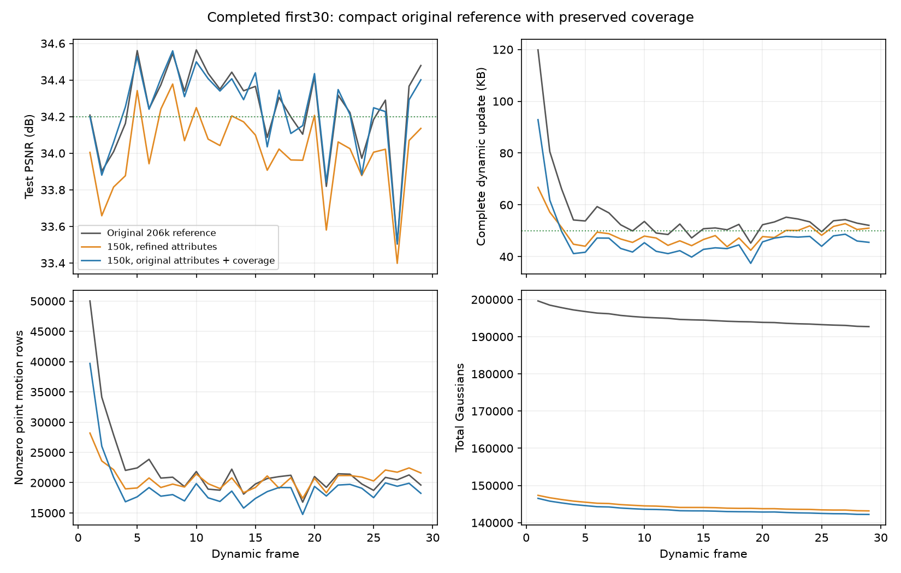
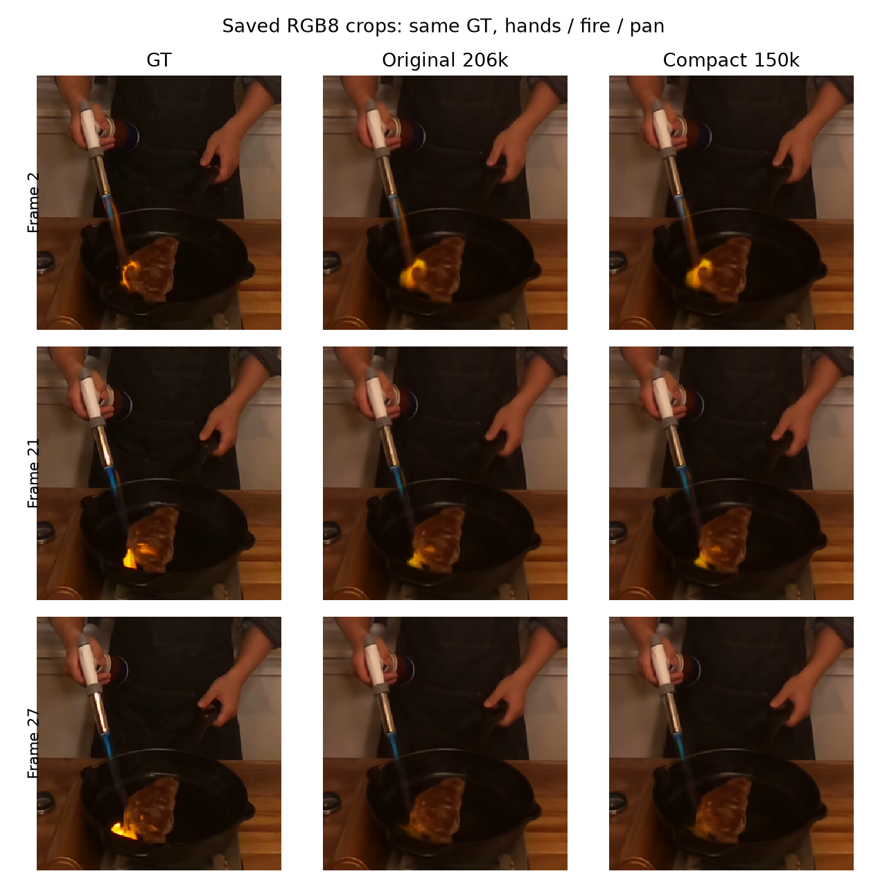

# 保留原属性与区域覆盖的15万点首帧：完整前30帧

本轮完成frame0–29，共30帧：平均PSNR **34.227168 dB**，完整动态更新 **46.775172 KB/帧**。原首帧同units流程为34.235354 dB / 56.044345 KB。画质相近，动态存储减少 **16.539%**；共享首帧从17.720236 MB降到 **13.118597 MB**。本轮通过短资格检查，已按相同方法从首帧重新启动300帧，尚无本候选的完整300帧或FPS结论。

30帧运行：`output/flame_steak_1028/fs_cov150_30/20261028T130843_517401`。配置：[fs_cov150_30.yaml](../../config/fs_cov150_30.yaml)，启动提交`4ff9095`；首帧覆盖裁点实现`c9137ac`。动态沿用units的4视角、L1+DSSIM、300步训练、量化、共享运动/gate/残差阶段与新增/退出机制，共享颜色关闭。

## 想法与首帧处理

此前全部属性续训得到静态34.186138 dB的15万点首帧，但动态30帧只有34.019742 dB，恢复原候选划分也没有恢复画质。另尝试固定几何与透明度、只续训SH2500步，冻结属性哈希核验通过，首帧PSNR反而从33.952248降到33.872604 dB，因此没有扩展该颜色校准候选。

本轮完整保留“重要版”首帧中被选中GS的位置、旋转、尺度、透明度和SH，只裁点，不续训这些属性：

- 原214996点按相同初始opacity≥0.0075加载后为206237点。
- 用20个训练相机的原生透明度gate图像Jacobian能量估计单点图像影响，cam00不参与逐点评分。这个统计仅在首帧离线进行，不增加逐动态帧的20视角筛选。
- 全局保留最高分150000点会清空39个原有最细候选区域。改为每个原有非空最细区域优先保留至多两个最高分点，再按全局分数填满余量；仅替换119个保留名额，即保留全部4050个原有非空最细区域。
- 复用原首帧候选划分平面和离群点路由，区域运动与gate仍重新学习；新码流参考包含完整划分数据。模板只含原frame0数据，没有使用后续动态运动选择点。

覆盖约束只作用于首帧选择，后续不保护这些GS，新旧点仍按解码透明度低于0.01退出。原始、全局裁点和覆盖裁点的可细分节点均为583个，不能声称覆盖约束恢复了更多可用gate。它只保证有限的初始空间覆盖，不保证动态最优。

裁点后静态PSNR为33.958199 dB，SSIM为0.968939。保留属性与原保存点对应行逐位一致，SHA为`7fa53b8471437c40624a50eebc1df30749918784b6aa219d8c73c64878f34730`；保存、重新加载及Adam行状态检查通过。初始共享参考13,118,597字节。

图像影响分数是近似代理，不是精确联合删除代价。本次三个原生alpha有限扰动投影检查最大相对偏差约30%，不宣称其Jacobian估计精确；最终判断使用实际裁点渲染及动态结果。cam00参与开发时整体模型选择，不能把本轮视为独立泛化测试。

## 完整30帧结果

| 指标 | 原206237点units | 全属性续训15万点、原划分 | 本轮原属性15万点、覆盖约束 |
|---|---:|---:|---:|
| 首帧PSNR/dB | 33.952248 | 34.186138 | 33.958199 |
| 全30帧PSNR/dB | 34.235354 | 34.019742 | **34.227168** |
| 动态1–29 PSNR/dB | 34.245116 | 34.014004 | 34.236443 |
| 完整动态KB/帧 | 56.044345 | 48.754241 | **46.775172** |
| 运动包KB/帧 | 45.861034 | 40.300069 | 38.138414 |
| 新点属性KB/帧 | 2.334000 | 2.463690 | 2.503138 |
| 旧透明度KB/帧 | 6.729034 | 4.870103 | 5.013207 |
| 非零逐点运动残差行/帧 | 22228.97 | 20643.31 | 19360.93 |
| 有效共享区域/帧 | 262.79 | 262.55 | 278.21 |
| 累计编码新点 | 3110 | 3286 | 3370 |
| 最后GS数 | 192717 | 143175 | 142219 |
| 出生前第200步PSNR均值/dB | 34.184864 | 33.934313 | 34.187664 |

相对原首帧units，全30帧PSNR降低0.008186 dB；动态SSIM为0.969857（原0.969941），LPIPS为0.116198（原0.115821），均有很小代价，不称为画质提升。运动包减少16.839%，旧透明度减少25.499%，非零逐点运动残差行减少12.902%；有效区域略增，新点属性开销也略增，不能把总存储下降归因于gate更优或出生数量下降。

本轮累计编码3370个新点、退出11151个旧点，末帧142219点，净减少7781点。动态训练与评估平均47.10秒/帧。保持原首帧属性和裁点方式一起改变了初始化；不同点集合与归一化也可能影响优化，不能将相对前一候选约0.207 dB的恢复单独归因于“几何正确”或119个覆盖点。

[本轮逐帧CSV](assets/20261028_cov150_30.csv)包含首帧、动态PSNR、SSIM、LPIPS和各包大小；[三版比较CSV](assets/20261028_cov150_compare30.csv)为动态1–29帧。KB=1000字节，完整动态更新包含运动、新点属性、透明度与manifest。动态总计1,356,480字节，30帧总流14,475,077字节，含首帧均值482.502567 KB/帧；46.775172 KB是动态均值，不能替代总流口径。

## 困难帧与机制诊断

第21帧为33.841972 dB，原units为33.818741；第27帧为33.506847 dB，原为33.503395。裁点后总体没有明显加重这两帧，但第27帧的火焰仍偏弱，不能声称新增表达问题已经解决。

保存图像的手/火焰/锅ROI中，第27帧RGB8 SSE为375.32，原units为366.70；总体浮点PSNR相近不代表每个区域都保持。该ROI也包含手和锅，其误差约占新图总RGB8 SSE的20.54%，不能把这些误差全部归为火焰，也不能用RGB8诊断替代浮点主指标。

将新首帧点ID映射到旧units完整299个动态更新，本轮保留约98.66%的原首帧点非零残差使用事件和98.76%的残差符号L1总量。该追踪在选择完成后进行，未用于按未来运动选点；它不是实际压缩字节、真实运动或边际画质。说明很多被裁点在旧流程中很少承担运动残差，但动态重训是否仍有效必须由实际序列判断。

另对旧units第1/29/149/269帧固定已学总运动和区域划分，假设将共享预测改为区域整向量众数，非零残差行分别仅少8/9/8/0行。该检查不是实际编码或训练结果，暂不支持继续依靠固定划分下的重分解获得显著收益。

## 核验与下一步

训练82158、CPU顺序解码30708、GPU核验81796、最终checkpoint核验5657均正常退出。独立解码覆盖29个动态更新，原始属性、状态、实际字节和反馈链吻合；GPU覆盖全部30帧，原始属性、渲染输入及像素逐位一致，保存PSNR差值为0。最终checkpoint属性SHA为`370c1a11d8293b4f98ebdf0ff4436f9dbffc4e4021e4aba7b37072e617a861f8`，累计动态字节及反馈状态一致。首帧工具7项CPU回归通过，真实保留属性和覆盖数量另行核验。本轮未重复测FPS。

已按[fs_cov150_300.yaml](../../config/fs_cov150_300.yaml)从同一首帧新启动 `output/flame_steak_1028/fs_cov150_300/20261028T133500_9a96a2`，训练90487、CPU核验94852。初始化属性及状态与本轮30帧逐位一致；训练设置仅改变序列长度、实验名及保存帧，不拼接不同方法前缀。接下来先完成这同一300帧，再核验全流、渲染FPS及完整播放FPS，不能用当前30帧宣称达到目标。

该新300帧运行自己的frame0–29前缀已完成：**34.220882 dB / 动态46.531310 KB**，末帧142099点，累计动态1,349,408字节。第29帧checkpoint的原始属性、实际累计字节及反馈状态通过CPU核验，CPU顺序解码已覆盖该前缀；初始相机元数据与资格试验相同，训练/基准源码哈希亦一致。新前缀与资格试验数值略有差异，后续以这次实际300帧运行的完整结果为准，不拼接指标。此处未新增GPU前缀复核或FPS测量；全300帧结束后统一完成。证据为`tmp/goal_frame_plan/cov150_300_first30.json`和`cov150_300_checkpoint29_verified.json`。

若完整后段画质仍不足，再检查剩余预算是否有效转化为图像收益，以及新点在瞬态区域的可见性、幅度与梯度。当前预算反馈有价格下界，新生点幅度初始化是保守先验；两者都只是后续待诊断因素，不预设降低价格或增大透明度会改善结果。

只读抽查旧units的第1/29/149/269帧、200/250步共4000个刚出生点，按实际量化前向重建透明度，23个低于渲染器`1/255`硬剔除阈值（0.575%），397个低于0.01退出阈值。后一类仍可能在清理前获得图像梯度、长大；高于渲染阈值也不保证可见或有用。因此该样本暂不支持将大量候选退出主要归因于初始化透明度过低，不据此修改当前训练。统计在`tmp/goal_frame_plan/units_birth_alpha_census.json`，渲染阈值来自`extensions/observed_rasterizer/cuda_rasterizer/forward.cu:345`。

## 统一300帧运行的前150帧进展

截至本次汇总，当前统一运行已完成frame0–149。以下是原生训练评估及磁盘完整包的前缀统计，**不是本候选完整300帧结果，也没有本轮FPS结论**。CPU独立顺序解码已超过149；保存点119和149的原始属性、累计字节及预算反馈链核验通过。训练和基准源码哈希仍与资格30帧相同，运行未中断或换方法。

| 相同frame0–149 | 原206237点units | 当前150000点 |
|---|---:|---:|
| 全150帧PSNR/dB | 34.443269 | 34.456906 |
| 完整动态更新KB/帧，149次 | 51.497322 | 47.757564 |
| 运动包KB/帧 | 41.096040 | 38.228094 |
| 新点属性KB/帧 | 2.840705 | 3.523933 |
| 透明度包KB/帧 | 6.439544 | 4.884369 |
| 非零逐点运动残差行/帧 | 18682.11 | 18700.18 |
| 第149帧GS数量 | 187656 | 141382 |

当前全150帧PSNR高0.013638 dB，动态包小7.262%，初始参考小25.968%。前30帧16.5%的动态节省没有按同样比例延续；新点属性开销更高，非零运动残差行已经接近原版，不能声称GS总数下降27%会使动态存储同比下降，也不能据此判断gate选择更好或更差。当前运动包约占动态字节80%，仍是主要开销。

旧units完整300帧为34.064716 dB，前150帧34.443269 dB，后150帧仅33.686163 dB。当前要使最终300帧达到34.2 dB，剩余150帧需平均至少33.943094 dB；要使299次完整动态更新平均不超过50 KB，剩余150次需平均不超过52.227487 KB。这是剩余目标的算术门槛，不是未来效果预测。主要不确定性转向后半段画质，暂不继续大幅裁首帧或降低量化精度。

只读码流出生批次追踪显示，当前第149帧141382点中，133163点来自首帧，8219点为后续出生，占5.813%。全149次更新中，已出生点承担4.304%的非零运动残差行事件和15.597%的残差整数符号L1量；L1量不是压缩字节或真实运动。累计编码25207个新点，其中16988个在后续帧退出；**仅对已经退出的编码新点**，退出年龄中位数为2帧，当前存活新点年龄中位数为47帧。未通过同帧清理的候选不在这份寿命统计内，存活寿命存在右截尾，不能简单说所有新点只活两帧。

作为历史参考，完整旧units末帧出生点占8.465%，全序列承担7.372%的非零残差行事件、23.576%的符号L1量，已退出编码新点的年龄中位数同为2帧。因此“新点让总点数失控”暂不符合本轮前缀；“部分新点短期替换且后续残差幅度较大”有统计线索，但可能也来自真实快速运动，不能直接判定初始化错误。应优先检查其实际图像收益与跨帧复用，避免按年龄或残差大小直接删除。

当前第201–300步整个联合阶段相对第200步，平均PSNR只提高0.023630 dB，149帧中66帧下降。该阶段还优化旧点透明度并执行清理，**不是新点的独立因果贡献**。现有初始化将四个训练视角的颜色平均为DC、高阶SH置零，而高阶SH学习率为DC的1/20、每批只有100或50步。一个待验证候选是在同样四视角证据下初始化有界SH1，以改善新点外观冷启动；候选只在独立工作树`/tmp/my4dgs_birth_sh1`、提交`0419b5d`，26项CPU生命周期/量化/恢复检查通过，尚无原生GPU图像收益或实际存储收益，不改当前300帧运行。

几何支持的只读投影抽查发现，火焰ROI并非普遍没有候选覆盖；投影潜在覆盖忽略遮挡，不能证明深度、可见性正确。后续先完成当前300帧和码流/FPS验收，再用原生渲染固定几何检验外观初始化及实际遮挡，只有图像证据支持后才运行下一版30帧，不做参数网格。

前缀证据：`tmp/goal_frame_plan/cov150_300_prefix149/metrics.json`、`per_frame.csv`及`comparison.png`；保存点核验`cov150_300_checkpoints119_149_verified.json`；出生追踪`cov150_population_lineage.json`、`units300_population_lineage.json`；潜在投影`units_birth_projection.json`。这些只读诊断未修改历史输出或当前训练源码。

更新至frame0–179：全180帧 **34.407917 dB / 动态48.558006 KB**，第179帧143432点；checkpoint179原始属性及累计8,691,883字节核验通过。第150–179帧为34.162970 dB，原206237点版同期33.862031 dB，提升0.300939 dB。但出生前第200步已经高0.285403 dB（34.134833对33.849430），不能把这段整体提升归因于当前帧新增阶段。同期物理字节价格分别为`6.6813e-10`和`1.1394e-9`，不同初始化、历史状态及预算反馈共同变化，价格差与图像差只是机制线索，不构成独立因果验证。

检查这30帧的保存RGB8图像，GT数组逐位一致，全图SSE合计下降6.961%；固定手/火焰/锅框的SSE反而增加约0.581%。GT时间方差最高5%的像素只改善0.119%，其余像素改善8.712%；最高1%像素误差增加1.160%。方差掩码仅为变化程度的代理，不是语义前景分割；上述均为RGB8局部诊断，不替代原生浮点PSNR。增益图显示较大收益集中在背景，当前还不能声称困难动态内容已改善。证据在`tmp/goal_frame_plan/cov150_late150_179_stage_comparison.json`和`cov150_late150_179_visual/`中的`metrics.json`、`temporal_variation.json`、`spatial_gain.png`与`crops.png`。

统计口径另行核对：现有项目将CHW传入`libgs.metric.psnr`，先算三个颜色通道的dB再平均。本地S2GS的`utils/image_utils.py:114`则先将两图乘255并四舍五入，再以**整幅RGB整数误差的单一MSE**计算PSNR；其`metrics_video.py`从RGB8 PNG读入图片。这不仅是是否添加batch维度的区别，两者公式本身不同。两种定义及图像量化可能产生数值差，不能混用；尚未据此确认论文最终表格采用哪个出口。已准备独立全300帧审计`tmp/goal_frame_plan/audit_psnr_definitions.py`，将同时报告现有口径、整幅RGB浮点口径和RGB8整幅口径，最后一项复现本地S2GS离线公式，核对证书像素哈希及299张实际保存PNG；两个CPU解析公式检查通过，**尚未执行全300 GPU审计**。训练日志口径和当前训练源码保持原样。

训练结束后的全流证书、纯渲染FPS、三轮完整播放FPS、checkpoint299核验和全300报告已由只读等待进程串行接续，状态在`tmp/goal_frame_plan/cov150_300_finish_status.json`。该进程只等待现有训练与CPU解码结束，验证进程身份及源码，确认GPU空闲后测量；不会另启训练。其测量结束也不自动宣布goal完成，仍需按实际全300指标及核实后的比较口径验收。若已经满足全部要求，无需为了使用已准备的候选而再启动实验。

证据：`tmp/goal_frame_plan/cov150_30_cpu_decode.json`、`cov150_30_gpu_verified.json`、`cov150_checkpoint29_verified.json`、`cov150_30_analysis/metrics.json`、`cov150_comparison/metrics.json`、`cov150_visual/metrics.json`；首帧证据在`tmp/first_frame_v3/coverage_seed_proof.json`、`coverage_motion_retention299.json`、`coverage_gate_eligibility.json`、`cov150_dynamic_bootstrap.json`与`cov150_300_bootstrap.json`。共享颜色保持关闭。
