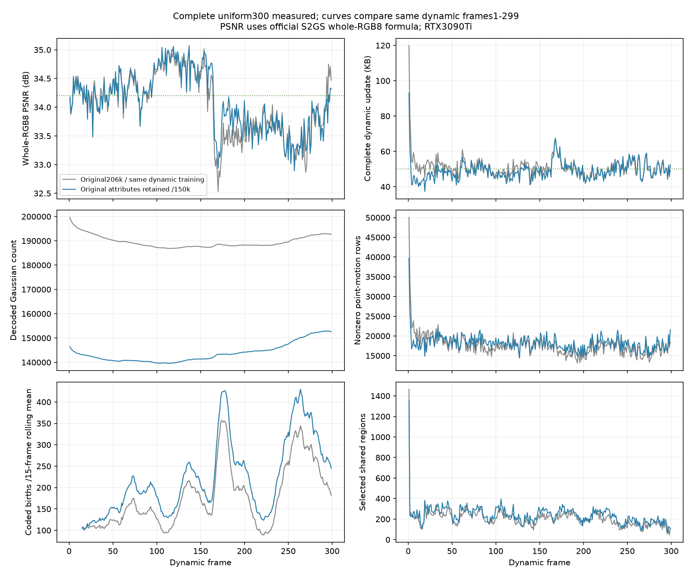

# 保留原属性的15万点首帧：完整300帧结果与后续方向

本轮从同一个15万点共享首帧连续完成frame0–299。项目原生日志PSNR为 **34.120266 dB**，整幅RGB浮点PSNR为34.105655 dB，复现S²GS离线RGB8公式的PSNR为 **34.091273 dB**。完整动态更新平均 **48.962441 KB/帧**，已解码渲染 **313.562 FPS**。存储与渲染速度达到当前动态更新口径要求，画质超过34 dB，但尚未达到希望的34.2 dB。

运行：`output/flame_steak_1028/fs_cov150_300/20261028T133500_9a96a2`；配置：fs_cov150_300.yaml（原路径 `../../config/fs_cov150_300.yaml` 已不在工作区）。启动提交`4ff9095`，首帧覆盖裁点实现`c9137ac`。本轮训练、解码及两种FPS测量期间的训练与播放源码保持一致，未拼接不同方法的前缀。开发与评估使用cam00，不能将其当成独立泛化验证。

2026-10-29配置维护：原units运行的外部空间模板文件已不存在，主配置的`reference_layout`改为本轮已保存的frame0 reference，其内嵌原候选布局。用当前15万点与该模板重新初始化，XYZ、旋转、归属、父层级、路径、开关、切分中心及离群点路由逐位一致，完整frame0状态摘要也一致（`86f2233dfc4f6a62defef00398107485f1fb9a964bc0f0768fa4eb1b7f2e05b1`）。本次仅修正路径，没有重跑训练或修改历史产物。

## 核心想法与代码改动

沿用每帧训练计划（原路径 `../frame_training_plan.md` 已不在工作区）及units流程：4个训练视角、L1+DSSIM、300步、区域共享平移/gate/量化逐点残差，以及200/250步新增、200/250/300步统一清理。共享颜色与旧点旋转更新关闭；新点全部属性仍通过量化差分训练和编码，包含新点旋转。

本轮只更换首帧及其对应参考结构：原首帧214996点经过既有透明度加载阈值后为206237点，按训练相机图像影响代理保留150000点，完整保留所选点的实际属性；对原有非空最细候选区域保留覆盖，再按全局分数填满名额。复用原候选划分平面，避免裁点后无意改变候选空间。当时使用的`scripts/compact_initial_model.py`现已清理；动态训练机制与同流程的206237点units版本一致。首帧离线统计使用20个训练视角，不增加逐动态帧的候选视角数。

选择方法、属性逐位核验及完整资格30帧见[首帧压缩记录](20261028_flame_steak_first30_experiments.md)。影响分数是近似代理，不是精确删除代价；有限扰动抽查存在偏差。本轮也没有仅凭覆盖约束增加可细分节点数。

## 完整序列结果

同流程对照为[原206237点units完整300帧](20261028_units_full300.md)，两次运行的299张动态GT数组及相机几何一致。初始化和随之变化的训练历史、预算反馈共同影响结果，不把总指标变化单独归因于gate。

| 指标 | 原206237点units | 本轮150000点 |
|---|---:|---:|
| 全300帧PSNR，项目原生/dB | 34.064716 | **34.120266** |
| 动态1–299帧PSNR，RGB8/dB | 34.038418 | **34.091877** |
| 完整动态更新/KB | 50.970251 | **48.962441** |
| 共享首帧/MB | 17.720236 | **13.118597** |
| 含首帧完整流/MB | 32.960341 | **27.758367** |
| 含首帧摊至300帧/KB | 109.867803 | **92.527890** |
| 末帧GS数 | 192764 | **152597** |
| 非零逐点运动残差行/动态帧 | 17564.17 | 18150.63 |
| 有效共享区域/动态帧 | 203.32 | 239.26 |
| 训练与评估秒/动态帧 | 49.23 | 47.38 |
| 已解码渲染/FPS | 308.624 | 313.562 |
| 完整本地热缓存播放/FPS | 238.971 | 243.215 |

首帧点数减少27.27%，参考包减少25.97%，完整动态包仅减少 **3.94%**；含首帧总流减少 **15.78%**。项目原生PSNR提高0.055550 dB，动态RGB8 PSNR提高0.053459 dB。说明该规模的裁点保住了本序列画质，也说明总GS数与动态更新字节不是正比关系。已存v19为原生34.133703 dB / 66.658686 KB；其训练视角、阶段和损失不同，只作历史参考。

所有KB按1000字节、MB按1000000字节。当前完整动态包包含运动/结构38.520114 KB、新点非位置属性4.438485 KB、旧点透明度4.882314 KB及manifest 1.121528 KB，颜色包为零。**运动包也含新增位置、参考和删除等信息，不能全部当作旧点运动残差。** 动态更新总计14639770字节，参考13118597字节。48.96 KB未包含首帧；若目标改为包含首帧的平均存储，则本轮仍是92.53 KB，尚不满足50 KB。

本轮动态帧SSIM为0.967392，LPIPS为0.119871，来自当前项目评估实现。单场景、单次运行与单台3090Ti上的结果不构成跨场景SOTA结论。

[逐帧CSV](assets/20261028_cov150_300.csv)包含全部300帧、三种PSNR、各包大小、GS数、区域数、残差行与同流程对照。首帧和动态更新在不同列中报告。

## 哪些问题仍未解决

**后半段画质是主要短板。** 前150帧RGB8 PSNR为34.432515 dB，后150帧为33.750031 dB；最后240–269帧为33.367167 dB。阶段间场景内容不同，不能只凭这一趋势断言累计漂移。第150–179帧相对原点数版的全图RGB8 SSE下降6.961%，手/火焰/锅固定ROI误差反而增加0.581%；时间变化最高5%像素只改善0.119%，其余像素改善8.712%。因此整体改善主要来自背景，困难动态细节仍缺乏收益。ROI和时间方差都只是诊断代理，不能当语义分割或独立归因。

**新增阶段的收益还不充分。** 第201–300步相对第200步，全299个动态帧的原生PSNR平均仅提高0.029818 dB，129帧下降。该阶段同时调整旧透明度、执行删除及新点训练，不是新点的独立因果贡献。累计创建299000个候选，最终当帧编码65829个；当前出生策略会先付出大量训练工作，最终留下的表达是否有效仍需检查。

累计退出63232个上一帧点，末帧152597点，比初始净增2597点，并没有恢复到原来的20万级。编码新点中42223个在后续帧退出，**仅这些已退出点**的年龄中位数为2帧；末帧仍存活23606个出生点，其年龄中位数101帧。短命点可能表达真实瞬态，不能据年龄直接删点。

出生点承担7.60%的非零残差行事件，却占残差整数符号L1总量25.87%，提示部分出生点后续需要较大修正；这不是压缩字节占比，也不证明其初始化错误。运动包占动态字节78.67%，非零逐点残差行没有随点数同比下降。因此继续减少总点数不保证动态存储显著下降，也不能直接认定learnable gate失效。

## 已完成的小诊断与下一步

以下只在本轮完整验收后，用冻结快照进行诊断，没有改写历史结果，也没有形成新的30帧训练结论：

- 同样4个实际训练视角初始化SH1，在第1/29/149/269帧的200/250步共8个快照中，留出视角RGB8 PSNR平均仅提高0.00655 dB，两个快照下降。单独换SH初值暂不足以优先启动长实验。
- 对第149/269帧的旧点独立DC做20步量化拟合，新增颜色包分别115.678/96.066 KB，留出视角变化为−0.10355/+0.14678 dB。收益不稳定且开销过大，不直接启用逐旧点颜色分支；区域共享颜色继续关闭。
- 4000个当前新点原生渲染抽样中，21个没有实际合成权重。多数点具有非零可见性，但这不等于深度正确、图像有益或跨帧可复用，暂不支持将主要问题归于普遍零梯度。

**优先方向是提高新增表达的有效性，保留当前15万点首帧与量化精度。** 现有几何已按真实残差足迹初始化，但深度仍继承父点先验；现有颜色是图像采样的加权平均，并非给定当前透明度、遮挡和旧场景后的最佳补偿。先检查新点在实际合成权重下应补偿的有符号渲染残差，判断初始化或几何支撑哪项造成主要浪费，再验证训练后与跨帧收益。不要仅增加额度或按寿命保护/删除点。

**共享运动仍是进一步压缩的重点，但要先找到未解释残差的来源。** 将困难区域中的旧点/出生点、共享预测与实际残差对应起来，区分真实复杂运动、初始化偏差和共享粒度选择不合适，再决定如何修正gate或阶段。下一版须检查困难晚帧；前30帧资格通过也不能替代完整300帧。以上为待验证方向，当前没有证据证明某一新机制已经有效。

## 指标与独立核验

原生项目对三个颜色通道分别算dB再平均；整幅RGB浮点与RGB8公式另行报告。RGB8项复现官方[PSNR函数](https://github.com/liyw420/S2GS/blob/main/utils/image_utils.py)与[离线读图](https://github.com/liyw420/S2GS/blob/main/metrics_video.py)，全部299张动态保存PNG与重新序列化数组一致，首帧在内存做同样RGB8量化。保留原日志定义，不将34.120266与不同公式的论文数字直接混用；RGB8口径距34.2仍差0.108727 dB。

CPU独立顺序解码覆盖299个动态更新，GPU核验覆盖全部300帧，原始属性、状态、激活后渲染输入及像素逐位一致，原生日志PSNR差值为0；第299帧checkpoint及完整字节反馈链一致。最终状态SHA为`ccd0da6eb6e78ab07a328d26c41790c6fa125b704fc6eab029ddf1d66df2dd68`。

FPS在RTX3090Ti、1345×1008、GPU空闲时测量。渲染每帧10次预热、50次计时，共15000次完整`Module.forward+clamp`，预解码属性缓存不计入渲染范围。播放覆盖3轮×299次更新，包含读取、校验、两个CPU解析进程、至多两个未来稀疏包预取、H2D、更新和渲染；不预缓存未来稠密场景。首帧加载、进程/JIT启动不计，本地文件为热缓存，不代表网络或冷盘速度。

证据汇总：`tmp/goal_frame_plan/cov150_300_final_report.json`；全流`cov150_300_cpu_decode.json`、`cov150_300_gpu_certificate.json`、`cov150_300_checkpoint299_verified.json`；定义审计`cov150_300_psnr_definitions.json`；FPS为`cov150_300_render.json`和`cov150_300_playback.json`；出生追踪`cov150_300_population_lineage.json`；阶段配对`cov150_300_stage200_summary.json`；冻结诊断`cov150_birth_sh_native_summary.json`与`cov150_private_dc_native_summary.json`。历史output只读，未复制大型数据。

## 运动共享的场景分析与编码对照

为汇报制作了[图集](../figures/motion_sharing/index.html)，预先选取第29/149/269帧，展示真实场景中的[最终共享区域与粒度](../figures/motion_sharing/00_shared_regions.png)、[完整逐点运动与共享后残差](../figures/motion_sharing/01_scene_residual.png)、[局部区域编号、共享平移与对应残差](../figures/motion_sharing/02_local_regions.png)，以及[空间近邻/随机点的运动差异](../figures/motion_sharing/03_neighbour_similarity.png)。所有区域身份来自最终码流的实际owner，逐区域验证其成员共享同一三维平移向量；没有按图像内容另行聚类。第149帧所示手部的三个主要可见区域为D4/D3/D4，窗帘窗口的三个主要区域为D2，说明当前运行确实使用了不同共享粒度，但不能据此证明粒度选择最优。

图中色点是透明度≥0.03、每2×2屏幕格保留最近中心后的旧GS投影，不是渲染像素运动，也不是精确alpha遮挡。局部虚线是该窗口内同一区域成员的投影包络，不是二维分割边界，投影可以重叠。共享平移箭头选取真实成员，在前一帧位置计算其共享三维位移的屏幕投影，再统一放大8倍。区域身份颜色和残差幅值色标分别解释，跨图的同一R编号保持一致。

对全部299次动态更新，将同一整数总运动写入逐点流、将区域运动置零，保留原出生/删除与新点位姿负载，使用同一量化网格与生产压缩器。实际运动包均值由139.116151降为38.520114 KB，减少72.310825%。逐点非零向量占全部旧GS事件的比例由92.890348%降为12.644060%，逐点L2幅值总和下降90.758023%。这些是冻结已拟合运动场的表示/编码对照，**不是重新训练的无共享、固定粒度或gate消融**。各替代包独立使用原始前一帧参考，不是新的连续替代流；全部整数总运动一致，浮点加法次序的最大差异为0.009791个量化格，不声称替代流渲染像素逐位一致。

同一锚点的近邻/随机非自身配对中，每帧从位移幅值前25%的旧GS抽样1200个锚点；299帧平均运动差异分别为5.847134/44.604883格，近邻低86.891269%。该统计反映当前拟合运动的局部相关性，模型本身已有空间共享先验，不能充当独立真实运动的验证。实际运动包38.52 KB与完整动态更新48.96 KB分开报告，未混用口径。

图表与数值见[逐帧CSV](../figures/motion_sharing/per_frame.csv)、[样本帧区域CSV](../figures/motion_sharing/scene_regions.csv)与[汇总及哈希](../figures/motion_sharing/summary.json)。提取工具为`scripts/extract_motion_sharing_figures.py`，制图为`scripts/plot_motion_sharing_scenes.py`；均只读CPU分析，不修改训练实现或历史产物。全部1197个输入文件的哈希在提取前后保持一致。

### 更直观的汇报候选图 A–H

针对点投影图难理解的问题，新增[八种选图总览](../figures/motion_choices/00_choose_A_to_H.png)与[高清图集](../figures/motion_choices/index.html)。A高亮两个实际共享区域，B对比粗/细候选分区与当前分区，C显示原生渲染权重主导区域的投影交界，D用9个实际GS的稀疏箭头分析共享，E把运动/残差热区叠在同一重建底图上，F实际渲染位置分量开关对照，G显示逐点修正使像素误差改善/变差的位置，H展示当前重建及同量化运动场的编码节省。全部提供PNG与SVG。

此次区域高亮通过原生合成器计算区域成员的T×alpha贡献，其他点保留为遮挡物；比中心投影更接近实际图像贡献，但仍不是语义分割。B仅改变真实候选层级的着色归属，没有训练固定粒度模型；路径使用本帧解码的spatial_paths，并与checkpoint训练路径逐位核对，避免沿用上一帧可能已过期的路径。C逐像素取贡献最大的实际旧点区域，显示其二维投影交界，不将其说成三维分割面。

F/G冻结全部当前外观、透明度、旋转、尺度与新点，只干预存活旧点在本帧的位置更新。在预先固定的第149帧手部窗口中，RGB8 PSNR从不更新位置31.2588、仅共享32.1801到完整32.4612 dB；第269帧火焰窗口对应24.9403、25.2976、25.7092 dB（精确数值见[窗口指标](../figures/motion_choices/roi_metrics.json)）。窗口的正收益不代表全图或全序列都改善：第29帧完整更新全图为34.373872 dB，不更新旧点位置反而为34.435935 dB。全部三帧与全部变体保留在[原生证据](../figures/motion_choices/evidence.json)，未将反例删除。三张完整重建的RGB8像素与历史PNG逐位相同。

这些是图像贡献、候选划分与冻结渲染诊断，不是重新训练的gate/固定粒度消融，不构成新的全300帧方法结论。原生证据和排版使用的一次性候选图脚本已在后续清理中移除；历史图表仍保留，本次没有训练或FPS测量。

用户未采用上述八套汇报样式，进一步要求先画三张直接的运动箭头图：[无共享表示的逐GS完整运动](../figures/three_motion_fields/01_full_per_gs.png)、[区域共享运动](../figures/three_motion_fields/02_regional_shared.png)、[共享后的逐GS残差](../figures/three_motion_fields/03_per_gs_residual.png)。使用同一第148→149帧更新、同一底图，最初121个抽样GS，按用户要求将网格间距从56缩小至18像素，加密到1042个GS，涉及150个共享区域，297个抽样GS有非零量化残差。区域图对每个涉及的区域取一个代表点绘箭头。三张箭头长度均严格按三维位移L2幅值同比例绘制，方向取相机投影，零位移不画箭头。长度不表示真实像素位移，不进行逐箭头幅值归一化或截断。第一张是同一拟合运动场的完整逐点表示，并非重新训练的无共享基线。脚本为`scripts/plot_three_motion_fields.py`，全部箭头数值与统一比例核验保存在同目录`arrows.csv`和`summary.json`。

新增[不同相邻区域的运动相似性图](../figures/three_motion_fields/04_neighbor_regions.png)，避免用同一区域共享同一向量的必然结果充当跨区域相似性的证据。候选区域边界从保存的中位数切分平面逐层恢复，以共享面且另两轴重叠为正定义三维邻接；核对了支持球内GS的实际归属。手部固定窗口按可见面积选择A/B/C三个相邻细区域，未按运动相似程度挑选；对应真实区域编号1970/1974/1972。运动使用各区域内完整GS位移的均值，A–B/A–C三维夹角分别为1.58°/2.03°。原生渲染的主导区域像素给出彩色覆盖，三根箭头按相同参考点投影比较方向，长度按三维位移同比例显示。

本帧至少含16个旧GS的251个区域共有925对候选共面邻接。取区域平均完整位移幅值前25%的63个区域，其中88对邻接的平均三维方向夹角为26.28°，同锚点随机配对的精确期望为63.33°；运动向量差分别为40.78/88.97量化格。随机对照遍历相同运动区域池内所有非自身伙伴，并保留邻接统计中的锚点权重。全部区域向量与邻接对见同图目录`region_motion_vectors.csv`、`neighbor_region_pairs.csv`，脚本`scripts/plot_neighbor_region_motion.py`。这为当前拟合场的跨区域局部相关性提供描述性证据；模型本身已有空间共享先验，不能视为独立真实运动验证，也不单独证明gate最优或跨场景SOTA。

### 箭头真实性核对与画法修正

原三张箭头图混用了二维投影方向和三维位移幅值，虽已在文字说明口径，但不能作为屏幕运动轨迹展示。核对同一1042个抽样GS，998个完整投影位移小于1像素，中位数0.124073像素、最大3.874232像素；旧画法最长箭头却为93.878432像素，相对实际屏幕位移的放大程度因点而异。旧图不再用于说明实际投影运动。

已修改同一制图脚本，直接绘制投影坐标差，保留[原始1倍](../figures/motion_projection_audit/gain1/00_three_fields.png)与[统一10倍](../figures/motion_projection_audit/gain10/00_three_fields.png)。没有逐箭头归一化、以三维长度代替二维长度、强制最短长度或幅值截断；1042个GS、抽样规则和原始投影向量完全一致。第一张更名为“GS完整位移（共享+残差）”，避免被理解成重训的无共享消融。残差向量从“共享后的投影位置”到“完整更新后的投影位置”计算，再平移回共同起点作分量比较，因此不是单独一条GS真实轨迹。

读取时已核对量化共享/残差更新后的GS位置与实际解码位置逐位一致，投影向量满足完整=共享+残差；两套图逐坐标满足显示向量=原始投影向量×标注倍率，误差为零。[审计数值](../figures/motion_projection_audit/audit.json)记录全部检查。数据为模型拟合并写入码流的GS更新，**不是物理运动真值或独立光流**；中心可见性仍是近似筛选。模型拟合运动是否符合真实场景，需要独立图像对应证据，不能用自己的运动场自证。
