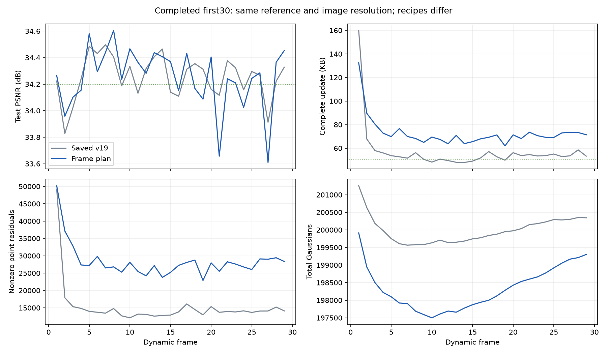

# 分阶段共享运动与两批新增：完整前30帧

本次已完成 frame0–29，运行目录为 `output/flame_steak_1027/fs_plan_30/20261027T235034_32c9ca`，代码提交 `f96a42d`，配置 `config/fs_plan_30.yaml`。训练于10月27日晚启动、28日凌晨完成。历史结果只读取，没有启动新的对照训练。

## 想法与实现

先充分拟合旧点，再用剩余误差引导新增：1–100步学习共享平移与gate；101–150步固定gate、开放逐点平移残差和旧点透明度；151–180步再次联合学习gate；181–200步固定最终gate继续优化；201–300步固定旧运动，学习新点属性和旧点透明度。每步随机4个不同训练视角，统一 `0.8 L1 + 0.2 DSSIM`，存储正则每步一次。关闭共享颜色和旧点旋转。

200/250步清理后分别新增，300步再次清理；阈值均为已解码物理透明度 `<0.01`，不以可见性或父点身份豁免。两批共享1000个出生额度、总GS上限250000。新点颜色由训练图像初始化DC，高阶SH为零；位置在父点局部尺度轴分裂后转到世界坐标，尺度/旋转/透明度复制父点。每批独立Adam状态及出生年龄学习率，初始学习率为v19的两倍。删除原参考后保持实际属性、重选相近旧点并重算差分，码流仍为量化差分。

主要代码为 `pipeline/frame_plan.py`、`pipeline/model/frame_plan_birth.py`，以及motion阶段控制、trainer采样和checkpoint接入。此前单独修复的局部轴坐标错误不视为本轮方法收益。统一退出压力保留，新点属性差分存储和点存在压力分别计算。

## 结果与口径

PSNR读取留出cam00评估。存储逐帧核对磁盘中的motion、birth、opacity及必要manifest，KB=1000字节；17.720236 MB共享首帧单列。表中旧v19取已完成300帧运行相同的frame1–29，数据、分辨率和首帧相同，但损失、视角数及出生/阶段安排不同，不能作单因素归因。

| 指标，动态帧1–29均值 | 已存v19 | 本轮计划 |
|---|---:|---:|
| PSNR/dB | 34.253958 | 34.251246 |
| 完整更新KB/帧 | 57.096483 | 72.724966 |
| motion KB/帧 | 46.475517 | 57.108759 |
| birth属性 KB/帧 | 3.968345 | 6.914483 |
| opacity KB/帧 | 5.646897 | 7.580966 |
| 选中区域数 | 259.69 | 304.86 |
| 非零逐点运动残差行数 | 15245.38 | 28349.24 |
| 每帧最终保留新点 | 232.90 | 331.52 |
| 每帧删除旧点 | 436.07 | 570.66 |
| 末帧GS | 200345 | 199302 |
| 训练及评估秒/帧 | 28.61 | 51.38 |

首帧独立渲染PSNR为33.952248 dB；包含它的全30帧均值为34.241279 dB。本轮画质与已存v19接近，完整动态更新增加15.628483 KB/帧、约27.4%，未达到约50 KB目标。因此不直接扩到300帧。本轮未做速度验收，不报告新的渲染/完整播放FPS。

GS从206237降到199302，不能把存储增加简单归因于总点数；motion和逐点非零残差显著增加是主要证据。第一帧较大的运动包不是唯一原因，后段仍明显高于目标。第一阶段gate实际改变了GS归属，但151–180步的联合细化阶段，29个动态帧的实际归属变化均为0；节点开关编辑不能替代有效重新分组。

## 机制检查

### 未选候选无法在联合阶段继续学习

只读加载真实frame1 step150 checkpoint，在第151步核验：3032个有效未选区域，对当前实际位置的依赖和rate/relative-motion参数梯度均为零，候选拟合项也为零。现有前向仅使用已选区域；存储比较中候选预测被detach，且独立候选拟合分支排除了当前joint-image模式。

因此gate虽能比较已有候选，却不能同时让未选候选根据当前拟合出的逐点运动继续更新。这是机制缺口的证据，尚不能断言它解释全部额外存储。

下一版准备在151–180步为未选候选补上相对运动拟合：目标来自detach后的当前总运动，只更新候选自身相对父区域的偏移，不改当前已选运动，不增加SGD步数或额外渲染。隔离分支的一步CPU诊断使2941个候选获得非零梯度，候选损失下降，当前实际位置最大变化为0。数值回归通过；尚无训练收益结论。

### 新生点初始扰动大，抽查帧最终直接收益很小

全部出生事件的同组四训练视角新增后SSE/新增前SSE平均为6.00。该比值描述出生瞬间，不代表最终质量。另独立读取已存checkpoint并重渲染同一留出视角：

| 状态 | frame1 PSNR | frame29 PSNR |
|---|---:|---:|
| step200旧点 | 34.076332 | 34.142647 |
| step200旧点+刚初始化的新点 | 30.554169 | 31.574423 |
| step300旧点，隐藏本帧新点 | 34.265785 | 34.451050 |
| step300完整结果 | 34.264046 | 34.453377 |

两帧最终本帧新点的直接PSNR贡献分别约−0.00174和+0.00233 dB；后100步旧点透明度变化与清理的贡献更明显。直接采样图像颜色不能保证复制高透明度点后不会增加遮挡或误差。新点是否更好地承接未来帧、其它困难帧是否必需，未由这两次隐藏渲染证明；也不能据此直接取消新增。后续需继续检查出生初始化和基于实际作用的退出，而非只扩大新增额度。

## 验证与后续

29个动态包独立顺序解码并逐帧通过manifest的状态/六类属性哈希校验，最终状态SHA256为 `04b9bd1daef6b504c633e975cc9a3c3c16c033ab7352e726af54f7e200a62d78`。frame1、29完整结果的独立渲染PSNR与保存值之差均为0。阶段、两批优化器、换参考及CPU/GPU码流已有数值回归；测试不替代全300帧指标。

下一轮先修复未选区域的学习反馈，仍保留当前总体阶段和出生/退出流程，检查实际motion字节、非零残差及画质是否改善。不将尚未验证的候选拟合收益当成结论。证据、逐帧CSV及诊断脚本保存在 `tmp/goal_frame_plan/`。
