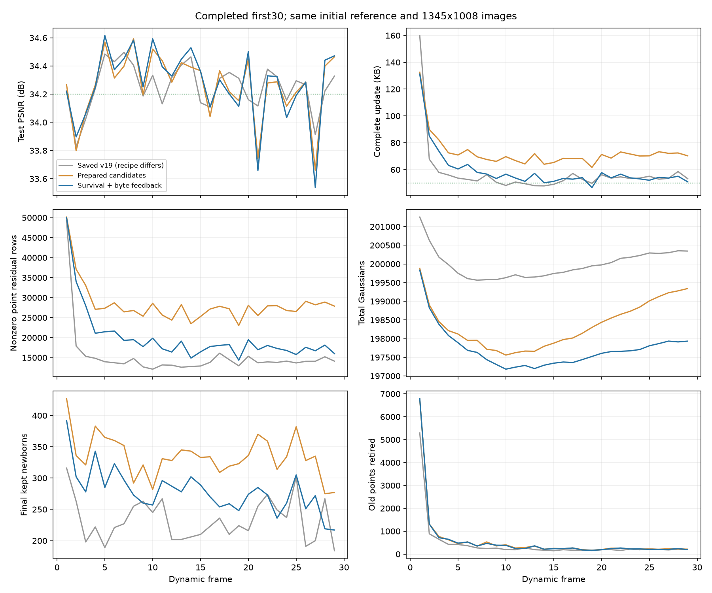

# 存活计费与完整字节反馈：前30帧

`fs_rate_30` 已正常完成 frame0–29。动态帧平均 **34.270951 dB / 59.102793 KB**，相较上一轮候选预备版本，PSNR相近，完整动态更新下降 **18.69%**。frame14–29为 **34.212062 dB / 53.101688 KB**，值得续跑300帧检查长期表现；全段仍高于50 KB，不能宣布目标达成。

配置为 `config/fs_rate_30.yaml`，方法提交 `c543b8f`，运行目录为 `output/flame_steak_1027/fs_rate_30/20261028T014446_258b12`。首帧、1345×1008图像、四训练视角、100/50/30/20/100步安排与上一轮一致，共享颜色关闭，量化精度未降低。

## 核心想法与改动

上一轮概率透明度新点的属性存储代理将存在权重固定为1，基础开销没有退出梯度；负透明度差分的熵项还可能把淡出的新点拉回不透明父点。本轮用 `birth.survival_aware_storage` 明确“存活则支付整行属性基础开销，低于实际解码阈值则退出”：前向按解码透明度是否≥0.01计费，反向使用 `a/(a+0.01)` 提供退出梯度；负透明度差分保留前向价格，截断其反向抬高透明度的路径。零属性差分仍要支付存活点的基础字节，不等于删除。

同时增加完整字节反馈：目标50000字节，每帧使用固定倍率，编码后按 `log倍率 += 0.25 × log(实际完整字节/50000)` 更新下一帧，限于1–64。相同字节价格用于运动、旧点透明度和新增属性；不修改静态配置或量化步长，不使用留出PSNR反馈。共享首帧不参与控制。倍率与累计字节数写入checkpoint，防止重复更新并支持前缀续跑。

实现集中于 `adaptive_birth_storage.py`、`rate_budget.py`、`frame_plan.py`，以及运动模型的有效字节价格和 `module.py` 的保存/恢复。数值检查覆盖存活点基础计费、淡出梯度、透明度端点、倍率上下界、重复更新和恢复；147项测试运行中2项CUDA用例在CPU批次跳过，另完成相关CUDA编解码/恢复检查。最终设置顺序调整后8项针对性检查通过。

## 完整结果

动态指标使用frame1–29，KB=1000字节，完整更新包括motion、birth、opacity和manifest。共享首帧17.720236 MB单列。首帧六类属性与上一轮逐位相同，独立重渲染33.952248 dB；包含它的全30帧平均为 **34.260328 dB**。

| 指标 | 上一轮fs_ready_30 | 本轮fs_rate_30 |
|---|---:|---:|
| 动态PSNR/dB | 34.261226 | 34.270951 |
| 完整KB/帧 | 72.688621 | 59.102793 |
| motion KB/帧 | 56.947655 | 44.580483 |
| birth属性 KB/帧 | 6.982034 | 5.817586 |
| opacity KB/帧 | 7.638172 | 7.583966 |
| manifest KB/帧 | 1.120759 | 1.120759 |
| 非零逐点运动残差行/帧 | 28271.07 | 19928.79 |
| 活跃区域数/帧 | 305.52 | 265.10 |
| 最终保留新点/帧 | 334.97 | 278.79 |
| 删除旧点/帧 | 572.72 | 565.14 |
| 末帧GS | 199342 | 197933 |
| 训练与评估秒/帧 | 51.95 | 53.73 |

存储下降13.585828 KB/帧，主要体现在motion包和非零残差行，其次是新生属性；旧点透明度包基本相同。由于同时改了新点存活梯度和码率反馈，不能把收益全部归于其中一项，也不能归因于自适应层级本身。约0.01 dB差异不作为画质提升证据。

已存v19相同前29个动态帧为 **34.253958 dB / 57.096483 KB**；本轮尚未优于它的短序列存储，且两者图像目标、视角数和出生训练流程不同。续跑理由是本轮后段已接近目标且存在完整字节控制，需要检查其能否避免v19全300帧后期存储增长，不能预先假设它一定更好。

29个动态包共1.713981 MB，含共享首帧总流为19.434217 MB。首个动态帧耗时103.08秒，其余平均约51.96秒；这轮未重新验收FPS，不用训练时间代替渲染或播放速度。

## 尚未解决的问题

- 倍率从1升至下一帧将用的2.851904。前5帧平均82.74 KB，frame14–29为53.10 KB；完整30帧的均值不能用后段较低值替代。反馈使用前一帧，不能保证每帧或全段严格低于50 KB。
- 第10帧GS最低197183，末帧197933，后段仍在净增长。frame14–29平均新增263.38、删除217.50，净增约45.88/帧。总数低于首帧不等于已经实现长期人口稳定。
- frame21为33.658913 dB，上一轮33.744026；frame27为33.536922 dB，上一轮33.660763。较难的新内容仍存在回退，不能用均值掩盖。
- 29帧的151–180步仍没有实际归属切换。前一轮固定字段DP已经提示不能仅据此判断gate坏了；本轮压缩改善也不能作为层级选择收益的独立证据。

新增共创建28576个，最终保留8085个，旧点删除16389个。frame29的只读渲染诊断为：step200旧点34.083935 dB，新点初始化后31.611324；最终旧点单独34.491936，完整结果34.472015。此帧新点直接贡献约−0.0199 dB，而后100步旧点透明度/清理的综合变化约+0.4080 dB。它说明此帧的新点仍有初始化负担，不能推广为所有新点都无用，也不能把阶段总改善称为新点贡献。

## 校验与下一步

29个包按顺序独立CPU解码，逐帧状态与六类原始属性哈希、文件实际字节与报告、倍率反馈链全部一致。最终状态哈希为 `5d9af152f3dc2835adbfc10556229c7ea134ae77995151e9697f41369a382215`。末帧checkpoint已保存29个动态帧、累计1713981字节，以及当前使用倍率2.838391和下一帧倍率2.851904；不能在续跑时重置控制器。

已用 `config/fs_rate_300.yaml` 从该末帧checkpoint开始续到300帧，新目录为 `output/flame_steak_1027/fs_rate_300/20261028T021519_48d9de`，运行提交 `b3884c1`。前缀146个文件与原运行逐项字节及SHA-256一致；续跑frame30使用正确倍率2.851904。全300帧完成后再验收平均PSNR、完整动态存储、已解码渲染≥200 FPS和完整播放FPS。300帧配置增加了未来定期checkpoint（配置提交 `6714a2d`），不改变训练数学过程。

后续结果：此扩展在保存frame179后因后段明显回退主动停止，并未完成全300帧；已完成180帧的结果及诊断见 [长序列记录](20261028_rate_stopped180.md)。不以本页短序列的乐观趋势代替后续结果。

逐帧数据、CSV和图在 `tmp/goal_frame_plan/rate30_analysis/`；顺序解码证据在 `rate_decode_029.json`，单帧反事实渲染在 `rate_cohort_probe_029.json`。历史output保持只读，没有用30帧结果宣称全300帧达标或SOTA。
