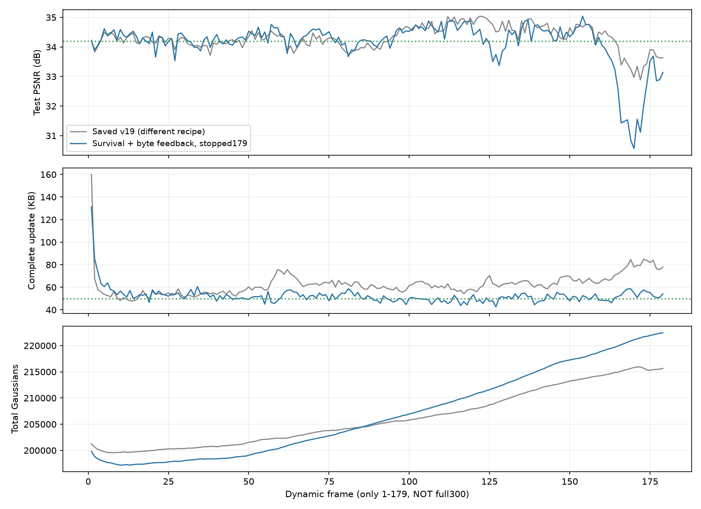

# 完整字节反馈：长序列在180帧停止

`fs_rate_300` 计划验证300帧，实际完成 **frame0–179，共180帧** 后主动停止。全180帧平均 **34.152077 dB**；179个动态更新平均 **52.381430 KB**，未达到画质与存储的联合目标。最后30帧降至33.206762 dB，比已存v19同段低0.809487 dB，因此保留第179帧完整checkpoint后停止这一个候选，继续改进机制。不能将本记录称为完整300帧结果。

运行目录：`output/flame_steak_1027/fs_rate_300/20261028T021519_48d9de`。方法提交 `c543b8f`，启动提交 `b3884c1`；配置 `config/fs_rate_300.yaml`。frame0–29来自已完成的 `fs_rate_30`，146个前缀文件逐项字节/SHA-256相同；frame30起继续训练，码率控制器未重置。停止是本轮实验决策，不是程序崩溃。

## 想法与结果

沿用[前30帧记录](20261028_rate_first30.md)的存活新点计费、完整字节反馈、四视角L1+DSSIM和分阶段gate/运动/新点训练；量化精度、共享首帧、关闭共享颜色的设置不变。本轮没有增加新的训练机制，目的是检查短序列收益能否延续。

以下均为相同动态帧区间；KB=1000字节，包含运动、新点属性、透明度和manifest，首帧单列。v19使用的视角数和训练目标不同，所以是保存结果参照，不能据差异单独归因于gate或字节反馈。

| 动态帧区间 | 本轮PSNR/dB | 本轮KB/帧 | 已存v19 PSNR/dB | 已存v19 KB/帧 |
|---|---:|---:|---:|---:|
| 1–29 | 34.270951 | 59.102793 | 34.253958 | 57.096483 |
| 30–59 | 34.287165 | 51.483667 | 34.195820 | 56.979267 |
| 60–89 | 34.241987 | 52.985300 | 34.087291 | 64.395767 |
| 90–119 | 34.577696 | 48.407533 | 34.601395 | 59.744900 |
| 120–149 | 34.338524 | 50.411900 | 34.678489 | 63.163700 |
| 150–179 | 33.206762 | 52.121433 | 34.016249 | 72.754333 |
| 全部1–179 | 34.153193 | 52.381430 | 34.305822 | 62.385123 |

运动37.719497 KB、新点属性5.986821 KB、透明度7.553810 KB，剩余约1.121302 KB为manifest。动态更新共9,376,276字节；共享首帧17,720,236字节单列，包含首帧的总流为27,096,512字节。首帧经独立重渲染为33.952248 dB。末帧222451个GS，高于首帧206237个；动态帧平均保留新点306.32、删除旧点215.74，长期仍在净增长。训练与评估平均57.33秒/动态帧。本候选未通过质量筛选，不重复测FPS，也不宣称速度达标。

## 诊断证据及其边界

第126帧的独立GPU重放与保存指标一致：本轮33.505924 dB，已存v19为34.755547 dB。火焰附近ROI约占本轮总SSE的33%，占相对v19额外SSE的约91%。stage200旧点为33.340446 dB，最终旧点单独33.379868，完整结果33.505924：当前帧新点直接提供约+0.126057 dB，不能简单认定新点全都无用。长期误差也不能只用当前新增点数量解释。

透明度梯度经过有限差分核对，未发现旧点透明度端点不传梯度的实现错误。按颜色和投影尺寸挑出的991个旧点直接隐藏没有改善；使用留出误差梯度淡化部分旧点虽能改善该留出视角，却使相同四个训练视角损失变差。这些只读反事实用于排除过于简单的解释，**没有进入训练筛选、删除规则或阈值选择**。不能据此把所有大GS当作无效点删除。

可检验的下一假设来自初始化支持范围：第149帧step200的492个首批父点中，434个最大尺度超过场景extent的5%，263个超过10%；中位最大尺度约为extent的10.07%，中位轴长比109.78。当前子点完整复制父点协方差，而颜色来自局部图像采样。这可能造成“局部颜色、过宽或极扁几何支持”的冲突；统计本身尚不能证明它导致最终PSNR下降。

另发现**新增瞬间误差统计口径不一致**：新增前的`old_RGB_SSE`扣除了0.03残差底噪，新增后的SSE未扣。历史训练报告中的倍数因此偏大，应停止将其当作可比倍率。后续实现分别记录原始SSE和筛选用SSE，前后统一原始口径。此处只影响诊断，不影响最终PSNR、训练损失或独立渲染反事实的数值。

## 校验与下一步

第179帧最终checkpoint、全部179个动态包已保存。独立CPU按顺序解码验证了每帧原始属性/状态哈希、实际文件字节和反馈链；最终状态为 `a5b09c18370745c5020de6ab92021ee1bdd6bed6a9020d2f5d52455a23a53e6c`，下一帧倍率5.855392。所有历史output保持只读。

下一版保留共享运动、量化残差、统一退出及存储约束，只改新点初始化：利用相同四训练视角的真实合成权重，测量高残差的图像支持范围，据此给出新点中心与独立紧凑协方差。深度仍是父点中心深度先验，不称为测得表面或三角化结果；不增加20视角筛选、不使用留出图像决策、不降低量化精度。先验证数值和30帧完整结果，合适再跑完整300帧。

证据：`tmp/goal_frame_plan/rate_stop179_metrics.json`、`rate_stop179_decode.json`、`rate_fire_render126.json`、`rate_fire_grad126_fullroi.json`、`rate_birth_covariance149.json`；逐帧CSV为`rate180_analysis/per_frame.csv`。本轮说明短前缀不能替代全序列，不构成SOTA结论。
