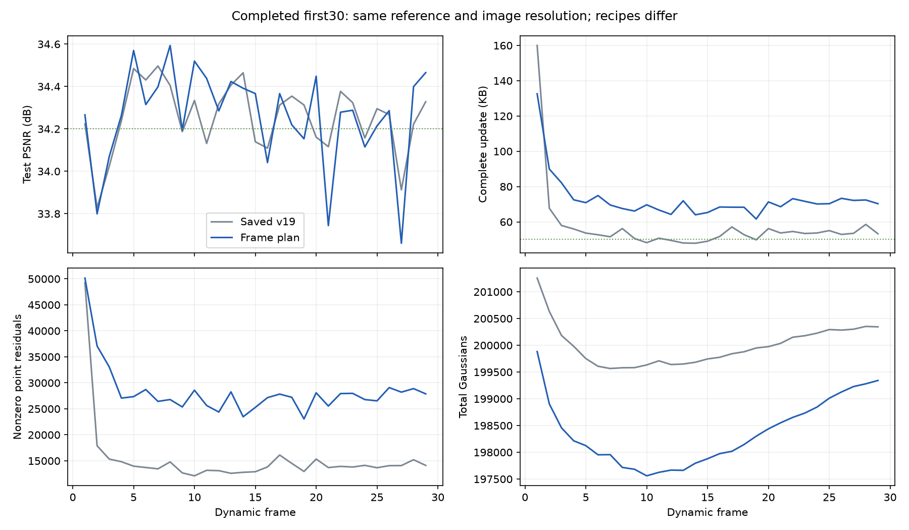

# 候选预备与gate阶段衔接：完整前30帧

运行 `output/flame_steak_1027/fs_ready_30/20261028T003533_80c33b` 已正常完成frame0–29；配置 `config/fs_ready_30.yaml`，提交 `f764f22`。本记录仅覆盖完整实验，不把中途结束的短尝试当作30帧结果。

## 想法与代码

前一轮发现未选区域在联合阶段没有拟合当前运动的梯度。此轮在101–150步固定gate时就开始准备未选候选，持续到180步：以detach的当前总运动为目标，只更新候选自身相对父区域的偏移。151步重启gate自身Adam，避免旧的图像目标动量支配新的表示代价；其余参数状态保留。其余100/50/30/20/100步安排、4训练视角、两批出生/清理、量化及共享颜色关闭保持前一轮配置。

实现集中于 `spatial_gated_motion.py` 的候选梯度掩码、候选拟合及一次性优化器衔接，新增配置有默认值以保持旧版本行为。128项CPU数值回归通过，2项CUDA用例在这轮CPU测试设置中跳过；另真实checkpoint在CPU/CUDA上强制切换130376个点的归属，量化总运动保持一致。这些测试不替代画质与存储实验。

## 结果

动态帧1–29，KB=1000字节；完整更新包括motion、birth、opacity及manifest，17.720236 MB共享首帧另计。

| 指标 | 前一轮fs_plan_30 | 本轮fs_ready_30 |
|---|---:|---:|
| PSNR/dB | 34.251246 | 34.261226 |
| 完整KB/帧 | 72.724966 | 72.688621 |
| motion KB/帧 | 57.108759 | 56.947655 |
| birth属性 KB/帧 | 6.914483 | 6.982034 |
| opacity KB/帧 | 7.580966 | 7.638172 |
| 非零逐点运动残差行/帧 | 28349.24 | 28271.07 |
| 活跃区域数/帧 | 304.86 | 305.52 |
| 最终保留新点/帧 | 331.52 | 334.97 |
| 末帧GS | 199302 | 199342 |
| 训练与评估秒/帧 | 51.38 | 51.95 |

包含相同已核验首帧的全30帧平均PSNR为34.250927 dB。两次独立运行存在CUDA数值差异；约0.01 dB和0.036 KB的变化不足以支持方法收益。仍未达到约50 KB，因此本版不扩到300帧，也未测新的渲染或完整播放FPS。

## 为什么不再以“让gate变化”为直接目标

29个动态帧的151–180步实际归属变化依然都是0。候选梯度和gate更新实际发生，且优化器重启由真实checkpoint核实；但零归属变化本身不能证明选择失效。

进一步对frame1、29 step180的**固定已学候选、固定当前总运动**做离线树动态规划，按训练中相同的raw-block存储代理加relative-motion目标求最佳合法frontier。诊断成本与实际loss去除常数metadata后的差分别仅约6.8e−12和4.7e−12，最佳划分都没有降低目标；非零逐点残差行数也未降低。存在不同归属但完全等价的零运动表示，不能把这种换名当作压缩收益。

这不是生产中的后处理或重分解，没有改checkpoint或当前训练结果。结论仅为：对这两帧已学到的运动字段，强迫换一种划分没有收益；不能推广成整个空间层级已经全局最优，也不能仅凭不换分组断言learnable gate坏了。后续停止反复延长gate训练，转而检查残差表示、优化自由度以及新增点的实际码率压力。

## 额外诊断与下一步

对前一轮frame1、29的180/200步残差端点作检查：最终非零残差绝大多数超过单轴一个量化格；两端点直接平均反而增加非零行数。不能把小运动统一当作数值噪声，也没有证据支持直接平均就能省存储。

对本轮稀疏GS部分单独压缩，frame29原顺序约51544字节，逐帧Morton排序的理想诊断约48376字节，沿活跃序列做差反而约60712字节。它不是可用的完整新码流，也不是实际整帧收益；改善量级不足以解释或解决全部约23 KB的超额，不优先为此改大批编解码代码。

代码与数值检查还发现一个直接影响新增控制的问题：当前概率透明度新点的storage代理将存在权重固定为1，基础属性开销没有退出梯度。父透明度0.8、子透明度0.2、其它属性相同的例子中，storage对子的概率透明度梯度为−0.4054；梯度下降会把它推回父透明度以减小属性差分，而不是减少存活点。统一人口压力虽独立存在，不能把属性差分压缩等同于出生数量已被码率控制。

下一步拟将“存活则支付基础字节、真正删除则不发送”的条件写进可微存储代理，保持前向按实际透明度阈值计费，同时提供退出梯度，并避免负透明度差分的熵项反向抬高透明度。再考虑根据上一帧实际完整字节反馈统一码率权重，以目标带宽运行；反馈只使用字节，不使用留出视角PSNR训练。实现和结果尚待验证，不预先声称可以在保持画质下达到50 KB。

## 校验与证据

29个动态包独立顺序解码并通过逐帧manifest状态及六类属性哈希，最终状态为 `3152d6cf141e311136d7e89ebfb76a63d78e7d56c3db808d06920dd19219a695`。完整分析、逐帧CSV和上述诊断保存在 `tmp/goal_frame_plan/ready30_analysis/`、`ready_frontier_oracle*.json`、`residual_stability.json`、`ready_codec_order_probe.json` 与 `birth_survival_gradient.json`。历史output只读；未通过30帧结果推断全300帧或SOTA。
