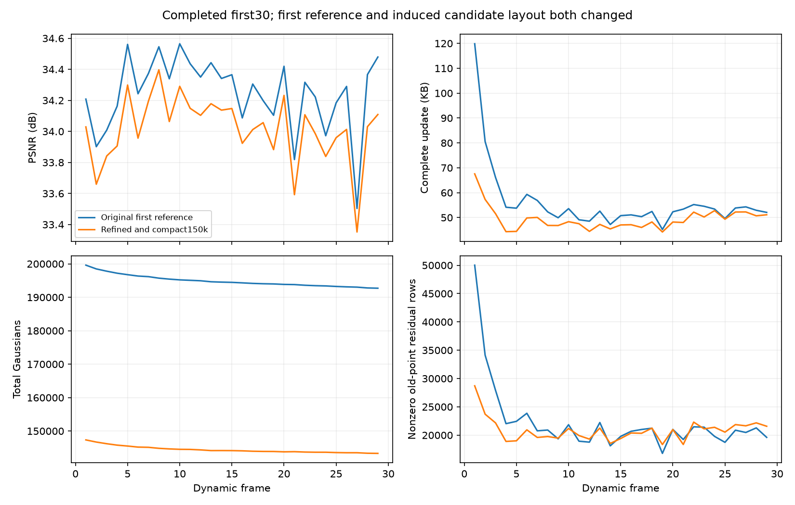

# 改善并压缩首帧至15万点：完整前30帧

本轮完成frame0–29，共30帧。首帧从206237点/33.952248 dB改善为150000点/34.186138 dB，但全30帧PSNR为 **34.021085 dB**，低于原首帧同units流程的 **34.235354 dB**。完整动态更新从56.044345降到 **49.353552 KB/帧**。不扩展此候选到300帧；首帧静态改善尚未转化为动态画质收益。

运行：`output/flame_steak_1028/fs_ref150_30/20261028T114002_7b38b0`，启动提交`1ed7915`，配置[fs_ref150_30.yaml](../../config/fs_ref150_30.yaml)。动态沿用units的四视角、分阶段共享运动/gate/残差、L1+DSSIM、相同量化和字节反馈；共享颜色关闭，末20步联合优化关闭。首帧保存点global_step为17500，相应设置trainer.num_init_steps=17500；每个动态帧仍300步。

## 首帧处理

旧首帧按约1600宽训练，本轮在当前1345×1008、同一相机和SH1下续训全部属性。17500步优于20000步，选择17500步。随后通过训练视角的原生透明度gate图像Jacobian能量估计单点图像影响，逐轮重算分数裁点；不使用cam00像素计算逐点分数。

| 状态 | opacity≥0.0075后的点数 | 项目PSNR/dB |
|---|---:|---:|
| 原15000步首帧 | 206237 | 33.952248 |
| 续训17500步 | 204122 | 34.187904 |
| 裁点第一轮 | 183709 | 34.188396 |
| 第二轮 | 165338 | 34.189430 |
| 最终候选 | 150000 | 34.186138 |

后两轮单帧画质变化很小，最终候选未经额外恢复训练。有限前向扰动检查支持Jacobian代理的近似有效性，保存后属性哈希及Adam行布局核验通过。逐点删除影响并非多点联合删除的精确代价，静态影响小也不代表动态永远无用。

新首帧文件13,127,162字节，旧首帧17,720,236字节；新初始化原始属性SHA与输入候选完全一致，确认动态加载未改变模型。cam00用于开发选择，不能把本轮视为独立泛化检验。

## 动态结果

| 指标（动态1–29，PSNR另标） | 原首帧units | 新15万点首帧 |
|---|---:|---:|
| 全30帧PSNR/dB | 34.235354 | 34.021085 |
| 完整更新KB/帧 | 56.044345 | 49.353552 |
| 运动包KB/帧 | 45.861034 | 40.855655 |
| 新点属性KB/帧 | 2.334000 | 2.484517 |
| 旧透明度KB/帧 | 6.729034 | 4.893000 |
| 非零逐点运动残差行/帧 | 22228.97 | 20830.00 |
| 有效共享区域/帧 | 262.79 | 248.93 |
| 当帧编码新点/帧 | 107.24 | 114.59 |
| 末帧GS数 | 192717 | 143319 |

初始点数约少27%，运动包仅少约11%。被删掉的许多点原本很少传逐点运动残差，因此这两种降幅不应线性对应。剩余GS的非零残差占比上升，也不能单凭这一比例判定gate变差。新点属性开销和新点数量略增，暂不支持继续减少初始点或单纯扩大新增额度。

[每帧CSV](assets/20261028_ref150_30.csv)；KB=1000字节，完整更新包括运动、新点、透明度与manifest，共享首帧单列。

## 诊断与下一步

沿旧units全300帧输出追踪原始点ID，新15万点保留约95.99%的首帧点非零残差使用事件和97.08%的残差符号L1总量；它们不是实际分组压缩字节，也不是真实物理运动或边际画质。没有简单证据说明大多数残差承担点被删除，但不能排除少量关键点的删除影响。

处理首帧也改变了预建候选层级：当前实现按点坐标中位数递归划分。用同一批15万点分别按旧、新候选层级路由，第一层约7.29%、最深层约74.84%的节点标签不同；这不证明哪套边界更好。support_ball只用于鲁棒离群点路由，不能把它误读为均匀八叉树的空间半径。

另外，按初始点数归一化的相对残差项，在150000与206237点之间具有不同的单点梯度尺度；码率反馈倍率同时变化，不能简单认定总存储约束变强。首帧续训也改动了几何和外观，多种因素尚未分离。

下一步优先保持15万点属性不变，复用压缩前的候选空间，继续学习运动与gate，验证候选边界的耦合是否影响动态拟合。该实现目前仅在独立工作树完成CPU验证，尚无质量结论；如果不能恢复画质，再检查首帧几何优化与残差约束口径。最终仍须重新跑完整300帧，不能用本记录替代。

## 核验

训练21039与CPU顺序解码67019正常退出；GPU独立核验覆盖frame0–29，原始属性、状态、渲染输入、像素及保存PSNR一致。最终checkpoint的累计1,431,253动态字节、原始属性和控制状态一致。该候选未通过画质筛选，未重复测FPS。

证据：`tmp/goal_frame_plan/ref150_30_gpu_verified.json`、`ref150_30_cpu_decode.json`、`ref150_checkpoint29_verified.json`、`ref150_30_analysis/metrics.json`，及`tmp/first_frame_v2/`下的首帧评估、裁点、原始点运动使用追踪和路由比较JSON。
