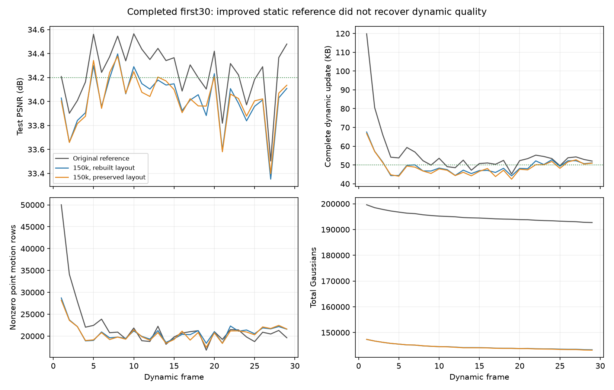

# 保留原候选空间的15万点首帧：完整前30帧

本轮从同一个150000点首帧重新运行frame0–29，共30帧，保留裁点前的候选划分平面与离群点路由字典。全30帧 **34.019742 dB**，完整动态更新 **48.754241 KB/帧**；前一版重新构建层级为34.021085 dB / 49.353552 KB。画质没有恢复，不将本候选扩展到300帧。这个结果不支持“仅恢复旧候选边界即可恢复画质”，但不能排除共享运动学习仍有改进空间。

运行：`output/flame_steak_1028/fs_ref150t_30/20261028T123227_47ec31`。配置：[fs_ref150t_30.yaml](../../config/fs_ref150t_30.yaml)，启动/方法提交`3a57ef8`。训练59013、CPU解码48957均正常退出；GPU核验68137、最终checkpoint核验64345正常退出。本轮只完成30帧，没有运行对应300帧配置。

## 想法与改动

上轮首帧从206237点/33.952248 dB改善到150000点/34.186138 dB，动态画质却降低。候选空间按点坐标中位数递归划分，裁点和首帧几何续训会改变划分，因此本轮保留原始候选空间，继续独立学习全部区域运动和gate，不复用训练后的动态运动或gate。

`spatial_gate.reference_layout`可从frame0解码参考读取候选层级，在新GS位置上重新路由。初始化检查帧号、深度、场景尺度和离群点模式；新参考保存完整划分数据，解码不依赖模板路径。相同150000点的原始属性哈希保持`de4bebd71f5aafbe973bd2eb66e6f2e16a0cdd63411ef96e9fcb6365451b0c85`，父区域、划分平面及离群点字典与旧参考逐位一致。模板是旧运行的首帧空间数据，没有引入后续帧图像或动态拟合结果。

其它训练沿用units：每步4视角，L1+DSSIM，300步，原量化，完整字节反馈；共享颜色关闭，最后20步联合优化关闭。321项回归中316项通过、5项GPU检查跳过；实际数据上的独立解码和渲染核验另行完成，不能用CPU测试代替质量验证。

## 结果

| 指标 | 原首帧units前30 | 15万点重建层级 | 15万点保留层级 |
|---|---:|---:|---:|
| 首帧PSNR/dB | 33.952248 | 34.186138 | 34.186138 |
| 全30帧PSNR/dB | 34.235354 | 34.021085 | 34.019742 |
| 动态1–29帧PSNR/dB | 34.245116 | 34.015393 | 34.014004 |
| 完整动态KB/帧 | 56.044345 | 49.353552 | 48.754241 |
| 运动包KB/帧 | 45.861034 | 40.855655 | 40.300069 |
| 新点属性KB/帧 | 2.334000 | 2.484517 | 2.463690 |
| 旧透明度KB/帧 | 6.729034 | 4.893000 | 4.870103 |
| 非零逐点运动残差行/帧 | 22228.97 | 20830.00 | 20643.31 |
| 有效共享区域/帧 | 262.79 | 248.93 | 262.55 |
| 累计编码新点 | 3110 | 3323 | 3286 |
| 最后GS数 | 192717 | 143319 | 143175 |
| 第200步旧点画质均值/dB | 34.184864 | 33.931778 | 33.934313 |

新参考的画质差距在第200步、出生操作前已经存在，不能全部归因于新增阶段。第200步与最终结果之间还涉及旧透明度变化，不能将差值等同于新点的独立贡献。保留层级与重建层级的PSNR仅差-0.001343 dB，存储减少约1.21%；不据此宣称质量差异显著或层级学习更优。

KB=1000字节，动态开销包括运动、新点、透明度和manifest。新首帧另有13,120,828字节，动态总计1,413,873字节；全部30帧流平均484.490033 KB/帧，不能将48.754241 KB当作包含首帧的均值。

[三版每帧CSV](assets/20261028_ref150t_30.csv)

## 分析与后续方向

静态首帧PSNR和点数不足以筛选动态初始化。首帧续训同时改变了几何、透明度和颜色；对保留的15万点与旧可见点交集，约20.76%的位置变化超过旧协方差的一倍标准尺度，世界协方差相对变化中位数约25.09%。这说明几何改动不能简单忽略，尚未证明它导致动态退化；裁点、可见性与损失归一化也可能有影响。

追踪旧units全299个动态更新的点ID，新15万点保留约95.99%的原首帧点非零残差使用事件、97.08%的残差符号L1总量。因此裁掉很多点不会按比例降低运动存储；这些使用统计也不能排除少数关键点的删除影响。按点数归一化的残差约束随点数改变，但码率反馈倍率同时变化，目前不把它认定为已证实原因。

下一步优先保留旧首帧XYZ、尺度、旋转和透明度，只在当前分辨率校准首帧SH外观，随后根据图像贡献与空间覆盖谨慎裁点。该方向旨在保留可供动态运动拟合的几何支撑，不预设15万是最佳点数；当前尚未实施或验证。动态共享颜色仍保持关闭。只有完整30帧画质与存储合适，再用同一方法和首帧重新完成300帧。

完整300帧参照仍是[units记录](20261028_units_full300.md)：34.064716 dB / 动态50.970251 KB，已解码渲染308.624 FPS、完整本地热缓存播放238.971 FPS。运动包占动态存储约78.59%，新点属性约6.89%；改善共享运动解释效率仍是动态压缩重点，不能把全部工作转为削减出生数量。共享首帧17.720236 MB，包含首帧的整段均值109.867803 KB；动态50KB目标与整段50KB目标应分别陈述。

## 核验

独立CPU解码逐帧核对原始属性、状态、实际字节及反馈链；GPU覆盖frame0–29，原始属性、控制状态、激活后渲染输入和像素与独立解码一致，保存PSNR吻合。最终checkpoint原始属性哈希`cefa9eaf37ceb867e4e3ffad355c5fb698013a01d1596e4fa1485cbb0b702d2c`，累计动态字节1,413,873，码率状态一致。该30帧候选未恢复画质，未重复测FPS。

证据：`tmp/goal_frame_plan/ref150t_30_cpu_decode.json`、`ref150t_30_gpu_verified.json`、`ref150t_checkpoint29_verified.json`、`ref150t_30_analysis/metrics.json`、`ref150t_comparison/metrics.json`，以及`tmp/first_frame_v2/ref150t_dynamic_bootstrap.json`、`geometry_changes17500.json`、`motion_retention299.json`。
