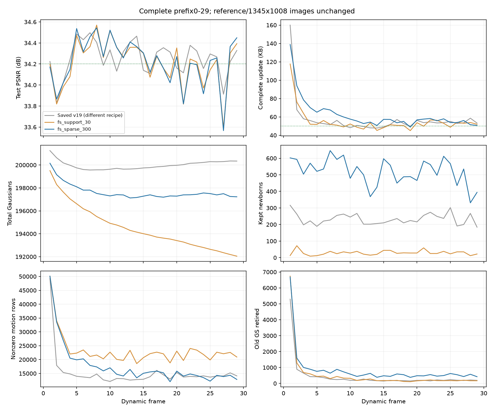

# 低透明度新点的logit学习：30帧后停止

`fs_sparse_300` 计划300帧，完成 **frame0–29，共30帧** 后保存并主动停止。全30帧平均 **34.212077 dB**；29个动态更新 **34.221037 dB / 62.075793 KB**。相对[上一个残差支持版本](20261028_support_first30.md)，画质只增加0.011750 dB，完整存储增加13.01%，不值得按此实现继续长序列。

目录：`output/flame_steak_1027/fs_sparse_300/20261028T053645_73b35b`。配置 `config/fs_sparse_300.yaml`，启动提交 `6d242d6`，方法为 `43a7e67` 和 `ca60578`；之后 `0f9fefc` 只更新文档。首帧、图像、量化、四训练视角、300步安排与关闭共享颜色不变。本轮从原始共享首帧开始，未混用上一轮前缀。停止发生在第29帧最终checkpoint和评估报告核验之后；进程退出130为主动SIGINT，关停时的数据加载器连接重置不是训练崩溃。

## 本轮改动

第一项补齐旧点透明度的存储约束：第201–300步继续执行近端窗口，并保证第300步收缩最后的不满窗口。旧实现的代理在近端模式下detach，但这100步没有对应的非零更新支持收缩，只有L1继续执行。

第二项改变低透明度新点的优化载体。残差支持新点初始透明度常约0.05，原概率域Adam步长0.06会让许多点第一步变成零。本轮改为内部logit参数，公开物理透明度、量化父参考差分和0.01删除阈值不变；继续从出生第一步计费，不增加保护期。参数化标识写入checkpoint，旧checkpoint按原概率载体恢复。本轮仍直接将0.06作为logit域学习率，后续证据显示该尺度没有充分适配50步的第二批新点。

## 完整结果

动态指标为frame1–29，KB=1000字节，含运动、新点属性、透明度和manifest。共享参考17.720236 MB单列，六类原始属性逐位相同，独立渲染33.952248 dB。动态共1.800198 MB，含参考总流19.520434 MB。

| 指标 | fs_support_30 | 本轮未校准logit |
|---|---:|---:|
| 动态PSNR/dB | 34.209286 | 34.221037 |
| 完整KB/帧 | 54.929138 | 62.075793 |
| 运动KB/帧 | 46.244897 | 43.985172 |
| 新点属性KB/帧 | 0.743276 | 10.057931 |
| 透明度KB/帧 | 6.821241 | 6.911897 |
| 非零逐点运动残差行/帧 | 23247.17 | 17648.97 |
| 最终保留新点/帧 | 29.10 | 519.62 |
| 删除旧点/帧 | 518.45 | 830.31 |
| 末帧GS | 192046 | 197227 |

更高的出生开销推动下一帧码率倍率升到3.973059，上一轮为1.721295；运动残差和运动包因此减少，而总存储仍增加。不能把非零运动行减少单独当作共享粒度改善。本轮同时改了旧透明度调度和新点参数化，不能把全部差异只归因于其中一项。

frame14–29为34.158330 dB / 54.658250 KB；上一轮同段34.157352 dB / 51.402625 KB。尾段画质几乎相同，字节仍偏高。已存v19相同动态帧为34.253958 dB / 57.096483 KB，视角及图像目标不同，只作结果参照。训练与评估平均50.18秒/帧；首帧JIT缓存条件不同，不据此宣称训练加速。

共创建29000个点，最终编码15069个，删除旧点24079个，GS从206237到197227。追踪编码删除/追加映射：可评估的14675个新点中，6386个下一帧退出，存活率56.48%；两帧后49.54%，五帧后41.52%。短寿命本身不代表无用，火焰确有短时表达需求，但需要检查是否把本可在当前帧退出的点先编码传出、下一帧才删除。

第29帧独立GPU重放与保存指标完全一致：stage200旧点34.078079 dB，插入后34.015957，最终旧点单独34.440624，完整34.448914；当前帧新点直接贡献约+0.008289 dB。旧点单独也包含之前帧出生且存活的点，不能据此判断历史新点无用。本候选未进行FPS验收，不用局部帧替代完整300帧协议。

## 为什么继续修正步长

用实际量化和新点storage loss做数值排查：不施加任何图像保留需求，第一批100步、第二批50步后如下。

| 初始透明度 | 100步后，原logit尺度 | 50步后，原logit尺度 | 删除阈值 |
|---|---:|---:|---:|
| 0.05 | 0.004309 | 0.015028 | <0.01 |
| 0.285 | 0.023142 | 0.100408 | <0.01 |

即使只想省存储，原步长也不能让这些代表性晚生点在可用步数内退出。增加storage loss的权重不能等同于增加Adam的可用运动范围；这里应先校准参数域与训练时间的尺度。

下一版以sigmoid在透明度0.5处的导数1/4为标尺，将原概率载体的0.06数值尺度转换为内部logit域0.24；这是局部尺度校准，不是任意梯度下Adam实际步长的硬上限，也不宣称理论最优。其它属性学习率、退出阈值、量化、训练步数不变。上述纯storage检查中，两批、两个初值均能下降到0.01以下，且第一步不会归零。覆盖的是这些代表性初值，最终仍需检验整段数据。

真实第1帧step201、同一初始化及四训练视角：原概率载体500个点一步有360个精确归零；校准后的logit为0个，低于删除阈值59个（初始已有44个）。初始图像损失相同0.013326，校准后一更新为0.013123；该单步不证明最终画质收益。新增生命周期回归在旧未校准代码上按预期失败，在修正版通过；共161项CPU批次检查，2项CUDA跳过，另通过原生GPU单步检查。修正提交为隔离分支 `d1f87c2`，主分支 `79cc724`，新配置 `fs_units_30.yaml` / `fs_units_300.yaml`。

另一个只读训练视角排查：第1/29帧新点的原生误差责任中，23.7%/46.8%位于相邻GT变化较大的像素，全图对应比例仅4.1%/5.6%；候选已偏向动态外观，不能简单认定都在静态背景出生。500个初始点中完全无原生贡献的为0/5个，投影重叠代理提示的近似重复为21/102个，也不足以解释所有问题。这些变化/重叠只是二维诊断，没有加入训练规则。

## 保存与后续

29个动态包独立CPU顺序解码，原始属性/状态哈希、实际文件字节、码率反馈链均一致。最终状态 `f021467fe88dd516f4deee47b0b8faf66347f9c857ffe82ddbc7da3480670245`；最终checkpoint累计1800198字节。历史输出未修改。

下一版 `fs_units_300` 从同一共享首帧新开300帧，先复查完整前30帧再继续整段，保留共享运动/gate/量化残差与统一退出思路，不混入本轮未校准前缀。逐帧CSV为 `tmp/goal_frame_plan/sparse30_analysis/per_frame.csv`，解码为 `sparse30_decode.json`；生命周期与步长证据为 `sparse_churn29.json`、`sparse_opacity_exit_budget.json`、`sparse_opacity_exit_units.json`、`units_alpha_step201.json`。
