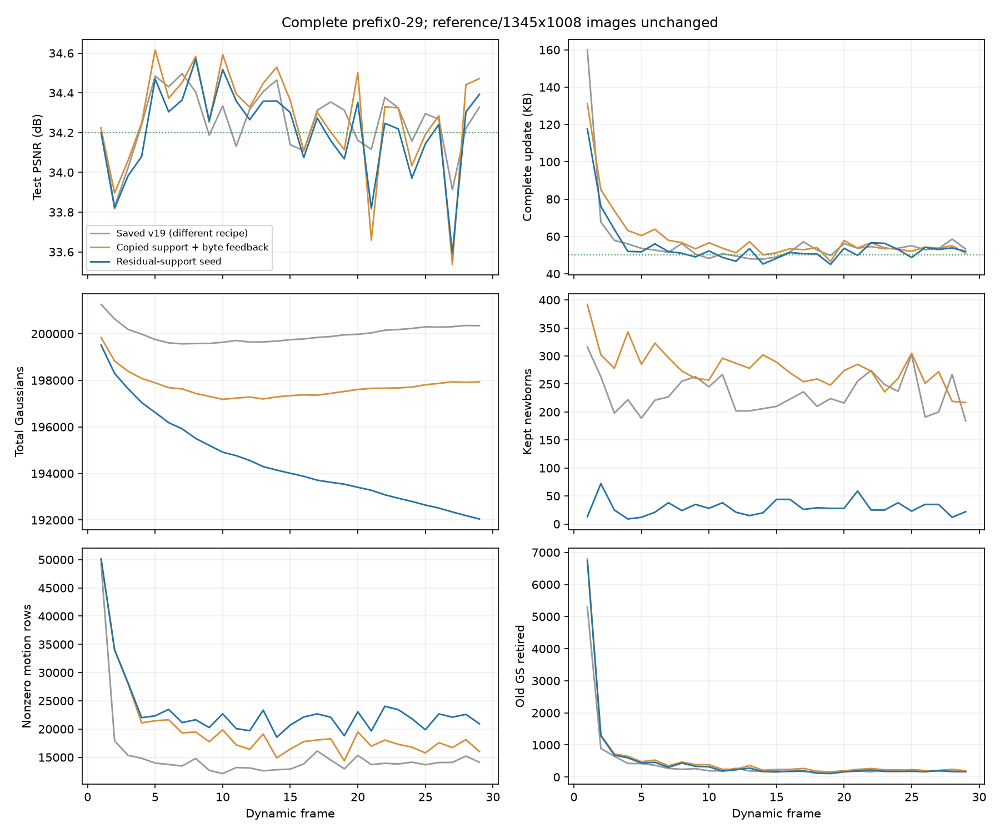

# 残差支持初始化：完整前30帧

`fs_support_30` 已正常完成frame0–29。全30帧平均 **34.200718 dB**，29个动态帧 **34.209286 dB / 54.929138 KB**。相对上一轮同训练安排的 `fs_rate_30`，完整动态更新减少 **7.06%**，PSNR降低 **0.061665 dB**；GS从206237降至192046，后段持续下降。它改善了新增开销和人口增长，但未证明画质改善，也不代表300帧结果或SOTA。

运行目录为 `output/flame_steak_1027/fs_support_30/20261028T045924_0b7b7d`，方法提交 `cbd619f`，配置 `config/fs_support_30.yaml`。1345×1008图像、同一共享首帧、四训练视角、量化精度、分阶段步数、码率反馈和关闭共享颜色均保持不变。本轮仍使用原有概率透明度训练载体；后续的透明度更新修正不在本轮结果中。

## 想法与实现

[前一轮长序列](20261028_rate_stopped180.md)发现，高误差父点常带有很宽或极扁的协方差，直接复制它再采样局部GT颜色可能不匹配。本轮在相同四训练视角的原生颜色Jacobian中，测量真实 `T×alpha×RGB残差平方` 的图像中心和协方差，不添加视角筛选或额外前向，只增加一次反向/视角。新点据此取得独立位置和尺度/旋转，以父点中心深度作为先验；多视角选择有证据位置的加权medoid，不把这些误差分布称为测得表面。未观测射线厚度仍使用先验。

新范围未经过训练，透明度初值取父透明度与其原生支持加权残差RGB均方根的较小值；颜色继续采样训练GT，高阶SH清零。全部属性仍独立学习、量化和相对存活旧点编码。默认关闭此初始化，v19配置不进入本路径。实现集中在 `residual_support_geometry.py`、原生误差矩采集、`frame_plan.py` 和出生配置。

另外修正新增误差统计：新增前后均使用相同训练视角上的未过滤RGB SSE，筛选用误差另列。旧报告的新增前SSE扣除了0.03误差下限过滤、之后没有，历史倍率偏大，不能与本轮倍率直接比较。此修正不改图像损失或最终PSNR。

## 结果与限制

KB=1000字节，完整动态更新包含运动、新点属性、旧点透明度和manifest。初始参考17.720236 MB单列，六类原始属性与此前逐位相同，独立重渲染33.952248 dB。29个动态包共1.592945 MB，含参考总流19.313181 MB。

| 指标 | 上一轮fs_rate_30 | 本轮fs_support_30 |
|---|---:|---:|
| 动态PSNR/dB | 34.270951 | 34.209286 |
| 完整KB/帧 | 59.102793 | 54.929138 |
| 运动KB/帧 | 44.580483 | 46.244897 |
| 新点属性KB/帧 | 5.817586 | 0.743276 |
| 透明度KB/帧 | 7.583966 | 6.821241 |
| 非零逐点运动残差行/帧 | 19928.79 | 23247.17 |
| 最终保留新点/帧 | 278.79 | 29.10 |
| 删除旧点/帧 | 565.14 | 518.45 |
| 末帧GS | 197933 | 192046 |
| 训练与评估秒/帧 | 53.73 | 51.89 |

总存储下降主要来自新点属性；运动包反而增加，非零运动残差行也增加约3318行。下一帧码率倍率仅1.721295，上一轮为2.851904，出生开销下降会经反馈改变其他分支的压力。因此，不能把GS减少直接等同于运动残差减少，不能将总体收益归因于gate或初始化中的某一个属性。

frame14–29为 **34.157352 dB / 51.402625 KB**，平均新增30.81、删除171.31，净减少约140.5个GS/帧。完整均值仍为54.93 KB，不能用后段均值替代它。已存v19相同动态帧为34.253958 dB / 57.096483 KB，但视角数和图像目标等不同，只作为结果参照。

共创建29000个新点，仅保留844个；低存储也可能意味着新点被过早删除，需要核对学习过程。58次出生事件中36次使四训练视角即时SSE下降，平均新增后/前为0.992088。第29帧独立GPU重放：旧点stage200为34.055435 dB，新增初始化后34.016045，最终旧点单独34.381691，完整34.392647。新点初始化的留出跌幅仅约0.0394 dB，最终直接贡献约+0.0110 dB；最后100步的综合改善主要仍来自旧点透明度和清理。该单帧不代表所有新点或长期贡献。

第27帧为33.593140 dB，上一轮33.536922，有小幅改善但仍偏低。前30帧达到34.2附近不保证后段可靠，上一轮长序列失败已说明必须完整验证。

## 校验和下一步

CPU按顺序独立解码全部29个包，原始属性/状态哈希、实际文件字节和反馈链均一致；最终状态为 `11f1519fc0ff32248f1a04f65dd5b095fedc7ceac9d06f6b216023a615f5d9ba`。第29帧GPU重渲染与保存PSNR完全一致。158项CPU批次检查中2项CUDA用例跳过，另完成真实原生误差矩/出生渲染检查；本轮未测FPS，最终必须在完整300帧上验收。

审查确认另一个阶段衔接遗漏：旧点透明度在近端模式下将存储代理detach，但第201–300步未继续执行非零更新的近端收缩，只有L1仍执行。下一版将延续原窗口并保证第300步最终收缩，不增加Adam更新。真实checkpoint179上的只读“补一次最终支持收缩”使透明度包7581→7317字节；这只是诊断，历史输出没有修改，不能作为重训练画质结果。

第1帧step201的真实四训练视角单步检查确认了低透明度新点的数值风险：500个新点初始透明度均值0.052843，其中44个原本低于删除阈值；469个收到降低透明度的梯度。原概率参数化一步后360个精确归零、383个低于0.01；相同量化前向改用logit参数化后，精确归零为0、低于阈值45个。原参数化的单步图像损失下降更多（0.013326→0.012815），logit为0.013245，所以该检查不能证明最终画质改善；它说明原流程会在几何/颜色刚开始学习时让多数低透明度新点失去渲染梯度。

下一版仅对残差支持新点使用logit优化载体，物理透明度、量化父参考差分和退出阈值保持不变，仍从第一次更新支付存储代价，不添加保护期。保存参数化标识；旧checkpoint缺失此标识时继续按原概率载体恢复。160项CPU批次检查中2项CUDA跳过，新增检查覆盖一步归零、存储梯度、换参考和保存恢复；原生GPU单步前向一致。修正后从同一首帧新开 `fs_sparse_300`，先检查其完整前30帧，再继续长期验收，不将本轮旧实现前缀混入新实现。

附加排查没有支持继续事后重分解或复杂无损包装：固定区间与总运动后，代表向量换成中位数/众数只改变几个非零残差行；179帧的上一帧残差无损预测平均仅节约约21字节/帧。它们只用于排除优先级，不是新的训练结论。

逐帧CSV与指标在 `tmp/goal_frame_plan/support30_analysis/`；解码为 `support30_decode.json`，反事实渲染为 `support_cohort_probe029.json`，阶段存储遗漏核对为 `opacity_missing_final_support_only179.json`，新点真实单步为 `support_alpha_step201.json`。历史output保持只读。
