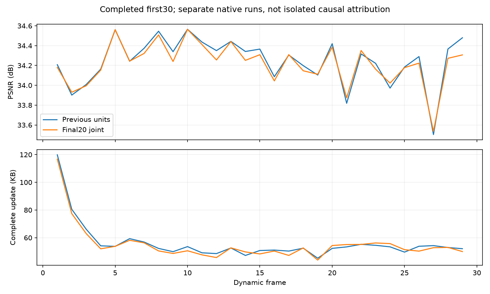

# 最后20步联合优化：完整前30帧

`fs_tail_30` 完成frame0–29，共30帧，训练及独立CPU/GPU解码均正常结束。全30帧平均PSNR **34.208182 dB**，29个完整动态更新平均 **55.147000 KB**。

运行：`output/flame_steak_1027/fs_tail_30/20261028T102930_cc69a1`；方法提交`3228443`，配置[fs_tail_30.yaml](../../config/fs_tail_30.yaml)。共享首帧、量化精度、四训练视角、L1+DSSIM与存储反馈沿用前版，共享颜色关闭。

## 想法与改动

旧运动在200步固定后，新点与旧透明度仍变化，最终组合可能需要重新调整旧运动。本候选在281–300步固定gate，联合优化旧共享运动、逐点残差、旧透明度和新点；仍只有300次共享Adam更新，没有额外SGD或事后运动重分解。编码前更新旧点的实际量化位姿，再删除、重选新点参考并导出。

真实第1/29帧核验通过：共享运动总220次、逐点残差120次、新点两批100/50次，gate在末段固定；280/281步checkpoint包含新点，恢复后不重复出生/清理，最终训练属性与独立解码一致。

## 结果与判断

| 指标 | 前版units同帧段 | 本轮 |
|---|---:|---:|
| 全30帧PSNR | 34.235354 | 34.208182 |
| 完整动态KB/帧 | 56.044345 | 55.147000 |
| 末帧GS | 192717 | 192879 |

本轮PSNR差值-0.027172 dB，存储变化-1.601%。没有取得预期的画质提升，因此不扩展该候选到300帧；按用户最新指示，下一步优先优化首帧质量与点数。

两次运行的首帧原始属性与解码状态完全一致，首帧相同布局、门控随机序列亦核验一致；但第100–200步的实际优化结果已存在差异，不能把最终指标差全归因于末20步。此处比较是保存结果参照，不是严格单变量消融，未另跑重复实验归因。

首帧17,720,236字节单列，KB=1000字节。动态统计包含运动、新点属性、透明度及manifest。[逐帧CSV](assets/20261028_tail30.csv)保留每帧指标；本轮不是全300帧结果，也未重复测FPS。

## 核验

独立CPU顺序解码覆盖全部29个动态包，原始属性/状态、实际字节与反馈链一致。GPU核验覆盖frame0–29，原始属性、状态、激活后的渲染输入、实际像素及保存PSNR一致。真实保存点29的累计动态1,599,263字节、控制状态和原始属性哈希核验通过。

证据：`tmp/goal_frame_plan/tail30_gpu_verified.json`、`tail30_cpu_decode.json`、`tail30_native1_schedule.json`、`tail30_native29_schedule.json`、`tail30_checkpoint29_verified.json`、`tail30_pre200_frame1_comparison.json`。只读诊断不修改历史输出。
