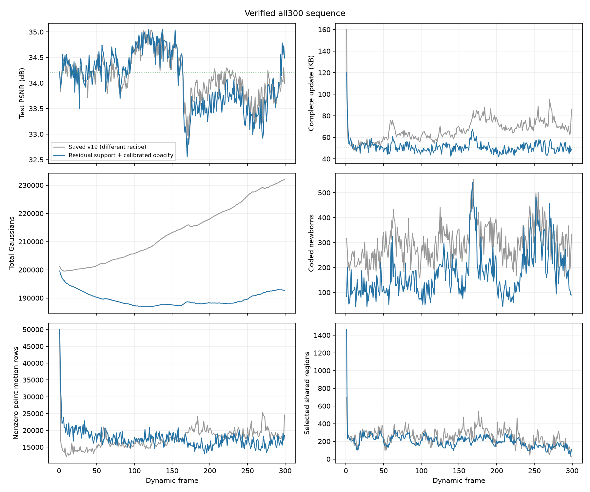

# 残差支持初始化与透明度尺度校准：完整300帧

`fs_units_300` 已从共享首帧连续完成 **frame0–299，共300帧**，没有混入其他训练方法的前缀。平均 PSNR **34.064716 dB**；299个动态更新的完整存储平均 **50.970251 KB/帧**。超过34 dB的最低画质要求，尚未达到希望的34.2 dB。相比已存v19，画质略降、动态存储明显减少；训练设置不同，不能把全部收益归因于自适应共享粒度。

运行：`output/flame_steak_1027/fs_units_300/20261028T060649_97d995`。配置：fs_units_300.yaml（原路径 `../../config/fs_units_300.yaml` 已不在工作区）；方法源码提交 `79cc724`，启动提交 `97d995`。后续主分支仅更新文档，直到本轮整段核验和计时结束仍保持相同训练与播放源码。训练进程和独立CPU顺序解码进程均正常退出。

## 核心想法与实现

延续 frame_training_plan.md（原路径 `../frame_training_plan.md` 已不在工作区）：预建空间层级、可学习gate、共享区域平移与量化逐点残差；每步4个不同训练视角，统一L1+DSSIM，共300次共享Adam更新。前100步学共享运动与gate，101–200步逐步开放残差和透明度、再次学习gate并固定；201–300步固定旧运动、训练新点及旧透明度。共享颜色和旧点旋转更新关闭，新点旋转继续学习。

本次继承此前候选的三项处理，量化精度不变：

- 第200/250步利用同一组4个训练视角的原生合成责任度，估计残差区域的中心和范围，给新点独立紧凑协方差。深度仍采用父点中心先验，不是多视角三角化；颜色从训练图像采样。
- 新点按可解码存活状态支付基础属性与差分开销；新旧点统一按当前解码透明度低于0.01退出，200/250/300步清理，父点不受保护。参考退出后重选存活旧点，保持新点实际属性并重新计算量化差分。
- 每帧编码后，使用完整实际字节反馈下一帧的存储价格；目标50000字节。低透明度新点采用logit优化载体，并将透明度学习率按sigmoid中点Jacobian校准，避免概率载体一步归零或未校准logit载体难以退出。旧透明度在201–300步继续执行近端存储窗口。

这些处理旨在减少无效支撑与错误生命周期带来的开销，不等于已经验证了共享粒度选择的独立贡献。

## 完整结果

KB按1000字节计算，动态存储包含运动、新点属性、透明度与每帧manifest；运动包中也有新增位置和删除映射，不能全算作旧点运动残差。

| 指标 | 本轮完整300帧 | 已存v19参考 |
|---|---:|---:|
| PSNR，包含共享首帧 | 34.064716 dB | 34.133703 dB |
| 完整动态更新，299帧均值 | 50.970251 KB | 66.658686 KB |
| 末帧GS数 | 192764 | 232033 |
| 已解码渲染FPS | 308.624 | 261.024 |
| 完整播放FPS | 238.971 | 未按本轮协议测量 |

动态存储较v19减少23.535%，全300帧PSNR低0.068987 dB。v19与本轮在训练视角数、图像损失和阶段安排等方面不同，是保存结果参照，不是单变量消融。当前不声称超过跨场景SOTA。

本轮在RTX3090Ti、1345×1008下逐帧预热10次、计时50次，共15000次`Module.forward+clamp`。同步计时总48.602761秒，按总渲染次数除总时间得到308.624 FPS；最慢帧261.243 FPS。预先解码和激活属性缓存不计入此渲染范围，完整播放单列。全300帧独立重渲染的SSIM均值为0.967465。

动态更新总计 **15,240,105字节**。共享首帧另有 **17,720,236字节**，包含首帧的完整流总计 **32,960,341字节**，摊至全部300帧为 **109.867803 KB/帧**。50.970 KB指动态更新，不能当成已包含首帧的平均成本。

动态存储中，运动包平均40.058094 KB、新点属性3.511151 KB、旧透明度6.279602 KB；其余约1.121405 KB为manifest，共享颜色包为零。动态帧平均17564.17个旧点具有非零逐点运动残差，这一数量与v19接近，因此不能仅凭存储下降声称残差行数显著减少或gate更优。

首帧206237个GS，序列累计编码52629个当帧新点、退出66102个旧点，末帧192764个，净减少13473个。后段仍有局部增长，但本轮没有总点数持续超过首帧的问题。训练与评估平均49.23秒/动态帧；精确计时范围另见逐帧记录。

| 动态帧区间 | 本轮PSNR/dB | 本轮KB/帧 | 已存v19 PSNR/dB | 已存v19 KB/帧 |
|---|---:|---:|---:|---:|
| 1–29 | 34.245116 | 56.044345 | 34.253958 | 57.096483 |
| 30–59 | 34.278822 | 50.714067 | 34.195820 | 56.979267 |
| 60–89 | 34.287910 | 52.039433 | 34.087291 | 64.395767 |
| 90–119 | 34.688408 | 47.910533 | 34.601395 | 59.744900 |
| 120–149 | 34.725849 | 50.929800 | 34.678489 | 63.163700 |
| 150–179 | 33.862031 | 53.844867 | 34.016249 | 72.754333 |
| 180–209 | 33.534856 | 48.090400 | 33.921249 | 76.243000 |
| 210–239 | 33.761225 | 49.118200 | 34.107712 | 69.173400 |
| 240–269 | 33.397348 | 51.053900 | 33.641941 | 73.529533 |
| 270–299 | 33.875356 | 50.126100 | 33.842979 | 73.187733 |

[全300帧逐帧CSV](assets/20261028_units300.csv)单列共享首帧大小和动态更新，包含PSNR、SSIM、LPIPS、各包大小、GS数及码率倍率。

## 画质诊断与下一步

前150帧均值曾达到34.443269 dB，后段下降，不能使用此前缀代替完整结果。第150–239帧相对已存v19存在画质代价；最后270–299帧为33.875356 dB / 50.126100 KB，已存v19同段为33.842979 dB / 73.187733 KB，说明下降并非每个晚段都相同。

只读保存图像诊断显示，第206帧当前火焰/锅ROI的RGB8误差略低于v19，整体PSNR仍低约0.715 dB；第269帧低约0.840 dB，衣服/手臂区域有明显偏差。ROI可重叠，不能相加归因；图像为RGB8诊断，主指标始终采用浮点评估。不能把全部下降简单解释为火焰新增不足。

第200步到最终结果在多数30帧区间只增加约0.01–0.08 dB，部分区间略降。这里新点与旧透明度同时变化，不能分离其影响。旧运动在200步固定，而最终支撑和透明度继续变化，是下一步待检验的阶段衔接假设。

下一候选 `goal/late_joint` 已在独立工作树提交 `17123e8`，完成319项回归（314项通过，5项GPU检查跳过），计划最后20步固定gate、联合学习共享运动、旧点残差、旧透明度及新点，仍总计300步。第300步先更新旧点实际量化位姿，再清理及重选新点参考；不做事后运动重分解。当前记录不将尚未训练的候选视为有效改进。

## 核验与证据

独立CPU顺序解码覆盖299个动态更新，逐帧原始属性/状态哈希、实际文件大小及反馈链均一致；第299帧checkpoint原始属性、累计字节和码率控制状态亦核验通过。最终状态哈希为 `8a2784e636da73cd973f5249284bcf190467085787c6b19a0fc62dada1ff04af`。

GPU完整核验覆盖全部300帧，原始属性、状态、激活后渲染输入和实际像素与独立CPU解码一致，保存PSNR差值全部为0，300帧cam00相机几何签名一致。两种FPS均独占GPU测量。完整播放三轮各覆盖299次更新，按总897次更新除总时间得到238.970618 FPS（各轮为248.255、226.169、243.650）。范围包括文件读取与校验、两个CPU解析进程、至多两个未来稀疏包预取、属性预测和GPU更新及实际渲染；不缓存未来帧的稠密属性。首帧加载、进程启动与JIT属于启动开销，不计入播放计时；每轮末状态和像素均重新核对。本地文件已预读，报告本地热缓存口径，不能当成网络或冷盘吞吐。

计时脚本的旧字段兼容已修正于 `ac45382`：新格式的`encoded_bytes`包含manifest，旧格式仅为包体，现分别严格核验并保留完整字节统计，防止漏计或重复计入。18项回归及全部299帧实际字段检查通过；训练源码、码流和渲染内核没有因此改变。测量前重新生成匹配当前脚本哈希的GPU完整核验证书。

证据位于 `tmp/goal_frame_plan/units300_cpu_decode.json`、`units_checkpoint299_verified.json`、`units300_gpu_certificate_v2.json`、`units_stage200_vs_final.json`、`units_motion_convergence269.json`、`units_hard206_269/`。逐帧CSV及曲线见上；速度证据为 `units300_render_v2.json` 和 `units300_playback.json`。
