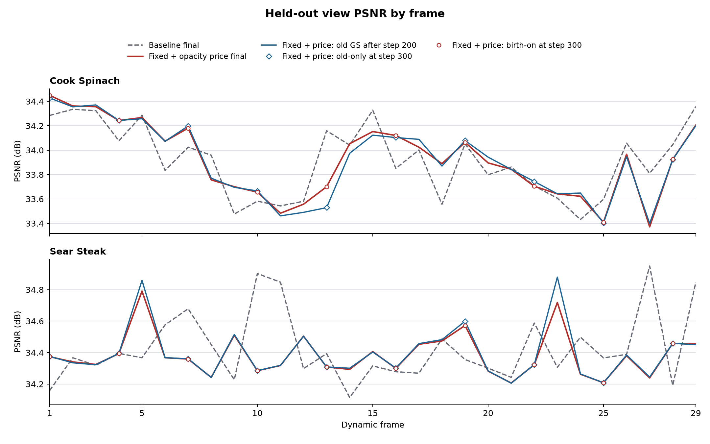
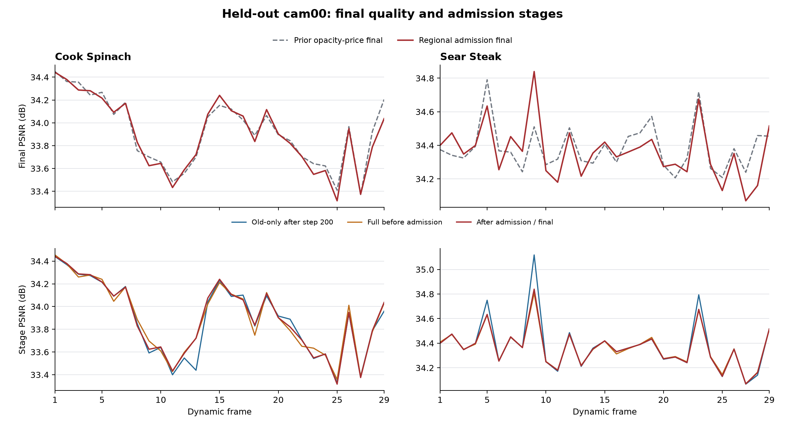

# 历史实验记录汇编

## Cook Spinach：旧点固定后出生点拟合的前 30 帧

日期：2026-11-02

### 目的与设置

检验每帧前 200 步完成区域共享运动、可学习空间 gate、逐点量化残差和旧点透明度拟合后，固定旧点状态，只继续优化 newborn 是否改善后阶段的画质。五层候选边界预先确定；本实验的整体结果不能单独证明 gate 的因果收益。

启用 `birth.keep_incumbent_fixed_after_motion: true` 后，第 200 步清理结束的旧点位置、旋转、透明度、区域 DC 和尺度保持固定，后续 newborn 仍可新增和训练。配置保留 `final_joint_refine_steps: 30` 以记录原值，但实际旧运动 tail 为 0；前 200 步训练计划与原实现一致。

实现主要在 `pipeline/frame_plan.py` 和 `pipeline/module.py` 控制旧参数、优化器与实际尾训，`pipeline/trainer.py` 记录各阶段诊断；`tests/test_frame_plan.py` 覆盖前 200 步一致、旧参数冻结、恢复和码流一致。

与同场景单帧基线使用同一共享首帧、固定五层空间层级、分辨率和四视角训练。保持 `target_update_bytes=0`、运动及区域 DC 有效价格 `0.006`，并关闭指定 newborn storage loss 与旧点 opacity 价格；阈值清理仍存在。因此这次首先检验画质机制，完整动态更新不以达到 50 KB/帧为前提。留出 cam00 的阶段图像只作记录，不参与训练或选择。

- 配置：运行目录的 `config.yaml`。当前入口为 [Cook 基础配置](../../config/cook_spinach_core_depth5_incumbent_opacityprice_30_20261102.yaml)，覆盖 `module.birth.population_rate_exempt=true`、`module.opacity_update.l1_weight=0.0`、`module.opacity_update.proximal_regularization=false`，并指定新实验名；frame0–29 共 30 帧；frame1 和 frame29 保存第 300 步 checkpoint。
- 新实验：`/mnt/SSD500GB/my4dgs_output/goal_n3dv_dynamic_20261031/cook_spinach_core_depth5_fixedprice_fixed_incumbent_30_20261102/20261102T231038_64d740`。
- 既有基线：`/mnt/SSD500GB/my4dgs_output/goal_n3dv_dynamic_20261031/cook_spinach_core_depth5_fixedprice_singleframe_30_20261102/20261102T124653_dc2fdc`。
- `cache_data_on_device: false` 只作用于普通 Fetcher；frame-plan 的训练视角仍由 `transaction_camera_views()` 缓存在设备上。

### 前 29 个动态帧

frame0 为共享 reference，以下统计 frame1–29；KB 按 1,000 B。完整动态更新包括 motion、birth、opacity、区域 DC 和逐帧 manifest，reference 单列。

| 指标 | 基线 | 固定旧点 | 差值（固定减基线） |
|---|---:|---:|---:|
| test PSNR / dB | 33.91630 | 33.88405 | -0.03225 |
| SSIM | 0.962479 | 0.962167 | -0.000312 |
| LPIPS | 0.123856 | 0.124314 | +0.000458 |
| 完整动态更新 / KB/帧 | 107.868 | 110.217 | +2.349 |
| 动态更新 P95 / 最大 / KB | 125.955 / 166.900 | 129.801 / 166.321 | — |
| motion / opacity / birth / 区域 DC / manifest / KB/帧 | 31.715 / 61.893 / 12.546 / 0.429 / 1.285 | 33.876 / 61.995 / 12.568 / 0.405 / 1.373 | — |
| 新增 / 退休 GS 总数 | 16,420 / 64,592 | 16,355 / 62,051 | -65 / -2,541 |
| frame0 → frame29 GS | 152,557 → 104,385 | 152,557 → 106,861 | 末帧 +2,476 |
| 平均训练时间 / 秒/动态帧 | 56.55 | 52.20 | -4.35 |

新实验 frame1–9、10–19、20–29 的平均 test PSNR 分别为 34.14571、33.83596、33.69664 dB；最低/最高分别为 33.41436/34.43748 dB。平均完整动态更新相对基线变化 +2.18%，其中 opacity 仍是实际字节的重要组成。

新实验动态更新总量为 3,196,289 B，共享 reference 为 13,811,629 B（SHA256 `71bfd3fa2b8880318d1b295359b600799cf7122e2073f7192fb85cb34338f32b`）；两者之和摊至本次 30 帧为 566.931 KB/帧。此摊销数不代表 300 帧。

### 新实验的阶段画质

下表均为 cam00、29 个动态帧的算术平均 PSNR；每行各有 29 个观测。200/250 后加入新点的瞬间变化不等于其训练完成后的贡献。旧基线只保存了 step200 old-only 与最终结果，没有下表中其他阶段，不能补成配对数据。

| 阶段 | 平均 PSNR / dB |
|---|---:|
| 200 清理前 | 33.85917 |
| 200 清理后 | 33.85917 |
| 200 加入 newborn 后 | 33.76096 |
| 250 清理前 | 33.88196 |
| 250 清理后 | 33.88191 |
| 250 加入 newborn 后 | 33.74710 |
| 300 清理前 | 33.88359 |
| 300 清理后 | 33.88405 |
| 300 birth_off | 33.85917 |
| 300 birth_on | 33.88405 |
| 300 独立解码 | 33.88405 |

固定旧点的 step200 清理后 → step300 birth_off 平均变化 +0.00000 dB，范围 0.00000 至 0.00000 dB（29 帧）。同一最终旧点状态上，birth_on 相对 birth_off 平均变化 +0.02488 dB，范围 -0.05617 至 0.31298 dB；200、250 两批新点刚插入后的平均瞬时变化分别为 -0.09820、-0.13481 dB。

旧点更新、出生初始化与后续训练可能共同影响这些差值；单次前后比较无法确定每项的独立作用。短测中，即使开关尚未生效，两个 Cook 三帧运行在首个动态帧 step200 清理后也已有约 0.02200 dB 差异。CPU 测试中前 200 步轨迹一致，但 GPU 运行不保证逐位确定；本轮总指标变化不能全部归因于固定旧点。两帧短测的首帧诊断位于各自 `frame_summary/frame_001.json`。

### 固定运动下的层级诊断

frame29 的 106,281 个旧点全部位于 depth1 的 8 个活动区域；旧基线的 103,832 个旧点按 depth1–5 分别为 85,843、16,864、973、150、2 个。两次运行的状态不同，不能把此差异单独归因于冻结。固定新实验该帧已学的总量化运动、存活集和出生点，重新编码可逐字节复现学习 frontier 的 28,842 B motion 包；统一 depth1 并用各区坐标中位数作为代表为 28,818 B，统一 depth5 为 33,158 B。这说明本帧活动划分没有实际细分；均匀深层较大但不能据此断言自适应层级整体有效。该诊断固定总量化运动符号，反事实解码位置只按 `allclose(atol=1e-6, rtol=1e-5)` 检查、旋转按归一化四元数点积检查，补充逐位检查中，统一 depth1/2 的 xyz 与学习包一致，depth3/4/5 分别有 911/1,054/2,146 个点不同，最大绝对差依次为 9.54e-7、1.91e-6、1.91e-6；因此不应将这三种反事实称为逐位一致。各区中位数不是最优编码下界，诊断没有重新训练或比较画质。结果与逐位精度保存在 `/mnt/SSD500GB/my4dgs_diagnostics/cook_frontier_fixed_and_opacity_20261102/fixed_incumbent_frame029.json` 和同目录 `fixed_incumbent_frame029_xyz_precision.json`。

对本实验全部 29 帧分别以真实前驱为锚做相同诊断，29 个学习 motion 包均逐字节复现，合计 982,390 B；五种固定均匀深度里 D4 的坐标中位数构造最小，合计 1,020,906 B，多 38,516 B。即使每帧从五种均匀构造中选择最小包，oracle 合计仍为 1,018,718 B，多 36,328 B，学习包在 28/29 帧更小。该 oracle 未计每帧深度信令，各反事实独立使用真实前驱，并非核验过的连续替代码流；它只比较这些特定中位数构造下的完整 motion 包；该包还含 gate、生存映射和 newborn 的位姿/来源，差额不能全算成 gate 编码节省，也不代表全流节省、重训画质或编码最优性。结果位于 `/mnt/SSD500GB/my4dgs_diagnostics/cook_frontier_fixed_and_opacity_20261102/fixed_incumbent_frame001_029_sequence.json`。

### 验证与限制

- 源码快照、配置差异和监测日志位于本次运行 `diagnostics/guarded_launch/`；启动快照 SHA256 `ef654db73f7b14b57c4785555a6c26ce5d029021500798ab189e0bf871fd8157`，运行期间已收录源码变化：0 项。快照不包含外部 libgs、Python 环境和预编译库。
- CPU 从共享 reference 连续解码 frame1–29，逐帧 manifest 状态和 raw 属性摘要通过；frame29 decoder SHA256 `ba0cc28a3614e71175d165f0e3acb84acc180ceb6db9dcb95ad5ddd1f5367ccd`。最终 checkpoint 的 xyz、rotation、logscale、opacity、SH DC 和 SH rest 均与解码结果逐字节一致。
- 逐帧文件实际长度与 summary 全部一致；29/29 帧的独立解码阶段状态与属性摘要匹配。GPU 进程组显存峰值 3606 MiB，设备最低空闲 2311 MiB；未触发守护。
- 本实验未测量已解码渲染 FPS 或含读取、解码、更新与渲染的完整播放 FPS；本段结果不代表完整 300 帧，也不能声称超过 SOTA。
- Cook 启动快照漏收 141 个第三方 `.inl/.txt`，已在运行中补存为 `source_supplement.tar.gz`（SHA256 `7e3fefdd8a8ec33059868dfdcf2e0dd8c141a404e4b390c753443ed78268516a`）；这些文件 mtime 均早于启动，补存时内容与 HEAD 一致，但补充包并非启动瞬间采集。

---

## Cook Spinach：五层候选运动、固定运动价格的单帧基线

日期：2026-11-02

### 目的和配置

本实验是人口窗口方案的单帧基线，使用固定五层候选空间、可学习 gate、区域共享运动和逐点量化残差。训练机制与同期 Sear Steak 单帧基线一致；两场景的前 30 帧结果不代表完整 300 帧表现，也不能单独证明自适应 gate 的因果收益。

配置关闭 newborn storage loss 和 survival-aware storage，将 population loss、alpha sparsity loss、旧点 opacity 的 L1 与 proximal 正则设为零，并启用 `birth.population_rate_exempt`，使旧点 opacity 的额外字节价格为零。运动及区域 DC 价格保留：`target_update_bytes=0`、`initial_rate_multiplier=1`、`rate_loss_weight=0.006`，与原 core 的起始运动有效价 `0.002 × 3` 相同。旧点 opacity 阈值仍为 0.01，其他人口变化机制也仍生效；这只是清零指定的人口码率和稀疏正则，不是消除全部人口压力，不能假定满足 50 KB/帧。

- 配置：运行目录的 `config.yaml`。当前入口为 [Cook 基础配置](../../config/cook_spinach_core_depth5_incumbent_opacityprice_30_20261102.yaml)，覆盖 `module.birth.keep_incumbent_fixed_after_motion=false`、`module.birth.population_rate_exempt=true`、`module.opacity_update.l1_weight=0.0`、`module.opacity_update.proximal_regularization=false`、`trainer.cache_data_on_device=true`，并指定新实验名；每动态帧 200 motion + 100 birth steps，每步 4 个训练视角。
- 数据：`data/colmap4d/cook_spinach_300` 软链接，`resolution: -1`，图像 1345×1008，cam00 留出评测。
- 首帧：`/mnt/SSD500GB/my4dgs_assets/cook_spinach_twostage_cap150k_15k_20261031/ckpt-0-15000.pth`，15,000 steps、SH1；原始 157,635 GS，按 0.0075 opacity 阈值保留 152,557 GS。六类保留属性与五层 reference 逐位一致。
- 五层 reference：`/mnt/SSD500GB/my4dgs_assets/cook_spinach_depth5_core_rd_joint_20261102/reference_frame0.npz`；原四层路径和首帧属性保留，候选节点由 4,681 增至 37,449。派生文件 SHA256：`a1502931781732c6d617400f053c75523fb24fd085f33b42e95623f41a5e0cb1`。
- 运行目录：`/mnt/SSD500GB/my4dgs_output/goal_n3dv_dynamic_20261031/cook_spinach_core_depth5_fixedprice_singleframe_30_20261102/20261102T124653_dc2fdc`。

启动前保存了 `main.py`、`pipeline/`、`extensions/` 和本实验配置的源码快照与逐文件清单，启动后复核快照范围内文件无变化；快照位于运行目录 `diagnostics/repository_source_at_launch.tar.gz`，SHA256 为 `72892b5a6271713e81507d6494dc5cfd33f55e3c2f6449dc166b23efca6ccaad`，不包含外部 Python 环境、数据、预编译第三方库或首帧资产。

### 前 30 帧结果

frame0 为共享参考，本次没有单独重测 frame0 画质。画质和动态更新统计为 frame1–29，KB 使用十进制字节；完整更新包括 motion、birth、opacity、区域 DC 和逐帧 manifest。

| 指标 | 结果 |
|---|---:|
| 动态 test PSNR / SSIM / LPIPS | 33.91630 dB / 0.962479 / 0.123856 |
| 动态 PSNR 最低 / 最高 | 33.43200 / 34.35785 dB |
| 完整更新均值 / P95 / 最大 | 107.868 / 125.955 / 166.900 KB/帧 |
| motion / opacity / birth / 区域 DC 均值 | 31.715 / 61.893 / 12.546 / 0.429 KB/帧 |
| manifest 均值 | 1.285 KB/帧 |
| 动态更新总量 | 3,128,170 B |
| 共享 reference | 13,811,629 B |
| reference 加动态更新，摊至 30 帧 | 564.660 KB/帧 |
| 出生 / 退休总数 | 16,420 / 64,592 |
| GS 数量，frame0 → frame29 | 152,557 → 104,385 |
| 平均训练时间 / 墙钟时间 | 56.55 / 56.82 秒/动态帧 |

首个动态帧退休 11,751 个 GS、出生 502 个；其后点数继续下降。frame1–9、10–19、20–29 的平均 test PSNR 分别为 34.06684、33.86967、33.82743 dB，出现分段下降，但场景内容、训练和持续人口变化均可能相关；该记录不能单独证明删除点导致画质下降。step200 的同一留出视角旧点基线平均 33.87764 dB，最终结果平均提高 0.03866 dB；11/29 帧最终结果低于该步，单帧差值范围为 −0.26437 至 +0.54681 dB。后续多种更新共同影响该差值。

opacity 占完整更新约 57.4%，每帧平均约 89,186 行旧点 opacity 有编码更新，是主要码流来源。关闭指定的 opacity 价格可能使较多更新保留，但这不是单变量实验。逐点运动残差平均约 10,333 行；平均每帧约 857 个点位于最深活动区域，点加权平均选择深度约 1.367。最深层被使用不等于已经证明它改善画质。

对 frame29 做冻结重编码：区域和逐点平移步长同为 `6e-5`（extent 单位），旋转步长同为 `0.001` 弧度；固定已学总量化运动、存活集和出生点。学习 frontier 逐字节重现真实 25,950 B motion 包；统一 depth5 以每区坐标中位数代表运动时为 29,850 B，多 3,900 B；统一 depth3 为 26,406 B，多 456 B。中位数并非最优编码下界，也没有重新训练或比较画质。诊断保存在运行目录 `diagnostics/frame029_uniform_frontier.json`。

### 核验与边界

- 运行时 reference SHA256 为 `71bfd3fa2b8880318d1b295359b600799cf7122e2073f7192fb85cb34338f32b`；与派生参考的全部数组逐项相同，NPZ 容器大小差 1 B。
- 29 组 packet 与 manifest 实际文件长度均与 frame summary 一致。逐帧比较数据保存在运行目录 `diagnostics/paired_baseline_frames_001_029.json`。
- CPU 从共享 reference 连续解码 frame1–29，29 组 manifest 的状态与原始属性 hash 均通过；最终 decoder SHA256 为 `e6141d4791d27a1595e385b5b21e65a20eb52b822ac82a1cfe741efd5aa75af0`，与 frame29 checkpoint 状态和六类原始属性逐位一致。raw SHA256 为 `4cd58bd31a5f880690fe48c30bcf1f0ad5a24e76c79ecfbdac85833c59682767`，核验日志在运行目录 `diagnostics/cpu_replay_frame029.log`。
- 本次没有测量已解码渲染 FPS 或完整播放 FPS；此前短测的 CPU/GPU 解码检查不替代本次序列的速度验收。

前 29 个动态帧的平均画质低于 34 dB，完整动态更新均值也超过 50 KB；这是一组为了与窗口方案统一价格的基线，不能视为达到最终工程目标，也不能推断全 300 帧或 SOTA 表现。

---

## Cook Spinach：固定旧点与旧透明度稀疏约束的前 30 帧

日期：2026-11-03

### 目的和实现

在固定候选空间层级的共享运动和逐点残差框架中，检验第 200 步后固定旧点状态，并在前半阶段对旧点透明度更新施加稀疏约束，能否改善画质与动态存储的权衡。该实验的总指标不能单独证明自适应 gate 的因果收益。

本轮不修改训练源码。沿用 `birth.keep_incumbent_fixed_after_motion: true`：200 步清理后固定旧运动、透明度、区域 DC 和尺度，newborn 继续拟合；配置中的 30 步旧运动 tail 实际关闭。与固定旧点不计价配置相比，只将 `population_rate_exempt` 设为 false、`opacity_update.proximal_regularization` 设为 true、`opacity_update.l1_weight` 设为 0.05。

newborn storage loss、survival-aware storage、population loss、alpha sparsity 均关闭或为零，编码成本不参与新增/删除决策。运动及区域 DC 的有效价格仍为 0.006、`target_update_bytes=0`；前 200 步使用旧点 opacity 的 L1 与近端稀疏压力。使用同一共享首帧、五层空间候选、分辨率和每步四个训练视角；留出的 cam00 阶段记录不参与训练或选择。

- 配置：`config/cook_spinach_core_depth5_incumbent_opacityprice_30_20261102.yaml`；frame0–29 共 30 帧，动态 frame1 和 frame29 保存第 300 步 checkpoint。
- 新实验：`/mnt/SSD500GB/my4dgs_output/goal_n3dv_dynamic_20261031/cook_spinach_core_depth5_incumbent_opacityprice_30_20261102/20261102T234144_ed8e00`。
- 原 fixedprice 基线：`/mnt/SSD500GB/my4dgs_output/goal_n3dv_dynamic_20261031/cook_spinach_core_depth5_fixedprice_singleframe_30_20261102/20261102T124653_dc2fdc`。
- `cache_data_on_device: false` 只影响普通 Fetcher；frame-plan 的训练视角仍由 `transaction_camera_views()` 放在设备上。

### 前 29 个动态帧

frame0 为共享 reference；以下画质及存储均为 frame1–29，KB=1,000 B。完整动态更新包含 motion、birth、opacity、区域 DC 和逐帧 manifest。

| 指标 | 原 fixedprice 基线 | 固定旧点、opacity 不计价 | 固定旧点 + opacity 约束 |
|---|---:|---:|---:|
| test PSNR / dB | 33.91630 | 33.88405 | 33.91996 |
| SSIM | 0.962479 | 0.962167 | 0.962220 |
| LPIPS | 0.123856 | 0.124314 | 0.123247 |
| 完整动态更新 / KB/帧 | 107.868 | 110.217 | 64.668 |
| 动态更新 P95 / 最大 / KB | 125.955 / 166.900 | 129.801 / 166.321 | 70.610 / 92.618 |
| motion / opacity / birth / 区域 DC / manifest / KB/帧 | 31.715 / 61.893 / 12.546 / 0.429 / 1.285 | 33.876 / 61.995 / 12.568 / 0.405 / 1.373 | 43.760 / 6.678 / 12.417 / 0.439 / 1.373 |
| 新增 / 退休 GS 总数 | 16,420 / 64,592 | 16,355 / 62,051 | 16,261 / 11,192 |
| frame0 → frame29 GS | 152,557 → 104,385 | 152,557 → 106,861 | 152,557 → 157,626 |
| 活动区域 / 点加权深度均值 | 141.9 / 1.367 | 129.0 / 1.295 | 143.0 / 1.367 |
| 最深层平均点数 / 使用帧数 | 856.6 / 29 | 736.7 / 28 | 2845.1 / 28 |
| 平均训练时间 / 秒/动态帧 | 56.55 | 52.20 | 55.36 |

相对原 fixedprice 基线，新方案平均 PSNR 变化 +0.00367 dB，完整动态更新变化 -43.200 KB/帧（-40.05%）。新方案 frame1–9、10–19、20–29 的平均 test PSNR 分别为 34.15450、33.87022、33.75863 dB；最低/最高为 33.37187/34.44922 dB。

动态更新总量 1,875,360 B；共享 reference 单独为 13,811,629 B（SHA256 `71bfd3fa2b8880318d1b295359b600799cf7122e2073f7192fb85cb34338f32b`）。两者之和摊至本段 30 帧为 522.900 KB/帧，此数不代表 300 帧。

图中蓝线为新方案 step200 清理后的旧点，空心菱形为 step300 birth_off；两者重合。红线为新方案最终值，空心圆为 birth_on；灰色虚线为各场景原基线最终值。

### 新方案的阶段画质

下表是 cam00 的 29 个动态帧算术平均 PSNR，每行各 29 帧。两次新点插入的瞬时值不代表训练完成后的贡献。旧 fixedprice 基线只保存 step200 old-only 和最终值，不能补写其他阶段。

| 阶段 | 平均 PSNR / dB |
|---|---:|
| 200 清理前 | 33.91303 |
| 200 清理后 | 33.91290 |
| 200 加入 newborn 后 | 33.78673 |
| 250 清理前 | 33.92142 |
| 250 清理后 | 33.92200 |
| 250 加入 newborn 后 | 33.77596 |
| 300 清理前 | 33.92029 |
| 300 清理后 | 33.91996 |
| 300 birth_off | 33.91290 |
| 300 birth_on | 33.91996 |
| 300 独立解码 | 33.91996 |

step200 清理后 → step300 birth_off 的 old-only 平均变化 +0.00000 dB，范围 0.00000 至 0.00000 dB；最终 birth_on 相对 birth_off 平均变化 +0.00706 dB，范围 -0.06433 至 0.17140 dB。其中 12/29 帧的最终 birth_on 低于 birth_off。两批 newborn 插入瞬间平均变化分别为 -0.12617、-0.14604 dB。

旧透明度稀疏压力可能减少传输更新，也可能改变退出数量、后续点数和运动负担；这些变化在连续帧相互影响。本实验没有把新增/删除成本显式加入损失，不能将所有画质或码率变化归因于某一单项。较早的两个 Cook 三帧运行在开关生效前首帧 step200 已相差约 0.02200 dB；前 200 步 CPU 回归一致，但 GPU 运行不保证逐位确定。

### 固定运动符号的末帧诊断

前 29 个动态帧中有 28 帧使用最深候选层，但 frame29 的 8 个活动区域全部位于 depth1。固定该帧总量化运动符号、存活集和出生点，学习 frontier 的 motion 包逐字节复现为 41,178 B；统一 depth1/2 并使用逐区坐标中位数为 41,174 B，统一 depth5 为 45,974 B。深度 1/2 的解码 xyz 在此帧与学习包逐位一致；深度 3/4/5 的最大绝对差分别为 4.77e-7、1.91e-6、3.81e-6，因此深层反事实只保证数值接近。中位数不是最优编码下界，诊断没有重新训练或测 PSNR，也不代表整段可播放的替代码流。明细位于 `/mnt/SSD500GB/my4dgs_diagnostics/cook_frontier_fixed_and_opacity_20261102/opacityprice_frame029.json` 及同目录 `opacityprice_frame029_xyz_precision.json`。

对本实验全部 29 帧分别以真实前驱为锚做同类诊断，29 个学习 motion 包均逐字节复现，合计 1,269,054 B；五种固定均匀深度的坐标中位数构造中 D4 最小，合计 1,365,706 B，多 96,652 B。逐帧从五种均匀构造选择最小的 oracle 合计 1,359,062 B，多 90,008 B，学习包在 28/29 帧更小。该 oracle 未计深度信令，各反事实独立使用真实前驱，并非核验过的连续替代码流；它只比较这些特定中位数构造下的完整 motion 包；该包还含 gate、生存映射和 newborn 的位姿/来源，差额不能全算成 gate 编码节省，也不代表全流节省、重训画质或编码最优性。结果位于 `/mnt/SSD500GB/my4dgs_diagnostics/cook_frontier_fixed_and_opacity_20261102/opacityprice_frame001_029_sequence.json`。

### 验证与限制

- 本次源码、配置、相对原基线及固定旧点配置的 diff、监测日志位于 `diagnostics/guarded_launch/`。启动源码快照 SHA256 `270c5254c690d8ff65832ce7ec11a32ff9e4fe3841b2cae2b32bec6b4a8e2f2c`；运行期间已收录源码变化 0 项。快照不包含外部 libgs、Python 环境和预编译库。
- 从共享 reference 在 CPU 连续解码 frame1–29，逐帧 manifest 状态及 raw 属性摘要通过；frame29 decoder SHA256 `59ff808f4f4f232daca7e7fb05ddbcabe125adf0faf75d34b2181aef8c0db92f`。最终 checkpoint 的 xyz、rotation、logscale、opacity、SH DC、SH rest 均与解码结果逐字节一致。
- 逐帧实际包及 manifest 文件大小与 summary 一致；29/29 帧独立解码阶段摘要匹配。GPU 进程组显存峰值 3756 MiB、设备最低空闲 2268 MiB，守护未触发。
- 本次没有测量已解码渲染 FPS 或完整播放 FPS；前 30 帧不代表 300 帧，也不能声称超过 SOTA。

---

## Cook Spinach：新生点拟合后的区域准入（前 30 帧）

日期：2026-11-03

### 目的与实现

在预先构建的固定空间候选层级、区域共享运动与逐点残差框架上，检验拟合后的 newborn 区域准入对画质和动态存储的影响。对照使用同场景已有的 fixed-incumbent + opacity-price 30 帧运行，双方均从完全相同的共享首帧重新训练；后续各自依赖自己的前驱。总指标变化不能单独归因于自适应 gate 或某一次筛选。

step200 首批 proposal 使用四个训练相机，另选四个不重叠的训练相机，在 step201–300 的 newborn 拟合和第二次 proposal 中排除。step300 清理后，按固定空间树最细叶和原行顺序将候选点分为每组最多 32 点；从 old-only 场景开始，逐组计算四个留出相机的完整渲染误差，只有其夹取到 [0,1] 后的平均 RGB MSE 改善超过 `max(1e-12, 8*float32_eps*max(abs(before),abs(after)))` 才接受。四个准入相机仍可参与 step200 前的旧点拟合，cam00 只作评估。所有组都检查；固定次序的贪心结果不代表全局最优。

原配方保持 step200 后固定旧点、旧 opacity 更新 L1=0.05 与近端稀疏约束，以及运动和区域 DC 价格 0.006；birth storage loss、survival-aware、population loss 和 alpha sparsity 均关闭或为零。alpha 校准与三角化均关闭。此次运行使用独立 scratch；经验证的准入实现现已以默认关闭的可选开关合入母库，历史结果仍以当时的源码快照为准。

- 历史配置：新运行目录的 `diagnostics/guarded_launch/experiment_config.yaml`，仅实验名和 `module.birth.regional_postfit_admission: true` 不同于对照配置。母库复现配置为 [Cook30 基础配置](../../config/cook_spinach_core_depth5_incumbent_opacityprice_30_20261102.yaml)，启动时设置 `module.birth.regional_postfit_admission=true` 和新的 `experiment_name`。
- 新运行：`/mnt/SSD500GB/my4dgs_output/goal_n3dv_dynamic_20261031/cook_spinach_core_depth5_incumbent_opacityprice_region_admission_30_20261103/20261103T010146_37b7a5`。
- 对照：`/mnt/SSD500GB/my4dgs_output/goal_n3dv_dynamic_20261031/cook_spinach_core_depth5_incumbent_opacityprice_30_20261102/20261102T234144_ed8e00`。

### 动态 frame1–29

以下均为 29 个动态帧的算术平均；KB=1,000 B。逐帧完整更新包含 motion、opacity、birth、DC 和 manifest，局部决策日志不计传输；共享 reference 单列。

| 指标 | 原 opacity-price | 区域准入 |
|---|---:|---:|
| PSNR / dB | 33.91996 | 33.90243 |
| SSIM | 0.962220 | 0.962166 |
| LPIPS | 0.123247 | 0.123237 |
| 完整动态更新 / KB/帧 | 64.668 | 51.713 |
| motion / KB/帧 | 43.760 | 38.580 |
| opacity / KB/帧 | 6.678 | 6.338 |
| birth / KB/帧 | 12.417 | 4.982 |
| 区域 DC / KB/帧 | 0.439 | 0.441 |
| manifest / KB/帧 | 1.373 | 1.373 |
| 新增 / 退休 GS 总数 | 16261 / 11192 | 6188 / 7584 |
| frame0 → frame29 GS | 152557 → 157626 | 152557 → 151161 |
| 平均训练秒/动态帧 | 55.36 | 58.74 |

相对对照，PSNR -0.01753 dB，完整动态更新 -12.954 KB/帧（-20.03%）。两组共享 reference 均为 13,811,629 B，SHA256 `71bfd3fa2b8880318d1b295359b600799cf7122e2073f7192fb85cb34338f32b`，不包含在逐动态帧平均中。

图上排比较各自 opacity-price 基线与区域准入的最终质量，下排展示区域准入方案的旧点和筛选前后阶段。

### cam00 阶段画质

各值为 29 帧平均 PSNR；200/250 刚插入 newborn 的瞬时值不代表最终贡献。

| 阶段 | 原 opacity-price / dB | 区域准入 / dB |
|---|---:|---:|
| 200 清理前 | 33.91303 | 33.88786 |
| 200 清理后、birth 前 | 33.91290 | 33.88778 |
| 200 birth 后 | 33.78673 | 33.76504 |
| 250 清理前 | 33.92142 | 33.90437 |
| 250 清理后、birth 前 | 33.92200 | 33.90498 |
| 250 birth 后 | 33.77596 | 33.74648 |
| 300 清理前 | 33.92029 | 33.90195 |
| 300 清理后 | 33.91996 | 33.90210 |
| 300 准入前 | — | 33.90210 |
| 300 准入后 | — | 33.90243 |
| 300 birth_off | 33.91290 | 33.88778 |
| 300 birth_on | 33.91996 | 33.90243 |
| 300 实际解码 | 33.91996 | 33.90243 |

本方案检测 17,295 个候选，接受 6,188、拒绝 11,107；6,491/6,491 组均检查，接受 1,485 组。四个留出训练相机的帧均 MSE 从 0.000339328758 降至 0.000335841368。cam00 上准入后减准入前平均 +0.00034 dB，14/29 帧下降。组选择平均额外 3.75 秒，其中同步渲染 3.27 秒；最终码流验证另 0.15 秒。这些是同步墙钟时间，不是 FPS。

两组在 frame1 的 step200 旧点画质已经相差 +0.01314 dB；此时 newborn 准入尚未执行。之后因为各帧接受点集和前驱不同，step200 旧点也随训练轨迹变化。前 200 步 CPU 回归一致，但 CUDA 训练不保证逐位确定；不能把最终差异全部归因于 step300 的准入。

### 固定量化运动的前沿重编码诊断

将 29 个动态帧分别锚定到各自真实解码前驱，固定总量化运动符号、旧点生存和 newborn 输入，学习前沿的 29 个 motion 包均逐字节复现，合计 1,118,822 B。用各区域坐标中位数构造统一深度 1–5 时，对应包总量依次为 2,394,385、1,572,987、1,333,870、1,195,006、1,260,310 B；该范围内最优固定深度 D4 比学习包多 76,184 B（以 D4 为分母，学习包少 6.38%）。逐帧从这五种构造中选最小的 oracle 合计 1,193,530 B，29/29 帧都大于学习包，该 oracle 未计深度选择信令。

这些反事实分别使用真实前驱，中位数构造不是编码最优下界；解码位置仅核验数值接近，最大绝对差 3.815e-6，未重测 PSNR 或验证连续替代流。所比为完整 motion 包，还包含 gate、生存映射及 newborn 位姿/来源，不能把全部差额算成单独 gate 的编码节省，也不能据此声称相同画质的全流节省。明细：`/mnt/SSD500GB/my4dgs_diagnostics/frontier_admission_v4_20261103_5ipp4o/cook_sequence.json`。

### 核验与边界

- 逐帧文件大小与 summary 的完整包和 manifest 一致；CPU 从共同 reference 连续解码 frame1–29 并校验各 manifest，frame1 与 frame29 checkpoint 的 xyz、rotation、logscale、opacity、SH DC、SH rest 与回放结果均逐字节一致。每帧实际最终码流另核对六属性/source rows 及四个准入训练视角的重渲染 MSE；最大 MSE 差 0，不声明图像逐像素位级一致。
- 独立 CPU 账本检查逐帧复核候选行覆盖、组顺序、每组四视角 MSE 的串行基线与阈值判定、接受点数、训练步数和 checkpoint 相机名，29/29 帧通过；结果保存在 `diagnostics/guarded_launch/independent_ledger29.txt`。
- 根据保存的 seed 和实际训练相机池重建 step201–300 的 100 次采样，29/29 帧均排除了留出视角，且与已保存的 step200/250 proposal 相机匹配；每一步的视角未逐条落盘。old200 与 birth_off 的最大 PSNR 差 0 dB，准入后训练态与实际解码图最大差 3.81e-06 dB。
- 新运行的 `diagnostics/guarded_launch/` 保存完整源码和扩展源码快照、配置 diff、逐帧报告和核验；运行中收录源码变化 0 项，显存峰值 3606 MiB、设备最低剩余 2432 MiB，守护未触发。快照不包含数据、外部 libgs、Python 环境或预编译库。
- 只验证了前 30 帧，不能代表全 300 帧或声称超过 SOTA；未测已解码渲染 FPS，也未测包含读包、解码、更新、渲染的完整播放 FPS。
