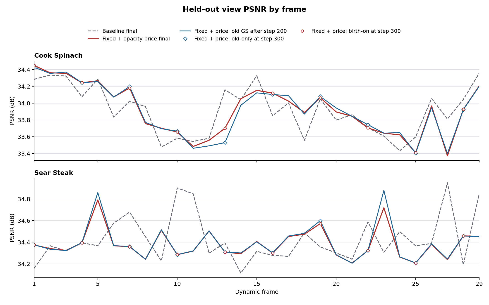
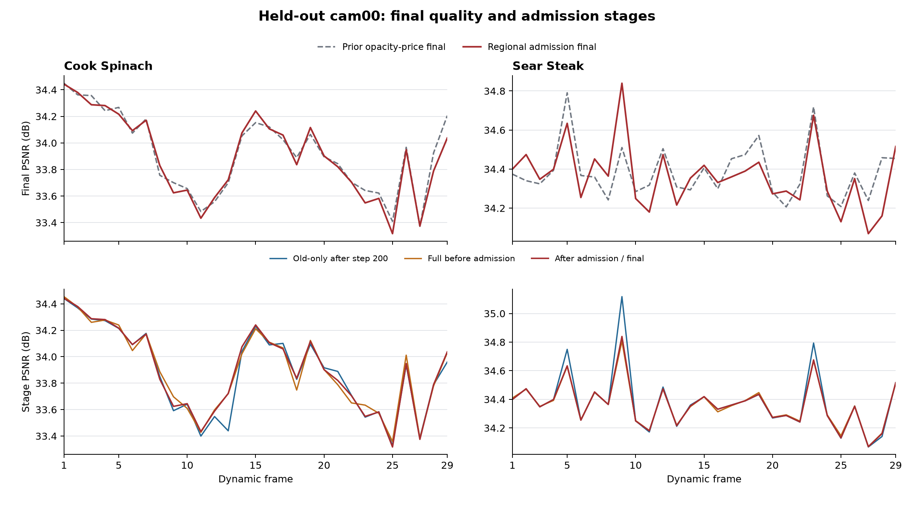

# 历史实验记录汇编

## Sear Steak：五帧联合优化与单帧基线

日期：2026-11-02

### 目的和设置

在相同的五层候选运动层级、首帧和运动价格下，考察同时优化相邻五帧及按画质筛选 GS 增删，能否改善单帧训练的画质与存储。五层 gate 选择固定候选区域的细分，区域共享运动之外仍保留逐点残差；本实验的总体结果不能单独证明 gate 的收益。

五帧方案先按原设置训练暂存帧，再以最多五帧为一个窗口，对区域及逐点运动、opacity、颜色和新生 GS 属性联合优化，每个窗口做 10 步，每帧每步使用 1 个训练视角。随后最多测试 8 组 GS 的移除，使用 4 个训练视角的图像误差决定是否删除或拒绝，未经测试的点保留；筛选本身不计字节价格。每次只正式发布窗口中的最早一帧。单帧基线每个动态帧使用 200 motion + 100 birth steps，每步 4 个训练视角；五帧方案在这些暂存训练之上增加联合优化和筛选，因此不是相同计算量的比较。

两者均采用固定运动有效价格 `0.006`、`target_update_bytes=0`；关闭指定的 GS 新增存储价格及 opacity 稀疏价格，保留运动和区域 DC 价格。旧点 opacity 阈值 `0.01` 和其余增删约束仍在。cam00 为留出评测视角，筛选只使用训练视角。两份配置仅有实验名、目标帧数和上述五帧参数差异，详细配置差异记录在恢复运行的 `diagnostics/source_snapshot/formal_config_diff.json`。

基线最初配置为 60 帧，但为节约等待时间，在 frame32 提交后中止；按预先统一的时间预算只比较 frame0–29，并非按画质选帧。frame0 为共享首帧，不纳入本报告的动态平均。本场景首帧、单帧配置与其他核验见 [单帧实验记录](20261102_03_sear_steak_experiments.md)。

### 配对结果

完整动态更新包括 motion、birth、opacity、区域 DC 和每帧 manifest；KB 为 1,000 B。前 24 帧在一次运行内完成，后 5 帧从其已提交边界恢复，限制见下文。

| 帧范围与指标 | 单帧基线 | 五帧联合优化 |
|---|---:|---:|
| frame1–24 平均 test PSNR | 34.40575 dB | 34.15124 dB |
| frame1–24 动态更新均值 | 100.183 KB/帧 | 167.170 KB/帧 |
| frame24 的 GS 数量 | 115,645 | 167,460 |
| frame1–29 平均 test PSNR | 34.43035 dB | 34.19452 dB |
| frame1–29 平均 SSIM / LPIPS | 0.967820 / 0.113967 | 0.967556 / 0.114110 |
| frame1–29 动态更新均值 | 98.887 KB/帧 | 163.461 KB/帧 |
| frame1–29 新增 / 删除 GS | 11,837 / 41,695 | 29,000 / 0 |
| frame29 的 GS 数量 | 113,602 | 172,460 |

五帧方案在前 24 帧和全部 29 个动态帧分别比基线低 0.25451 和 0.23583 dB；全部 29 帧的动态更新均值高约 65.3%。其中 motion / opacity / birth / 区域 DC / manifest 分别为 64.454 / 74.795 / 20.607 / 0.638 / 2.966 KB/帧，基线分别为 25.840 / 62.657 / 8.713 / 0.393 / 1.284 KB/帧。五帧方案的平均画质超过 34 dB，但实际动态字节高于 50 KB/帧目标。

完整 29 个动态帧，五帧方案共有 29,000 个新生候选，其中 15,532 个被纳入删除测试、13,468 个未测试，拒绝数为零；旧点候选 19,508 个，测试 8,474 个、未测试 11,034 个，删除数为零。共测试 232 个组，没有一组通过移除判定。未观测点统计与已测试、未测试集合有交集，不能相加；组级结果本身也不能证明是哪类点或何种重锚操作导致了零删除。相比之下，单帧基线的阈值机制持续删除 GS。点数与字节同时更高是观察到的结果，但这组比较不足以把画质或字节差异全部归因于某个机制。

五帧方案的 step200 留出视角 PSNR 平均 34.25918 dB，使用的是初次暂存训练时的前驱状态；每次正式提交前的窗口 PSNR 均值为 34.11467 dB，提交后为 34.19452 dB，平均变化 +0.07984 dB，范围为 −0.89101 至 +1.06734 dB，12/29 帧为负。该前后差值只描述当前提交窗口，并不表示相对于单帧基线的收益。平均暂存训练、单次窗口联合优化、筛选分别为 59.94、16.18、7.40 秒；它们是已提交轨迹的分段时间，不是完整播放速度，也不是两次运行的总耗时。中断前另一次 frame25–29 暂存训练共耗时 311.50 秒，未包含在上述均值中；其中 frame25–28 曾参与前面已提交帧的窗口，不能把这段计算全部视作无效。

### 字节与冻结 gate 诊断

单帧基线动态帧合计 2,867,731 B，加共享 reference 12,805,629 B 后，摊至 30 帧为 522.445 KB/帧。五帧方案的动态帧合计 4,740,379 B，加同一 reference 和一次性窗口元数据 43 B，逻辑连续流为 17,546,051 B，摊至 30 帧为 584.868 KB/帧。这些摊销值只针对本段 30 帧，并不代表 300 帧摊销。

单帧基线 frame29 的冻结重编码中，实际学习 gate 的 motion 包为 23,126 B；固定同样的逐点量化运动、存活集和出生点，采用 uniform depth5 并用每区中位数代表运动时为 26,242 B，前者少 3,116 B，约 11.9%。这是单帧 motion 包的诊断，不是全流节省或重训后的画质比较；中位数也不是最优编码下界，详见单帧记录。

### 中断、恢复与核验

原五帧运行在暂存 frame29 时因出生四元数符号重建逐位不一致而中止，已正式发布 frame1–24。检查真实失败码流后，恢复版删除了窗口初始化中对已解码四元数的重复半球翻转，并以真实失败数据及反向重锚情况做回归。恢复版从 frame24 已验证的检查点重新计算 frame25–29；由于当时未提交的窗口优化状态没有保存，这五帧实际累计参与窗口次数依次为 1、2、3、4、5，而不是假称未中断。frame1–24 使用修复前实现，frame25–29 使用修复后实现，前 24 帧单列结果可避免把恢复段误当成同等优化历史。

恢复目录通过 `prefix_provenance.json` 记录了已验证复制的 frame0 reference 和 frame1–24 码包；从原始 reference 连续 CPU 回放至 frame29 成功，最终 decoder SHA256 为 `c09bee985c377215e0fbfdafa371b17d5c10a169e9d7b5d781c4e7eedba451b2`，且与最终 checkpoint 的六项原始属性逐位一致。逐帧实际包和 manifest 字节与摘要一致。

原运行和恢复运行的**已发布码流目录**分别占 16,817,753 B 和 17,546,051 B，两个实体目录合计 34,363,804 B；其中前 24 帧、reference 和 43 B 共享元数据重复保存共 16,817,753 B。checkpoint、暂存和其他训练产物不包含在此统计，重复的历史副本不计入上述逻辑传输流。

恢复运行：`/mnt/SSD500GB/my4dgs_output/goal_n3dv_dynamic_20261031/sear_steak_core_depth5_fixedprice_window_30_resume24_20261102/20261102T140948_295576`。CPU 回放日志为该目录 `diagnostics/cpu_replay.log`；修复后的启动源码快照为 `diagnostics/source_snapshot/source_snapshot.tar.gz`，SHA256 `49fd06d5cfdaa9461d00f0a7763754a80057f65b21d3d54a835c7c9e65508a80`；修复前快照位于原运行 `diagnostics/source_snapshot/source_snapshot.tar.gz`，SHA256 `3555ce1a249976e014d6a29085db3bd03031e0c029394466487e77290f982451`。源码快照不包含外部环境和数据。单帧基线没有完整启动源码快照，其可复现限制见基线记录。

本次没有测量已解码渲染 FPS 或包含解码的完整播放 FPS。两组都只是短序列，不能据此声称解决长期漂移、达到完整 300 帧目标或超过 SOTA。

---

## Sear Steak：五层候选运动、固定运动价格的单帧基线

日期：2026-11-02

### 目的和配置

本实验为后续人口窗口训练准备单帧基线：使用五层固定候选空间层级、可学习 gate 选择运动共享粒度，并以区域共享运动加逐点量化残差表示动态运动。研究假设是，不同区域适合的共享粒度不同；本实验的总画质和码率本身不能证明 gate 带来的收益。

在当前 core 配置上，关闭 newborn 的 storage loss 和 survival-aware storage，将 population loss、alpha sparsity loss、旧点 opacity 的 L1 与 proximal 正则设为零，并启用 `birth.population_rate_exempt`，使旧点 opacity 的额外字节价格为零。运动和区域 DC 的价格保留；为固定运动价格，设置 `target_update_bytes=0`、`initial_rate_multiplier=1`、`rate_loss_weight=0.006`，与原 core 配置的初始有效运动价格 `0.002 × 3` 相同。`opacity.prune_threshold=0.01` 和其他人口变化机制仍然生效，因此这里是清零指定的人口码率与稀疏正则，不是取消所有人口压力，也不预期自动满足 50 KB/帧。

- 数据：`data/colmap4d/sear_steak_300` 软链接，`resolution: -1`，图像 1344×1007，cam00 留出评测。
- 原始运行配置保存在运行目录的 `config.yaml`。当前入口为 [Sear 基础配置](../../config/sear_steak_core_depth5_incumbent_opacityprice_30_20261102.yaml)，覆盖 `data.extra_dataset_kwargs.num_frames=60`、`module.birth.keep_incumbent_fixed_after_motion=false`、`module.birth.population_rate_exempt=true`、`module.opacity_update.l1_weight=0.0`、`module.opacity_update.proximal_regularization=false`、`trainer.cache_data_on_device=true`、`trainer.saving_ckpt_frames=[1,29,59]`，并指定新实验名；每动态帧 200 motion + 100 birth steps，各阶段每步 4 个训练视角。
- 共享首帧：`/mnt/SSD500GB/my4dgs_assets/sear_cap150k_15k_20261030_verified/ckpt-0-15000.pth`，15,000 steps、SH1；原始 151,367 GS，按 0.0075 opacity 阈值保留 143,460 GS。六类保留属性与五层 reference 逐位一致。
- 五层 reference：`/mnt/SSD500GB/my4dgs_assets/sear_steak_depth5_core_rd_joint_20261102/reference_frame0.npz`；由场景原四层 reference 派生，所有原有四层路径不变，节点数从 4,681 增至 37,449。派生文件 SHA256：`357e38adebfeb3558de521916f3c5215f3f63c28c45af090726037b4fd37b40c`。
- 运行目录：`/mnt/SSD500GB/my4dgs_output/goal_n3dv_dynamic_20261031/sear_steak_core_depth5_fixedprice_singleframe_60_20261102/20261102T115509_380022`。

运行最初配置为 60 帧；为减少等待，按统一的时间预算改为分析前 30 帧，在 frame32 已完整提交后用 SIGINT 停止，frame30–32 原样保留但不纳入结果。这不是按画质挑选的截断，也不是完成了 60 帧。

启动时未保存完整源码快照。运行基于 HEAD `7f02759368336ed19a592d3f7afd273db6444cd7` 的未提交工作区，且启动后共享训练文件继续有 opt-in 窗口分支的开发；该 commit 不能唯一标识当时代码。可确认的是运行时配置、首帧和 reference、已验证的 `population_rate_exempt` 行为以及记录的实际结果；无法声称有完整可复现的启动源码哈希。

### 前 30 帧结果

frame0 为共享参考；本次没有单独重测 frame0 画质。画质和动态更新统计均为 frame1–29，KB 使用十进制字节。完整更新包括 motion、birth、opacity、区域 DC 和逐帧 manifest。

| 指标 | 结果 |
|---|---:|
| 动态 test PSNR / SSIM / LPIPS | 34.43035 dB / 0.967820 / 0.113967 |
| 动态 PSNR 最低 / 最高 | 34.11476 / 34.95031 dB |
| 完整更新均值 / P95 / 最大 | 98.887 / 108.437 / 115.948 KB/帧 |
| motion / opacity / birth / 区域 DC 均值 | 25.840 / 62.657 / 8.713 / 0.393 KB/帧 |
| manifest 均值 | 1.284 KB/帧 |
| 动态更新总量 | 2,867,731 B |
| 共享 reference | 12,805,629 B |
| reference 加动态更新，摊至 30 帧 | 522.445 KB/帧 |
| 出生 / 退休总数 | 11,837 / 41,695 |
| GS 数量，frame0 → frame29 | 143,460 → 113,602 |
| 平均训练时间 / 墙钟时间 | 54.41 / 54.70 秒/动态帧 |

frame1 退休 10,981 个 GS、出生 382 个；frame1–29 每帧平均出生约 408 个。首帧之后退休数量明显下降，但总体点数继续减少。`opacity.prune_threshold=0.01` 仍会触发退出，因此不能把退出归因于已关闭的人口码率项。

按 frame1–9、10–19、20–29 分段，平均 test PSNR 分别为 34.39336、34.42616、34.46782 dB。尽管点数下降，画质没有在这三段中同步下降，尚不能认定点数变化已经造成长期画质损害。step200 的同一留出视角旧点基线平均为 34.39818 dB，最终结果高 0.03217 dB；12/29 帧最终结果低于该步，单帧差值范围为 −0.67538 至 +0.88958 dB。step200 到最终之间包含多种更新，这个差值不能单独归因于出生或 opacity。

opacity 占完整更新约 63.4%，是这组配置的主要字节来源；每帧平均约 94,337 行旧点 opacity 有编码更新。无旧点 opacity 稀疏价格可能使大量更新得以保留，与较高的实际字节相符，但这里没有单独控制其他因素，不能把字节变化全部归因于某一个开关。逐点运动残差平均约 8,823 行。平均每帧约 381 个点位于五层最深的活动区域，点加权平均选择深度约 1.658；这说明最深层被使用，但不证明其提高画质。

对 frame29 做只读冻结重编码：区域和逐点的平移量化步长同为 `6e-5`（extent 单位），旋转步长同为 `0.001` 弧度；固定已学的逐点总量化运动、存活集和出生点。学习得到的 frontier 恢复了逐字节相同的 23,126 B motion 包；将所有点统一置于 depth5，并以每区坐标中位数代表运动时，motion 为 26,242 B，多 3,116 B；统一 depth4 为 23,646 B，多 520 B。这里的中位数只是指定构造，不是最优编码的下界，也没有重新训练或比较画质。完整诊断位于运行目录的 `diagnostics/frame029_uniform_frontier.json`。

### 核验与边界

- 保存的运行 reference SHA256 为 `a7ecb86cc21701b4833f90539ebddd0fcd0b82d3eff8810ca7d14dbd1c259dcc`；与派生参考的所有数组逐项相同，NPZ 文件字节大小差 1 B。
- 读取完整 29 帧的 packet 和 manifest，逐帧实际字节与 frame summary 一致。
- CPU 从共享 reference 连续解码 frame1–29，29 组 manifest 的状态与原始属性 hash 均通过；最终 decoder SHA256 为 `e42015521eb7845a79dd8d296a36bb373c8847dff32c69841814069ca69279f7`。最终状态与 frame29 checkpoint 的六类原始属性逐位一致，raw SHA256 为 `ce6db5c81667dbdd428a257cbc32592f7ce791d8ceb3f56b56cdc350e839fd9c`。
- 本次 30 帧没有单独测量渲染 FPS 或完整播放 FPS；此前五层短测的 CPU/GPU 解码核验不能代替本次完整序列的速度验收。

这个基线的画质在前 29 个动态帧达到 34 dB 以上，但完整动态更新均值约为目标的两倍。它只用于与后续统一人口价格设置的窗口方案比较，不能据此推断全 300 帧结果，也不能归因于五层 gate 或宣称超过 SOTA。

---

## Sear Steak：固定旧点与旧透明度稀疏约束的前 30 帧

日期：2026-11-03

### 目的和实现

在固定候选空间层级的共享运动和逐点残差框架中，检验第 200 步后固定旧点状态，并在前半阶段对旧点透明度更新施加稀疏约束，能否改善画质与动态存储的权衡。该实验的总指标不能单独证明自适应 gate 的因果收益。

本轮不修改训练源码。沿用 `birth.keep_incumbent_fixed_after_motion: true`：200 步清理后固定旧运动、透明度、区域 DC 和尺度，newborn 继续拟合；配置中的 30 步旧运动 tail 实际关闭。与固定旧点不计价配置相比，只将 `population_rate_exempt` 设为 false、`opacity_update.proximal_regularization` 设为 true、`opacity_update.l1_weight` 设为 0.05。

newborn storage loss、survival-aware storage、population loss、alpha sparsity 均关闭或为零，编码成本不参与新增/删除决策。运动及区域 DC 的有效价格仍为 0.006、`target_update_bytes=0`；前 200 步使用旧点 opacity 的 L1 与近端稀疏压力。使用同一共享首帧、五层空间候选、分辨率和每步四个训练视角；留出的 cam00 阶段记录不参与训练或选择。

- 配置：`config/sear_steak_core_depth5_incumbent_opacityprice_30_20261102.yaml`；frame0–29 共 30 帧，动态 frame1 和 frame29 保存第 300 步 checkpoint。
- 新实验：`/mnt/SSD500GB/my4dgs_output/goal_n3dv_dynamic_20261031/sear_steak_core_depth5_incumbent_opacityprice_30_20261102/20261103T001246_d68bf1`。
- 原 fixedprice 基线：`/mnt/SSD500GB/my4dgs_output/goal_n3dv_dynamic_20261031/sear_steak_core_depth5_fixedprice_singleframe_60_20261102/20261102T115509_380022`。
- `cache_data_on_device: false` 只影响普通 Fetcher；frame-plan 的训练视角仍由 `transaction_camera_views()` 放在设备上。

### 前 29 个动态帧

frame0 为共享 reference；以下画质及存储均为 frame1–29，KB=1,000 B。完整动态更新包含 motion、birth、opacity、区域 DC 和逐帧 manifest。

| 指标 | 原 fixedprice 基线 | 固定旧点 + opacity 约束 |
|---|---:|---:|
| test PSNR / dB | 34.43035 | 34.38449 |
| SSIM | 0.967820 | 0.967455 |
| LPIPS | 0.113967 | 0.112907 |
| 完整动态更新 / KB/帧 | 98.887 | 51.078 |
| 动态更新 P95 / 最大 / KB | 108.437 / 115.948 | 56.638 / 56.895 |
| motion / opacity / birth / 区域 DC / manifest / KB/帧 | 25.840 / 62.657 / 8.713 / 0.393 / 1.284 | 35.333 / 5.507 / 8.475 / 0.390 / 1.373 |
| 新增 / 退休 GS 总数 | 11,837 / 41,695 | 11,888 / 6,914 |
| frame0 → frame29 GS | 143,460 → 113,602 | 143,460 → 148,434 |
| 活动区域 / 点加权深度均值 | 176.5 / 1.658 | 179.4 / 1.651 |
| 最深层平均点数 / 使用帧数 | 381.4 / 29 | 441.8 / 28 |
| 平均训练时间 / 秒/动态帧 | 54.41 | 51.20 |

相对原 fixedprice 基线，新方案平均 PSNR 变化 -0.04586 dB，完整动态更新变化 -47.809 KB/帧（-48.35%）。新方案 frame1–9、10–19、20–29 的平均 test PSNR 分别为 34.41142、34.39146、34.35330 dB；最低/最高为 34.20654/34.79074 dB。

动态更新总量 1,481,269 B；共享 reference 单独为 12,805,629 B（SHA256 `a7ecb86cc21701b4833f90539ebddd0fcd0b82d3eff8810ca7d14dbd1c259dcc`）。两者之和摊至本段 30 帧为 476.230 KB/帧，此数不代表 300 帧。

图中蓝线为新方案 step200 清理后的旧点，空心菱形为 step300 birth_off；两者重合。红线为新方案最终值，空心圆为 birth_on；灰色虚线为各场景原基线最终值。

### 新方案的阶段画质

下表是 cam00 的 29 个动态帧算术平均 PSNR，每行各 29 帧。两次新点插入的瞬时值不代表训练完成后的贡献。旧 fixedprice 基线只保存 step200 old-only 和最终值，不能补写其他阶段。

| 阶段 | 平均 PSNR / dB |
|---|---:|
| 200 清理前 | 34.39430 |
| 200 清理后 | 34.39442 |
| 200 加入 newborn 后 | 34.33947 |
| 250 清理前 | 34.38478 |
| 250 清理后 | 34.38511 |
| 250 加入 newborn 后 | 34.32984 |
| 300 清理前 | 34.38225 |
| 300 清理后 | 34.38449 |
| 300 birth_off | 34.39442 |
| 300 birth_on | 34.38449 |
| 300 独立解码 | 34.38449 |

step200 清理后 → step300 birth_off 的 old-only 平均变化 +0.00000 dB，范围 0.00000 至 0.00000 dB；最终 birth_on 相对 birth_off 平均变化 -0.00993 dB，范围 -0.16150 至 0.00557 dB。其中 21/29 帧的最终 birth_on 低于 birth_off。两批 newborn 插入瞬间平均变化分别为 -0.05495、-0.05527 dB。

旧透明度稀疏压力可能减少传输更新，也可能改变退出数量、后续点数和运动负担；这些变化在连续帧相互影响。本实验没有把新增/删除成本显式加入损失，不能将所有画质或码率变化归因于某一单项。较早的两个 Cook 三帧运行在开关生效前首帧 step200 已相差约 0.02200 dB；前 200 步 CPU 回归一致，但 GPU 运行不保证逐位确定。

### 验证与限制

- 本次源码、配置、相对原基线及固定旧点配置的 diff、监测日志位于 `diagnostics/guarded_launch/`。启动源码快照 SHA256 `6ca183e61a9e63b6f7d396f9adea417b65306de9b6ead96e03cb5025df05a25b`；运行期间已收录源码变化 0 项。快照不包含外部 libgs、Python 环境和预编译库。
- 从共享 reference 在 CPU 连续解码 frame1–29，逐帧 manifest 状态及 raw 属性摘要通过；frame29 decoder SHA256 `5a18bac61dd8d3e1cdefd7e1b03dc03ebd2ae19599049145b0711df60c293627`。最终 checkpoint 的 xyz、rotation、logscale、opacity、SH DC、SH rest 均与解码结果逐字节一致。
- 逐帧实际包及 manifest 文件大小与 summary 一致；29/29 帧独立解码阶段摘要匹配。GPU 进程组显存峰值 3748 MiB、设备最低空闲 2297 MiB，守护未触发。
- 本次没有测量已解码渲染 FPS 或完整播放 FPS；前 30 帧不代表 300 帧，也不能声称超过 SOTA。
- 原 Sear 单帧基线启动时没有完整源码快照，其复现限制见已有基线实验记录。

---

## Sear Steak：新生点拟合后的区域准入（前 30 帧）

日期：2026-11-03

### 目的与实现

在预先构建的固定空间候选层级、区域共享运动与逐点残差框架上，检验拟合后的 newborn 区域准入对画质和动态存储的影响。对照使用同场景已有的 fixed-incumbent + opacity-price 30 帧运行，双方均从完全相同的共享首帧重新训练；后续各自依赖自己的前驱。总指标变化不能单独归因于自适应 gate 或某一次筛选。

step200 首批 proposal 使用四个训练相机，另选四个不重叠的训练相机，在 step201–300 的 newborn 拟合和第二次 proposal 中排除。step300 清理后，按固定空间树最细叶和原行顺序将候选点分为每组最多 32 点；从 old-only 场景开始，逐组计算四个留出相机的完整渲染误差，只有其夹取到 [0,1] 后的平均 RGB MSE 改善超过 `max(1e-12, 8*float32_eps*max(abs(before),abs(after)))` 才接受。四个准入相机仍可参与 step200 前的旧点拟合，cam00 只作评估。所有组都检查；固定次序的贪心结果不代表全局最优。

原配方保持 step200 后固定旧点、旧 opacity 更新 L1=0.05 与近端稀疏约束，以及运动和区域 DC 价格 0.006；birth storage loss、survival-aware、population loss 和 alpha sparsity 均关闭或为零。alpha 校准与三角化均关闭。此次运行使用独立 scratch；经验证的准入实现现已以默认关闭的可选开关合入母库，历史结果仍以当时的源码快照为准。

- 历史配置：新运行目录的 `diagnostics/guarded_launch/experiment_config.yaml`，仅实验名和 `module.birth.regional_postfit_admission: true` 不同于对照配置。母库复现配置为 [Sear30 基础配置](../../config/sear_steak_core_depth5_incumbent_opacityprice_30_20261102.yaml)，启动时设置 `module.birth.regional_postfit_admission=true` 和新的 `experiment_name`。
- 新运行：`/mnt/SSD500GB/my4dgs_output/goal_n3dv_dynamic_20261031/sear_steak_core_depth5_incumbent_opacityprice_region_admission_30_20261103/20261103T013042_df452c`。
- 对照：`/mnt/SSD500GB/my4dgs_output/goal_n3dv_dynamic_20261031/sear_steak_core_depth5_incumbent_opacityprice_30_20261102/20261103T001246_d68bf1`。

### 动态 frame1–29

以下均为 29 个动态帧的算术平均；KB=1,000 B。逐帧完整更新包含 motion、opacity、birth、DC 和 manifest，局部决策日志不计传输；共享 reference 单列。

| 指标 | 原 opacity-price | 区域准入 |
|---|---:|---:|
| PSNR / dB | 34.38449 | 34.36437 |
| SSIM | 0.967455 | 0.967379 |
| LPIPS | 0.112907 | 0.112889 |
| 完整动态更新 / KB/帧 | 51.078 | 38.812 |
| motion / KB/帧 | 35.333 | 30.310 |
| opacity / KB/帧 | 5.507 | 5.152 |
| birth / KB/帧 | 8.475 | 1.572 |
| 区域 DC / KB/帧 | 0.390 | 0.407 |
| manifest / KB/帧 | 1.373 | 1.371 |
| 新增 / 退休 GS 总数 | 11888 / 6914 | 1830 / 4313 |
| frame0 → frame29 GS | 143460 → 148434 | 143460 → 140977 |
| 平均训练秒/动态帧 | 51.20 | 55.10 |

相对对照，PSNR -0.02012 dB，完整动态更新 -12.266 KB/帧（-24.01%）。两组共享 reference 均为 12,805,629 B，SHA256 `a7ecb86cc21701b4833f90539ebddd0fcd0b82d3eff8810ca7d14dbd1c259dcc`，不包含在逐动态帧平均中。

### cam00 阶段画质

各值为 29 帧平均 PSNR；200/250 刚插入 newborn 的瞬时值不代表最终贡献。

| 阶段 | 原 opacity-price / dB | 区域准入 / dB |
|---|---:|---:|
| 200 清理前 | 34.39430 | 34.38082 |
| 200 清理后、birth 前 | 34.39442 | 34.38106 |
| 200 birth 后 | 34.33947 | 34.33199 |
| 250 清理前 | 34.38478 | 34.37209 |
| 250 清理后、birth 前 | 34.38511 | 34.37293 |
| 250 birth 后 | 34.32984 | 34.31407 |
| 300 清理前 | 34.38225 | 34.36191 |
| 300 清理后 | 34.38449 | 34.36395 |
| 300 准入前 | — | 34.36395 |
| 300 准入后 | — | 34.36437 |
| 300 birth_off | 34.39442 | 34.38106 |
| 300 birth_on | 34.38449 | 34.36437 |
| 300 实际解码 | 34.38449 | 34.36437 |

本方案检测 13,249 个候选，接受 1,830、拒绝 11,419；9,201/9,201 组均检查，接受 1,270 组。四个留出训练相机的帧均 MSE 从 0.000218288769 降至 0.000217912188。cam00 上准入后减准入前平均 +0.00042 dB，16/29 帧下降。组选择平均额外 4.35 秒，其中同步渲染 3.83 秒；最终码流验证另 0.14 秒。这些是同步墙钟时间，不是 FPS。

两组在 frame1 的 step200 旧点画质已经相差 +0.02434 dB；此时 newborn 准入尚未执行。之后因为各帧接受点集和前驱不同，step200 旧点也随训练轨迹变化。前 200 步 CPU 回归一致，但 CUDA 训练不保证逐位确定；不能把最终差异全部归因于 step300 的准入。

### 固定量化运动的前沿重编码诊断

将 29 个动态帧分别锚定到各自真实解码前驱，固定总量化运动符号、旧点生存和 newborn 输入，学习前沿的 29 个 motion 包均逐字节复现，合计 878,986 B。用各区域坐标中位数构造统一深度 1–5 时，对应包总量依次为 2,865,034、1,692,926、1,110,546、909,710、997,994 B；该范围内最优固定深度 D4 和逐帧 oracle 均为 909,710 B，学习包少 30,724 B（以 D4 为分母少 3.38%），29/29 帧均更小。oracle 未计深度选择信令。

这些反事实分别使用真实前驱，中位数构造不是编码最优下界；解码位置仅核验数值接近，最大绝对差 3.815e-6，未重测 PSNR 或验证连续替代流。所比为完整 motion 包，还包含 gate、生存映射及 newborn 位姿/来源，不能把全部差额算成单独 gate 的编码节省，也不能据此声称相同画质的全流节省。明细：`/mnt/SSD500GB/my4dgs_diagnostics/frontier_admission_v4_20261103_5ipp4o/sear_sequence.json`。

### 核验与边界

- 逐帧文件大小与 summary 的完整包和 manifest 一致；CPU 从共同 reference 连续解码 frame1–29 并校验各 manifest，frame1 与 frame29 checkpoint 的 xyz、rotation、logscale、opacity、SH DC、SH rest 与回放结果均逐字节一致。每帧实际最终码流另核对六属性/source rows 及四个准入训练视角的重渲染 MSE；最大 MSE 差 0，不声明图像逐像素位级一致。
- 独立 CPU 账本检查逐帧复核候选行覆盖、组顺序、每组四视角 MSE 的串行基线与阈值判定、接受点数、训练步数和 checkpoint 相机名，29/29 帧通过；结果保存在 `diagnostics/guarded_launch/independent_ledger29.txt`。
- 根据保存的 seed 和实际训练相机池重建 step201–300 的 100 次采样，29/29 帧均排除了留出视角，且与已保存的 step200/250 proposal 相机匹配；每一步的视角未逐条落盘。old200 与 birth_off 的最大 PSNR 差 0 dB，准入后训练态与实际解码图最大差 6.1e-05 dB。
- 新运行的 `diagnostics/guarded_launch/` 保存完整源码和扩展源码快照、配置 diff、逐帧报告和核验；运行中收录源码变化 0 项，显存峰值 3748 MiB、设备最低剩余 2290 MiB，守护未触发。快照不包含数据、外部 libgs、Python 环境或预编译库。
- 只验证了前 30 帧，不能代表全 300 帧或声称超过 SOTA；未测已解码渲染 FPS，也未测包含读包、解码、更新、渲染的完整播放 FPS。
