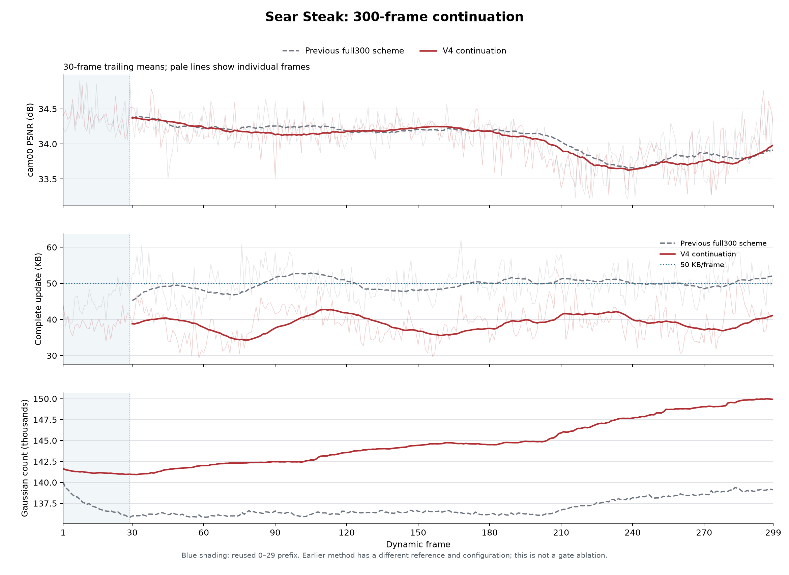

# Sear Steak：区域准入机制续跑至完整 300 帧

日期：2026-11-03

## 思路与运行

固定世界空间候选层级以区域共享运动加逐点残差编码动态高斯；选层 gate、量化和运动/DC 码率压力沿用已完成的 Sear V4 30 帧方案。每帧先拟合旧点与 newborn，step300 按最细固定叶、每组最多 32 点从 old-only 开始逐组渲染；仅当四个为 newborn 拟合和 proposal 留出的训练相机的平均 MSE 改善超过 `max(1e-12, 8*float32_eps*max(abs(before), abs(after)))` 时接受。留出相机可以参与 step200 以前的旧点拟合；cam00 只用于评估。该贪心组筛选不保证测试视角或整段性能最优。

本次使用经核验的同一 Sear V4 30 帧运行作前缀，从其完整 frame29/step300 checkpoint 接续 frame30–299；不是把另外短实验的指标拼接。启动入口严格检查 30→300 的配置差异、630 个前缀相机、实际当前图片路径属性和 frame0 场景范围，并先连续解码旧包匹配 checkpoint；175 个前缀文件经哈希校验后复制到新运行并记入 `prefix_provenance.json`。图像身份检查记录的是当前路径、设备、inode、大小及修改时间，不能证明历史图像字节。

- 配置：`config/sear_steak_core_depth5_incumbent_opacityprice_region_admission_300_resume30_20261103.yaml`；新运行：`/mnt/SSD500GB/my4dgs_output/goal_n3dv_dynamic_20261031/sear_steak_core_depth5_incumbent_opacityprice_region_admission_300_resume30_20261103/20261103T020546_a66da9`。
- 已完成前缀：`/mnt/SSD500GB/my4dgs_output/goal_n3dv_dynamic_20261031/sear_steak_core_depth5_incumbent_opacityprice_region_admission_30_20261103/20261103T013042_df452c`。
- 先前 full300 完整方案：`/mnt/SSD500GB/my4dgs_output/goal_n3dv_dynamic_20261030/sear_steak_cap143_gatepricefix_regdc_full300_20261030/20261030T131305_cfb5f8`；reference 文件及训练/码率配置不同，不作为单机制消融。两份 reference 文件的 SHA 和大小不同，但六项原始 GS 属性的 shape、dtype 和逐字节内容相同，证据见新运行的 `diagnostics/guarded_launch/reference_old_new_comparison.json`。

## 完整序列结果

PSNR 是逐帧 dB 的算术平均；0–299 包含单独实际渲染的共享 frame0。字节使用十进制 KB，动态更新包含所有运动、birth、opacity、DC 包和 manifest，训练诊断及候选组日志不计传输。

| 指标 | 旧 full300 方案 | V4 续跑 |
|---|---:|---:|
| frame0 PSNR / dB | 34.19685 | 34.19685 |
| frame1–299 PSNR / dB | 34.09241 | 34.06326 |
| frame0–299 PSNR / dB | 34.09276 | 34.06371 |
| 动态完整更新 / KB/帧 | 49.565 | 38.997 |
| 共享 reference / B | 12,314,349 | 12,805,629 |
| 299 帧动态完整更新 / B | 14,819,850 | 11,660,207 |
| reference + 动态更新 / B | 27,134,199 | 24,465,836 |
| 全部字节摊至 300 帧 / KB/帧 | 90.447 | 81.553 |
| 动态更新 P95 / 最大 / KB | — | 46.452 / 53.917 |
| 真实 GS：reference → frame299 | — | 143,460 → 149,898 |
| 新生 / 退休 GS 总数 | — | 26,346 / 19,908 |
| 新生候选 / 接受 / 拒绝 | — | 150,498 / 26,346 / 124,152 |
| 检查 / 接受组 | — | 75,906 / 10,679 |

每动态帧包均值：motion 30.095、opacity 5.128、birth 2.106、区域 DC 0.297、manifest 1.372 KB。共享 reference 不计入动态平均；完整流摊销另行列出。

本场景 0–299 平均超过 34 dB，但未达到 34.2 dB；动态更新均值低于 50 KB，包含 reference 的 300 帧摊销仍高于 50 KB。相比旧完整方案，动态均值减少约 21.32%，PSNR 下降约 0.029 dB；由于两者配置不同，不能将差异归因于单一机制。

图中细线是逐帧，粗线是动态帧 30 帧滑动均值；浅蓝背景标记复制且核验的前 29 个动态帧。旧方案是完整方案对照，不能从两条线单独归因于 gate 或准入。

对前 29 个动态帧，另做冻结前沿重编码时，学习前沿完整 motion 包相对所测最优统一深度 D4 少 3.38%；此比较固定每帧真实前驱和总量化运动符号，位置只验证数值接近，未重测 PSNR 或验证连续替代流，完整 motion 包差额也不只来自 gate。细节与边界见 [30 帧实验记录](20261102_03_sear_steak_experiments.md)。

## 30 帧分段与阶段

首段 PSNR 包含 frame0；首段动态字节只含 frame1–29。其余各段均含 30 个动态帧。

| 帧 | V4 PSNR / dB | 旧方案 PSNR / dB | V4 更新 / KB/动态帧 | 段末 GS | 准入候选 / 接受 |
|---|---:|---:|---:|---:|---:|
| 0–29 | 34.35879 | 34.37752 | 38.812 | 140,977 | 13,249 / 1,830 |
| 30–59 | 34.25248 | 34.21705 | 38.073 | 142,014 | 14,829 / 2,775 |
| 60–89 | 34.14888 | 34.25368 | 37.257 | 142,481 | 13,569 / 1,855 |
| 90–119 | 34.16424 | 34.19515 | 41.835 | 143,552 | 14,403 / 2,902 |
| 120–149 | 34.22362 | 34.20397 | 37.000 | 144,401 | 15,129 / 2,266 |
| 150–179 | 34.18499 | 34.18034 | 37.494 | 144,512 | 12,862 / 1,784 |
| 180–209 | 33.94548 | 34.05012 | 40.725 | 145,845 | 14,064 / 3,135 |
| 210–239 | 33.62950 | 33.65915 | 40.351 | 147,645 | 18,805 / 3,637 |
| 240–269 | 33.74587 | 33.87534 | 37.293 | 149,030 | 17,111 / 2,834 |
| 270–299 | 33.98320 | 33.91528 | 41.126 | 149,898 | 16,477 / 3,328 |

| V4 阶段，cam00 平均 | PSNR / dB |
|---|---:|
| 200 清理前 | 34.06689 |
| 200 清理后 | 34.06696 |
| 200 birth 后 | 33.98945 |
| 250 清理前 | 34.05324 |
| 250 清理后 | 34.05453 |
| 250 birth 后 | 33.95986 |
| 300 清理前 | 34.04206 |
| 300 清理后 | 34.04565 |
| 300 准入前 | 34.04565 |
| 300 准入后 | 34.06326 |
| 300 birth_off | 34.06696 |
| 300 birth_on | 34.06326 |
| 300 实际解码 | 34.06326 |

四留出训练相机的帧均 MSE 0.000277830051 → 0.000277281809。cam00 的准入后减准入前平均 +0.01761 dB，125/299 帧下降；birth_on 减 birth_off 平均 -0.00370 dB，137/299 帧下降。两组训练轨迹与前驱不同，这些阶段差和方案差都不应简单当作 gate 的因果收益。

组选择平均额外同步墙钟 3.61 秒/动态帧，其中渲染 3.13 秒；码流确认另 0.14 秒。平均训练时间 56.42 秒/动态帧，以上均不是 FPS。

## 末帧粗区域误差

同一 GT、已保存 8 位 PNG 的近似对比；固定矩形不等于语义或运动分割，不能直接推断运动漂移。每区 RGB 有符号均值为预测减 GT；去均值 MSE 只用于辅助区分颜色均值偏差与剩余误差，不改变图像或正式 PSNR。

| 区域 | 面积 | 旧 MSE | V4 MSE | 对全图 MSE 差的有符号贡献 | 旧 / V4 去均值 MSE | 旧 / V4 RGB 平均残差 |
|---|---:|---:|---:|---:|---:|---|
| 上方 | 39.92% | 0.00034113 | 0.00038299 | +0.00001671 | 0.00021027 / 0.00020815 | (+0.00394, -0.01471, -0.01267) / (+0.00417, -0.01695, -0.01482) |
| 人物/锅粗框 | 16.99% | 0.00030827 | 0.00031295 | +0.00000079 | 0.00025891 / 0.00025731 | (+0.00899, -0.00548, -0.00610) / (+0.00844, -0.00677, -0.00707) |
| 其余 | 43.09% | 0.00038827 | 0.00039057 | +0.00000099 | 0.00030054 / 0.00029943 | (+0.01500, -0.00350, -0.00509) / (+0.01449, -0.00526, -0.00598) |

PNG 近似全图 MSE 的 V4−旧方案为 +1.84987493e-05；正式浮点 PSNR 分别为 V4 34.28461、旧方案 34.51840 dB。结果仅对应 frame299，不代表整段或分离的机制因果。

### 首帧与末帧的五视角只读补充

为了解上方颜色偏差是否已在初始参考存在，以及它在训练相机是否也出现，从真实 reference 连续解码至 frame299，在 frame0 和 frame299 分别渲染 cam00 和 frame299 准入留出的 cam20、cam19、cam08、cam13；每帧使用对应时刻和相机的 GT。下表为浮点 clamp 后的相同矩形诊断；RGB 残差为预测减 GT，四相机项是分别计算后取平均，RGB 均值可能相互抵消。四相机仅在 frame299 的 step200 proposal 和 step201–300 newborn 拟合/提案期间留出，仍可参与首帧及 frame299 的旧点拟合，不能视作完全未参与训练的测试集。

| 帧 / 相机 | 区域 | 有符号 RGB 平均残差 | 原 MSE | 去区域 RGB 均值 MSE |
|---|---|---|---:|---:|
| 0 / cam00 | 上方 | (+0.004988, -0.017377, -0.016458) | 0.000432384 | 0.000233145 |
| 0 / cam00 | 人物/锅粗框 | (+0.005675, -0.007865, -0.008122) | 0.000242282 | 0.000188936 |
| 0 / cam00 | 其余 | (+0.011092, -0.006711, -0.007026) | 0.000388474 | 0.000316000 |
| 0 / 四训练相机平均 | 上方 | (-0.003457, -0.002654, -0.002694) | 0.000097133 | 0.000079869 |
| 0 / 四训练相机平均 | 人物/锅粗框 | (-0.003428, -0.001529, -0.001264) | 0.000167702 | 0.000134830 |
| 0 / 四训练相机平均 | 其余 | (-0.002363, -0.000723, -0.001266) | 0.000164038 | 0.000150317 |
| 299 / cam00 | 上方 | (+0.004175, -0.016959, -0.014821) | 0.000381740 | 0.000206833 |
| 299 / cam00 | 人物/锅粗框 | (+0.008438, -0.006770, -0.007065) | 0.000311723 | 0.000256071 |
| 299 / cam00 | 其余 | (+0.014489, -0.005266, -0.005975) | 0.000389232 | 0.000298108 |
| 299 / 四训练相机平均 | 上方 | (-0.000630, -0.001334, -0.000182) | 0.000122788 | 0.000099681 |
| 299 / 四训练相机平均 | 人物/锅粗框 | (-0.004151, -0.002083, -0.001158) | 0.000442123 | 0.000389837 |
| 299 / 四训练相机平均 | 其余 | (-0.001696, -0.001167, -0.000536) | 0.000229718 | 0.000200764 |

cam00 上方绿、蓝负偏差在首帧已出现，末帧的绝对值没有更大。四个训练相机的上方颜色偏差方向和大小不同；末帧逐相机的 RGB 均值平方平均为 0.000023107，cam00 为 0.000174907。固定图像矩形在各视角和时刻覆盖的真实内容不相同；这些结果不能证明偏差只发生在测试相机，也不能单独区分颜色、运动或其他原因，更不能直接解释整段漂移。每个视角、三个区域的原始值见新运行的 `diagnostics/guarded_launch/reference299_views_roi_20261103_062819_903602/frame_000_299.json`。

### 已准入新点的跨帧生存

只读连续解码真实 survivor 映射，为 reference 点和每个最终准入并传输的新点分别维护编码身份；编码参考 source 不作为物理身份。按出生后 1、3、5、10、30 帧仍存活统计，分别为 **92.51%、88.09%、85.53%、81.27%、71.34%**；各期限只纳入有足够后续帧的出生批次，对应分母为 26,311、26,177、26,008、25,443、23,018。末帧仍存活者属于右删失；同帧已被清理或准入拒绝的候选不在统计内。

共传输新点 26,346 个，其中 11,371 个在观测期退休、14,975 个仍在末帧；143,460 个初始点中有 134,923 个仍在末帧。退休新点在退休前一帧的解码透明度中位数为 0.01656；这不是本帧优化后被删时的透明度。多数已准入新点并未在下一帧退休，因此该序列本身不足以要求对全部新点做跨帧确认；短寿命也不等于错误几何或漂移原因。逐出生批次、退休年龄和每 30 帧增删存量见 `/mnt/SSD500GB/my4dgs_diagnostics/sear_v4_birth_survival_20261103/birth_survival.json`。

## 核验与限制

- CPU 从共享 reference 连续解码 frame1–299，逐帧检查实际包大小、manifest 状态摘要和 raw 摘要；逐一检查原始 prefix 的 checkpoint1/29 与本次 39、49、…、299 的 checkpoint，共 29 个，六项高斯 raw 属性逐字节匹配，codec state 摘要一致。
- 五视角补充诊断再次连续解码并核对 299 帧摘要；两帧 cam00 PSNR 与原记录一致，frame299 的四训练相机 MSE 与实际码流验证值最大差约 1.6e-11。诊断进程显存峰值 628 MiB、最低设备剩余 5301 MiB，guard 未触发。
- 对每帧准入 ledger 独立检查各组行覆盖、顺序、四视角 MSE 的串行基线与阈值、点数和训练步数；按保存 seed 重建 step201–300 采样，检查留出相机与已记录的 step200/250 proposal。每一步相机选择未逐条落盘。实际终流另核对六属性/source rows 与四个相机的重渲染 MSE；不称图像逐像素位级一致。
- old200 与 birth_off 的最大 PSNR 差 0 dB；训练态准入后与实际解码图最大差 6.1e-05 dB。GPU 训练进程峰值 3756 MiB，设备最低剩余 2172 MiB；guard 未触发，其他进程未受干预。
- 源码、数据身份预检、严格 prefix 验证、每30帧汇总、checkpoint 记录、独立 CPU 核验与本次图表输入均存于新运行 `diagnostics/guarded_launch/`。源码快照不含数据、外部 libgs、Python 环境与预编译库。
- 正式已解码渲染 FPS 和含读包、解码、更新、渲染的完整播放 FPS 均未测：现有独占检查发现外部 GPU 计算上下文，未停止外部任务或绕过检查。
- 仅为 Sear Steak 一个场景；完整方案对照和当前结果不单独证明自适应 gate 的作用，也不能据此声明整体超过 SOTA。
