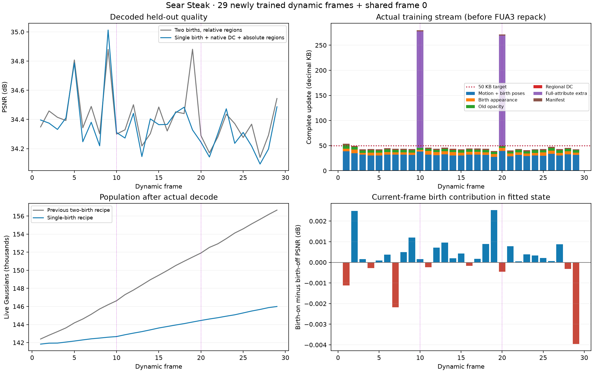

# Sear：单批出生、原生残差颜色初始化与独立区域值，30时间点

2026-11-04。本次检验一次性分配区域新增容量、随后给这批新点完整100步拟合的整体候选。固定世界空间D5树、learnable gate、区域共享运动＋逐点残差及storage loss仍保留。时间点0使用共享首帧，本轮新训练1–29共29个动态帧，每帧300次共享Adam；frame10/20前200步全量更新旧点六类属性，200后冻结旧几何/外观及区域/gate。

## 核心idea与实现

相对前一轮两批出生方案，本次有三项变化同时发生，不能据总指标作单因素归因：

1. 只在step200按原有归一化区域颜色L1阈值新增，原500候选上限不变；step250仍清理、测量old+new完整场景并union旧alpha许可，但新增cap=0。总候选预算因此也减少，没有把250额度搬到200。
2. 新点DC从既有codec参考DC＋SH1出发，利用四个训练视角中当前新点的真实量化合成响应作一次有符号残差初始化；沿用gain=0.5、截幅0.05，至少两个视角同向，既有SH1只作用一次。仅改本帧新点DC，不作后验MSE准入，不使用cam00选择候选。
3. 区域运动与区域DC采用当前frontier的独立值；未使用子节点从最近已使用祖先继承运动暖启。它与之前祖先增量累加的relative表示不同，不能说收益单纯来自gate或D5。

普通帧gate仍在1–100、151–180学习，逐点残差从101步参与，区域运动到200；201–300只训练新点和高误差区域旧alpha。区域L1按真实Tα支持归一化，阈值0.03、每视角至少32有效像素及至少2可靠视角。初始新alpha=0.1，删除按实际量化alpha<0.01，重锚后复查。新点不加存储/人口/生存惩罚。主运动λ=0.006、相对残差权重0.5、gate rate gradient scale=1不变。

关键实现位于冻结源的frame_plan、native_residual_dc和spatial_gated_motion；出生身份仅放checkpoint诊断，不进入码流。源配置和完整小源码快照保存在[源证据目录](/mnt/SSD500GB/my4dgs_diagnostics/sear_single_birth30_analysis_20261104/source_guard)。该候选尚未合入母库；母库当前只独立合入了无损FUA3编码。种子仍用单视角误差足迹与母点中心深度，并用切向半径猜射线厚度，**未使用后续的条件深度候选，也未三角化新表面**。

## 结果与计账

PSNR为cam00逐动态帧dB算术均值；KB为十进制完整实际包＋帧manifest，reference另计。

| 方案，均为1–29 | PSNR / dB | 动态KB/帧 | 末帧GS数 |
|---|---:|---:|---:|
| 前一轮两阶段两批出生 | 34.407961 | 75.464 | 156,656 |
| 本轮实际训练流 | 34.359530 | 60.070 | 145,994 |
| 本轮FUA3无损派生流 | 34.359530（继承） | 57.219 | 145,994 |

相对前一轮，PSNR减少0.04843dB，实际训练流减少20.40%；派生FUA3流进一步无损减少4.75%。本轮普通27帧为34.365633dB/44.114KB，全量2帧为34.277153dB/275.483KB；对应GT时刻不同，不能据分组均值证明校正帧有收益。

作为历史参照，同段V4区域准入为34.364371dB/38.812KB；其新增准入使用从后续出生拟合中预留的训练视角，非cam00测试视角。本轮画质与其相近，但开销仍大得多。周期全量校正能否改善后段，仍缺完整300帧证据。**目前不足以证明gate真实收益、长期漂移解决或整体超过SOTA。**

| 实际包均值 / KB每帧 | 前一轮 | 本轮 |
|---|---:|---:|
| 运动包，含新点位置/旋转与来源 | 38.562 | 32.035 |
| 新点外观 | 14.173 | 5.457 |
| 旧透明度 | 5.185 | 4.932 |
| 区域DC | 0.375 | 0.492 |
| 全量附加包 | 15.774 | 15.601 |
| manifest | 1.395 | 1.554 |

运动包包含新点位姿与来源，不能全算旧点运动，也不能按原始通道长度分摊压缩后的整包。旧点非零平移残差比例9.161%，T/R并集9.165%，以每帧存活旧点为分母再平均；含本帧新点分母的并集9.150%。人口、表示和增点预算都变了，不能将这些差异归因于层数。

训练流动态共1,742,042B，reference=12,805,629B，合计14,547,671B，摊至30时间点484.922KB/帧。FUA3派生流动态1,659,361B，合计14,464,990B，摊销482.166KB/帧。FUA3没有改量化/整数/模型或训练，它的PSNR在逐帧六属性位级相同后继承，未重测。

## 增点阶段和存活

| 同一cam00阶段均值 | PSNR / dB |
|---|---:|
| 200：清理后、增点前 | 34.359183 |
| 200：刚增点 | 34.350225 |
| 250：清理后、仅测量 | 34.359622 |
| 300：关闭本帧新点 | 34.359364 |
| 300：开启本帧新点 | 34.359530 |
| 300：真实码流解码 | 34.359530 |

最终本帧新点开关差平均+0.000166dB，8/29帧为负；200→300旧点视图变化+0.000181dB。尾段基本稳定，但**本帧新点的即时直接收益仍很小**。该开关是在已拟合状态上关闭本帧新点，不是从头不增点的消融，也不衡量已成为旧点的历史出生批次贡献。

共创建11,139个候选，同帧清理4,298个，最终传输6,841个；重锚后额外低alpha删除7个。前帧点退休4,307个；总数143,460→145,994，末帧首帧点139,395、历史新点6,599。已传输新点1/3/5/10/20帧生存率99.11%/98.32%/97.68%/97.06%/93.88%，按有足够后续帧的批次右删失；30期限无样本。高生存不等于有效，不能说大多数已保留点马上死亡。

两个全量帧：frame10为34.309757→34.309937dB，完整279,626B/FUA232,113B；frame20为34.245949→34.244370dB，完整271,339B/FUA220,316B。以上是200增点前到最终的同刻阶段比较，不是有/无全量更新因果实验。

## 验证与后续

独立CPU回放29份真实更新，六属性/state/source/字节逐帧一致，alpha<0.01为0。核对29次200出生及29次250空测量；8份保存的最终CP（1/9/10/11/19/20/21/29）及其初始seed NPZ→最终birth_id映射通过，其余21帧未保存CP，不声称逐帧身份CP核验。正式运行未保存200/250，相关冻结和恢复由同源码短核验验证。

guard正常退出0，无触发、CUDA错误或源码变化，训练进程峰值3620MiB、最小GPU空闲3137MiB。平均训练52.54秒/动态帧；普通50.98、全量73.67秒；不是渲染FPS。外部可运行GPU任务仍存在，已解码渲染与完整播放尚未验收。

当前假设是已有误差不一定意味着需要更多点，且单视角足迹推断的射线厚度可能不适合多视角拟合。后续需用几何和真实渲染证据判断；现有数据不能把低收益都归因于第二批竞争或厚度。

[逐帧CSV](assets/20261104_sear_single_birth_first30.csv)、[完整分析](/mnt/SSD500GB/my4dgs_diagnostics/sear_single_birth30_analysis_20261104/analysis.json)、[独立审计](/mnt/SSD500GB/my4dgs_diagnostics/sear_single_birth30_analysis_20261104/independent_audit.json)和[FUA3派生流](/mnt/SSD500GB/my4dgs_diagnostics/fua3_single_birth30_repack_20261104/sear)保留完整证据。
