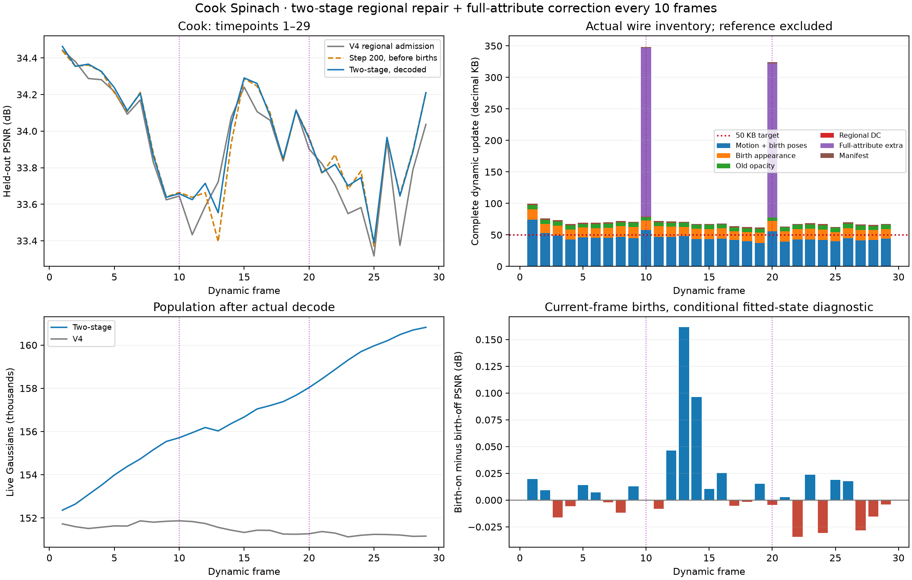
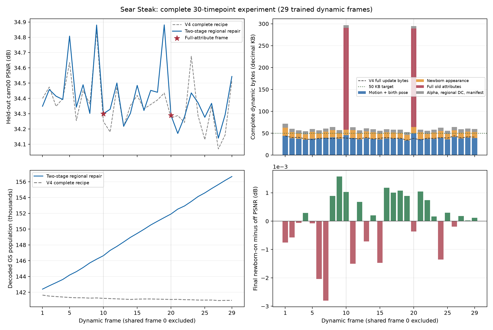

# Cook Spinach 与 Sear Steak：两阶段区域修复前 30 帧实验

## Cook Spinach：两阶段区域修复与周期全属性校正，30帧

2026-11-04。核心 idea、代码改动和固定参数与同轮 [Sear 记录](20261104_two_stage_regional_repair_first30.md)一致：固定世界空间 D5 候选树、区域共享运动＋逐点残差、learnable gate；先拟合已有表示，再按剩余区域颜色误差修复点容量。研究假设是分开运动拟合与局部增点，减少新旧点相互补偿；本轮不是 gate 或深度的单因素验证。

配置为 [cook_two_stage_region_fullattr_k10_30_20261104.yaml](../../config/cook_two_stage_region_fullattr_k10_30_20261104.yaml)。[实际运行](/mnt/SSD500GB/my4dgs_output/goal_n3dv_dynamic_20261031/cook_two_stage_region_fullattr_k10_30_20261104/20261104T003847_19e0d3)覆盖时间点0–29，frame0使用共享已训练首帧，本轮新训练29个动态帧；每帧300次共享Adam，frame10/20全属性校正，无额外SGD。gate在1–100、151–180步更新，普通帧逐点运动残差从101步参与、区域运动到200步；全属性帧前200步从step1训练旧GS的位置、旋转、尺度、透明度、DC和高阶SH。两类帧200步后冻结旧几何/外观及区域/gate，仅更新新GS和高误差区域中的旧透明度；250步扩充透明度许可行，集合外参数及Adam逐行状态保持200步基准。

区域RGB L1按实际Tα贡献归一化，每视角有效支持至少32像素、至少2个可靠视角，阈值0.03。测量区域独立于运动gate，弱叶回退到不重复计数的父区剩余部分。新点初始可训练alpha=0.1，删除按实际量化alpha<0.01，重锚后再次检查；本轮不加新点存储、人口、生存或透明度稀疏惩罚，关闭V4的预留训练视角MSE准入（不使用cam00测试视角）。种子依赖既有父点深度和图像误差矩，尚未实现独立三角化或纯空洞定位。

主要修改在 [frame_plan.py](../../pipeline/frame_plan.py)、[regional_topology.py](../../pipeline/regional_topology.py)、[full_attribute_update.py](../../pipeline/model/full_attribute_update.py)。全量属性STE同时回传参考值与增量的梯度，修正区域DC被截断；旧属性采用原生学习率与运动衰减，同一byte price计入属性存储并作每属性L1=0.005及块近端。主运动λ=0.006、相对残差权重0.5、gate rate gradient scale=1；附加属性采用FUA1/FUA2择短，六属性真实解码后延续。增删、全量校正和训练安排同时改变，整体改善不能归因于5层。

以下PSNR为cam00逐动态帧dB的算术平均；KB均为十进制完整实际包＋manifest，reference另计。

| 指标 | V4区域准入，1–29 | 本轮，1–29 |
|---|---:|---:|
| PSNR / dB | 33.902434 | 33.960162 |
| 完整动态更新 / KB每帧 | 51.713 | 87.771 |
| 普通帧完整更新 / KB | — | 69.366（27帧） |
| 全属性帧完整更新 / KB | — | 336.233（2帧） |
| 末帧GS数 | 151,161 | 160,822 |

画质增加0.05773dB，动态存储增加69.73%。Cook尚未达到34dB，动态存储也高于50KB。reference=13,811,629B，动态总计2,545,359B，合计16,356,988B，摊到30个时间点为545.233KB/帧。两份实际reference逐数组dtype、shape及字节一致；不能与reference资产不同序列直接混比。

| 实际包均值 / KB每帧 | V4 | 本轮 | 增量 |
|---|---:|---:|---:|
| Motion + birth poses | 38.580 | 45.952 | +7.372 |
| Birth appearance | 4.982 | 15.881 | +10.900 |
| Old opacity | 6.338 | 6.454 | +0.116 |
| Regional DC | 0.441 | 0.430 | -0.011 |
| Full-attribute extra | 0.000 | 17.659 | +17.659 |
| Manifest | 1.373 | 1.396 | +0.023 |

全量附加包frame10/20为267,629/244,469B，对应完整帧348,314/324,153B；全量包平均摊销17.659KB/帧。普通帧也达到69.366KB，说明开销不只来自校正帧。运动包含新点位姿和来源，不能全部归为旧点运动；压缩整包不按原始通道比例机械分摊。旧点非零平移残差比例10.541%，T/R并集10.544%（逐帧以存活旧点为分母后平均）；含本帧新点的分母下并集10.496%。

| 同一cam00的阶段均值 | PSNR / dB |
|---|---:|
| 200：清理后、增点前 | 33.950290 |
| 200：刚增点 | 33.949991 |
| 250：拟合和清理后、第二批增点前 | 33.963938 |
| 250：刚增第二批点 | 33.946421 |
| 300：关闭本帧新点 | 33.949374 |
| 300：开启本帧新点 | 33.960163 |
| 300：实际码流解码 | 33.960162 |

200到300的旧点视图平均变化-0.000916dB；最终本帧新点开/关差平均+0.010788dB，13/29帧为负，范围-0.034382到+0.161430dB。该开关是在实际拟合状态上关闭本帧新点，仅衡量其直接贡献，不能替代从头不增点的序列实验。第二批增点后平均由33.963938下降至33.946421，最后恢复至33.960163，尚未超过250步第二批增点前的均值；不同阶段也包含不同训练和清理，不能断言单一因果。

两个全属性帧200→最终分别为33.664734→33.657677、33.967674→33.958786dB，尾段小幅下降。普通帧与校正帧对应不同GT时刻，二者均值不能证明校正的提升。与Sear最终新点直接收益近零相比，Cook在部分帧能看到正收益，但仍不足以支撑当前额外存储；30帧无法证明长期漂移已解决。

共创建23,895个训练候选，同帧清理3,344个，最终传输20,551个新点；重锚后额外低alpha删除2个。前帧点退休12,286个，初始152,557点到末帧160,822点，其中首帧点仍存活147,560个、后续新点13,262个。已传输新点的1/3/5/10/20帧生存率为90.46%/79.61%/72.67%/63.04%/60.22%，仅纳入有足够后续帧的批次，30帧期限无有效样本。Cook生存率低于同轮Sear，说明两场景的点容量变化不同，不能用共同的“新点都马上消失”解释。

独立CPU解码29份真实码流，核对六属性/raw及state摘要、survivor/source、区域/透明度侧车和字节库存；保存的8份最终checkpoint（1/9/10/11/19/20/21/29）逐字节匹配。最小alpha=0.010000858，训练态birth_on与实际decoded PSNR最大差0.00002671dB。正式运行只保存step300，200/250冻结与优化器状态由同源码短核验验证。平均训练59.95秒/动态帧；普通58.26、全量82.71秒。这些不是渲染FPS；外部GPU任务在运行，正式已解码渲染与完整播放速度尚未验收。

运行中原监督进程在00:50:21收到SIGTERM，工具退出143，但独立训练PGID9989继续运行，没有重跑或丢帧。00:57:46起由核验身份后的独立监视器接管；中间约7分25秒缺少连续0.5秒监控，仅有手动安全读数，不能声称全程无监控间隙。接管区间训练峰值3770MiB、最小空闲2990MiB，无guard触发/CUDA错误，源码和资产保持冻结；Finished日志、全部29帧和独立真实流审计共同证明本轮完成。接管者不能wait非子进程，原训练退出码为unknown，**不记作0**。后续实验改用独立会话的持久监督器。

[逐帧数据](assets/20261104_cook_two_stage_first30.csv)、[完整分析](/mnt/SSD500GB/my4dgs_diagnostics/cook_two_stage_30_analysis_20261104/analysis.json)、[独立审计](/mnt/SSD500GB/my4dgs_diagnostics/cook_two_stage_30_analysis_20261104/independent_audit.json)和[监督完成证据](/mnt/SSD500GB/my4dgs_diagnostics/cook_two_stage_30_analysis_20261104/adopted_guard_result.json)保留证据。历史比较是 [V4 Cook首30帧](/mnt/SSD500GB/my4dgs_output/goal_n3dv_dynamic_20261031/cook_spinach_core_depth5_incumbent_opacityprice_region_admission_30_20261103/20261103T010146_37b7a5)。下一步优先检查区域运动表示是否给gate留下实际的粒度收益，再改善区域新增点的必要性与效果；目前不把小幅PSNR提升作为机制已验证的结论。

---

## Sear Steak：两阶段区域修复与周期全属性校正，30帧

2026-11-04。沿用固定世界空间 D5 候选树、区域共享运动与逐 GS 残差、learnable gate 和 storage loss。先把已有表示拟合到当前帧，再用剩余区域颜色误差决定增点和局部透明度修复。研究假设是：稳定已有几何与外观后再修复局部容量，能减少新旧点互相补偿造成的退化；本次不单独验证 gate 的存储收益。

配置为 [sear_two_stage_region_fullattr_k10_30_20261104.yaml](../../config/sear_two_stage_region_fullattr_k10_30_20261104.yaml)。[实际运行](/mnt/SSD500GB/my4dgs_output/goal_n3dv_dynamic_20261031/sear_two_stage_region_fullattr_k10_30_20261104/20261104T001010_b98006)覆盖时间点 0–29；frame0 使用已训练的共享首帧，本轮新训练 29 个动态帧，每帧 300 次共享 Adam。frame10、20 做全属性校正；没有跳过逐帧更新，也没有额外 SGD。

普通帧沿用前200步的区域/gate/逐点运动分阶段训练；全属性帧从step1起训练旧点的位置、旋转、尺度、透明度、DC和高阶SH。200步后，两类帧都冻结旧几何、外观和区域/gate；只训练高误差区域中的旧点透明度与新点。200步建立旧点许可集合，250步按新误差取并集，集合外参数和Adam逐行状态均保持200步基准。区域RGB L1以真实 Tα 贡献归一化，每视角至少32个有效像素、至少2个可靠视角，触发阈值0.03；测量树独立于运动gate，弱叶回退到不重复计数的父区剩余部分。

新点可训练初始alpha=0.1，实际渲染值受logit量化影响；旧/新点按alpha<0.01清理，重锚后再检查实际量化alpha。新点没有存储、人口或生存惩罚，本轮关闭V4的预留训练视角MSE准入（不使用cam00测试视角）。位置种子仍来自已有GS的残差图像矩与父点深度先验，**不是独立三角化深度**，不能声称已解决纯未覆盖区域。

代码集中在 [frame_plan.py](../../pipeline/frame_plan.py)、[regional_topology.py](../../pipeline/regional_topology.py) 和 [full_attribute_update.py](../../pipeline/model/full_attribute_update.py)。修复了全量逐点DC切断区域DC参考梯度的问题；旧点附加属性改用原生学习率和运动衰减，纳入同一byte price的块近端及每属性L1=0.005。主运动λ仍0.006、相对残差权重0.5、gate rate gradient scale=1。FUA1稠密/FUA2稀疏择短，解码包含全部六属性；这些变化与增删、训练安排同时发生，不能将总指标变化归因于5层或gate。

下表PSNR是cam00逐动态帧dB的算术平均，字节使用十进制KB，包含所有真实包和manifest；共享首帧另计。

| 指标 | V4区域准入，1–29 | 本轮，1–29 |
|---|---:|---:|
| PSNR / dB | 34.364371 | 34.407961 |
| 完整动态更新 / KB每帧 | 38.812 | 75.464 |
| 普通帧完整更新 / KB | — | 59.146（27帧） |
| 全属性帧完整更新 / KB | — | 295.764（2帧） |
| 末帧GS数 | 140,977 | 156,656 |

画质相对V4增加0.04359dB，动态码流增加94.43%。这是整体方案比较，不是单因素消融。共享reference为12,805,629B；动态总计2,188,458B；两者合计14,994,087B，摊至30个时间点为499.803KB/帧。本轮动态质量超过34.2dB仅适用于这29帧，动态存储仍明显高于50KB，尚不适合据此宣称完成工程目标或长期漂移已解决。

| 实际包均值 / KB每帧 | V4 | 本轮 | 增量 |
|---|---:|---:|---:|
| 运动包（含新点位置/旋转与来源） | 30.310 | 38.562 | +8.252 |
| 新点外观包 | 1.572 | 14.173 | +12.600 |
| 旧点透明度 | 5.152 | 5.185 | +0.033 |
| 区域 DC | 0.407 | 0.375 | -0.032 |
| 全量属性附加包 | 0.000 | 15.774 | +15.774 |
| 帧 manifest | 1.371 | 1.395 | +0.024 |

全量附加包占平均15.774KB；frame10/20分别为232,491/224,960B。运动包中包含新点的位姿和来源，不能把它全部归为旧点运动，也不能把压缩后的整包字节机械分摊到各通道。旧点非零平移残差比例为9.413%，T/R并集为9.417%（逐帧先除以存活旧点数再平均）；若分母包含本帧新点，并集为9.377%。这些是本轮计数，不构成4/5层因果验证。

| 同一cam00的阶段均值 | PSNR / dB |
|---|---:|
| 200：清理后、增点前 | 34.407581 |
| 200：刚增点 | 34.394630 |
| 250：拟合和清理后、第二批增点前 | 34.408025 |
| 250：刚增第二批点 | 34.393702 |
| 300：关闭本帧新点 | 34.407980 |
| 300：开启本帧新点 | 34.407961 |
| 300：实际码流解码 | 34.407961 |

200清理后到300旧点视图平均变化+0.000399dB；最终本帧新点开/关差平均-0.000019dB，12/29帧为负。这里的开关只衡量已拟合轨迹下的本帧新点直接贡献，不能代替从头不增点的序列实验。两个校正帧分别保持34.298706→34.299755、34.289124→34.288979dB；普通帧平均尾段也基本稳定。**阶段退化受到控制，但新点的即时全图收益仍接近零。**

共创建25,284个候选新点，其中6,862个同帧被清理，最终传输18,422个；重锚后额外筛除12个低alpha点。前帧点退休5,226个，GS由143,460增长至156,656。已传输新点的1/3/5/10/20帧生存率分别为98.12%/96.86%/96.24%/94.62%/92.53%，仅纳入有足够后续帧的出生批次；30帧期限无有效样本。不能说大多数已保留新点很快死亡。高生存也不等于有效：需要继续区分长期贡献与邻近表面的冗余复制。

独立CPU逐帧解码29份真实更新，核对六属性/raw与state摘要、survivor/source、区域侧车和逐包库存；8份保存的最终checkpoint逐字节匹配，alpha最小0.010000037。29帧训练态birth_on与实际decoded PSNR一致。正式运行只保存step300；同源码短核验的200/250/300 checkpoint另行验证参数、Adam状态、区域alpha行映射和冻结。本轮guard未触发，训练进程峰值3642MiB；平均训练55.79秒/动态帧（普通54.22、全量77.03）。这些不是渲染FPS；现有外部GPU任务仍在，已解码渲染FPS与完整播放FPS尚未正式验收。

[逐帧数据](assets/20261104_sear_two_stage_first30.csv)和[完整分析](/mnt/SSD500GB/my4dgs_diagnostics/sear_two_stage_30_analysis_20261104/analysis.json)、[独立审计](/mnt/SSD500GB/my4dgs_diagnostics/sear_two_stage_30_analysis_20261104/independent_audit.json)保留了证据。对照运行是 [V4首30帧](/mnt/SSD500GB/my4dgs_output/goal_n3dv_dynamic_20261031/sear_steak_core_depth5_incumbent_opacityprice_region_admission_30_20261103/20261103T013042_df452c)，两份实际reference逐数组dtype和字节一致。当前最需要推进的是区域增点的必要性和全量附加属性成本；gate本身的有效性仍需单独证据，不能靠整体画质略升来证明。

## 两个前缀的FUA3无损重打包

对以上Sear/Cook两个已完成前缀分别重打包29个动态更新，未重新训练或改变量化整数与属性。`pipeline/model/full_attribute_update.py` 将FUA2的稀疏有符号值作可逆zigzag及高低字节分离后用zlib压缩；`scripts/repack_fua3.py` 提供派生码流。新reader支持FUA1/2/3，encoder按完整包长度择短；旧reader不能读取FUA3。

| 动态帧1–29 | 原更新 / KB | FUA3更新 / KB | 总节省 | 继承的PSNR / dB |
|---|---:|---:|---:|---:|
| Sear | 75.464 | 72.556 | 84,326 B（3.85%） | 34.407961 |
| Cook | 87.771 | 84.590 | 92,261 B（3.62%） | 33.960162 |

frame10/20的全属性包本身节省约18%，但每10帧才出现一次，故整段收益约3.6%–3.9%。新旧流逐帧六属性、顺序、生存行、出生来源和摘要逐位一致后继承源PSNR，未重新渲染或测FPS。两场景29帧独立CPU读包解码分别3.95/3.93秒，不含渲染；格式边界、CRC与全部允许的int16值均已核验。这是无损编码收益，不能归因于gate或层级，也未解决50 KB目标。证据：`/mnt/SSD500GB/my4dgs_diagnostics/fua3_repack30_20261104/`。
