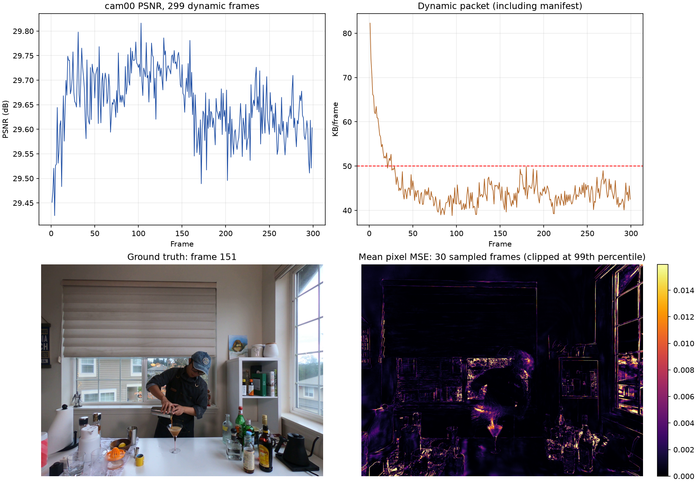

# Coffee Martini：近端收缩 0.8，300 个时间点分析

## 实验与口径

2026-11-08 完成。frame 0 是共享首帧，frame 1–299 是动态帧；16 个训练视角，cam00 评估，分辨率 1341×1006。cam00 已多次参与开发选型，不能视为独立的最终测试集。指标是 299 帧逐帧指标的算术平均；KB 为 1000 字节。

沿用已有逐分量运动近端收缩，将相对运动权重设为 0.8、固定码率损失权重 0.008；预设候选空间层级，gate 决定细分，逐点残差补充局部运动。每帧运动阶段 200 步，再进行 100 步属性纠偏；两轮梯度探测合计选择 1000 个点，全部帧保持 160,000 个 GS，无新增点。具体配置保存在运行目录 `config.yaml`；本次分析没有修改训练代码。仓库存在未提交改动，不能仅凭 Git 版本号还原运行时的全部代码。

## 结果

| 指标 | 本次结果 |
|---|---:|
| 动态帧 cam00 PSNR / SSIM / LPIPS | 29.6530 dB / 0.92626 / 0.14152 |
| 动态包，含 manifest | 44.880 KB/帧；275/299 帧低于 50 KB |
| 共享首帧 | 13.027 MB |
| 首帧加全部动态包，摊至 300 个时间点 | 88.154 KB/时间点 |
| 训练时间 | 平均 18.55 秒/动态帧，累计约 92.5 分钟 |

只算动态更新满足 50 KB 平均目标；首帧成本摊入后不满足。距离 34 / 34.2 dB 分别约 4.35 / 4.55 dB；以相同逐帧 PSNR 差近似换算，相当于需要将 MSE 降约 63% / 65%，不是依靠微调码率参数就能保证解决。这里的 34 dB 是本项目目标，不能不考虑场景、图像分辨率、测试视角与编码口径，直接与其他论文数值比较。

动态包拆分：运动 31.586 KB（70.4%），透明度 5.344 KB（11.9%），属性 5.865 KB（13.1%），manifest 2.085 KB（4.6%）。运动损失使用的 raw-block 字节代理均值约 142.7 KB，与最终压缩运动包不是同一单位；逐帧相关系数约 0.988 只说明本次波动相近，不证明代理价格与真实码率等价。

| 帧范围 | PSNR dB | 动态包 KB/帧 | 活跃区域数/帧 |
|---|---:|---:|---:|
| 1–29 | 29.617 | 57.435 | 316.2 |
| 30–59 | 29.687 | 44.728 | 80.2 |
| 60–89 | 29.673 | 41.984 | 48.4 |
| 90–119 | 29.726 | 42.165 | 53.1 |
| 120–149 | 29.725 | 43.986 | 75.2 |
| 150–179 | 29.638 | 43.709 | 122.0 |
| 180–209 | 29.615 | 44.652 | 109.1 |
| 210–239 | 29.621 | 42.433 | 99.2 |
| 240–269 | 29.614 | 44.547 | 116.6 |
| 270–299 | 29.613 | 43.577 | 119.8 |

最低第 4 帧 29.424 dB，最高第 103 帧 29.816 dB。中段较高，后段比 90–149 帧约低 0.11 dB，但最初 29 帧和最后 60 帧接近，不能据此断言存在单调累积漂移；内容变化、遮挡和拟合都可能影响分段分数。

## 首帧、空间误差与视角

本次从保存的状态只读渲染首帧：16 个训练视角平均 PSNR 33.7529 dB，cam00 为 29.4232 dB，相差 4.3297 dB。不同视角的可见内容和难度不同，差距说明首帧测试视角已存在较大误差，但不能单独归因于过拟合、标定或几何，也不是后续动态帧的画质上限。

对 1、11、…、291 共 30 帧的 cam00 PNG 做像素误差统计。将图像均分为 4×4，右上角一格占画面约 6.25%，贡献总平方误差 14.39%；误差图在窗户和窗框、人物边界、玻璃器皿及桌面细节附近较明显。同一组样本中按时间平均误差选出的最差 10% 像素贡献约 70.1% 的平方误差，这是事后选出的集中程度，并非事先可预测的区域收益。

按真实图像的时间方差选变化最大的 20% 像素，其贡献约 37.4% 的平方误差；这只是同一固定视角的二维变化启发式，包含亮度及遮挡变化，不能直接等同于三维运动区域。仍有约 62.6% 误差位于其余像素，说明也应检查相对稳定的背景、窗框和首帧视角质量。

## 阶段与机制诊断

对本次保存的 200、300 步 checkpoint，只读渲染全部 16 个训练视角和 cam00。两列为同一递推轨迹上运动结束和属性阶段结束的状态，不是两套独立训练：

| 帧 | 训练视角平均 PSNR：200 → 300 | cam00 PSNR：200 → 300 |
|---|---:|---:|
| 1 | 33.4635 → 33.4703 | 29.4947 → 29.4514 |
| 10 | 33.0428 → 33.0441 | 29.5606 → 29.6077 |
| 29 | 32.9175 → 32.9221 | 29.7287 → 29.6452 |
| 99 | 32.8936 → 32.8923 | 29.7143 → 29.7317 |
| 199 | 32.6645 → 32.6720 | 29.6504 → 29.6386 |
| 299 | 32.3464 → 32.3314 | 29.5342 → 29.6031 |

测试视角有涨有跌，六帧平均变化约 −0.001 dB，不能推广为全部帧的因果效果。每帧只选 1000/160000 = 0.625% 的点做属性纠偏，选择依据两轮各两个单训练视角梯度探测；这可能漏掉对多个视角重要的点，但目前没有无纠偏或扩大预算的同条件实验证明它是主要瓶颈。第 299 帧训练视角均值比首帧低 1.42 dB，但画面内容随时间变化，不能单凭差值确定漂移。

候选层级有 37,449 个节点，第 1、85、299 帧分别有 610、8、113 个活跃区域。gate 确实产生了不同粒度，但区域数少不自动等于有害，也没有固定粒度对照证明自适应粒度的独立收益。第 1 帧记录 15 个、末帧 7,236 个旧 GS 在本帧运动优化采样视角没有实际合成观察；这不代表这些点在全部视角永久不可见，值得结合遮挡和点的支持范围继续诊断。

前 29 动态帧的独立运行中，运动收缩从 0.5 提到 0.8，动态码率由 68.479 降至 57.281 KB/帧，而 PSNR 由 29.5973 变为 29.6035 dB。两次训练轨迹不同、样本较少；结果支持该次压缩收益，不能证明更强收缩一定不伤画质。30 时间点运行与此次 300 时间点运行的前 29 帧也不是完全一致，应避免把它们当作同一条轨迹。

## 与旧 300 时间点结果比较

11 月 6 日 Coffee 完整序列记录为 29.1681 dB、46.985 KB/动态帧；本次分别高约 0.485 dB、低约 2.105 KB/动态帧。旧方案采用约 15.03 万点的不同首帧、每帧 200 步，当前采用 16 万点及额外属性阶段，不能把差异归因于单项改动或 gate。旧完整序列包含首帧为 87.292 KB/时间点，本次为 88.154 KB/时间点：动态包更小，但本次首帧更大。旧记录也提示图像与历史标定关系尚待核实，跨数据版本比较需特别谨慎。

## 后续优先方向

1. 优先排查首帧测试视角及窗口区域：核实数据、图像与标定的一致性，并检查遮挡、视角覆盖和反射等复杂外观；保持目标测试视角不作为训练选点依据。
2. 围绕长期固定高误差区域，研究多视角一致的几何与外观修复，并允许新增可见区域获得足够表达能力；需要同时核算首帧及动态码流的代价。
3. 分析属性纠偏的点选择及预算，比较跨视角支持与当前少量单视角探测；报告各视角收益和最差帧，避免只看平均数。
4. 针对活跃区域粒度、运动残差及真实压缩率，研究画质收益和实际码率联合选择；保留逐点残差，不把小运动直接当噪声。
5. 分别测量已解码渲染 FPS 和包含读包、解码、状态更新、渲染的完整播放 FPS。当前没有两项速度数据，不能判断是否达到渲染 200 FPS。

运行：`output/experiments/coffee_gradient_prox08_1000_300frames_20261108/20261108T170522_6ebc03`。阶段诊断由 `scripts/diagnose_sequence_psnr.py` 只读生成于 `/tmp/coffee300_stage_analysis_20261108`；空间误差是从运行目录现成 PNG 抽样计算，图中热图按 99 分位截断显示，不影响数值统计。训练前向与当前帧解码渲染检查的最大像素差为 2.38e-7；该检查本身不等同于完整序列独立重放。

使用 `scripts/replay_rigid_tree.py` 从共享参考顺序重放至第 299 帧，通过每帧解码状态和属性摘要检查；最终 160,000 点，解码状态 SHA256 为 `412289c32c88059c5a94eac0496b4d6b0682942e14da335e7cadd714aa03591b`。这是正确性检查，不是播放 FPS 测试。

## 补充：299 帧属性阶段同相机配对与数据协议核查

2026-11-08 补充检查了本次全部 299 个动态帧的 `step_diagnostics` 和逐步相机记录。每帧取纠偏阶段开始的第 201、202 步（梯度探测、不做优化更新）各自使用的训练相机，在该帧第 270–300 步中找相同相机的最后一次记录，计算 PSNR 后减前；共 598 对、覆盖全部 299 帧。后者是临近结束的一次训练前向，并非严格第 300 步最终解码，也并非独立测试视角。

每帧两相机变化取平均，再对 299 帧求平均：**+0.00163 dB**；中位数 **+0.00043 dB**；154 帧为正、145 帧为负。分段：1–30 帧 +0.00521，61–90 帧 +0.00470，211–240 帧 −0.00609，241–270 帧 +0.00682 dB。单帧两视角平均的范围为 −0.06974 至 +0.08830 dB。该配对提示现有属性阶段对抽中的训练视角总体增益很小且不稳定，不能直接推出 cam00 或全部训练视角的逐帧增益，更不能替代从相同前驱独立训练有无纠偏两条序列。

本次 200、300 步 checkpoint 实际只保存了第 1、10、29、99、199、299 帧；六帧 cam00 对比结果见上表。此前另一个 Coffee 配置的 30 动态帧实验对比了 `DC+尺度` 与 `全属性`，分别为 29.43463、29.43239 dB，后者高约 217 B/帧；但两组均有属性纠偏、首帧和配置均不同于本次，因此不是当前配置的“有无纠偏”消融。见 [该实验记录](20261108_regional_fullattr_coffee_30.md)。这些证据暂不支持说当前纠偏稳定带来 0.5–1 dB 提升，也不足以断言纠偏完全无用。

数据协议核查：本次入口的 `adapter.json` 指明排除 cam13 和对应标定、cam00 测试、16 路训练；图像实际软链接至公共 `coffee_martini_result`，当前加载为 1341×1006，原视频帧为 2704×2028，使用的是经过处理的图像而不是简单对原图缩小。2026-11-06 切换为公共图像时沿用了原 no-cam13 标定；本地 README 记录图像像素和 poses 文件与旧版有差异，但 poses 数值不同可能包含坐标系或处理方式差异，目前未进行坐标系对齐及像素重投影核验，不能认定几何错配，也不能估算对 PSNR 的影响。

公开资料中并非所有方法采用同一 cam13 协议：[E-D3DGS 官方仓库](https://github.com/JeongminB/E-D3DGS)要求删除该视频及对应位姿；[OR2 论文](https://ksp.etri.re.kr/ksp/article/file/71070.pdf)明确去掉 Coffee 不同步视频并下采样，同时使用去畸变图和 SfM 点；[SpacetimeGaussians 作者](https://github.com/oppo-us-research/SpacetimeGaussians/issues/105)说明训练时使用了数据集提供的 cam13。原数据维护者曾在 [Neural 3D Video issue](https://github.com/facebookresearch/Neural_3D_Video/issues/5)建议在 Coffee 同步问题解决前排除异常相机及对应位姿。因此，本次排除 cam13 有公开依据，并不意味着所有论文都这样处理；不同结果应逐一确认版本与切分。

例如 [3DGStream 补充材料](https://openaccess.thecvf.com/content/CVPR2024/supplemental/Sun_3DGStream_On-the-Fly_Training_CVPR_2024_supplemental.pdf)列出 Coffee 的 K-Planes 29.99、NeRFPlayer 31.53、3DGStream 27.75 dB；它们与本次的分辨率、预处理、训练协议与存储预算未确认完全一致，不能直接排 SOTA 名次。OR2 论文的 33.13 dB 是六场景平均，不可与本次 Coffee 单场景 29.653 dB 直接相减。

优先核对公共图像的去畸变映射、裁剪和缩放与当前 COLMAP 内参是否对应，使用静态特征和训练视角重投影误差检查；不依赖测试图像做参数调优。再设计保持同一真实前驱的多帧有无纠偏和不同点选择对照，统计测试视角与其他未用于选型的视角，以及真实包字节；仅在确认必要时扩展为连续 30 帧以上递推。训练速度和存储应与画质一并报告。

对当前入口做进一步只读核查：17 张相机记录共用一个 PINHOLE 内参，标注宽高 1341×1006，主点 (670.5, 503.0)，与当前加载尺寸和画面中心一致；相机记录为 17 路，测试文件指定 cam00。此检查排除了明显的尺寸和主点数值不一致，但不验证去畸变映射、外参或图像内容是否与该标定对应。

## 补充：以 S²GS 表格和本机旧运行作参考

用户指定仓库 `sota.png`（S²GS 论文 Table I）为暂定参照，论文宣称数字与本机复现分开记录。表中 Coffee：S²GS-full 为 30.07 dB / 0.933，S²GS-fast 为 29.87 dB / 0.931，ReCon-GS 为 30.14 dB / 0.938；其中 ReCon-GS 标记为引自原论文。表格是 1/2 分辨率、全帧平均，存储 0.11 MB 等是表格跨场景汇总，不能当作 Coffee 单场景的实测码流。

本项目常规 PSNR 为逐通道 dB 平均，S²GS 本机 `utils/image_utils.py` 的 PSNR 是 RGB 三通道整体 MSE，渲染和 GT 四舍五入至 RGB8 后计算。因此对本次 299 帧现有 PNG 重新计算，并将首帧只读渲染 PNG 一并纳入：动态 299 帧 RGB8 整图 MSE 口径为 **29.64155 dB**；全部 300 帧为 **29.64078 dB**。数值上分别低于表中的 S²GS-full 和 ReCon-GS **0.42922 / 0.49922 dB**。这统一了 PSNR 和首帧统计口径，不代表相机、标定、初始点云或训练协议已经一致。

本机还保留了 S²GS 的历史 Coffee 300 帧输出 `/home/gamer-02/Documents/DeepLearning/S2GS/output/coffee_martini_300`，其离线 `table_metrics_psnr_ssim.json` 报告 cam00 300 帧 **29.27180 dB / SSIM 0.93051**，较 S²GS 论文表中 30.07 dB 低约 **0.79820 dB**；本次按 RGB8 全帧计算比这个历史结果高约 **0.36898 dB**。已逐像素核对两次保存的 cam00 GT 的第 0、1、10、99、199、299 帧，尺寸均为 1341×1006 且完全一致。仅抽查六帧，不等于验证全部 300 帧。

两次训练并非同条件：历史 S²GS 日志记录 17 个训练相机，当前 run 16 个；本地当前 S²GS loader 按目录枚举相机，公共 Coffee 数据包含 cam13，默认测试索引为 0，但历史运行的精确源码与数据快照未保存，不能仅凭当前代码断定历史 cam13 的具体使用；当前 run 明确排除 cam13。两者还有首帧构建、相机标定及参数差异，历史运行配置文件之后曾被修改，不能认定它完整复现了论文。因此以上数字是有条件的本机参考，不能据此宣布公平胜负。先对齐这些条件，再使用此表和可重跑结果评估改进。

## 补充：本次方法与本机历史 S²GS 的空间误差

抽取动态帧 1、11、…、291，共 30 帧，分别读取两次运行保存的 cam00 RGB8 渲染及 GT；30 对 GT 逐像素完全一致。两次样本平均整图 RGB8 PSNR 分别为本方法 **29.6554 dB**、历史 S²GS **29.2773 dB**，但训练相机、标定、首帧和配置不同，该比较仅用于定位误差，不构成机制消融。

按这 30 张真实图像的每个像素时间方差排序，将最高 20% 的像素作为「高变化区」，其余作为「低变化区」。高变化区本方法 / 历史 S²GS 的 RGB 归一化 MSE 为 **0.002026 / 0.002049**，约低 1.1%；低变化区为 **0.000847 / 0.000965**，约低 12.3%。本次相对历史 S²GS 的样本平均误差优势主要来自低变化区；这不表示高变化区的动态运动是唯一瓶颈，因为时间方差还包含遮挡、曝光与反射等，且后者使用了不同相机和首帧。

以同一帧 PSNR 从 29.6408 提升到 30.07 dB 近似换算，整图 MSE 需降低约 **9.4%**。若只改善本样本中贡献约 37.4% 误差的高变化区，而其他像素不变，则该区域的 MSE 需要降低约 **25%**；这是局部变化假设下的算术估计，不是实测可实现收益。

下一步针对实现的优先考虑：先确认当前图像与相机映射可重投影，再围绕遮挡变化、人物边缘、玻璃/高光等选取具有跨视角共同证据的困难区域；以训练视角信息而非 cam00 标签设计选点，把当前每帧两个视角一轮的梯度探测扩展为多视角误差与可见性一致的选择，并避免仅按某一种属性梯度大小排名。需要检查更新前后训练视角的变化，同时记录实际运动、透明度、属性和完整包字节。候选区域 gate 仍限制在预建空间层级内，不能从上述相关现象声称自适应层级已经获得独立收益。

此前 29 帧以原始前驱做单帧反事实，去除不超过一档的运动残差可减少平均约 6.1 KB，而测试 PSNR 几乎不变；这提供了重新分配部分码率的线索，并非安全的长序列削减量。下一步应把任何节省与困难区域修复一起放入真实递推编码验证，不能将两项收益直接相加。
