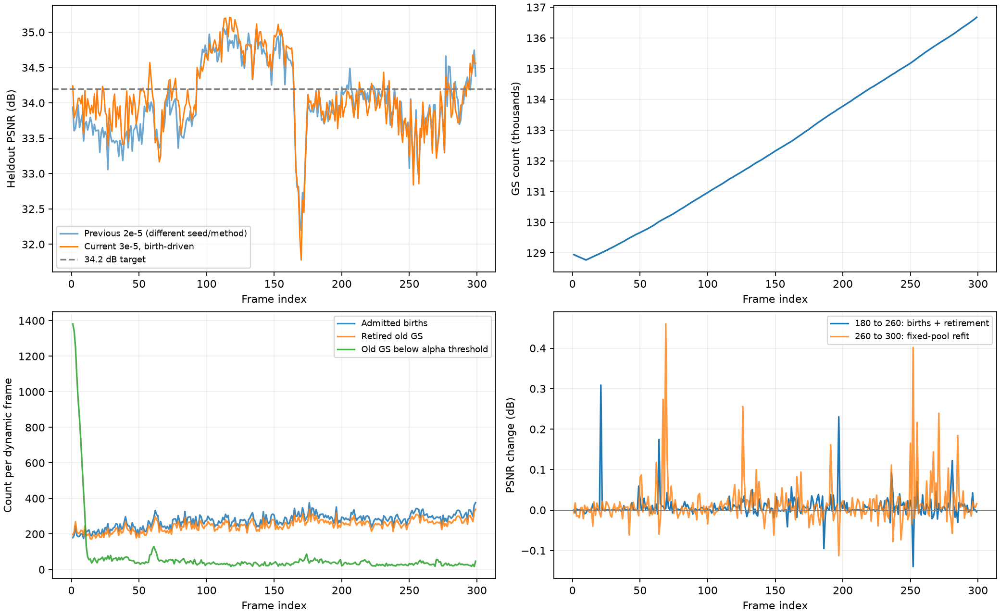
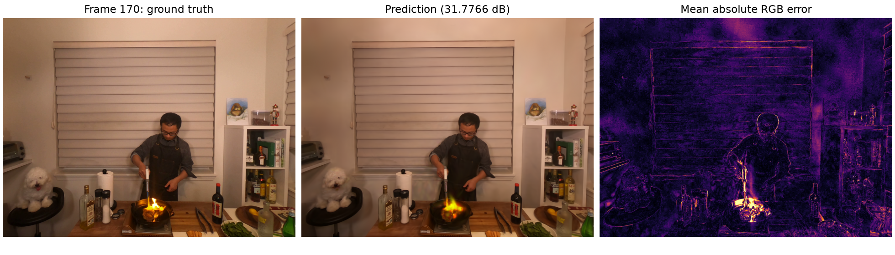

# Flame Steak：13万首帧、按新增数量约束删除、180＋80＋40

2026-10-23 分析。作者已完成第0–299帧。运行：`output/n3dv/flame_steak_1020/full300_130k_birthdriven10pct_180_80_40/20261022T142925_c8bbee`。本次只分析已有结果，未修改训练算法或启动新训练。

## Idea 与实际改动

希望让新增与删除接近平衡，并给改变点集后留下精修阶段，控制长期点数增长。

- 首帧132,586 GS，加载时初剪至128,963 GS，首帧测试PSNR 33.217857 dB。
- storage loss恢复3e-5；删除共享颜色训练逻辑。已有GS的SH、尺度固定，新生GS仍拟合自己的颜色和尺度。
- 180步运动，80步新生筛选，40步固定点集精修。运动支持从第161步固定，gate第70步冻结。
- `birth_driven_retirement`：先由新点自身的透明度/尺寸筛选确定最终新增K，再把旧点删除量D限制到`ceil(0.9K) ≤ D ≤ floor(1.1K)`。按旧点量化alpha升序删除，保护新点预测所需的来源点。新点不因总数量配额额外落选。
- 第260步完成新生最终剪枝与旧点退出；第261–300步联合精修既定运动幅值与新生属性，点集、gate及运动支持固定，旧透明度固定。

实际配置以[运行快照](../../output/n3dv/flame_steak_1020/full300_130k_birthdriven10pct_180_80_40/20261022T142925_c8bbee/config.yaml)为准。本轮与之前2e-5实验同时改变了首帧、颜色更新、增删机制和调度，不能将差异单独归因于某项改动。

## 全序列结果

画质包含首帧共300帧；动态增量和训练耗时统计299个后续帧。KB=1000 bytes。

| 指标 | 本轮 | 前轮2e-5 |
| --- | ---: | ---: |
| 平均PSNR/dB | **34.093082** | 34.011776 |
| SSIM | 0.966631 | 0.965490 |
| LPIPS | 0.123243 | 0.123141 |
| 动态完整增量（含索引）KB/帧 | **39.205699** | 47.049906 |
| 含首帧摊销 KB/帧 | 76.011823 | 77.646357 |
| GS起点→终点 | **128,963→136,672** | 107,228→186,036 |
| 模型训练秒/动态帧 | 16.1372 | 20.7307 |
| 验证时纯渲染FPS | 327.83 | 344.17 |

本轮比前轮平均PSNR高0.081306 dB，动态存储约下降16.67%，点数净增长7,709（约5.98%）。已超过34 dB，距离34.2 dB目标差0.106918 dB。相较更早3e-5实验的34.019337 dB，本轮高0.073745 dB；更早实验仅保留历史记录，未在本次重新核验原始结果。

参考首帧11.081043 MB，299帧完整增量11.722504 MB，总码流22.803547 MB。动态负载平均38.632060 KB，其中运动30.049933 KB、新生属性5.579689 KB、透明度3.002438 KB，另有索引0.573639 KB。运动包也包含删除映射、新点位置和空间结构信息，不能将它全当作逐点运动大小。

FPS沿用运行时同步forward＋clamp测量，排除解码、上传、数据加载及质量指标，未审计GPU独占。此次没有重新跑FPS基准或重新计算全部LPIPS。

## 10%确实执行了，但删除标准依然粗糙

299帧全部核对点数收支和10%整数边界，无违规；没有一帧新增数恰好等于删除数。

| 统计 | 数量 |
| --- | ---: |
| 累计正式新增 | 82,204 |
| 累计旧点删除 | 74,495 |
| 每帧平均新增/删除 | 274.93 / 249.15 |
| 自然低alpha数量不足下限，补删到下限 | **289帧** |
| 自然低alpha数量超过上限，只删到上限 | 10帧 |
| 自然删除量恰好落在区间内 | 0帧 |

在需要补删的帧中，累计60,725个删除名额来自补足下限，占全部删除量约81.5%。这些点未低于0.01阈值；这不证明它们都有用，但说明当前主要由数量配额决定删除，而不是由实际图像贡献决定。

第299帧是典型例子：新增376，只有47个可删除旧点低于阈值，实际删除339（下限），其中265个来自上一帧新增。前10帧左右初始低alpha积累较多，删除量触发上限；之后大部分帧贴着90%下限运行。

当前实现保证了收支，尚没有保证“被删的旧点比新点更没用”。新点来源于高梯度位置，旧点退出依据全局alpha排名，二者没有局部贡献上的对应关系。

## 新生点周转快，最后120步平均收益有限

累计初始克隆332,632点，split净增加839，候选剪除251,267，正式保留82,204。约75.35%的候选数量被剪除；现有报告未将透明度和尺寸原因拆开，不能将其全归因于低alpha。

完整运动码流追踪与报告一致：

- 上一帧正式新增池中，共43,719个点在紧接着下一帧被删除，占所有可观察下一帧的新生点81,828个的**53.43%**；最后一帧出生的点没有下一帧观察。
- 末帧首帧原有点存活112,021个，后续出生点存活24,651个。正式新增82,204个中，累计删除57,553个（约70.01%）。此比例包含不同年龄的点，不能据此断言被删点从未贡献过图像。

| 阶段（299动态帧） | 平均PSNR/dB | 相对上一阶段 | PSNR下降帧数 |
| --- | ---: | ---: | ---: |
| step180，旧点运动结束 | 34.072156 | — | — |
| step260，新生筛选＋旧点删除后 | 34.080642 | **+0.008486** | 95 |
| step300，固定点集精修后 | 34.096009 | **+0.015368** | 120 |

后120步总收益仅+0.023853 dB，98帧最终低于step180。新生和精修确实有时有效，但稳定收益偏小。

注意：step260指标在新点筛选和旧点删除之后采样，没有“删旧点前”的对应图像。因此不能把180→260的差值单独视为新点收益，也不能用它量化删除本身的损害。最终指标还不能证明把120步全部分给运动就会更好；后续帧会依赖累积新点。

## 画质下降的位置与可能原因

| 帧段 | 本轮PSNR | 前轮2e-5 PSNR | 本轮平均GS |
| --- | ---: | ---: | ---: |
| 1–49 | 33.8889 | 33.5716 | 129,133 |
| 50–99 | 34.0349 | 33.8693 | 130,287 |
| 100–149 | 34.8418 | 34.7564 | 131,626 |
| 150–199 | 33.9859 | 33.9462 | 133,024 |
| 200–249 | 33.9684 | 34.0437 | 134,472 |
| 250–299 | 33.8520 | 33.8969 | 135,923 |

早期相对收益更大，最后100帧略低于前轮，值得关注长期外观适应与增删周转；但多项机制及首帧同时改变，不能确认因果。

最高终态PSNR是第117帧35.210003 dB，对应131,428 GS。**这是特定帧的峰值，不是已证明的最优点数**。最低是第170帧31.776602 dB，对应132,877 GS；step180已只有31.781256 dB，最终阶段几乎没挽回。

第170帧误差在火焰、锅沿和附近区域尤其明显。将图像等分为3行4列，下方中间两个格子占约16.7%面积，贡献56.67%的总平方误差；这个区域也含其他物体，不能将所有误差归为火焰。

已有GS的颜色与尺度固定，位移和透明度不足以完整表达火焰形变、照明及其他外观变化；这些变化目前主要依赖新点补偿。结合候选大量淘汰、新点短期周转和后段净收益小，**局部外观补偿能力不足、新点准入及退出依据不匹配**是优先排查的机制问题。这是代码约束与结果共同支持的假设，尚未通过单项验证确认。

## 建议的下一步

1. 先补可定位的诊断：删旧点前后分别记录训练视角损失，分别统计候选因低alpha、屏幕尺寸及世界尺度被剪的数量；cam00继续只用于评价。下节已利用保存checkpoint补做12帧固定属性诊断，但尚未增加训练中的逐帧采样。
2. 保留10%数量要求，删除排名加入训练视角中的实际合成贡献、冗余和时间累计证据。保护长期有用点，避免新点只因alpha较低就在下一帧大量被配额删除。不能将暂时遮挡或静止直接等同于无用。
3. 优先改善高误差局部的新生表示、准入和外观拟合。旧点也需要某种稀疏局部外观补偿的可能性，具体实现再讨论；本次尚未恢复共享颜色，也未改动300步分配。

## 2026-10-23 补充：将新生收益与删除代价拆开

用户希望将问题分为运动阶段和新增阶段。对保存了step180、260 checkpoint的12帧（1、3、29、59、89、119、149、179、209、239、269、299）补做固定属性渲染，没有继续训练、改变参数或利用测试指标选择点。

构造四个集合：A为step180完整旧点；B为step260存活旧点；C为B加step260量化新点；D为A加同一批量化新点。先逐字段验证B完全等于A按survivor行号取出的子集，再核验A、C渲染PSNR与原180、260记录相差小于1e-4 dB。因此D−A衡量固定旧点时的新点即时收益，C−D衡量有新点时删除的即时影响。

| 对比 | cam00留出视角平均PSNR变化/dB | 全部20训练视角平均PSNR变化/dB |
| --- | ---: | ---: |
| D−A：保留完整旧点，仅加新点 | **+0.004403** | **+0.015172** |
| C−D：保留新点，删除所选旧点 | **−0.000402** | **−0.000094** |
| C−A：新生与删除合计 | +0.004000 | +0.015079 |

训练视角的平均实际光度目标（0.8 L1＋0.2 DSSIM）从0.015470998变为仅加新点时的0.015466895，下降约0.0265%。留出视角中4/12帧单独新增后PSNR下降。

**据此应收紧前面的因果判断：这些样本中，没有证据表明新点的明显收益被删除明显抵消；主要是新点本身即时收益就很小，而且训练视角也如此。** 删除排名和短周转仍是机制缺口，但不能仅由“补删配额多”认定它是这次画质偏低的主要原因。优先应排查候选位置与误差需求是否对应、新旧点遮挡竞争、初始化及短阶段拟合，而非只换删除数量公式。

以上只覆盖12帧step260状态，不能估计全部299帧即时影响，更不能证明另一套全序列训练政策的长期因果效果。运动阶段的34.072156 dB也包含前序帧已经继承的新点；它不是“从未新增GS”的独立基线。

诊断数据：[birth_retirement_render_probe.json](assets/flame_steak_birthdriven10pct/birth_retirement_render_probe.json)。本次脚本仅在临时目录执行，原checkpoint、图像和码流未修改。

## 当前新增/删除实现中的具体约束

运动最后30步（151–180）累计屏幕位置梯度，源点须满足梯度≥1.5e-4且最大尺度≤场景extent的1%。第180步在其协方差方向按2倍标准差随机采样，每个合格源点生成一个候选，继承颜色、尺度和旋转。`_opacity`直接初始化为0.1，这是logit，实际alpha约0.525；这是继承的ReCon-GS实现，不能按注释理解为alpha=0.1。

181–260只拟合新点，旧点位姿和透明度均固定。第220步对新生池的高梯度大点split，同时剪除低alpha或过大新点；第260步在最后一次梯度更新后仅剪枝，再按最终K决定旧点删除。没有对残差图中的未解释像素直接补点，也没有“加入它是否降低多视图损失”的准入判断。

第220步剪枝读取新点原始激活alpha，第260步终剪读取实际量化alpha。这是代码路径上的差别，现有汇总无法量化其影响。两次剪枝都检查投影半径>20像素及尺度>0.1倍场景extent。split只作用于新生池，不会在这一阶段拆分旧点。

旧点删除发生在新点已拟合、旧透明度仍固定的第260步。保护新生预测来源后，统计alpha<0.01的旧点数，将数量截进0.9K–1.1K，按alpha由低到高删除；“旧点”包括所有上一帧存活点，也包括上一帧新生点。最后40步联合精修已选运动幅值和新生属性，旧透明度仍固定。

## FPS口径复核

当前FPS来自真实调用计时：每帧cam00预热10次，GPU同步，连续执行50次forward＋clamp，再同步，以总15000次渲染/总耗时汇总。它是当前运行中的纯渲染吞吐参考，不是按GS数量推算，也不是包括解码、传输、上传的播放FPS。

13万与18万是两轮末帧数量，而327.83与344.17是全序列吞吐；只比末帧，本轮136,672点为351.97 FPS，上轮186,036点为367.76 FPS，差异仍存在。点数不能单独决定耗时：投影面积、与tile的重叠数量、可见性、透明度合成及提前终止都会影响实际工作量；原生实现可见[排序与tile展开](https://github.com/graphdeco-inria/diff-gaussian-rasterization/blob/main/cuda_rasterizer/rasterizer_impl.cu)及[前向合成](https://github.com/graphdeco-inria/diff-gaussian-rasterization/blob/main/cuda_rasterizer/forward.cu)。两轮还未在统一独立进程、GPU独占和相同渲染路径下重测，不能认定少点反而系统性更慢，也不能把差异直接归因为某一个渲染因素。

## 其他方法的增删策略核验

本节由受委派agent核对本地官方仓库并联网核验论文/代码；是方法调研，不是新增实验结果。

| 方法 | 动态帧新增/退出策略 | 与当前规则的关键区别 |
| --- | --- | --- |
| ReCon-GS | 运动后梯度驱动克隆，新生池拟合并按alpha/尺寸筛选；下一帧开始将上一帧增量K并入后，在旧＋新整体按alpha排序删K | 延迟清算，刚并入点也可被删；并非本帧准入K后本帧旧池单独强删K |
| QUEEN | 动态帧投影梯度clone/split，新旧点在同一模型中按阶段更新多种属性残差；动态阈值剪枝主要针对本帧新点，split也移除母点 | 没有新增K就配额删K旧点；首帧深度补点不能误读为每动态帧深度补点 |
| S²GS | 首帧建立点与固定层级，后续更新已有点的几何和外观残差 | 论文明确后续不能在线新建anchor，不走在线新增/替换路线 |
| 3DGStream | 运动后高梯度点附近生成补充点，冻结变形后的旧点，只拟合新点 | 补充点只服务当前帧，不作为持久点传到下一帧，没有配额删旧点 |

一手来源：

- ReCon-GS：[module.py](https://github.com/jyfu-vcl/ReCon-GS/blob/main/pipeline/ReCon-GS/module.py)、[Gaussian增删](https://github.com/jyfu-vcl/ReCon-GS/blob/main/pipeline/ReCon-GS/model/gaussian.py)、[N3DV配置](https://github.com/jyfu-vcl/ReCon-GS/blob/main/config/dynerf.yaml)。
- QUEEN：[训练代码](https://github.com/NVlabs/queen/blob/main/train.py)、[Gaussian增删](https://github.com/NVlabs/queen/blob/main/scene/gaussian_model.py)、[配置](https://github.com/NVlabs/queen/blob/main/configs/dynerf.yaml)。其首帧MiDaS深度反投影调用位于帧循环外；独立influence_prune路径在N3DV默认设置下未启用，不能宣称默认用贡献度剪掉旧点。[论文外观更新消融](https://arxiv.org/html/2412.04469v1#S4.SS4)支持保留外观适应能力的重要性，不能将该文提升幅度直接套用到本项目。
- S²GS：[论文III-C.2及附录J-1](https://arxiv.org/html/2608.19639v1)、[训练代码](https://github.com/liyw420/S2GS/blob/main/train.py)。
- 3DGStream：[论文4.2](https://arxiv.org/html/2403.01444v1#S4.SS2)、[逐帧训练代码](https://github.com/SJoJoK/3DGStream/blob/main/train_frames.py)。

## 证据与核验

- [逐帧统计CSV](assets/flame_steak_birthdriven10pct/per_frame.csv)
- [解码与大小核验](assets/flame_steak_birthdriven10pct/verification.json)
- [原始运行汇总](../../output/n3dv/flame_steak_1020/full300_130k_birthdriven10pct_180_80_40/20261022T142925_c8bbee/run_summary.json)

核验覆盖299份动态报告、点数收支、10%整数边界、全部运动/出生/透明度码流顺序解码、每帧原始属性及运动状态摘要、实际码流与索引大小。所有摘要一致，完整增量大小与运行汇总一致。本次检查排除了这些路径中的码流不一致，不能据此证明训练机制最优。
