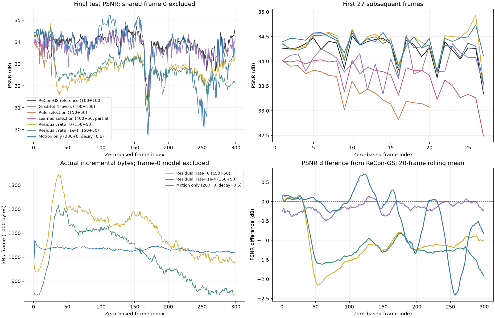
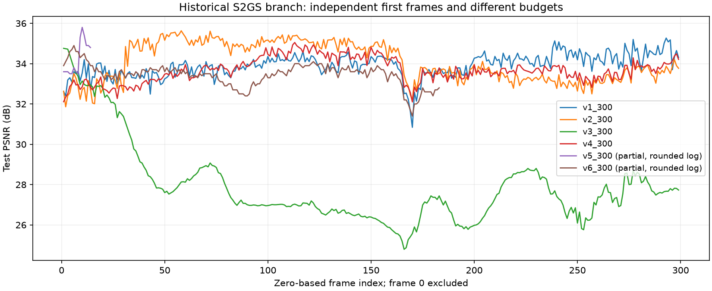

# 实验盘点：2026-09-30

这份报告回答三个问题：哪些实验确实完成、在相同帧上表现怎样、结果能否支持当前判断。只读取已有配置、日志、TensorBoard 和 JSON，不训练、不渲染、不加载 checkpoint。

## 先看结论

- 本地共 14 个实验目录：9 个完成各自计划范围，3 个只完成前缀，2 个为空。另核对了 1 个外部 ReCon-GS 参考。
- 近期完整序列都使用同一首帧路径、cam00 测试和 1600×1199 的保存图。299 个后续帧上，参考 PSNR 为 **33.942232 dB**，四层 GradHet 为 **33.782950 dB**，motion-only 为 **33.565293 dB**。
- motion-only 的平均 SSIM 为 **0.971295**，高于参考的 **0.968533**，但 PSNR 低 0.376938 dB。两个指标的结论不同，需要保留。
- 两个有新增 GS 的量化残差版本分别为 **32.795230 / 32.762555 dB**。加码率损失后字节减少约 **9.47%**，PSNR 降低 **0.032676 dB**；目前只有各一次运行。
- 三个残差版本的前 20 帧都略高于参考，完整均值却都低于参考。短前缀不能替代完整序列。motion-only 同时改变了步数分配和初始化，无法据此单独判断新增 GS 的作用。
- `v1–v6` 属于 S²GS 历史分支，SH degree=2，相机记录尺寸为 1345×1008，首帧独立训练。它们不能与近期 SH degree=1、1600×1199 的实验直接排名。

## 统计口径

主表使用“已完成帧的最终测试评估”，对逐帧 PSNR / SSIM 做算术平均。索引统一为从 0 开始，主均值排除首帧 0。300 总帧表示首帧＋299 个后续帧；规则版 21 总帧表示首帧＋20 个后续帧。未完成帧和中间 step 不进入主均值。

近期配置 `lpips_required: false`，原始记录没有 LPIPS，本次不补算。S²GS 没有 SSIM 记录；其 `Loss (Test)` 以 `legacy_test_loss` 原名语义保留，没有假定它等同于近期 L1。

S²GS 的 `Frame index` 从 1 开始，这里减 1 对齐。`v5` 完成 15 个总帧，因此只统计 14 个后续帧；`v6` 完成 184 个总帧，因此只统计 183 个后续帧。两者只剩 tqdm 日志，数值只有约三位有效数字，表中以“≈”标记。`v1–v4` 的逐帧 JSON 已保留，但 PSNR 原始值只有两位小数。

ReCon-GS 的 TensorBoard step 每帧重新从 1 开始。脚本按日志中的 frame 标记逐项配对事件顺序，同时检查 step 和打印值；不能按 step=200 去重。近期 JSON 的最终值与对应最终 step 评估逐项一致。

## 近期 ReCon-GS 实验清单

| 代号 | 方法与运行配置快照 | 运行 ID | 计划总帧 | 可统计后续帧 | 状态 | 每帧运动＋新增 GS 步数 |
| --- | --- | --- | --- | --- | --- | --- |
| REF | [ReCon-GS 参考](configs/flame_steak_fullres.yaml) | 20260926T225223_dc5baf | 300 | 1–299（299 帧） | 完整 | 100+100 |
| G4 | [GradHet 四层 gate](configs/flame_steak_gradhet4_recongs_first_checkpoint.yaml) | 20260928T101523_334ef2 | 300 | 1–299（299 帧） | 完整 | 100+100 |
| RULE | [规则选择](configs/flame_steak_selective_motion_21.yaml) | 20260929T163534_94efce | 21 | 1–20（20 帧） | 完整 | 150+50 |
| LEARN | [可学习选择](configs/fs_learned_selective_300.yaml) | 20260929T191109_e3525e | 300 | 1–27（27 帧） | 前缀；第 28 帧不完整 | 400+50 |
| R0 | [量化残差，λ=0](configs/fs_residual_rate0_300_steps200.yaml) | 20260929T235022_88a9c4 | 300 | 1–299（299 帧） | 完整 | 150+50 |
| R1 | [量化残差，λ=1e-4](configs/fs_residual_rate0001_300_steps200.yaml) | 20260930T094026_3f3f16 | 300 | 1–299（299 帧） | 完整 | 150+50 |
| MO | [motion-only，λ=0](configs/fs_motion_only_300_steps200.yaml) | 20260930T164205_0de781 | 300 | 1–299（299 帧） | 完整 | 200+0 |

共同首帧路径：

```text
/home/gamer-02/Documents/DeepLearning/ReCon-GS/output/flame_steak_fullres/20260926T225223_dc5baf/ckpt-0-15000.pth
```

参考从零训练首帧 15,000 步，测试 PSNR 为 34.004742 dB。其他六个近期实验从该 checkpoint 继续。三份残差 bootstrap 记录的基模型 SHA256 一致，旧 GS 数为 214,996；本次没有重新加载首帧模型核验张量摘要。

相同首帧、测试视角和图像尺寸使同帧画质比较有意义，但训练随机序列、损失、表示与步数分配未做完整配对。参考每帧还评估 20 个训练相机，近期试验通常只评估一个测试相机。不能将表中差异解释为严格单因素或等耗时消融。

### 完整 299 个后续帧：最终画质

| 代号 | PSNR / dB | SSIM | PSNR 相对参考 / dB | SSIM 相对参考 | PSNR 高于同帧参考 |
| --- | --- | --- | --- | --- | --- |
| REF | 33.942232 | 0.968533 | — | — | — |
| G4 | 33.782950 | 0.964306 | -0.159281 | -0.004227 | 83/299 |
| R0 | 32.795230 | 0.959211 | -1.147002 | -0.009322 | 21/299 |
| R1 | 32.762555 | 0.958821 | -1.179677 | -0.009713 | 23/299 |
| MO | 33.565293 | 0.971295 | -0.376938 | +0.002762 | 119/299 |

### 共同前 20 个后续帧

| 代号 | PSNR / dB | SSIM | PSNR 相对同帧参考 / dB |
| --- | --- | --- | --- |
| REF | 34.297643 | 0.972634 | — |
| G4 | 33.965849 | 0.970655 | -0.331794 |
| RULE | 33.453126 | 0.967311 | -0.844516 |
| LEARN | 33.843743 | 0.969812 | -0.453899 |
| R0 | 34.387757 | 0.973281 | +0.090115 |
| R1 | 34.360532 | 0.973108 | +0.062890 |
| MO | 34.394092 | 0.973789 | +0.096449 |

LEARN 的 27 个完整后续帧均值为 33.687684 dB；参考同一范围为 34.227876 dB，差 -0.540192 dB。其第 21–27 帧均值为 33.241800 dB，落后同帧参考 0.786743 dB。它的 450 步预算比参考的 200 步多，仍不能由这一次试验推断选择学习已优于基线。

### 完整序列的分段 PSNR 差值

| 后续帧范围 | G4−REF / dB | R0−REF / dB | R1−REF / dB | MO−REF / dB |
| --- | --- | --- | --- | --- |
| 1–50 | -0.239980 | -0.771452 | -0.559630 | +0.074262 |
| 51–100 | -0.281364 | -1.721436 | -1.499588 | -0.106815 |
| 101–150 | -0.110481 | -1.216303 | -1.136448 | +0.268301 |
| 151–200 | -0.111157 | -1.040891 | -1.064710 | -0.662507 |
| 201–250 | -0.115577 | -1.141198 | -1.281362 | -0.768039 |
| 251–299 | -0.095861 | -0.987541 | -1.543605 | -1.080912 |

MO 在第 101–150 帧平均高于参考，后 149 帧明显落后。两个有新增 GS 的版本也存在长序列退化。表格能定位退化范围，不能区分运动表达、选择、拓扑增删或跨帧误差累积的因果作用。



### 中间阶段带来多少提升

| 代号 | 参与统计后续帧数 | 各评估点平均 PSNR / dB | 最后一段提升 / dB |
| --- | --- | --- | --- |
| G4 | 299 | 50步 33.621605；99步 33.759339；100步 33.762940；200步 33.782950 | +0.020010 |
| RULE | 20 | 40步 33.454483；100步 33.415936；149步 33.415364；150步 33.415410；200步 33.453126 | +0.037716 |
| LEARN | 27 | 100步 33.583025；350步 33.648646；400步 33.664478；450步 33.687684 | +0.023206 |
| R0 | 299 | 30步 32.675573；150步 32.779893；200步 32.795230 | +0.015337 |
| R1 | 299 | 30步 32.637160；150步 32.741962；200步 32.762555 | +0.020592 |
| MO | 299 | 30步 33.498638；150步 33.543560；200步 33.565293 | +0.021734 |

G4 的最后一段为 100→200 新增 GS；RULE 为 150→200；LEARN 为 400→450；R0/R1 为 150→200。MO 的 150→200 仍是运动训练。这里比较的是每个实验自身同帧阶段差，不能将不同预算直接视作效率比较。

## 真正发出的增量码流

下表来自 299 个 `.bin` 的实际文件长度，加一次 `bootstrap.json`。逐帧检查了 `.bin` 长度、JSON sidecar、类别字节之和与最终汇总；三个流均完整。共享首帧模型、完整 checkpoint、诊断 JSON 和 PNG 不计入码流。未读取或提交这些二进制内容，也未执行独立全流解码重放。

| 代号 | 实际 bytes/帧 | 实际 kB/帧 | 全流 bytes | 全流 MiB | bootstrap bytes（仅一次） |
| --- | --- | --- | --- | --- | --- |
| R0 | 1104521.057 | 1104.521 | 330251796 | 314.953 | 1222 |
| R1 | 999975.582 | 999.976 | 298992699 | 285.142 | 1225 |
| MO | 1032531.435 | 1032.531 | 308726899 | 294.425 | 1246 |

R1 相对 R0：平均减少 104545.475 bytes/帧（9.465%），PSNR 变化 -0.032676 dB，SSIM 变化 -0.000390。两个运行快照仅实验名和 `module.quantized_residual.lambda_rate` 不同；这不证明训练源码和随机序列逐项一致。

| 代号 | 运动 kB/帧 | 新增 GS kB/帧 | 删除索引 kB/帧 | 头部/协议 kB/帧 |
| --- | --- | --- | --- | --- |
| R0 | 762.350 | 304.759 | 31.917 | 5.495 |
| R1 | 683.953 | 279.404 | 31.131 | 5.488 |
| MO | 1027.459 | 0.000 | 0.000 | 5.073 |

三份 bootstrap 都依赖外部共享首帧。报告没有首帧模型的独立编码成本，因此这些数字是增量流大小，不能作为完整视频总压缩率。未记录可据以换算的播放帧率，故不报告 Mbps。kB=1,000 bytes，MiB=2²⁰ bytes。

G4 的已有 `frame_storage` 记录为平均运动 NPZ 2,234,253.371 bytes，加新增 GS 文件 46,643.953 bytes，共 2,280,897.324 bytes/帧。它是文件存储格式，不是本节的算术编码流；参考本次没有同口径逐帧运动包。S²GS JSON 的 `Size (MB)` 与层级 estimated MB 也不是本次实测的增量 `.bin`。

## 活动区域与 GS 增删

| 代号 | 旧 GS KEEP | 旧 GS 只继承区域运动 | 旧 GS 有局部残差 | 累计新增 GS 操作 | 累计删除操作 |
| --- | --- | --- | --- | --- | --- |
| R0 | 3.404% | 18.876% | 77.719% | 2,392,915 | 2,385,794 |
| R1 | 1.728% | 24.771% | 73.501% | 2,334,433 | 2,327,025 |
| MO | 0.000% | 0.029% | 99.971% | 0 | 0 |

上述 GS 比例先按每帧旧 GS 分母计算，再对帧平均；三组分母均为 214,996。残差模式的 SPLIT 表示该 GS 的局部量化残差非零；区域各层也各自有分母，不是一棵互斥树切分。它与规则/可学习选择的内部节点 SPLIT 含义不同。新增/删除是跨帧操作累计，不是互不重复的独立点数。

MO 的局部残差几乎处处非零，当前质量提升没有伴随稀疏局部运动；同时它没有新增或删除 GS。R0/R1 的新增和删除操作累计都超过 230 万，需要在后续单因素试验中检查它们与长期质量的关系，本次没有运行这种消融。

LEARN 每帧平均有效 SPLIT 为 4.889 个；终止 SHARED 共 1140 个，其中最粗层 953 个，占 83.596%。平均 29.703% 的旧 GS 被允许共享运动。详细解释见[27 帧诊断](../../learned_selective_27_diagnosis.md)。

RULE 的原始 JSON 记录了 640 次候选比较，269 次禁止共享运动，最终复核回退 0 次。累计 clone 12,781 次，其中 KEEP 来源 11,875 次；merge/prune 删除 KEEP 7,975 次。KEEP 占比大，不能只凭这些操作次数断言背景被错误增删。见[规则版诊断](../../selective_motion_21_diagnosis.md)。

| G4 gate 层 | 所有父区域累计 | 有资格累计 | 开启累计 | 开启/有资格 | 开启/所有父区域 |
| --- | --- | --- | --- | --- | --- |
| L2 | 297,505 | 271,922 | 148,558 | 54.633% | 49.935% |
| L3 | 854,429 | 391,131 | 222,477 | 56.880% | 26.038% |
| L4 | 2,249,486 | 519,981 | 329,546 | 63.377% | 14.650% |

这些数值来自 897 份 gate CSV。日志里的“开启数量/候选数量”与 CSV 中的有资格分母并非总能直接对应，报告以逐行 `eligible` / `active` 计数为准。不要从某一帧日志的 497/497 推断整层所有区域均已开启。

## 训练、编解码与输出开销

| 代号 | training s/帧 | evaluation | drawing | saving | wall | encode | decode |
| --- | --- | --- | --- | --- | --- | --- | --- |
| LEARN | 27.346 | 2.911 | 14.616 | 3.529 | 48.955 | — | — |
| R0 | 15.746 | 2.232 | 3.193 | 2.099 | 26.225 | 0.341 | 1.236 |
| R1 | 15.778 | 2.330 | 3.195 | 2.085 | 26.284 | 0.329 | 1.165 |
| MO | 16.604 | 2.162 | 3.199 | 2.069 | 27.030 | 0.349 | 1.295 |

这里均为已有 JSON 记录的均值。wall 包含整帧准备、训练、各评估点和输出；本次没有重新计时。残差版 training 剔除了 frame_prepare / finalize；布局、encode、decode 是相关阶段中的子计时，不能再与其他列简单相加。LEARN 与残差版预算及计时划分不同。

较早的 REF / G4 / RULE 只有旧 PerfTimer 的 `frame`：8.822 / 13.617 / 21.266 s。它不包含相同范围的最终评估和输出，不纳入 wall 排名。S²GS 的 `Frame time IO` 另保留在机器记录中，也不与这些 wall 直接比较。所有 FPS 仅保留原始记录，本报告不据此宣称推理加速。

## S²GS 分支历史实验

六组相机 JSON 的尺寸均为 1345×1008；没有同帧保存 PNG 可再次核对图像内容。配置使用 SH degree=2、独立 3,600 步首帧和 `test_indices=[0]`。这些设置与近期实验不同。旧入口 `train.py` 和旧 worktree 已不在当前仓库，不能把它们描述为当前代码可直接复现的运行。

| 实验与 Namespace 快照 | 方法 | 可统计后续帧 | 状态 | 配置主阶段步数/帧 | PSNR / dB | 旧 Frame time IO / s |
| --- | --- | --- | --- | --- | --- | --- |
| [v1_300](configs/v1_300.json) | 6 层共享运动 | 1–299 | 完整300总帧 | 200 | 33.91 | 6.09 |
| [v2_300](configs/v2_300.json) | 4 层共享运动 | 1–299 | 完整300总帧 | 300 | 34.06 | 11.08 |
| [v3_300](configs/v3_300.json) | 4 层自适应；旧 split 规则 | 1–299 | 完整300总帧 | 400 | 27.89 | 10.15 |
| [v4_300](configs/v4_300.json) | 4 层自适应＋候选试分裂＋增长 | 1–299 | 完整300总帧 | 400 | 33.68 | 10.13 |
| [v5_300](configs/v5_300.json) | v4 路线；稀疏 offset gates | 1–14 | 中断：KeyboardInterrupt | 400 | ≈34.27 | ≈9.74 |
| [v6_300](configs/v6_300.json) | v5 路线；gate warmup 与 gate loss 修改 | 1–183 | 中断：KeyboardInterrupt | 400 | ≈33.44 | ≈10.31 |

自适应版本的短候选拟合有额外成本，表中主阶段步数不代表完整反传总数。`v5` 与 `v4` 的保存配置没有体现全部实现差异；稀疏 offset gates 的信息来自原日志。`v6` 快照另记录 warmup=100、offset gate LR=0.005、L0=0.0005、L2=0.001。配置和日志不能替代旧源码快照。

`v3` 的全序列 PSNR 只有约 27.89 dB，是应保留的失败结果。`v5/v6` 的前缀均值不能与 `v1–v4` 的 299 帧均值直接排名。原 `avg_metrics.json` 包含首帧，例如 `v3` 的 27.91 与这里排除首帧的 27.89 不矛盾。原均值也一起保存在 `inventory.json`。



## 空目录、已不可访问的结果与本地磁盘

`output/flame_steak_gradhet4_300/` 和 `output/fs_fixed_leaf_21_steps450/` 均为空。它们没有可核验配置、日志或指标，不能记为成功、失败或已完成消融。配置文件存在也不等于实验已经运行。

更早的 GradHet v2、binary RD 与 RD-tree 试验见[历史结果摘录](../history_20260919_20.md)。它们只由初始 Git 提交中的文档支持，原运行目录本次未找到，没有伪装成本次重算结果。先前规则版离线诊断图目录也已不可访问；保留的运行日志和 TensorBoard 已纳入本次统计。

| 代号 | 整个运行目录 / GiB | checkpoint / GiB | 图像 / GiB | checkpoint 文件数 |
| --- | --- | --- | --- | --- |
| REF | 5.227 | 0.121 | 5.067 | 2 |
| G4 | 31.380 | 28.533 | 1.643 | 299 |
| RULE | 2.088 | 1.236 | 0.128 | 20 |
| LEARN | 3.118 | 1.669 | 0.461 | 27 |
| R0 | 2.542 | 0.122 | 2.032 | 2 |
| R1 | 2.510 | 0.122 | 2.029 | 2 |
| MO | 2.480 | 0.120 | 1.991 | 2 |

14 个本地目录当前有 44.820 GiB 的文件，外部参考另有 5.227 GiB。口径是去重 inode 后的逻辑文件大小，不跟随软链接，不是文件系统分配块数；包括日志、诊断和未完成帧遗留产物。LEARN 的 27 个完整帧平均调试输出为 117.75 MiB，和真实增量码流不能混同。

## 配置差异与可复现性

R0/R1 的保存 YAML 仅实验名和码率权重不同。MO 相对 R0 还改变了：

- 运动训练 150→200，新增 GS 50→0，并关闭新增；全部预算转为运动。
- 新增 `motion_init_decay: 0.6`；R0 快照没有该字段，不能从当前代码默认值反推旧运行实现。
- `gaussian_stage2` 多项学习率从原 15 倍设置改回基础值；MO 关闭新增阶段，这些值不构成实际新增 GS 更新。
- checkpoint / PLY 保存间隔 1→1000，并保留指定帧；诊断配置路径也随目录整理改变。完整差异在 `inventory.json` 的 `config_differences`。

保存配置是当时的展开快照，包含旧诊断配置路径，例如 `config/selective_diagnostics_residual.yaml`。报告保留原值，未悄悄改成当前路径。当前可编辑配置在仓库 `config/`。历史配置不得按原实验名启动；需先与用户确定参数，再使用新名称。

各近期日志仍只记录初始 Git hash。由于当时工作区有未提交改动，这个 hash 不能证明不同实验使用同一份源码。本次提交保存的是当前原型，未声称它与所有历史运行源码逐字一致。当前依赖环境也未被打包成可独立安装的发布物。

## 核验与文件导航

自动统计生成时间：`2026-09-30T12:42:14.801722+00:00`；代码归档基准：`f55441f50617332cd7de93ad4bf119a634d39308`。来源清单记录 5,893 个配置、日志、事件、CSV / JSON 的字节数和 SHA256。大型 checkpoint、渲染图和码流只检查必要的文件状态或长度，没有复制或上传。

本轮已完成：完整 `test_nested_prototype.py` 数值检查；5 项统计脚本测试；完整统计脚本运行；299×3 个增量包长度、类别总量和 bootstrap 一次计数核对；JSON 与最终阶段指标一致性核对；旧 TensorBoard 与日志顺序核对；Git 的产物排除检查。没有重新训练、评估或独立全流重放。

| 文件 | 用途 |
| --- | --- |
| [summary.csv](summary.csv) | 15 条实验/空目录记录的总表 |
| [frames.csv](frames.csv) | 2,942 条最终逐帧记录，含 7 条首帧；主统计仍排除首帧 |
| [evaluations.csv](evaluations.csv) | 4,695 条阶段评估，包含训练/测试 split |
| [comparisons.csv](comparisons.csv) | 50 条同帧范围与参考的配对画质比较 |
| [inventory.json](inventory.json) | 完整覆盖范围、缺失帧、计时、字节、配置差异、来源 SHA256 |
| [configs/](configs/) | 13 份运行配置；S²GS Namespace 安全解析成 JSON |
| [统计脚本](../../../scripts/summarize_experiments.py) | 重算记录；不修改历史输出 |
| [统计测试](../../../tests/test_experiment_inventory.py) | 不完整帧、帧0排除、step重置、bootstrap和安全解析检查 |

按仓库根目录执行：

```bash
conda activate ReConGS
python scripts/summarize_experiments.py \
  --reference /home/gamer-02/Documents/DeepLearning/ReCon-GS/output/flame_steak_fullres/20260926T225223_dc5baf \
  --destination docs/experiments/new_inventory \
  --plots
```

### 名称与原始运行位置

以下是只读来源，未提交原始产物：

- **REF**：`/home/gamer-02/Documents/DeepLearning/ReCon-GS/output/flame_steak_fullres/20260926T225223_dc5baf`；`experiment_name=flame_steak_fullres`。
- **G4**：`output/flame_steak_gradhet4_recongs_first_checkpoint/20260928T101523_334ef2`；`experiment_name=flame_steak_gradhet4_recongs_first_checkpoint`。
- **RULE**：`output/flame_steak_selective_motion_21/20260929T163534_94efce`；`experiment_name=flame_steak_selective_motion_21`。
- **LEARN**：`output/fs_learned_selective_300/20260929T191109_e3525e`；`experiment_name=fs_learned_selective_300`。
- **R0**：`output/fs_residual_rate0_300_steps200/20260929T235022_88a9c4`；`experiment_name=fs_residual_rate0_300_steps200`。
- **R1**：`output/fs_residual_rate0001_300_steps200/20260930T094026_3f3f16`；`experiment_name=fs_residual_rate0001_300_steps200`。
- **MO**：`output/fs_motion_only_300_steps200/20260930T164205_0de781`；`experiment_name=fs_motion_only_300_steps200`。
- **v1–v6**：`output/v1_300/` 至 `output/v6_300/`。
